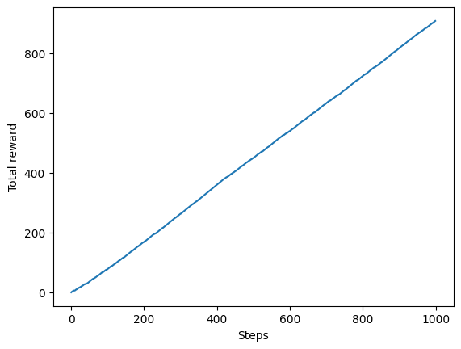
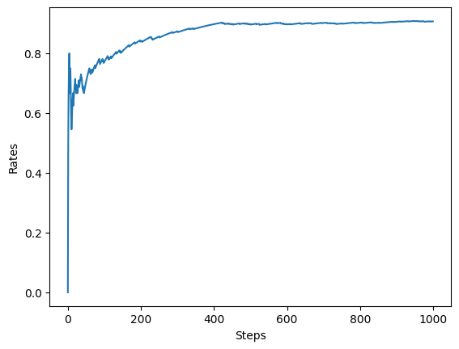
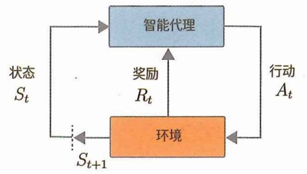
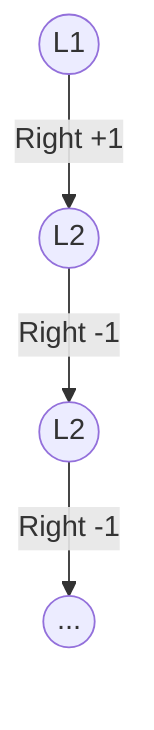
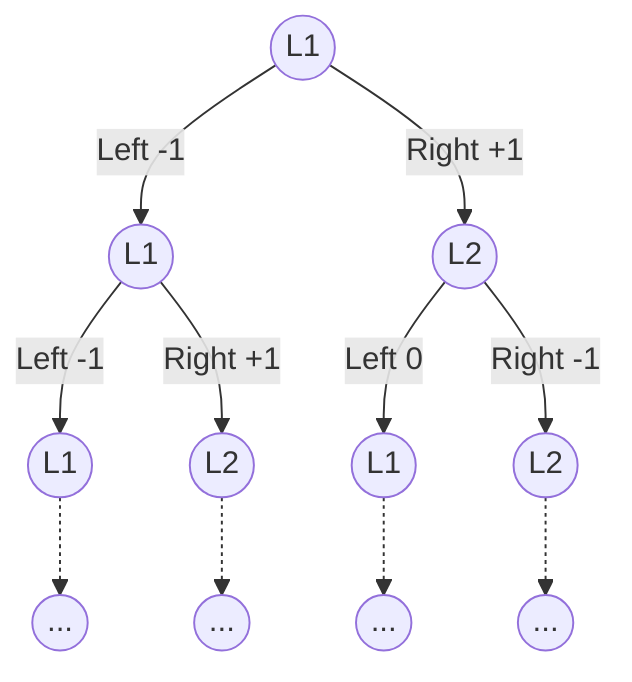
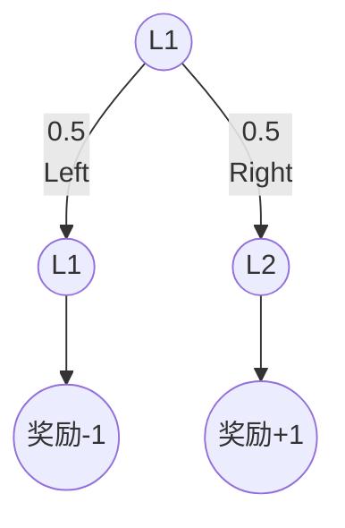
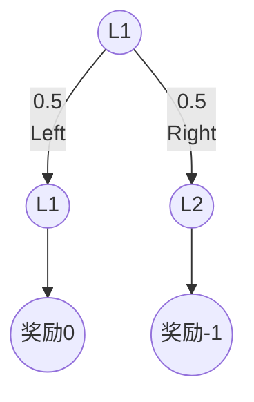
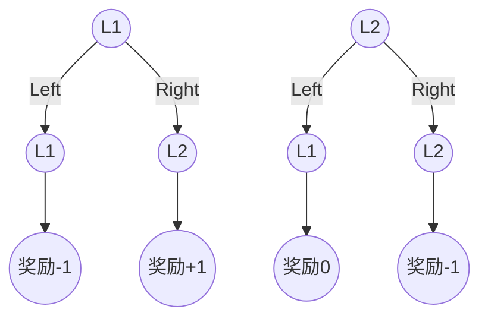

# 强化学习

## 1.老虎机问题

### 1.1 好的老虎机以及用数学表示

- **老虎机 a**

| 能获得的硬币数量 | 概率 |
| ---------------- | ---- |
| 0                | 0.70 |
| 1                | 0.15 |
| 5                | 0.12 |
| 10               | 0.03 |

- **老虎机 b**

| 能获得的硬币数量 | 概率 |
| ---------------- | ---- |
| 0                | 0.50 |
| 1                | 0.40 |
| 5                | 0.09 |
| 10               | 0.01 |

这样的概率分布表可以通过计算期望算得其**采取某个行动所得到的奖励的期望值**，也就是**行动价值**

老虎机a的期望值为1.05，老虎机b的期望值为0.95

- Expectation中的E表示期望
- action中的A表示智能代理采取的行动
- Reward中的R表示奖励

则选择行动A时奖励的期望值可以写作

\[
E[R \mid A]
\]


奖励的期望叫做行动价值，强化学习习惯用符号 \(Q\) 或 \(q\) 表示行动价值
\[
q(A) = E[R \mid A]
\]


### 1.2 老虎机价值的估计

如果玩家知道老虎机价值就可以知道最优解,但是玩家无法知道老虎机的价值,所以玩家必须尽可能估计老虎机的价值

可以通过计算样本均值得出其是否是最优的

\[
Q_n = \frac{R_1+R_2+...+R_n}{n}
\]

- \(Q_{n}\) 表示执行了n次行动后行动价值的估计值
- \(R_1,R_2,...,R_n\) 表示这种情况下实际获得的奖励
- \(n\) 表示玩家玩老虎机的次数

程序计算如下:

```python
# 样本均值计算
import numpy as np
np.random.seed(0)
rewards = []
for i in range(1, 11):
    reward = np.random.rand()
    rewards.append(reward)
    Q = sum(rewards) / i
    print(Q)
```

上述代码的问题是随着次数n增加，rewards内元素增加，代码中sum(rewards)的计算量增加，占用内存和计算量都会增加  
解决方法是关注第n-1次行动价值的估计值 \(Q_{n-1}\)

\[
Q_{n-1} = \frac{R_1+R_2+...+R_{n-1}}{n-1}
\]

\[
R_1+R_2+...+R_{n-1} = (n-1) Q_{n-1}
\]


由 \(Q_n = \frac{R_1+R_2+...+R_{n-1}+R_n}{n}\) 得到

\[
Q_n = \frac{1}{n}[(n-1)Q_{n-1}+R_n]
\]

\[
Q_n = (1-\frac{1}{n})Q_{n-1}+\frac{1}{n}R_n
\]


\[
Q_n = Q_{n-1} + \frac{1}{n}(R_n - Q_{n-1})
\]
这样,每次计算只需要 \(Q_{n-1}, R_{n}, n\) 这三个值即可，而不用存储中间所有价值

增量式实现如下:

```python
# 增量式实现
Q = 0
for i in range(1, 11):
    reward = np.random.rand()
    Q += (reward - Q) / i
    print(Q)
```


### 1.3 玩家的策略

玩家可以采取考虑当前计算 \(Q_n\) 最大的那台老虎机，这被称为贪婪行动——不考虑将来，而完全使用之前的游戏经验来选择最佳机器，但这可能不是期望最大的老虎机，所以还需要探索不同的老虎机，取得最优的 \(Q_n\)

人们采用 \(\epsilon-greedy\) 算法，在不同概率间判断探索还是利用，它是一种以 \(\epsilon\) 的概率进行探索，以 \(1-\epsilon\) 的概率行动的方法


### 1.4 老虎机与智能代理的实现

- **老虎机的实现**:

```python
import numpy as np

class Bandit:
    def __init__(self, arms=10):          # arms等于老虎机臂的数量，等于老虎机的台数
        self.rates = np.random.rand(arms) # 每台机器的胜率
    
    def play(self, arm):
        rate = self.rates[arm]
        if rate > np.random.rand(): # 胜率与一个0.0-1.0的随机数比大小，假如胜率为0.7，则有70%概率赢得游戏
            return 1
        else:
            return 0
        
bandit = Bandit()
for i in range(3):
    print(bandit.play(0)) # 玩3次第一台老虎机
```

则现在这个 \(class\) 设定好默认10台老虎机的胜率，并可以通过 `bandit.play(0)` 选择玩第几台老虎机，并有胜利和失败返回


- **智能代理的实现**:

```python
bandit = Bandit()
Q = 0

for i in range(1, 11):
    reward = bandit.play(0) # 玩第一台老虎机的奖励 返回0或1
    Q += (reward - Q) / i
    print(Q)
```

这段代码连续玩10次第一台老虎机，并且每次玩都会更新该老虎机的估计值

```python
bandit = Bandit()
Qs = np.zeros(10) # 10维初值全0的向量 存储10台机器的估计值
ns = np.zeros(10) # 10维初值全0的向量 存储10台机器的游玩次数

for i in range(10):
    action = np.random.randint(0, 10) # 随机玩1-10号机
    reward = bandit.play(action)      # 估计值为该机器的返回值

    ns[action] += 1                                  # 该号机游玩次数加1
    Qs[action] += (reward - Qs[action]) / ns[action] # 该号机的估计值
    print(Qs)
```

基于上述知识，可以实现一个基于 \(\epsilon-greedy\) 算法的Agent类 

```python
class Agent:
    def __init__(self, epsilon, action_size=10):
        self.epsilon = epsilon
        self.Qs = np.zeros(action_size)
        self.ns = np.zeros(action_size)

    def update(self, action, reward):
        self.ns[action] += 1
        self.Qs[action] += (reward - self.Qs[action]) / self.ns[action]

    def get_action(self):
        if np.random.rand() < self.epsilon: # 如果随机数小于epsilon概率就探索
            return np.random.randint(0, len(self.Qs)) # 盲选0-9——选择0-9号老虎机
        return np.argmax(self.Qs) # 否则则找老虎机估计值列表中最优（数值最大）的那台老虎机作为经验里最优老虎机使用
```

尝试运行

```python
import matplotlib.pyplot as plt
steps = 1000
epsilon = 0.1

bandit = Bandit()
agent = Agent(epsilon)
total_reward = 0
total_rewards = []
rates = []

for step in range(steps):
    action = agent.get_action()  # 选择行动
    reward = bandit.play(action) # 实际去玩，获得奖励
    agent.update(action, reward) # 从行动和奖励中更新
    total_reward += reward
    
    total_rewards.append(total_reward)
    rates.append(total_reward / (step+1))

print(total_reward)

# 图形的绘制(1)
plt.ylabel('Total reward')
plt.xlabel('Steps')
plt.plot(total_rewards)
plt.show()

# 图形的绘制(2)
plt.ylabel('Rates')
plt.xlabel('Steps')
plt.plot(rates)
plt.show()
```





由于代码中存在随机性，每一次运行结果都会不同，一种可行的评估方法是进行多次相同的实验，并对结果好坏进行平均

 \(\epsilon\) 不同会影响迭代次数和最终的平均胜率


### 1.5 非稳态问题

以上关于老虎机的问题而言，其每台机器设定的胜率保持固定，我们称为**稳态问题**

稳态问题中奖励的概率分布是稳定的，老虎机的胜率保持固定，但是有些老虎机概率是不停变化的


```python
# 稳态老虎机
class Bandit:
    def __init__(self, arms=10):
        self.rates = np.random.rand(arms) # 一旦设置，就不再改变

    def play(self, arm):
        rate = self.rates[arm]
        if rate > np.random.ramd():
            return 1
        else:
            return 0
        
# 非稳态老虎机
class NonStatBandit:
    def __init___(self, arms=10):
        self.arms = arms
        self.rates = np.random.rand(arms) # 设置每台机器胜率

    def play(self, arm):
        rate = self.rates[arm]
        # 添加噪声，每次运行每台老虎机概率都会变化
        # 生成arms个标准正态分布随机数 然后NumPy数组逐元素相加
        self.rates += 0.1 * np.random.randn(self.arms)
        if rate > np.random.rand():
            return 1
        else:
            return 0
```


### 1.6 解决非稳态老虎机

\[
Q_n = \frac{R_1+R_2+...+R_{n-1}+R_n}{n}
\]

可以变为
\[
Q_n = \frac{1}{n}R_1+ \frac{1}{n}R_2+...+ \frac{1}{n}R_{n}
\]
\(R_1, R_2, ..., R_n\)表示实际获得的奖励，\(\frac{1}{n}\)可以看作每个奖励的权重，现在每个权重是相同的，这在非稳态问题是不合适的，过去所有获得的数据的重要性应该随着实践的推移而下降，应该给新获得的奖励以更大的权重


之前由样本均值 \(Q_n = \frac{R_1+R_2+...+R_{n-1}+R_n}{n}\) 得到
\[
Q_n = Q_{n-1} + \frac{1}{n}(R_n - Q_{n-1})
\]
将步长\(\frac{1}{n}\)变为固定值\(\alpha(0<\alpha<1)\)，当按固定值\(\alpha\)更新时，过去获得的奖励越久远，奖励的权重沿指数级减少
\[
Q_n = Q_{n-1} + \alpha(R_n-Q_{n-1})
\]
如此权重就可用于非稳态问题

更清晰地分析
\[
\begin{aligned}
Q_n &= \alpha R_n + (1-\alpha)Q_{n-1} \\
&= \alpha R_n + (1-\alpha)\left[\alpha R_{n-1} + (1-\alpha)Q_{n-2}\right] \\
&= \alpha R_n + \alpha(1-\alpha)R_{n-1} + (1-\alpha)^2 Q_{n-2} \\
&= \alpha R_n + \alpha(1-\alpha)R_{n-1} + \alpha(1-\alpha)^2 R_{n-2} + (1-\alpha)^3 Q_{n-3} \\
&\quad \vdots \\
&= \alpha R_n + \alpha(1-\alpha)R_{n-1} + \cdots + \alpha(1-\alpha)^{n-1} R_1 + (1-\alpha)^n Q_0
\end{aligned}
\]


```python
# 稳态Agent
class Agent:
    def __init__(self, epsilon, action_size=10):
        self.epsilon = epsilon
        self.Qs = np.zeros(action_size) # 估计值向量
        self.ns = np.zeros(action_size) # 次数向量

    def update(self, action, reward):
        self.ns[action] += 1
        self.Qs[action] += (reward - self.Qs[action]) / self.ns[action]

    def get_action(self):
        if np.random.rand() < self.epsilon: # 如果随机数小于epsilon概率就探索
            return np.random.randint(0, len(self.Qs)) # 盲选0-9——选择0-9号老虎机
        return np.argmax(self.Qs) # 否则则找老虎机估计值列表中最优（数值最大）的那台老虎机作为经验里最优老虎机使用
   
# 非稳态Agent
class AlphaAgent:
    def __init__(self, epsilon, alpha, actions=10):
        self.epsilon = epsilon
        self.Qs = np.zeros(actions)
        self.alpha = alpha # 用alpha更新 不需要除以次数n了

    def update(self, action, reward):
        # 用alpha更新
        self.Qs[action] += (reward - self.Qs[action] * self.alpha)

    def get_action(self):
        if np.random.rand() < self.epsilon:
            return np.random.randint(0, len(self.Qs))
        return np.argmax(self.Qs)
```


### 1.7 总结

样本均值
\[
Q_n = Q_{n-1} + \frac{1}{n}(R_n - Q_{n-1})
\]
指数移动平均
\[
Q_n = Q_{n-1} + \alpha(R_n-Q_{n-1})
\]


## 2. 马尔可夫决策过程

马尔可夫是决策框架，定义了状态\动作\状态转移等参数


### 2.1 MDP

MDP指Markov Decision Process，意为马尔可夫决策过程

决策过程是智能代理通过与环境互动性决定其行动的过程

例如

|  🍎   |      |  🤖   |      |  💣   |
| :--: | :--: | :--: | :--: | :--: |

机器人就是智能代理，他所处的表格格子就是环境，智能代理只能朝左或朝右走，网格最左端是苹果，最右端是炸弹，拿走苹果奖励+1，拿走炸弹奖励-2，什么都没有的网格的奖励设置为0

|  🍎   |  🤖   |      |      |  💣   |
| :--: | :--: | :--: | :--: | :--: |

智能代理所处的情况根据其行动而发生改变，这种情况被称为状态`state`




假设在时刻\(t\)的状态是 \(S_{t}\) ，基于这个状态 \(S_{t}\) ，智能代理执行行动 \(A\) 获得奖励 \(R_{t}\) 并迁移到下一个状态 \(S_{t+1}\)

智能代理与环境之间的这种实际的互动产生了以下迁移
\[
S_0,A_0,R_0,S_1,A_1,R_1,S_2,A_2,R_2,...
\]

### 2.2 环境和智能代理的数学表示

MDP通过数学是来表示智能，代理环境以及二者之间的互动，要做到这一点需要用数学式表达以下3个要素

- 状态迁移:状态如何迁移
- 奖励:如何给予奖励
- 策略:智能代理如何行动


#### 2.2.1 确定性状态迁移

|      |  🤖   |  ⛰️   |
| :--: | :--: | :--: |

假设表中右边是⛰️，🤖总是向左移动

在确定性状态迁移情况下，下一个状态\(s'\)是由当前状态\(s\)和行动\(a\)唯一决定的，可以表达为
\[
s' = f(s, a)
\]
通过给定状态\(s\)和行动\(a\)，可以由**状态迁移函数\(f\)** 唯一确定下一个状态 \(s'\)


#### 2.2.2 随机性状态迁移

|  🧊   |  🤖   |  🧊   |
| :--: | :--: | :--: |

假如🤖是在一片冰上，机器人想向左移动，但因为在冰上有一定概率（10%）向右移动，这个时候向左移动的概率为90%，向右移动的概率为10%，这就是随机性状态迁移

假设智能体处于状态 \(s\) 选择了行动 \(a\) ，那么迁移到下一个状态的概率可以用如下**状态迁移概率**表示
\[
p(s' \mid s, a)
\]
**状态迁移不需要过去的信息，这个特性被称之为马尔可夫性 **，如果不假设马尔可夫性那么就必须考虑之前的所有状态和行动，组合的数量也会指数级增长

|  🧊   |  🧊   |  🤖   |  🧊   |  🧊   |
| :--: | :--: | :--: | :--: | :--: |

|       \(s'\)        |  1   |  2   |  3   |  4   |  5   |
| :-----------------: | :--: | :--: | :--: | :--: | :--: |
| \(p(s' \mid s, a)\) |  0   | 0.9  |  0   | 0.1  |  0   |

如表所示，智能代理处于位置3，其想向左移动，那么状态迁移概率就是 \(p(s' \mid s=3, a=left)=0.9\)


### 2.2.3 奖励函数

|  🍎   |  🤖   |      |      |      |
| :--: | :--: | :--: | :--: | :--: |

\[
r(s,a,s^\prime)
\]

- \(r\) 奖励函数
- \(s\) 输入状态
- \(a\) 行动
- \(s^\prime\) 下一状态

如 \(r(s=2,a=Left,s^\prime=1)=1\) 代表此时身处2位置，即将向左走，下一个状态位置在1处，这个动作的奖励为1

另外，在表中的情况只需要知道下一个状态\(s'\)就能确定奖励，即当前问题奖励只由下一个状态决定，因此奖励函数可以写 \(r(s')\)


### 2.2.4 智能代理的策略

策略表示智能代理如何决定其行动

策略的关键在于它使得智能代理仅根据当前状态来决定其行动（即\(r,s,a,s^\prime\)）

智能代理的行动可以是确定性的，也可以是随机性的

- **确定性策略**

之前🤖在某一位置总是向左移动，这样的确定性策略可以定义如下
\[
a = \mu(s)
\]
\(\mu(s)\)是以给定的状态 \(s\) 作为参数并返回行动\(a\)的函数（在状态 \(s\) 情况下通过策略 \(\mu\) 形成行动 \(a\) ）

- **随机性策略**

\[
\pi(a|s) \Leftarrow p(a|s)
\]

表示在为状态 \(s\) 下采取行动 \(a\) 的概率。特地使用 \(\pi\) 是为了区分智能体策略

|  🧊   |  🧊   |  🤖   |  🧊   |  🧊   |
| :--: | :--: | :--: | :--: | :--: |

这里
\[
\pi(a=2|s=3)=0.9
\]

\[
\pi(a=4|s=3)=0.1
\]


确定性策略 \(a = \mu(s)\) 也可以用在一个状态\(s\)下采取行动 \(a\) 的概率为1.0，采取任何其他行动的概率是0的概率分布来表示


### 2.3 MDP的目标

智能代理通过策略\(\pi(a|s)\)采取行动，他根据它的行动和状态迁移概率 \(p(s' \mid s, a)\) 迁移到下一个状态，然后根据奖励函数 \(r(s,a,s^\prime)\)获得奖励，这个框架内MDP的目标是找到**最优策略**，最优策略是指使收益最大化的策略

MDP问题大概分为两种，分别为回合制任务和连续性任务


#### 2.3.1 回合制任务和连续性任务

围棋被视为回合制任务。回合制任务中的回合的意思是从开始到结束的一系列操作  

连续性任务则是没有结束的问题，例如库存管理问题


#### 2.3.2 收益

**收益(return)**，智能代理的目标是使收益最大化  

设时刻为 \(t\)，状态为 \(S_t\)，智能代理根据策略 \(\pi\) 执行行动 \(A_t\)，获得奖励 \(R_t\)，之后迁移到新状态 \(S_{t+1}\)，这个过程不断重复进行。这种情况下收益 \(G_t\) 的定义如下
\[
G_t = R_t + \gamma R_{t+1} + \gamma ^2R_{t+2} + ...
\]

- \(G_t\) 表示智能代理获得的奖励之和
- \(\gamma\)  折现率，被设定为0.0和1.0之间的实数。引入折现率主要防止连续性任务的收益变为无穷大，并且显得近期奖励更加重要


#### 2.3.3 状态价值函数

智能代理和环境的行动可能是随机性的，智能代理可能随机地决定行动，状态也可能随机迁移，这个情况下得到的收益可能呈现随机的特点。即相同的状态开始，不同回合的收益也随机变化。为了处理这种随机行动，需要引入**收益的期望值**作为衡量标准。

**收益的期望值**数学公式如下：
\[
v_\pi(s)=\mathbb{E}[G_t|S_t=s,\pi]
\]

- \(S_t=s,\pi\)：\(S_t\) 状态为s，智能代理策略为 \(\pi\)

- \(v_\pi(s)\)：收益的期望值，就是**状态价值函数**
  - \(v_\pi(s)\)：将\(\pi\)写在\(v\)右下角的原因是智能代理的策略被作为条件给出，策略 \(\pi\) 发生变化，智能代理获得的奖励也会发生变化，收益也会变化

也可写作
\[
v_\pi(s)=\mathbb{E}_\pi[G_t|S_t=s]
\]


#### 2.3.4 最优策略和最优价值函数

如何判断最优策略？  

假如有两个状态价值函数 \(v_\pi(s)\) 与 \(v_{\pi^\prime}(s)\)，在所有状态下，\(v_{\pi^\prime}(s)≥v_\pi(s)\)，就可以说 \(\pi^\prime\) 是比 \(\pi\) 更好的策略  

如果用 \(\pi_*\) 表示最优策略，那么策略 \(\pi_*\) 就是与其他策略相比，在所有状态下的状态价值函数 \(v_{\pi_*}(s)\) 的值最大的策略（ \(\pi_*\) 表示最优策略，则所有状态价值函数中 \(v_{\pi_*}(s)\) 的值最大）

MDP中至少存在一个最优策略，此外最优策略是确定性策略，确定性策略中每个状态下的行动是唯一确定的，用数学式可以表示为函数 \(\mu_*\) ，有 \(a=\mu_*(s)\) 成立，当输入状态 \(s\) 时，会输出行动 \(a\)

**最优策略就是一张“状态到动作”的确定性映射表，每个状态对应一个最好的动作。**


### 2.4 MDP的例子

| 墙壁 |  L1  |  L2  | 墙壁 |
| :--: | :--: | :--: | :--: |
|  🧱   |  🤖   |  🍎   |  🧱   |

- 智能代理可以向右或向左移动。 
- 状态迁移是确定性的（如果智能代理采取向右移动的行动，那么它的下一个状态将总是向右移动）
- 当智能代理从\(L1\) 移动到 \(L2\) 时，它将获得一个苹果，奖励为 \(+1\) 
- 当智能代理从 \(L2\) 移动到 \(L1\) 时，苹果会重新出现。
- 如果智能代理撞到了墙，那么它会获得 \(-1\) 的奖励（惩罚）：如果智能代理在 \(L1\) 并向左移动，那么它会获得 \(-1\) 的奖励；如果智能代理在 \(L2\) 并向右移动，那么它同样会获得 \(-1\) 的奖励（此时苹果不会出现）
- 这次迭代问题被设定为没有“结束”的连续性任务。






#### 2.4.2 找出最优策略

因为状态有2个，行动有2个，总共有 \(2^2\) 个确定性策略，这四个策略如下

|            | $s = L1$ | $s = L2$ |
| :--------: | :------: | :------: |
| $\mu_1(s)$ |  Right   |  Right   |
| $\mu_2(s)$ |  Right   |   Left   |
| $\mu_3(s)$ |   Left   |  Right   |
| $\mu_4(s)$ |   Left   |   Left   |

带入 \(1 + r + r^2 + ... = \frac{1}{1-r}\)
\[
\begin{aligned} v_{\mu_1}(s=L1) &= 1 + 0.9\times(-1) + 0.9^2\times(-1)+\cdots \\ &= 1 - 0.9\big(1 + 0.9 + 0.9^2+\cdots\big) \\ &= 1 - \frac{0.9}{1-0.9} \\ &= -8 \end{aligned}
\]

\[
\begin{aligned} v_{\mu_1}(s=L2) &= -1 + 0.9\times(-1) + 0.9^2\times(-1)+\cdots \\ &= -1 - 0.9\big(1 + 0.9 + 0.9^2+\cdots\big) \\ &= -1 - \frac{0.9}{1-0.9} \\ &= -10 \end{aligned}
\]

\[
......
\]


这样就能算出来\(\mu_2\)是最优策略


## 3.贝尔曼方程

### 3.1 贝尔曼方程推导

#### 3.1.1 概率和期望


\[
\mathbb{E}[x]=\sum_xxp(x)
\]

\[
\begin{aligned}
\mathbb{E}[r(x,y)] &=\sum_x \sum_y p(x,y)r(x,y) \\
&=\sum_x \sum_y p(x)p(y|x)r(x,y)
\end{aligned}
\]

- 对每一对 \((x,y)\)，用它的概率 \(p(x,y)\) 乘以结果 \(r(x,y)\)。
- 最后全部加起来，就是  \(r(x,y)\) 的期望。


#### 3.1.2 贝尔曼方程的推导

回顾对收益的定义：

\[
G_t = R_t + \gamma R_{t+1} + \gamma^2 R_{t+2} + \cdots
\]

将 \(t+1\) 代入式中的 \(t\)：

\[
G_{t+1} = R_{t+1} + \gamma R_{t+2} + \gamma^2 R_{t+3} + \cdots
\]

变形：

\[
\begin{aligned}
G_t &= R_t + \gamma R_{t+1} + \gamma^2 R_{t+2} + \cdots \\
    &= R_t + \gamma(R_{t+1} + \gamma R_{t+2} + \cdots) \\
    &= R_t + \gamma G_{t+1}
\end{aligned}
\]

状态价值函数数学式如下：

\[
v_\pi(s) = \mathbb{E}_\pi[G_t \mid S_t = s]
\]

将 \(G_t\) 带入其中：

\[
\begin{aligned}
v_\pi(s) &= \mathbb{E}_\pi[R_t + \gamma G_{t+1} \mid S_t = s] \\
&= \mathbb{E}_\pi[R_t \mid S_t = s] + \gamma \mathbb{E}_\pi[G_{t+1} \mid S_t = s]
\end{aligned}
\]

---

其中期望 \(\mathbb{E}_\pi[R_t \mid S_t = s]\) 的计算如下。

首先：

- \(R_t = r(s,a,s^\prime)\)
- \(R_t\) 由动作 \(a\) 以及下一状态 \(s^\prime\) 决定。

由**条件期望**的定义：

\[
\mathbb{E}[X \mid C] = \sum_x x \cdot P(X = x \mid C)
\]

\[
\mathbb{E}[f(X,Y) \mid A] = \sum_x \sum_y f(x,y) \cdot P(X = x, Y = y \mid A)
\]

得：

\[
\mathbb{E}_\pi[R_t \mid S_t = s] = \sum_r r \cdot P(R_t = r \mid S_t = s)
\]

由**全概率公式**：

\[
P(X \mid C) = \sum_i P(X, B_i \mid C)
\]

得：

\[
P(R_t = r \mid S_t = s) = \sum_a \sum_{s^\prime} P(R_t = r, A_t = a, S_{t+1} = s^\prime \mid S_t = s)
\]

再简化：

\[
P(r, a, s^\prime \mid s) = P(r \mid s, a, s^\prime) \cdot P(a, s^\prime \mid s)
\]

因为在 MDP 中，\(R_t\) 只由 \(s, a, s^\prime\) 决定。当 \(s, a, s^\prime\) 被确定下来，\(R_t\) 就被唯一确定为特定值常数 \(r\)，此时其余常数 \(r\)的情况被推定为0：

\[
P(R_t = r \mid s,a,s') =
\begin{cases}
1, & r = r(s,a,s') \\
0, & r \neq r(s,a,s')
\end{cases}
\]

所以：

\[
P(r, a, s^\prime \mid s) = P(a, s^\prime \mid s)
\]

因此：

\[
\begin{aligned}
\mathbb{E}_\pi[R_t \mid S_t = s] &= \sum_a \sum_{s^\prime} \sum_r r \cdot P(r, a, s^\prime \mid s) \\
&= \sum_a \sum_{s^\prime} P(a, s^\prime \mid s) \sum_r r \cdot P(r \mid s, a, s^\prime) \\
&= \sum_a \sum_{s^\prime} P(a, s^\prime \mid s) \cdot r(s,a,s^\prime)
\end{aligned}
\]

现在状态 \(s\) 以概率 \(\pi(a \mid s)\) 选择动作 \(a\)，再以概率 \(p(s^\prime \mid s,a)\) 到达下一状态 \(s^\prime\)。

所以：

\[
\mathbb{E}_\pi[R_t \mid S_t = s] = \sum_a \sum_{s^\prime} \pi(a \mid s) p(s^\prime \mid s,a) r(s,a,s^\prime)
\]

---

接下来处理第二项：

\[
\gamma \mathbb{E}_\pi[G_{t+1} \mid S_t = s]
\]

\(\gamma\) 是常数。

注意到这个式子与状态价值函数定义式相似，但 \(G_{t+1}\) 部分有所不同。

由状态价值函数 \(v_\pi(s) = \mathbb{E}_\pi[G_t \mid S_t = s]\)，将 \(t+1\) 代入：

\[
v_\pi(s') = \mathbb{E}_\pi[G_{t+1} \mid S_{t+1} = s']
\]

现在这个式子与 \(\gamma \mathbb{E}_\pi[G_{t+1} \mid S_t = s]\) 唯一差在条件不相同上

现在需要解决 \(S_{t+1} = s'\) 时的价值函数。关键在于把条件 \(S_t = s\) 变成 \(S_{t+1} = s^\prime\) 的形式。

首先，由**全期望公式**：

\[
\mathbb{E}[X] = \sum_y P(Y = y) \cdot \mathbb{E}[X \mid Y = y]
\]

\[
\mathbb{E}_\pi[G_{t+1} \mid S_t = s] = \sum_a \pi(a \mid s) \mathbb{E}[G_{t+1} \mid s, a]
\]

其中：

\[
\mathbb{E}[G_{t+1} \mid s, a] = \sum_{s^\prime} p(s^\prime \mid s,a) \cdot \mathbb{E}[G_{t+1} \mid s, a, s^\prime]
\]

因为马尔可夫性，未来只取决于当前状态，因此 \(S_t = s, A_t = a\) 可以忽略。再代入 \(v_\pi(s') = \mathbb{E}_\pi[G_{t+1} \mid S_{t+1} = s']\)：

\[
\sum_{s^\prime} p(s^\prime \mid s,a) \cdot \mathbb{E}[G_{t+1} \mid s, a, s^\prime] = \sum_{s^\prime} p(s^\prime \mid s,a) \cdot \mathbb{E}_\pi[G_{t+1} \mid s'] = \sum_{s^\prime} p(s^\prime \mid s,a) v_\pi(s^\prime)
\]

合并公式：

\[
\mathbb{E}[G_{t+1} \mid S_t = s] = \sum_{a, s^\prime} \pi(a \mid s) p(s^\prime \mid s,a) v_\pi(s^\prime)
\]

---

因此可得：

\[
\begin{aligned}
v_\pi(s) &= \mathbb{E}_\pi[R_t \mid S_t = s] + \gamma \mathbb{E}_\pi[G_{t+1} \mid S_t = s] \\
&= \sum_{a, s^\prime} \pi(a \mid s) p(s^\prime \mid s,a) r(s,a,s^\prime) + \gamma \sum_{a, s^\prime} \pi(a \mid s) p(s^\prime \mid s,a) v_\pi(s^\prime) \\
&= \sum_{a, s^\prime} \pi(a \mid s) p(s^\prime \mid s,a) \left[ r(s,a,s^\prime) + \gamma v_\pi(s^\prime) \right] \\
&= \sum_{a} \pi(a \mid s) \sum_{s^\prime} p(s^\prime \mid s,a) \left[ r(s,a,s^\prime) + \gamma v_\pi(s^\prime) \right]

\end{aligned}
\]

这个式子就是贝尔曼方程。它表示状态 \(s\) 的价值函数与下一个可能状态 \(s^\prime\) 的价值函数之间的关系。


### 3.2 贝尔曼方程的例子

还是那个机器人移动的例子

| 墙壁 |  L1  |  L2  | 墙壁 |
| :--: | :--: | :--: | :--: |
|  🧱   |  🤖   |  🍎   |  🧱   |

它的状态表如下


这次问题的状态迁移是确定性的，所以状态迁移是由函数 \(f(s, a)\) 决定，而非概率 \(p(s^\prime \mid s,a) = 1\) 决定

- \(s' = f(s, a)\) 则 \(p(s^\prime \mid s,a) = 1\)
- \(s' ≠ f(s, a)\) 则 \(p(s^\prime \mid s,a) = 0\)

此时贝尔曼公式变为
\[
\begin{aligned}
v_\pi(s) 
&= \sum_{a} \pi(a \mid s) \sum_{s'} p(s' \mid s,a) \left[ r(s,a,s') + \gamma v_\pi(s') \right] \\
&= \sum_{a} \pi(a \mid s)
\left[
  \sum_{s' = f(s,a)} p(s' \mid s,a) \left[ r(s,a,s') + \gamma v_\pi(s') \right]
  +
  \sum_{s' \neq f(s,a)} p(s' \mid s,a) \left[ r(s,a,s') + \gamma v_\pi(s') \right]
\right] \\
&= \sum_{a} \pi(a \mid s) \left[ \sum_{s' = f(s,a)} 1 * \left[ r(s,a,s') + \gamma v_\pi(s') \right]
  +
  \sum_{s' \neq f(s,a)} 0 * \left[ r(s,a,s') + \gamma v_\pi(s') \right] \right] \\
&= \sum_{a} \pi(a \mid s) \left[ \sum_{s' = f(s,a)}\left[ r(s,a,s') + \gamma v_\pi(s') \right] \right] \\
&= \sum_{a} \pi(a \mid s) \left[ \sum_{s' = f(s,a)}\left[ r(s,a,f(s,a)) + \gamma v_\pi(f(s,a)) \right] \right] \\
&= \sum_{a} \pi(a \mid s) \left[ r(s,a,f(s,a)) + \gamma v_\pi(f(s,a)) \right]
\end{aligned}
\]
上式将用于下图计算



回溯线形图有两个分支，其中一个分支是以0.5的概率选Left并总是迁移到状态L1，这种情况得到的奖励为-1

折现率 \(\gamma\) 现在被设定为0.9

- 现在选择Left的项的奖励可以写作 \(0.5[-1 + 0.9v_\pi(L1) ]\)
- 现在选择Right的项的奖励可以写作 \(0.5[1 + 0.9v_\pi(L2)]\)

综上可以将贝尔曼公式表达如下
\[
v_\pi(L1) = 0.5[-1 + 0.9v_\pi(L1)] + 0.5[1 + 0.9v_\pi(L2)]
\]
整理如下
\[
-0.55 v_\pi(L1) + 0.45 v_\pi(L2) = 0
\]
讨论状态L2下的贝尔曼方程



计算贝尔曼方程如下
\[
0.45v_\pi(L1) - 0.55v_\pi(L2) = 0.5
\]

联立两个贝尔曼方程
\[
\begin{cases}
-0.55 v_\pi(L1) + 0.45 v_\pi(L2) = 0 \\
0.45v_\pi(L1) - 0.55v_\pi(L2) = 0.5
\end{cases}
\]
解得
\[
\begin{cases}
v_\pi(L1) = -2.25 \\
v_\pi(L2) = -2.75
\end{cases}
\]
这就是随机性策略的状态价值函数，\(v_\pi(L1)\) 的值比 \(v_\pi(L2)\) 的大，因为L1旁边就是苹果


### 3.3 行动价值函数与贝尔曼方程

**行动价值函数\(q_\pi(s,a)\)** 

先看一下状态价值函数  
\[
v_\pi(s) = \mathbb{E}_\pi[G_t \mid S_t=s]
\]
- **状态价值函数**表示在状态 \(s\) 下，**完全按照策略 \(\pi\) 选择动作**时的期望回报。

状态价值函数有两个条件，分别是状态 \(s\) 和策略 \(\pi\)，在这两个条件的基础上，可以考虑增加一个额外条件：行动 \(a\)
\[
q_\pi(s,a)=\mathbb{E}_\pi[G_t \mid S_t=s,A_t=a]
\]
这就是行动价值函数

- **行动价值函数**表示在状态 \(s\) 下，**先强制选择动作 \(a\)**，然后从下一时刻开始继续按照策略 \(\pi\) 行动，最终能得到的折扣回报期望。

行动价值函数也称 \(Q\) 函数，在时刻 \(t\) 的状态 \(s\) 下采取行动 \(a\)，并从时刻 \(t+1\) 开始根据策略 \(\pi\) 采取行动，此时得到的收益的期望值是 \(q_\pi(s,a)\)。

\(Q\) 函数是在状态价值函数的基础上，将行动 \(a\) 增加为条件的函数——原本状态价值函数 \(v_\pi(s)\) 是通过策略 \(\sum_a\pi(a\mid s)\) 到达 \(a\) 后继续，现在 \(Q\) 函数是通过将行动 \(a\) 纳为条件后继续。如果想办法使得 \(Q\) 函数中根据策略 \(\pi\) 来选择行动 \(a\)，那么 \(Q\) 函数和状态价值函数就一样了。  

假设在状态 \(s\) 中有 \(\{a_1,a_2,a_3\}\) 三个后续行动，那么此时将根据策略 \(\pi\) 行动

- 选择行动 \(a_1\) 的概率为 \(\pi(a_1\mid s)\)，此时 \(Q\) 函数为 \(q_\pi(s,a_1)\)
- 选择行动 \(a_2\) 的概率为 \(\pi(a_2\mid s)\)，此时 \(Q\) 函数为 \(q_\pi(s,a_2)\)
- 选择行动 \(a_3\) 的概率为 \(\pi(a_3\mid s)\)，此时 \(Q\) 函数为 \(q_\pi(s,a_3)\)

这种情况下，收益的期望值可作为 \(Q\) 函数的加权和来计算，数学式如下：
\[
\pi(a_1\mid s)q_\pi(s,a_1) + \pi(a_2\mid s)q_\pi(s,a_2) + \pi(a_3\mid s)q_\pi(s,a_3) = \sum_{a \in \{a_1,a_2,a_3\}}\pi(a\mid s)q_\pi(s,a)
\]
\[
v_\pi(s) = \sum_a\pi(a\mid s)q_\pi(s,a)
\]

#### 3.3.1 使用行动价值函数的贝尔曼方程

下面推导行动价值函数（\(Q\) 函数）的贝尔曼方程

\[
\begin{aligned}
q_\pi(s,a)
&= \mathbb{E}_\pi[G_t \mid S_t=s,A_t=a] \\
&= \mathbb{E}_\pi[R_t+\gamma G_{t+1} \mid S_t=s,A_t=a] \\
&= \mathbb{E}_\pi[R_t\mid S_t=s,A_t=a] + \gamma\mathbb{E}_\pi[G_{t+1} \mid S_t = s, A_t = a] \\
\end{aligned}
\]

---

计算 \(\mathbb{E}_\pi[R_t\mid S_t=s,A_t=a]\)
\[
\begin{aligned}
\mathbb{E}_\pi[R_t\mid S_t=s,A_t=a]
&= \sum_r rP(R_t = r \mid s, a)
\end{aligned}
\]
环境里没有直接给出 \(P(r\mid s,a)\)（即我们没法知道在状态\(s\)和下一步行动\(a\)所获得奖励 \(r\) 的概率），但是我们能通过别的方法轻松获取\(p(s'\mid s,a)\) （即我们可以知道在状态 \(s\) 和下一步行动 \(a\) 处于状态 \(s'\) 的概率）

这里，行动 \(a\) 和状态 \(s\) 都是固定的。这种情况下，以 \(p(s'\mid s,a)\) 的概率迁移到下一个状态 \(s'\)后，直接将奖励函数 \(R(s,a,s')\) 的参数确定出来为常数\(r\)直接将给出。

因为奖励由 \(s'\) 决定，所以奖励等于 \(r\) 这件事就等价于下一状态 \(s'\) 恰好使得  \(R(s, a, s') = r\) 


\[
\begin{aligned}
P(R_t = r\mid s,a)
&=\sum_{s'}P(R_t=r \mid S_{t+1} = s', s, a)P(S_{t+1}=s' \mid s, a)  \\
&=\sum_{\substack{s'\\ r(s,a,s')=r}} p(s'\mid s,a)
\end{aligned}
\]

其中
\[
P(R_t=r \mid S_{t+1} = s', s, a) =
\begin{cases}
1,  R(s,a,s')=r \\
0,  R(s,a,s')≠r
\end{cases}
\]


遍历所有可能的下一状态 \(s'\)，只把那些满足 \(r(s, a, s') = r\) 的 \(s\) 的概率 \(p(s' \mid s, a)\)加起来。

带入期望公式
\[
\begin{aligned}
\mathbb{E}_\pi[R_t\mid S_t=s,A_t=a]
&= \sum_r r \cdot \left(\sum_{\substack{s'\\ r(s,a,s')=r}} p(s'\mid s,a)\right) \\
&= \sum_{s'} p(s'\mid s,a)\cdot r(s,a,s')
\end{aligned}
\]

则

\[
\begin{aligned}
q_\pi(s,a)
&= \mathbb{E}_\pi[R_t+\gamma G_{t+1}\mid S_t=s,A_t=a] \\
&= \mathbb{E}_\pi[R_t\mid S_t=s,A_t=a]
+ \gamma \mathbb{E}_\pi[G_{t+1}\mid S_t=s,A_t=a] \\
&= \sum_{s'} p(s'\mid s,a) r(s,a,s')
+ \gamma \sum_{s'} p(s'\mid s,a)
\mathbb{E}_\pi[G_{t+1}\mid S_t=s,A_t=a,S_{t+1}=s'] \\
&= \sum_{s'} p(s'\mid s,a) r(s,a,s')
+ \gamma \sum_{s'} p(s'\mid s,a)
\mathbb{E}_\pi[G_{t+1}\mid S_{t+1}=s'] \\
&= \sum_{s'} p(s'\mid s,a)
\left[
r(s,a,s')+\gamma v_\pi(s')
\right]
\end{aligned}
\]

将

\[
v_\pi(s)=\sum_a \pi(a\mid s)q_\pi(s,a)
\]

带入 \(v_\pi(s')\)

\[
q_\pi(s,a)
=
\sum_{s'} p(s'\mid s,a)
\left\{
r(s,a,s')
+
\gamma \sum_{a'} \pi(a'\mid s')q_\pi(s',a')
\right\}
\]

此时，\(a'\) 表示在时刻 \(t+1\) 采取的行动。此式就是使用 \(Q\) 函数的贝尔曼方程。


### 3.4 贝尔曼最优方程

#### 3.4.1 状态价值函数的贝尔曼最优方程

首先从贝尔曼方程开始

\[
\begin{aligned}
v_\pi(s)
&= \sum_{a,s'} \pi(a\mid s)p(s'\mid s,a)\left[r(s,a,s')+\gamma v_\pi(s')\right] \\
&= \sum_a \pi(a\mid s)\sum_{s'} p(s'\mid s,a)\left\{r(s,a,s')+\gamma v_\pi(s')\right\} \\
\end{aligned}
\]

最优策略如果是 \(\pi_*(a\mid s)\)，则有以下贝尔曼方程成立

\[
\begin{aligned}
v_*(s)
&=\sum_a \pi_*(a\mid s)\sum_{s'} p(s'\mid s,a)\left\{r(s,a,s')+\gamma v_*(s')\right\} \\

\end{aligned}
\]

\(\sum_a \pi_*(a\mid s)\) 是在当前状态选择每个行动的概率，也是分配动作价值的权重。

最优策略的目标是最大化状态价值函数，可取以下式子作为贝尔曼最优方程

\[
v_*(s)
=
\max_a
\sum_{s'} p(s'\mid s,a)
\left\{r(s,a,s')+\gamma v_*(s')\right\}
\]

#### 3.4.2 Q函数的贝尔曼最优方程

基于最优策略的行动价值函数叫做**最优行动价值函数**，本文档取 \(q_*\) 表示最优行动价值函数

以下是 Q 函数的贝尔曼方程

\[
q_\pi(s,a)
=
\sum_{s'} p(s'\mid s,a)
\left\{
r(s,a,s')+\gamma \sum_{a'} \pi(a'\mid s')q_\pi(s',a')
\right\}
\]

代入最优策略 \(\pi_*\)

\[
q_*(s,a)
=
\sum_{s'} p(s'\mid s,a)
\left\{
r(s,a,s')+\gamma \sum_{a'} \pi_*(a'\mid s')q_*(s',a')
\right\}
\]

同样可以使用相同方法获得 \(Q\) 函数的贝尔曼最优方程——

\[
q_*(s,a)
=
\sum_{s'} p(s'\mid s,a)
\left\{
r(s,a,s')+\gamma \max_{a'} q_*(s',a')
\right\}
\]


### 3.5 贝尔曼最优方程的示例

#### 3.5.1 应用贝尔曼最优方程

| 墙壁 |  L1  |  L2  | 墙壁 |
| :--: | :--: | :--: | :--: |
|  🧱   |  🤖   |  🍎   |  🧱   |

还是那个机器人移动的例子，推导出的贝尔曼最优方程式子如下
\[
v_*(s)
=
\max_a
\sum_{s'} p(s'\mid s,a)
\left\{r(s,a,s')+\gamma v_*(s')\right\}
\]
当状态迁移是确定性时 \(p(s'\mid s,a) = 1\)
\[
v_*(s)
=\max_a\sum_{s'}\left\{r(s,a,s')+\gamma v_*(s')\right\}
\]



\[
v_*(L1) = max\{ -1 + 0.9v_*(L1), 1 + 0.9v_*(L2) \}
\]

\[
v_*(L2) = max\{ 0.9v_*(L1), -1 + 0.9v_*(L2) \}
\]

解方程出来 \(v_*(L1) = 5.26\) ， \(v_*(L2) = 4.73\)


#### 3.5.1 得到最优策略

假设最优行动价值函数 \(q_*(s,a)\)是已知的，状态 \(s\) 下的最优行动可以通过以下式子求出
\[
\mu_*(s) = \arg\max_{a}q_*(s, a)
\]
argmax返回的是让函数取到最大值的那个参数

如果知道最优的行动价值函数，那么只需选择使其成为最大值的行动即可，这个行动的选择就是**最优策略**


之前的行动价值函数公式如下
\[
q_\pi(s,a) = \sum_{s'} p(s'\mid s,a)\left[r(s,a,s')+\gamma v_\pi(s')\right]
\]
在该式中下标 \(\pi\) 可以替换为表示最优策略的下标 \(*\) 
\[
\mu_*(s) = \arg\max_{a} \sum_{s'} p(s' \mid s, a)[r(s,a,s') + \gamma v_*(s')]
\]
这个式子可以表明我们可以通过最优状态价值函数 \(v_*(s)\) 来得到最优策略 \(\mu_*(s)\)


### 3.6 小结

- 状态价值函数

\[
v_\pi(s)=\mathbb E_\pi[G_t\mid S_t=s]
\]

在状态 \(s\)，完全按策略 \(\pi\) 行动，未来能拿到的期望回报。

- 行动价值函数

\[
q_\pi(s,a)=\mathbb E_\pi[G_t\mid S_t=s,A_t=a]
\]

在状态 \(s\)，先强制做动作 \(a\)，之后才按策略 \(\pi\) 行动，未来能拿到的期望回报。

- 两者转换

\[
v_\pi(s)=\sum_a \pi(a\mid s)q_\pi(s,a)
\]

在状态 \(s\)，策略 \(\pi\) 以概率 \(\pi(a\mid s)\) 选择动作 \(a\)，每个动作对应一个 Q 值 \(q_\pi(s,a)\)，所以状态价值就是这些 Q 值的加权平均

反过来，行动价值可以由状态价值表示：
\[
q_\pi(s,a)
=
\sum_{s'} p(s'\mid s,a)
\left[
r(s,a,s')+\gamma v_\pi(s')
\right]
\]
在 \(s\) 先做 \(a\)，跳到 \(s'\)，拿到奖励 \(r\)，之后从 \(s'\) 按策略 \(\pi\) 走，价值是 \(v_\pi(s')\)。

**贝尔曼方程**  
\[
v_\pi(s) = \sum_{a,s'} \pi(a\mid s) p(s'\mid s,a) \left\{ r(s,a,s') + \gamma v_\pi(s') \right\}
\]
\[
q_\pi(s,a) = \sum_{s'} p(s'\mid s,a) \left\{ r(s,a,s') + \gamma \sum_{a'} \pi(a'\mid s') q_\pi(s',a') \right\}
\]

贝尔曼方程不是新的价值函数，而是价值函数满足的**递归关系**，把\[ G_t=R_t+\gamma G_{t+1} \] 它代入价值函数的期望里，就得到贝尔曼方程。

**贝尔曼最优方程**  
\[
v_*(s) = \max_a \sum_{s'} p(s'\mid s,a) \left\{ r(s,a,s') + \gamma v_*(s') \right\}
\]
\[
q_*(s,a) = \sum_{s'} p(s'\mid s,a) \left\{ r(s,a,s') + \gamma \max_{a'} q_*(s',a') \right\}
\]

**最优策略**  

\(\arg\max\limits_a q_*(s,a)\) 在所有可选动作 \(a\) 中，找到让 \(q_*(s,a)\) 最大的那个 \(a\)

\[
\begin{aligned}
\mu_*(s) &= \underset{a}{\arg\max} \, q_*(s,a) \\
&= \underset{a}{\arg\max} \sum_{s'} p(s'\mid s,a) \left\{ r(s,a,s') + \gamma v_*(s') \right\}
\end{aligned}
\]
