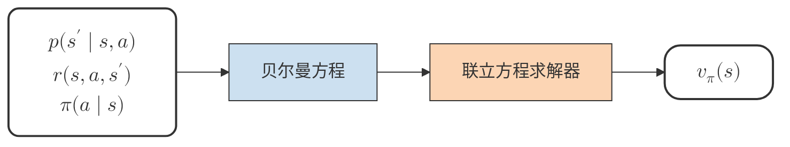
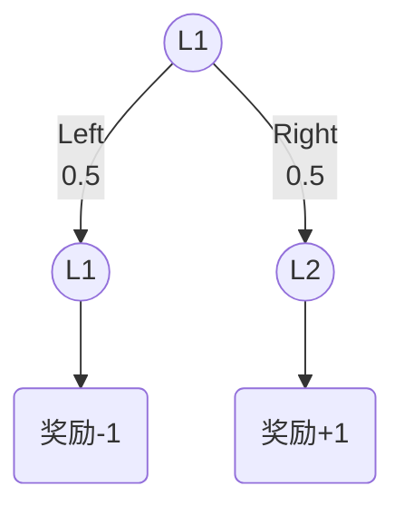
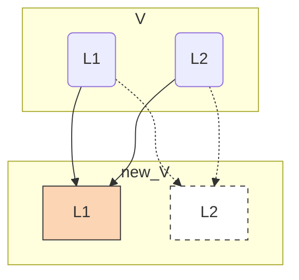
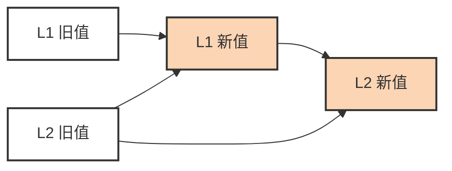
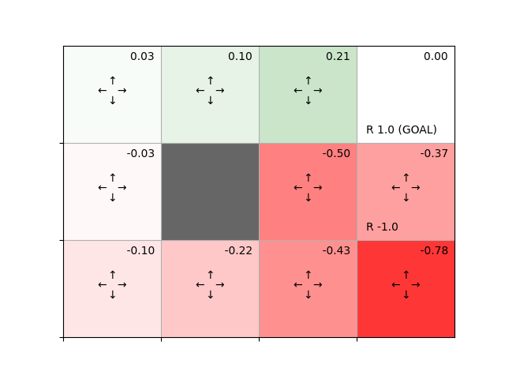
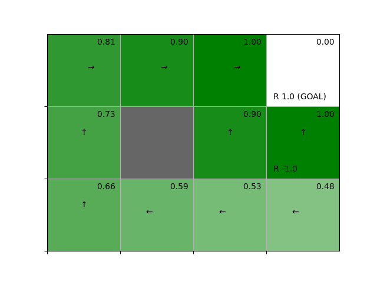
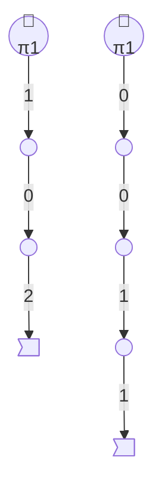
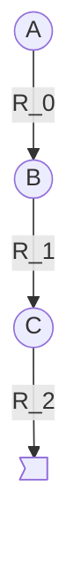

## 4.动态规划法



上图为使用贝尔曼方程求价值函数的流程

在实践中，当状态和行动模式的数量稍有增加，这种联立方程求解的方法就会变得难以使用

对于这种情况，应运而生了一种方法，**动态规划法(Dynamic Programming，DP)**

### 4.1 动态规划法和策略评估

强化学习的问题通常涉及两项任务:**策略评估**，**策略控制**

策略评估是求给定策略 \(\pi\) 的价值函数 \(v_\pi(s)\) 和 \(q_{\pi}(s, a)\)

策略控制是控制策略并将其调整为最优策略

强化学习的最终目标是策略控制，但要实现这一目标首先要解决的常是策略评估，大部分情况下我们很难获得最优策略

因此产生了一种**动态规划法**的算法进行策略评估

#### 4.1.1 动态规划法简介

价值函数的定义如下
\[
v_\pi(s) = \mathbb{E}(R_t+\gamma R_{t+1}+\gamma^2R_{t+2}+ \dots \mid S_t = s)
\]
这个包含无限多项期望值通常无法计算，但贝尔曼方程可以解决这一无限多项计算问题
\[
v_\pi(s) = \sum_{a,s'}\pi(a \mid s)p(s' \mid s,a)\{r(s,a,s') + \gamma V_\pi(s')\}
\]
动态规划法的思路是将贝尔曼方程变形为更形式
\[
V_{k+1}(s)=\sum_{a,s'} \pi(a|s)p(s'|s,a) \left\{r(s,a,s') + \gamma V_k(s')\right\}
\]
这里使用\(V_{k+1}(s)\)表示第 \(k+1\) 次进行更新的价值函数，\(V_{k}(s)\)表示第 \(k\) 次进行更新的价值函数，**这里的\(V_{k+1}(s)\)和\(V_{k}(s)\)是推测值，它们与真正的价值函数 \(v(s)\) 不同，因此用大写的 \(V\) 表示**

这种使用估计值改进估计值的过程叫做自举法

DP的具体使用中，首先将 \(V_0(s)\) 设置为初始值，然后利用\(V_{k+1}(s)\)的公式更新 \(V_1(s)\) ，重复这个过程就接近最终目标，这种算法称之为**迭代策略评估(iterative policy evaluation)**


#### 4.1.2 尝试迭代策略评估

| 墙壁 |  L1  |  L2  | 墙壁 |
| :--: | :--: | :--: | :--: |
|  🧱   |  🤖   |  🍎   |  🧱   |

智能代理根据随机性策略(或以0.5的概况向左向右移动)\(V_1(s)\) ，且这个问题的状态迁移是确定性的\(V_1(s)\) ，现根据公式简化

当 \(s'=f(s,a)\) ，\(p(s'|s,a)=1\)，且下一状态 \(s'\) 由 \(f(s,a)\) 唯一确定}
\[
\begin{aligned}
V_{k+1}(s) &=\sum_{a,s'} \pi(a|s)p(s'|s,a) \left\{r(s,a,s') + \gamma V_k(s')\right\} \\
&=\sum_{a} \pi(a|s) \sum_{s'}p(s'|s,a) \left\{r(s,a,s') + \gamma V_k(s')\right\} \\
&=\sum_{a} \pi(a|s) \left\{r(s,a,s') + \gamma V_k(s')\right\} \\
\end{aligned}
\]
**步骤一**:初始化
\[
V_0(L1)=0，V_0(L2)=0
\]



**步骤二**:

一种情况以0.5的概率向左移动，获得奖励-1，状态仍是 \(L1\) ，将折现率 \(\gamma\) 设为0.9，可得以下公式
\[
0.5\{-1+0.9V_0(L1)\}
\]
另一种情况是以0.5的概率向右移动，获得奖励+1，状态是 \(L2\) ，可得以下公式
\[
0.5\{1+0.9V_0(L2)\}
\]
这样就计算出两种情况下\(\pi(a|s) \left\{r(s,a,s') + \gamma V_k(s')\right\}\)，下一步进行计算\(\sum_{a} \pi(a|s) \left\{r(s,a,s') + \gamma V_k(s')\right\}\)和两种情况

**步骤三**:

根据上述信息可以求得 \(V_1(L1)\)
\[
\begin{aligned}
V_1(L1) &= 0.5\{-1 + 0.9V_0(L1)\} + 0.5\{1+0.9V_0(L2)\} \\
&= 0.5(-1+0.9 \times0) + 0.5(1+0.9\times0) \\
&= 0
\end{aligned}
\]
用如上方法可计算出\(V_1(L2)\)
\[
\begin{aligned}
V_1(L2) &= 0.5\{0 + 0.9V_0(L1)\} + 0.5\{-1+0.9V_0(L2)\} \\
&= 0.5(0+0.9 \times 0) + 0.5(-1+0.9 \times 0) \\
&= -0.5
\end{aligned}
\]

|            | L1   | L2   |
| ---------- | ---- | ---- |
| \(V_0(s)\) | 0    | 0    |
| \(V_1(s)\) | 0    | -0.5 |

运用python程序计算100次迭代，得到近似真正价值函数的值\([V_1(L1) = -2.25, V_2(L2)=-2.75]\)

```python
V = {'L1' : 0.0, 'L2' : 0.0}
new_V = V.copy()

for _ in range(100):
    new_V['L1'] = 0.5 * (-1 + 0.9 * V['L1']) + 0.5 * (1 + 0.9 *V['L2'])
    new_V['L2'] = 0.5 * (0 + 0.9 * V['L1']) + 0.5 * (-1 + 0.9 *V['L2'])
    V = new_V.copy()
    print(V)
```

上述代码进行了固定次数的更新，接下来通过设置阈值来自动确定更新的次数

```python
V = {'L1':0.0, 'L2':0.0}
new_V = V.copy()

cnt = 0 # 记录更新了几次
while True:
    new_V['L1'] = 0.5 * (-1 + 0.9 * V['L1']) + 0.5 * (1 + 0.9 *V['L2'])
    new_V['L2'] = 0.5 * (0 + 0.9 * V['L1']) + 0.5 * (-1 + 0.9 *V['L2'])
    
    delta = abs(new_V['L1'] - V['L1'])
    delta = max(delta, abs(new_V['L2'] - V['L2']))
    
    V = new_V.copy()
    
    cnt += 1
    if delta< 0.0001: # 76次更新
        print(V)
        print(cnt)
        break
```


#### 4.1.3 迭代策略评估的其他实现方式



以上是通过V字典中的L1和L2各自更新new_V中的L1和L2

还有另一种实现方式，通过覆盖字典中的每个元素进行更新，字典中每个元素都被覆盖了





```python
V = {'L1' : 0.0, 'L2' : 0.0}

cnt = 0
while True:
    t = 0.5 * (-1 + 0.9 * V['L1']) + 0.5 * (1 + 0.9 * V['L2'])
    delta = abs(t - V['L1'])
    V['L1'] = t

    t = 0.5 * (0 + 0.9 * V['L1']) + 0.5 * (-1 + 0.9 * V['L2'])
    delta = max(delta, abs(t - V['L2']))
    V['L2'] = t

    cnt += 1
    if delta < 0.0001: # 60次更新
        print(V)
        print(cnt)
        break
```


设置阈值更新的结果是进行了76次更新，而覆盖式更新只用了60次，所以之后都使用覆盖式更新

---

### 4.2 3×4网格世界

#### 4.2.1 Grid World类的实现

```python
import numpy as np
from collections import defaultdict
import res.gridworld_render as render_helper # 可视化 忽略

class GridWorld:
    def __init__(self):
        # 动作空间 动作空间定义 地图 各种地点定义
        self.action_space = [0, 1, 2, 3]
        self.action_meaning = {
            '0' : 'UP',
            '1' : 'DOWN',
            '2' : 'LEFT',
            '3' : 'RIGHT'
        }

        self.reward_map = np.array(
            [[0, 0, 0, 1.0],
            [0, None, 0, -1.0],
            [0, 0, 0, 0]])

        self.goal_state = (0, 3)
        self.wall_state = (1, 1)
        self.start_state = (2, 0)
        self.agent_state = self.start_state

    @property
    def height(self):
        return len(self.reward_map)

    @property
    def width(self):
        return len(self.reward_map[0])

    @property
    def shape(self):
        return self.reward_map.shape

    def actions(self):
        return self.action_space

    def states(self):
        for h in range(self.height):
            for w in range(self.width):
                yield(h, w)

    def next_state(self, state, action):
        # 1.移动目的地的计算
        action_move_map = [(-1, 0), (1, 0), (0, -1), (0, 1)]
        move = action_move_map[action]
        next_state = (state[0] + move[0], state[1] + move[1])
        ny, nx = next_state

        # 2.条件判断
        if nx < 0 or nx >= self.width or ny < 0 or ny >= self.height:
            next_state = state
        elif next_state == self.wall_state:
            next_state = state
        return next_state

    def reward(self, state, action, next_state):
        return self.reward_map[next_state]

    def render_v(self, v=None, policy=None, print_value=True):
        renderer = render_helper.Renderer(self.reward_map, self.goal_state,
                                          self.wall_state)
        renderer.render_v(v, policy, print_value)

env = GridWorld()
V = defaultdict(lambda:0) # 设置V所有元素初始化为0

```


#### 4.2.2 迭代策略评估实现

实现迭代式策略评估，首先实现单步策略评估，单步策略评估`eval_onestep`函数接收以下4个参数

- `pi(defaultdict`):策略
- `V(defaultdict)`:价值函数
- `env(GridWorld)`:环境
- `gamma(float)`:折现率


```python
# 单步策略评估
def eval_onestep(pi, V, env, gamma=0.9):
    for state in env.states(): # 遍历所有状态
        if state == env.goal_state: # 目的地的价值函数总是为0 智能代理抵达目的地 回合结束
            V[state] = 0
            continue

        action_probs = pi[state] # 行动概率 = 策略状态的概率字典
        new_V = 0

        for action, action_prob in action_probs.items():
        # 遍历状态s下所有可能的动作，按策略概率 π(a|s) 对「即时奖励 + 折扣后的下一状态价值」加权求和，得到状态s的新价值 V(s)
            next_state = env.next_state(state, action)
            r = env.reward(state, action, next_state)
            new_V += action_prob * (r + gamma * V[next_state]) # 确定性状态迁移的价值函数更新式
        V[state] = new_V
    return V
```


迭代式策略评估函数

```python
# 迭代式策略评估
def policy_eval(pi, V, env, gamma, threshold=0.001):
    while True:
        old_V = V.copy() # 1.备份
        V = eval_onestep(pi, V, env, gamma) # 2.更新

        delta = 0 # 3.度量 算最大变化量
        for state in V.keys():
            t = abs(V[state] - old_V[state])
            if delta < t:
                delta = t

        if delta < threshold: # 4.收敛 V里最大的变化量小于0.001，就认为收敛了
            break
    return V
```




由程序可得这个图，它代表在每个方向都等概率乱走这个策略下，从每个格子出发，最终能拿到的期望累计奖励是多少


### 4.3 策略迭代法

强化学习的最终目标，是找到一个最优策略 \(\pi_*\)——使得智能体在每个状态下都能获得最大的期望累计回报。

- 方法一：直接求解贝尔曼最优方程

理论上，最优价值函数 \(V_*\) 满足**贝尔曼最优方程**：

\[
V_*(s) = \max_a \Big[ r(s,a,s') + \gamma V_*(s') \Big], \quad \forall s \in \mathcal{S}
\]
对每个状态都写出一条这样的方程，就得到一组**联立方程**。解出这组方程，就能反推最优策略。

**但这条路走不通，原因有两个：**

1. **方程非线性**——里面有 `max` 运算，不能像线性方程组那样直接求解
2. **枚举策略代价爆炸**——若改用「枚举所有策略、逐一评估」的方式，策略总数是 \(A^S\)（\(S\) 为状态数，\(A\) 为动作数）

| 状态数 $S$ | 动作数 $A$ | 策略数 $A^S$ |
| ---------- | ---------- | ------------ |
| 5          | 4          | 1,024        |
| 10         | 4          | ~10⁶         |
| 20         | 4          | ~10¹²        |
| 100        | 4          | 天文数字     |

**只要状态数稍微增加，计算量就会指数级膨胀，求解在合理时间内根本无法完成。**

- 方法二：策略评估 + 策略改进

既然无法"一次解出"，就换一种思路——**从某个策略出发，反复"评估 → 改进"，逐步逼近最优**。


#### 4.3.1 策略的改进

- 最优策略 \(\mu_*(s)\)
- 最优策略的状态价值函数 \(v_*(s)\)
- 最优策略的行动价值韩书 \(q_*(s,a)\)

最优策略：\(\mu_*(s)\)
\[
\begin{align}
\mu_*(s) &= \arg \max\limits_aq_*(s,a) \\
&= \arg \max\limits_a \sum_{s'}p(s'|s,a) \left \{ r(s,a,s')+\gamma v_*(s')\right \}
\end{align}
\]
最优策略是由\(\arg \max\limits_a\)通过取最大值的行动a所决定，由于这个原因得到的策略也被称为贪婪策略

由 \(\mu_*(s) = \arg \max\limits_a \sum_{s'}p(s'|s,a) \left \{ r(s,a,s')+\gamma v_*(s')\right \} \)，如果将式子用于确定性策略 \(\mu\)，则
\[
\begin{align}
\mu'(s) &= \arg \max\limits_aq_\mu(s,a) \\
&= \arg \max\limits_a\sum_{s'}p(s'|s,a)\left\{ r(s,a,s') + \gamma v_\mu(s') \right\}
\end{align}
\]

- 当前策略：\(\mu(s)\)
- 策略\(\mu(s)\)的状态价值函数：\(v_\mu(s)\)
- 新的策略：\(\mu'(s)\)

通过此策略更新的做法叫做贪婪化

如果在所有状态 \(s\) 下 \(\mu(s)\) 和 \(\mu'(s) \)，都是一样的，那么可以说策略 \(\mu(s)\) 就已经是最优策略了，满足
\[
\mu(s) = \arg \max \limits_a q_\mu(s,a)
\]
则 \(\mu(s)\) 就已经是最优策略了


策略贪婪化意味着

- 策略总是被改进
- 如果该策略没有被改进，那么它就是最优策略


#### 4.3.2 重复评估和改进

现在有了找出最优策略的思路，那就是 评估 -> 贪婪化 往返重复，直至得出最优策略


### 4.4 实施策略迭代法

为了改进策略，先基于当前价值函数得到贪婪策略
\[
\mu'(s) = \arg \max\limits_a \sum_{s'}p(s'|s,a) \left\{r(s,a,s') + \gamma v_\mu(s') \right\}
\]
因为这个问题中的状态迁移是唯一的，当$s'=f(s,a)$时
\[
\mu'(s) = \arg\max\limits_a \left\{ r(s,a,s') + \gamma v_\mu(s') \right\}
\]

```python
def argmax(d):
    max_value = max(d.values())
    max_key = 0
    for key, value in d.items():
        if value == max_value:
            max_key = key
    return max_key

def greedy_policy(V, env, gamma):
    pi = {}

    for state in env.states(): # 遍历状态
        action_values = {}

        for action in env.actions(): # 遍历动作
            next_state = env.next_state(state, action)
            r = env.reward(state, action, next_state)
            value = r + gamma * V[next_state]
            action_values[action] = value
        max_action = argmax(action_values)
        action_probs = {0:0, 1:0, 2:0, 3:0}
        action_probs[max_action] = 1.0
        pi[state] = action_probs # 策略的每一状态 = 装有价值函数最大的行动的字典
    return pi

def policy_iter(env, gamma, threshold=0.001, is_render=True):
    pi = defaultdict(lambda:{0:0.25, 1:0.25, 2:0.25, 3:0.25})
    V = defaultdict(lambda: 0)

    while True:
        V = policy_eval(pi, V, env, gamma, threshold) # 评估
        new_pi =  greedy_policy(V, env, gamma) # 改进

        if is_render:
            env.render_v(V, pi)

        if new_pi == pi: # 更新检查
            break
        pi = new_pi

    return pi
```



更新结果如上


### 4.5 价值迭代法

策略迭代法在评估和改进之间交替进行，这种策略迭代法是广义策略迭代的一个实现

在策略迭代中不仅要最大限度进行评估和改进，而且要交替切换这两个阶段，如果最小限度进行评估和改进，这就要引进接下来**价值迭代法**


#### 4.5.1 价值迭代法的推导

在策略迭代法的评估阶段，所有状态的价值函数会被多次进行更新，一旦更新过程收敛，接下来就是进行贪婪化改进阶段

与之相反的更新方法是一次只更新一个状态，然后再进行一次改进，这就是价值迭代法的核心思想


- 首先从**策略改进阶段**开始，在改进阶段进行的贪婪化可以写为如下形式

\[
\mu(s)=\arg\max_{a}\underbrace{\sum_{s'} p(s'|s,a)\{r(s,a,s')+\gamma V(s')\}}_{Q(s,a)}
\]

- 接下来是评估阶段，如果更新前的价值函数是 \(V(s)\) ，更新后的价值函数是 \(V'(s)\)

\[
V'(s)=\sum_{a,s'}\pi(a\mid s)p(s'|s,a)\{r(s,a,s')+\gamma V(s')\}
\]

- 上式中 \(\pi(a \mid s)\) 表示为贪婪策略，贪婪策略是确定性策略，因为它只选择一个取最大值的行动，因此策略可以被视为确定性策略 \(\mu(s)\)

\[
V'(s)=\sum_{s'} p(s'|s,a)\{r(s,a,s')+\gamma V(s')\},\quad a=\mu(s)
\]

注意到

【改进】 
\[
\mu(s) = \arg\max_{a} \bbox[#e8edf4,6px]{\displaystyle \sum_{s'} p(s'|s,a) \big\{ r(s,a,s') + \gamma V(s') \big\}}
\]
 【评估】 当 \(a=\mu(s)\)时
\[
V'(s) = \bbox[#e8edf4,6px]{\displaystyle \sum_{s'} p(s'|s,a) \big\{ r(s,a,s') + \gamma V(s') \big\}}
\]
由式可知，在改进阶段进行了找出贪婪行动的计算之后，又使用贪婪行动进行了同样的计算，这个计算可以合并为如下
\[
V'(s) = \max\limits_a\sum_{s'} p(s'|s,a) \big\{ r(s,a,s') + \gamma V(s') \big\}
\]
对所有动作a，**取 Q 函数的最大值**

且上式没有出现策略 \(\mu\) ，价值函数的更新没有使用策略，因此通过此式获得最有价值函数的算法叫做**价值迭代法**

上式也可写作
\[
V_{k+1}(s) = \max\limits_a\sum_{s'} p(s'|s,a) \big\{ r(s,a,s') + \gamma V_{k}(s') \big\}
\]
价值迭代法在无限次更新后会得到最优价值函数，但在实践中需要设置阈值停止更新

得到 \(V_*(s)\) 后可以通过以下式子得到最优策略 \(\mu_*(s)\) 
\[
\mu_*(s) = \arg \max\limits_a \sum_{s'}p(s' \mid s,a)\{r(s,a,s') + \gamma V_*(s')\}
\]

#### 4.5.2 价值迭代法的实现

```python
def value_iter_onestep(V, env, gamma):
    for state in env.states():
        if state == env.goal_state:
            V[state] = 0
            continue

        action_values = []
        for action in env.actions(): # s' r v
            next_state = env.next_state(state, action)
            r = env.reward(state, action, next_state)
            value = r + gamma * V[next_state]
            action_values.append(value)

        V[state] = max(action_values)
    return V

def value_iter(V, env, gamma, threshold=0.001, is_render = True):
    while True:
        if is_render:
            env.render_v(V)

        old_V = V.copy()
        V = value_iter_onestep(V, env, gamma)

        delta = 0
        for state in V.keys():
            t = abs(V[state] - old_V[state])
            if delta < t:
                delta = t

        if delta < threshold:
            break
    return V
```


## 5.蒙特卡洛方法

蒙特卡洛方法是对数据进行反复采样并根据结果进行估计的方法的总称。在强化学习中，蒙特卡洛方法可以用来从经验中估计价值函数

### 5.1 蒙特卡洛方法的基础知识

之前处理的都是环境模型已知的问题，但是现实生活中更多问题并不知悉它们的环境模型，其状态迁移概率是未知的，即使能知道环境的状态前依概率，往往也需要进行大量的计算，以下将以骰子为例进行研究

#### 5.1.1 两个骰子的点数和

| 点数和 | 2 | 3 | 4 | 5 | 6 | 7 | 8 | 9 | 10 | 11 | 12 |
|:---------- |:-:|:-:|:-:|:-:|:-:|:-:|:-:|:-:|:--:|:--:|:--:|
| 概率       | $\frac{1}{36}$ | $\frac{2}{36}$ | $\frac{3}{36}$ | $\frac{4}{36}$ | $\frac{5}{36}$ | $\frac{6}{36}$ | $\frac{5}{36}$ | $\frac{4}{36}$ | $\frac{3}{36}$ | $\frac{2}{36}$ | $\frac{1}{36}$ |

抛出的两个骰子概率分布如上，按照概率学求其期望是7


#### 5.1.2 分布模型和样本模型

一个可以表示概率分布的模型称为**分布模型**

一个只需要采样的模型称为**样本模型**

采样的意思是时机掷骰子并观测骰子的点数和

```python
import numpy as np
def sample(dices=2): # 模拟dices个筛子
    x = 0
    for _ in range(dices):
        x += np.random.choice([1, 2, 3, 4, 5, 6])
    return x

print(sample()) # 模拟掷筛子 范围在2~12之间
```

随着样本数量的增加，方差变小，蒙特卡洛方法变得更加可信

使用样本模型计算期望值，做大量的采样并取平均值，这就是蒙特卡洛方法


#### 5.1.3 蒙特卡洛方法的实现


```python
import numpy as np
def sample(dices=2): # 模拟dices个筛子
    x = 0
    for _ in range(dices):
        x += np.random.choice([1, 2, 3, 4, 5, 6])
    return x

trial = 1000
samples = []
for _ in range(trial):
    s = sample()
    samples.append(s)
    
V = sum(samples) / len(samples) # 求平均值
print(V) # 7 ± 0.1
```

【一般方式】 
\[
V_n = \frac{s_1 + s_2 + \cdots + s_n}{n}
\]
【增量方式】 
\[
V_n = V_{n-1} + \frac{1}{n}\big(s_n - V_{n-1}\big)
\]
通过之前学习的两种计算方式，采取效率更高的增量方式


```python
trial = 1000
V, n = 0, 0

for _ in range(trial):
    s = sample()
    n += 1
    V += (s - V) / n
    print(V)
```


### 5.2 使用蒙特卡洛方法评估策略

我们可以从智能代理在实际行动中获得的经验（样本数据）估计价值函数

这里通过蒙特卡洛方法计算给定策略 \(\pi\) 的价值函数


#### 5.2.1 使用蒙特卡洛方法计算价值函数

价值函数的式子如下
\[
v_\pi(s) = \mathbb{E}_\pi[G \mid s]
\]
式中 \(G\) 代表从状态 \(s\) 开始获得的带折现率 \(\gamma\) 的过往收益 \(R\) 的累计，价值函数 \(v_\pi(s)\) 被定义为根据策略 \(\pi\) 行动时获得的收益期望值

则我们让智能代理根据策略 \(\pi\) 实际采取行动这样得到的实际收益就是样本数据，这样就能得到样本数据的平均值，计算式如下
\[
V_\pi(s) = \frac{G^{(1)} + G^{(2)} + \dots +G^{(n)}}{n}
\]
这里 \(G^{(i)}\)代表从状态 \(s\) 到第 \(i\) 个回合为止获得的收益

**蒙特卡洛方法只能用于回合制任务，由于连续性任务没有"结束"， \(G^{(1)}G^{(2)}\)等收益的样本数据将无法确定 **



在左边第一次实验中获得的奖励分别为1，0，2，如果折现率 \(gamma\) 为1，那么在状态 \(s\) 下获得的收益如下所示
\[
G^{(1)} = 1 + 0 + 2 = 3
\]
右边第二次实验获得的收益如下
\[
G^{(1)} = 0 + 0 + 1 + 1 = 2
\]
则此刻
\[
V_\pi(s) = \frac{G^{(1)} + G^{(2)}}{2} = 2.5
\]
这样一个状态的价值函数求出来了

#### 5.2.2 求所有状态的价值函数

到目前为止，我们只是关注了一个状态，并使用蒙特卡洛方法求出了该状态的价值函数，接下来尝试求所有状态的价值函数，可以通过改变起始状态，并重复之前的流程来计算




\[
G_A = R_0 + \gamma R_1 + \gamma^2R_2
\]

\[
G_B = R_1 + \gamma R_2
\]

\[
G_C = R_2
\]

这样一次实验就获得了3个状态的收益


#### 5.2.3 蒙特卡洛方法的高校实现

$$
G_A = R_0 + \gamma R_1 + \gamma^2R_2
$$

$$
G_B = R_1 + \gamma R_2
$$

$$
G_C = R_2
$$

可以变形为
$$
G_A = R_0 + \gamma G_B
$$

$$
G_B = R_1 + \gamma G_C
$$

$$
G_C = R_2
$$

在计算 \(G_A\) 的式子中出现了 \(G_B\)，在计算 \(G_B\) 的式子中出现了 \(G_C\)，以从后往前的顺序进行计算更合理
\[
G_C = R_2
\]

\[
G_B = R_1 + \gamma G_C
\]

\[
G_A = R_0 + \gamma G_B
\]

### 5.3 蒙特卡洛方法的实现

#### 5.3.1 GridWorld类的更新

```python
import numpy as np
from collections import defaultdict
import res.gridworld_render as render_helper

class GridWorld:
    def __init__(self):
        # 动作空间 动作空间定义 地图 各种地点定义
        self.action_space = [0, 1, 2, 3]
        self.action_meaning = {
            '0' : 'UP',
            '1' : 'DOWN',
            '2' : 'LEFT',
            '3' : 'RIGHT'
        }

        self.reward_map = np.array(
            [[0, 0, 0, 1.0],
            [0, None, 0, -1.0],
            [0, 0, 0, 0]])

        self.goal_state = (0, 3)
        self.wall_state = (1, 1)
        self.start_state = (2, 0)
        self.agent_state = self.start_state

    @property
    def height(self):
        return len(self.reward_map)

    @property
    def width(self):
        return len(self.reward_map[0])

    @property
    def shape(self):
        return self.reward_map.shape

    def actions(self):
        return self.action_space

    def states(self):
        for h in range(self.height):
            for w in range(self.width):
                yield(h, w)

    def next_state(self, state, action):
        # 1.移动目的地的计算
        action_move_map = [(-1, 0), (1, 0), (0, -1), (0, 1)]
        move = action_move_map[action]
        next_state = (state[0] + move[0], state[1] + move[1])
        ny, nx = next_state

        # 2.条件判断
        if nx < 0 or nx >= self.width or ny < 0 or ny >= self.height:
            next_state = state
        elif next_state == self.wall_state:
            next_state = state
        return next_state

    def reward(self, state, action, next_state):
        return self.reward_map[next_state]
    
    def reset(self):
        self.agent_state = self.start_state
        return self.agent_state
    
	# 用来使智能代理采取行动
    def step(self, action):
        state = self.agent_state
        next_state = self.next_state(state, action)
        reward = self.reward(state, action, next_state)
        done = (next_state == self.goal_state)

        self.agent_state = next_state
        return next_state, reward, done

    def render_v(self, v=None, policy=None, print_value=True):
        renderer = render_helper.Renderer(self.reward_map, self.goal_state,
                                          self.wall_state)
        renderer.render_v(v, policy, print_value)
```

现在这个 GridWorld 类新增了一个step和reset方法，这个step方法可以用来是智能代理采取行动，然后返回这次行动的价值，行动之后的位置和是否结束的标志，reset方法可以重置并返回智能体位置

```python
env = GridWorld()
action = 0 # 0 1 2 3 四个行动方向 这里虚拟一个行动
next_state, reward, done = env.step(action)
print('next_state:', next_state)
print('reward:', reward)
print('done:', done)
state = env.reset() # 将初始化的智能体位置返回给state
```


#### 5.3.2 智能代理类的实现

```python
# 智能代理类的实现
class RandomAgent:
    def __init__(self):
        self.gamma = 0.9
        self.action_size = 4

        random_actions = {0:0.25, 1:0.25, 2:0.25, 3:0.25}
        self.pi = defaultdict(lambda: random_actions) # 初始策略为随机移动
        self.V = defaultdict(lambda: 0)               # 价值函数
        self.cnts = defaultdict(lambda: 0)            # 增量式求平均值处理
        self.memory = []                              # 实际行动中获得的经验 状态,行动,奖励这三数据列

    def get_action(self, state):
        action_probs = self.pi[state]
        actions = list(action_probs.keys())
        probs = list(action_probs.values())
        return np.random.choice(actions, p=probs)     # 根据probs列表中的概率抽取actions列表中的行动

    def add(self, state, action, reward):
        data = (state, action, reward)
        self.memory.append(data)                      # 将(state, action, reward)元组汇总到列表中

    def reset(self):
        self.memory.clear()

    def eval(self):                                   # 执行蒙特卡洛方法
        G = 0
        for data in reversed(self.memory):
            state, action, reward = data
            G = self.gamma * G + reward
            self.cnts[state] += 1
            self.V[state] += (G - self.V[state]) / self.cnts[state] # 蒙特卡洛策略评估中增量式求平均值
```


### 5.3.3 运行蒙特卡洛方法

```python
# 运行蒙特卡洛方法
env = GridWorld()
agent = RandomAgent()

episodes = 1000
for episode in range(episodes):
    # 重置位置和智能代理的记忆
    state = env.reset()
    agent.reset()

    while True:
        action = agent.get_action(state)
        next_state, reward, done = env.step(action)

        agent.add(state, action, reward)
        if done:
            agent.eval()
            break

        state = next_state
env.render_v(agent.V)
```

这是在起始位置固定的情况下进行随机性策略的价值函数评估，结果如下


这与动态规划中得到的结果基本相同


### 5.4 使用蒙特卡洛方法的策略控制

上节使用蒙特卡洛方法进行了策略评估，策略评估之后是寻找最优策略的策略控制，也就是现在要将的内容


#### 5.4.1 评估和改进

最优策略是交替重复进行评估和改进得到的，在评估阶段，对策略进行评估以获得价值函数，在改进阶段，通过价值函数的贪婪化来改进策略，交替重复这两个过程，逐步接近最优策略和最优价值函数


在评估阶段，给定策略 \(\pi\) ，通过蒙特卡洛方法可以得到 \(V_\pi(s) = \frac{G^{(1)}+G^{(2)}+ \dots + G^{(n)}}{n}\)

下一步是改进阶段，可以进行贪婪话，这个阶段的数学式可以书写如下
\[
\begin{aligned}
\mu(s) &= \arg\max_\limits{a}Q(s,a) \\
&= \arg\max_\limits{a} \sum_{s'}p(s' \mid s,a){r(s,a,s') + \gamma V(s')}
\end{aligned}
\]
改进阶段会选择价值函数值最大的行动，即 \(\arg\max_\limits{a}Q(s,a)\) ，如果要用价值函数 \(V\) 来改进策略，就需要计算 \(\arg\max_\limits{a} \sum_{s'}p(s' \mid s,a){r(s,a,s') + \gamma V(s')}\) ，但是不可能知道环境的模型 \(p(s' \mid s,a)\) 和 \(r(s,a,s')\)，所以这里使用 \(\arg\max_\limits{a}Q(s,a)\)  来改进策略，而如果用 \(Q\) 函数改进策略，则必须先对 \(Q\) 函数进行评估

因此现在必须将蒙特卡洛方法的更形式变为 \(Q\) 函数形式

【对状态价值函数的评估】 

一般方式：\(V_n(s) = \frac{G^{(1)}+G^{(2)}+\dots+G^{(n)}}{n}\) 

增量方式：\(V_n(s) = V_{n-1}(s) + \frac{1}{n} \big\{ G^{(n)} - V_{n-1}(s) \big\}\) 

【对Q函数的评估】

一般方式：\(Q_n(s,a) = \frac{G^{(1)}+G^{(2)}+\dots+G^{(n)}}{n}\) 

增量方式：\(Q_n(s,a) = Q_{n-1}(s,a) + \frac{1}{n} \big\{ G^{(n)} - Q_{n-1}(s,a) \big\}\)

- \(G^{(n)}\) 是第 \(n\) 回合获得的收益
- \(V_n(s)\) 是第 \(n\) 回合结束时的状态价值函数的估计值
- \(Q_n(s,a)\) 是第 \(n\) 回合结束时 \(Q\) 函数的估计值
  - \(q\) 是真实行动价值，\(Q\) 是通过\(Q_n(s,a) = \frac{G^{(1)}+G^{(2)}+\dots+G^{(n)}}{n}\) 计算出来对行动价值的估计值，采样越多 \(Q_n(s,a) ≈ q_\pi(s,a)\)


#### 5.4.2 使用蒙特卡洛方法实现策略控制


```python
# 蒙特卡洛方法进行策略控制 的 智能代理
def greedy_probs(Q, state, action_size=4):
    qs = [Q[(state, action)] for action in range(action_size)]    # 从Q字典解码对应 (state, action) 这个元组作为键所对应的值
    max_action = np.argmax(qs)

    action_probs = {action: 0.0 for action in range(action_size)} # 此时action_probs = {0:0.0, 1:0.0, 2:0.0, 3:0.0}
    action_probs[max_action] = 1
    return action_probs

class McAgent:
    def __init__(self):
        self.gamma = 0.9
        self.action_size = 4

        random_actions = {0:0.25, 1:0.25, 2:0.25, 3:0.25}
        self.pi = defaultdict(lambda: random_actions)
        self.Q = defaultdict(lambda:0)                 # 唯一区别:使用Q而非V
        self.cnts = defaultdict(lambda:0)
        self.memory = []

    def get_action(self, state):
        action_probs = self.pi[state]
        actions = list(action_probs.keys())
        probs = list(action_probs.values())
        return np.random.choice(actions, p=probs)

    def add(self, state, action, reward):
        data = (state, action, reward)
        self. memory.append(data)

    def reset(self):
        self.memory.clear()

    # 更新
    def update(self):
        G = 0
        for data in reversed(self.memory):
            state, action, reward = data
            G = self.gamma * G + reward                       # 计算 G
            key = (state, action)
            self.cnts[key] += 1                               # 记录这个状态动作对被访问的次数
            self.Q[key] += (G - self.Q[key]) / self.cnts[key] # 状态s行动为a的行动价值函数Q增量计算
            self.pi[state] = greedy_probs(self.Q, state)      # 利用贪婪策略更新
```


现在，这个程序还需要一些修改，如果只采取贪婪行动，智能代理前进的路线就会被固定为一条，采用 \(\epsilon - greedy\) 算法


```python
# 蒙特卡洛方法进行策略控制 的 智能代理
def greedy_probs(Q, state, epsilon = 0, action_size=4):
    qs = [Q[(state, action)] for action in range(action_size)]
    max_action = np.argmax(qs)

    base_prob = epsilon / action_size
    action_probs = {action: base_prob for action in range(action_size)}
    action_probs[max_action] += (1 - epsilon)
    return action_probs
```


这个函数修改的地方是给所有方向增加了探索概率 \(\frac{\epsilon}{4}\) ，再让最大方向的行动概率从1变为 \(1-\epsilon + \frac{\epsilon}{4}\)，这样其总和还是为1，但是增加了探索

接着

```python
# self.Q[key] += (G - self.Q[key]) / self.cnts[key] # 状态s行动为a的行动价值函数Q增量计算
alpha = 0.1
self.Q[key] += (g - self.Q[key]) * alpha
```

修改前是对之前活动的样本数据求均匀权重的平均值，这个值也叫样本均值，此时每个数据权重都是 \(\frac{1}{n}\) ，与此相比，以固定值 \(\alpha\) 进行更新的方式让每个数据的权重都以指数形式增长，这个值也叫做指数移动平均，它赋予了较新的数据以更大权重


#### 5.4.3 使用修改后的蒙特卡洛方法实现策略迭代法

```python
import numpy as np
from collections import defaultdict
import res.gridworld_render as render_helper

# GridWorld环境类
class GridWorld:
    def __init__(self):
        # 动作空间 动作空间定义 地图 各种地点定义
        self.action_space = [0, 1, 2, 3]
        self.action_meaning = {
            '0' : 'UP',
            '1' : 'DOWN',
            '2' : 'LEFT',
            '3' : 'RIGHT'
        }

        self.reward_map = np.array(
            [[0, 0, 0, 1.0],
            [0, None, 0, -1.0],
            [0, 0, 0, 0]])

        self.goal_state = (0, 3)
        self.wall_state = (1, 1)
        self.start_state = (2, 0)
        self.agent_state = self.start_state

    @property
    def height(self):
        return len(self.reward_map)

    @property
    def width(self):
        return len(self.reward_map[0])

    @property
    def shape(self):
        return self.reward_map.shape

    def actions(self):
        return self.action_space

    def states(self):
        for h in range(self.height):
            for w in range(self.width):
                yield(h, w)

    def next_state(self, state, action):
        # 1.移动目的地的计算
        action_move_map = [(-1, 0), (1, 0), (0, -1), (0, 1)]
        move = action_move_map[action]
        next_state = (state[0] + move[0], state[1] + move[1])
        ny, nx = next_state

        # 2.条件判断
        if nx < 0 or nx >= self.width or ny < 0 or ny >= self.height:
            next_state = state
        elif next_state == self.wall_state:
            next_state = state
        return next_state

    def reward(self, state, action, next_state):
        return self.reward_map[next_state]

    def reset(self):
        self.agent_state = self.start_state
        return self.agent_state

    def step(self, action):
        state = self.agent_state
        next_state = self.next_state(state, action)
        reward = self.reward(state, action, next_state)
        done = (next_state == self.goal_state)

        self.agent_state = next_state
        return next_state, reward, done

    def render_v(self, v=None, policy=None, print_value=True):
        renderer = render_helper.Renderer(self.reward_map, self.goal_state,
                                          self.wall_state)
        renderer.render_v(v, policy, print_value)

    def render_q(self, q=None, print_value=True):
        renderer = render_helper.Renderer(self.reward_map, self.goal_state,
                                          self.wall_state)
        renderer.render_q(q, print_value)
        
# 蒙特卡洛方法进行策略控制 的 智能代理
def greedy_probs(Q, state, epsilon = 0, action_size=4):
    qs = [Q[(state, action)] for action in range(action_size)]          # 从Q字典解码对应 (state, action) 这个元组作为键所对应的值
    max_action = np.argmax(qs)

    base_prob = epsilon / action_size
    action_probs = {action: base_prob for action in range(action_size)} # 此时action_probs = {0:0.0, 1:0.0, 2:0.0, 3:0.0}
    action_probs[max_action] += (1 - epsilon)
    return action_probs

class McAgent:
    def __init__(self):
        self.gamma = 0.9
        self.epsilon = 0.1
        self.alpha = 0.1
        self.action_size = 4

        random_actions = {0:0.25, 1:0.25, 2:0.25, 3:0.25}
        self.pi = defaultdict(lambda: random_actions)
        self.Q = defaultdict(lambda:0)                 # 唯一区别:使用Q而非V
        self.cnts = defaultdict(lambda:0)
        self.memory = []

    def get_action(self, state):
        action_probs = self.pi[state]
        actions = list(action_probs.keys())
        probs = list(action_probs.values())
        return np.random.choice(actions, p=probs)

    def add(self, state, action, reward):
        data = (state, action, reward)
        self. memory.append(data)

    def reset(self):
        self.memory.clear()

    # 更新
    def update(self):
        G = 0
        for data in reversed(self.memory):
            state, action, reward = data
            G = self.gamma * G + reward                         # 计算 G
            key = (state, action)
            self.cnts[key] += 1                                 # 记录这个状态动作对被访问的次数
            # self.Q[key] += (G - self.Q[key]) / self.cnts[key] # 状态s行动为a的行动价值函数Q增量计算
            self.Q[key] += (G - self.Q[key]) * self.alpha
            self.pi[state] = greedy_probs(self.Q, state, self.epsilon)        # 利用贪婪策略更新

env = GridWorld()
agent = McAgent()

episodes = 10000
for episode in range(episodes):
    if episode % 1000 == 0:
        print(f"episode {episode}")
    state = env.reset()
    agent.reset()

    while True:
        action = agent.get_action(state)
        next_state, reward, done = env.step(action)

        agent.add(state, action, reward)
        if done:
            agent.update()
            break

        state = next_state
env.render_q(agent.Q)
```


### 5.5 异策略型和重要性采样

上一个程序中得到了接近最优的策略，但如果可能我们只想采取Q函数最大的行动，我们想要利用，但是这样就不能探索了，因此以 \(\epsilon\) 这个很小的概率进行探索，这种 \(\epsilon-greedy\) 算法是一种妥协

#### 5.5.1 同策略型和异策略型

我们基于其他地方获得的经验改进了自己的策略，这种做法被称为**异策略型(off-policy)**，基于自己的经验改进自己的策略的做法叫做**同策略型(on-policy)**

- 从作用的角度看，智能代理的策略可以被看作两种策略，一种是作为评估和改进对象的策略，我们会对这种策略进行评估和改进，这种策略叫做**目标策略(target policy)**
- 另一种是智能代理实际用来采取行动的策略，智能代理会基于这种策略产生状态，行动和奖励的样本数据，这种策略叫做**行为策略(behaviour policy)**


用于评估和改进目标策略和用于实际行动的行为策略的这样的目标策略和行为策略相同的情况叫做**同策略型**

分开考虑目标策略和行为的情况叫做**异策略型**

我们可以只让行为策略进行探索，只让目标策略进行利用，但是使用从行为策略获得的样本数据来求目标策略的期望时，我们需要一些计算上的技巧，例如**重要性采样**

#### 5.5.2 重要性采样

重要性采样利用从其他概率分布中采样的数据来计算某个概率分布的期望值

设 \(x\) 是随机变量，\(x\) 的概率用 \(\pi(x)\) 表示，期望值式子如下所示
\[
\mathbb{E}_{\pi}(x) = \sum x \pi(x)
\]
现在用蒙特卡洛方法近似这个期望值，从概率分布 \(\pi\) 对 \(x\) 进行采样，并取其平均值，数学式如下
\[
sampling: x^{(i)} \sim \pi	(i=1,2,\dots,n)
\]

- 从分布 \(\pi\) 中独立随机地抽取第 \(i\) 个样本 \(x^{(i)}\)

\[
\mathbb{E}_{\pi}[x] = \frac{x^{(1)} + x^{(2)} + \dots + x^{(n)}}{n}
\]

计算出其期望


若 \(x\) 是从概率分布 \(b\) (而不是 \(\pi\) )中采样，这种情况下，期望值 \(\mathbb{E}_{\pi}[x]\)近似如下
\[
\begin{aligned}
\mathbb{E}_{\pi}[x] &= \sum x \pi(x) \\
&= \sum x \frac{b(x)}{b(x)}\pi(x) \\
&= \sum x \frac{\pi(x)}{b(x)}b(x) \\
\mathbb{E}_{b}[x] &= \sum x b(x) \\
\mathbb{E}_{b}[x\frac{\pi(x)}{b(x)}] &= \sum x \frac{\pi(x)}{b(x)}b(x)
\end{aligned}
\]
\(\mathbb{E}_b\) 表示的是概率分布 \(b\) 的期望值

可以令\(\frac{\pi(x)}{b(x)} = \rho(x)\)，则可以将上面的式子看作 \(x\) 乘权重 \(\rho(x)\)，则基于蒙特卡洛方法的从概率分布 \(b\) 计算期望值的近似公式如下
\[
sampling: x^{(i)} \sim b	(i=1,2,\dots,n)
\]

\[
\mathbb{E}_{\pi}[x] = \frac{\rho(x^{(1)})x^{(1)} + \rho(x^{(2)})x^{(2)} + \dots + \rho(x^{(n)})x^{(n)}}{n}
\]

这样就从不同于 \(\pi\) 的概率分布 \(b\) 中采样的数据计算出了 \(\mathbb{E}_{\pi}[x]\)


这里的目标是求出期望值 \(\mathbb{E}_\pi[x]\)，先尝试用普通的蒙特卡洛方法求概率分布 \(\pi\) 的期望值

```python
import numpy as np
x = np.array([1, 2, 3])
pi = np.array([0.1, 0.1, 0.8])

# 期望值
e = np.sum(x * pi)
print('E_pi[x]', e)

# 蒙特卡洛方法
n = 100
samples = []
for _ in range(n):
    s = np.random.choice(x, p=pi) # 使用pi进行采样
    samples.append(s)

mean = np.mean(samples)
var = np.var(samples)
print(f'MC:{mean:.2f}, VAR:{var:.2f}') # MC:2.59, VAR:0.50

# 重要性采样方法
b = np.array([1/3, 1/3, 1/3])
samples = []
for _ in range(n):
    idx = np.arange(len(b))
    i = np.random.choice(idx, p=b)
    s = x[i]
    rho = pi[i] / b[i]
    samples.append(rho * s)

mean = np.mean(samples)
var = np.var(samples)
print(f'IS:{mean:.2f}, VAR:{var:.2f}') # IS:2.60, VAR:9.96
```

上面的结果显示，重要性采样的方差过大


#### 5.5.3 减小方差

重要性采样的方差过大，是因为目标分布 \(\pi\) 和提议分布 \(b\) 的差异，\(\rho = \frac{\pi(x)}{b(x)}\) ，导致采样到 x=3时，\(\rho = \frac{\pi(3)}{b(3)} = \frac{0.8}{1/3} = 2.4\)，此时期望为\(x\rho = 3 \times 2.4 = 7.2\)

通过权重 \(\rho\) 会对样本强行缩放，当 \(b\) 和 \(\pi\) 差别很大时，权重 \(\rho\) 就会变得非常极端，一种缩小方差的方法是使两个分布更加接近

```python
# 重要性采样方法
b = np.array([0.2, 0.2, 0.6])
samples = []
for _ in range(n):
    idx = np.arange(len(b))
    i = np.random.choice(idx, p=b)
    s = x[i]
    rho = pi[i] / b[i]
    samples.append(rho * s)

mean = np.mean(samples)
var = np.var(samples)
print(f'IS:{mean:.2f}, VAR:{var:.2f}') # IS:2.75, VAR:2.55
```

这里面只有 \(b\) 的分布被修改了，方差一下子降到原来 \(\frac{1}{4}\)，所以**在进行重要性采样时可以通过是两个概率分布更加接近来减小方差**
