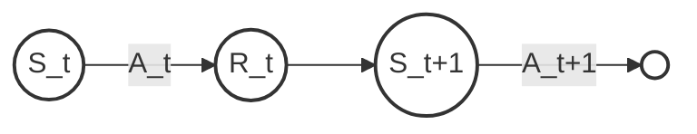
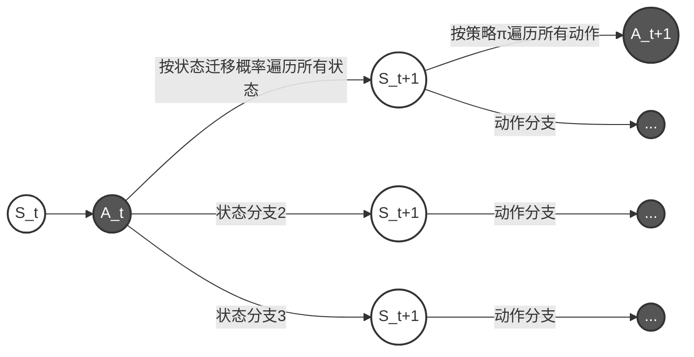
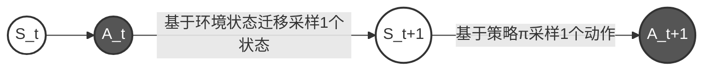
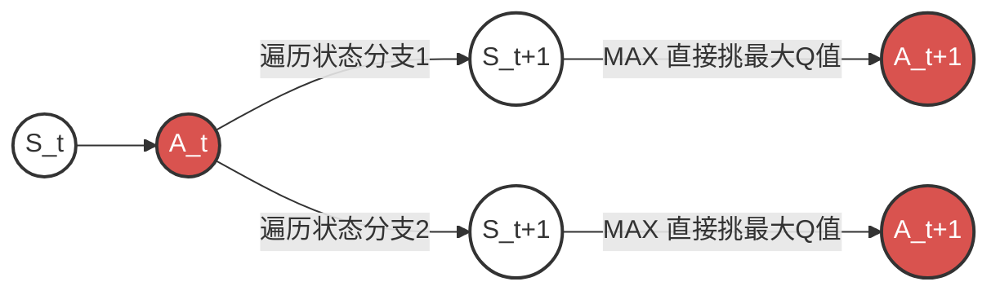
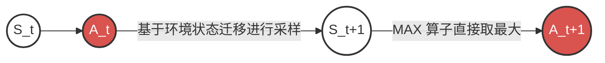
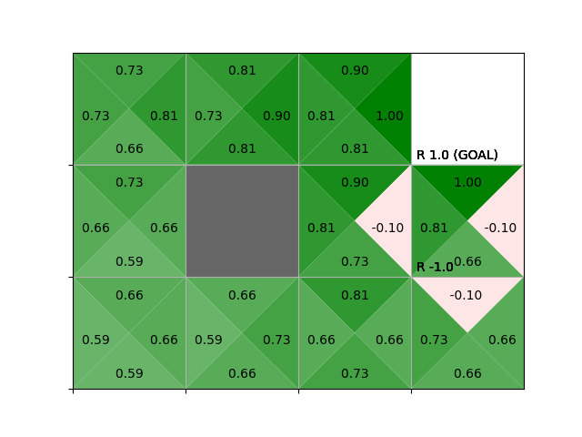

## 6. TD方法

使用蒙特卡洛方法可以在不使用环境模型情况下对策略进行评估，而且通过交替重复评估和改进，可以得到最优策略或者接近最优的策略

不过蒙特卡洛方法只有在达到回合的终点时更新价值函数，因为只有在回合结束时，才能确定收益

本章将介绍一种不适用环境模型，而且每次采取行动时都会更新价值函数的方法，即TD方法，TD方法中的TD是`Temporal Difference` 的缩写，是时间差分的意思，该方法不需要等待回合结束，每过一定的时间就会进行策略的评估和改进


### 6.1 使用TD方法评估策略

#### 6.1.1 TD方法的推导

我们对收益的定义如下
$$
\begin{aligned}
G_t &= R_t + \gamma R_{t+1} + \gamma ^ 2R_{t+2} + \dots \\
&= R_t + \gamma G_{t+1}
\end{aligned}
$$
使用收益，可以对价值函数，也可以称为期望值，做如下定义
$$
\begin{align}
v_{\pi}(s) &= \mathbb{E}_{\pi}[G_t \mid S_t = s] \tag{1}\\
&= \mathbb{E}_{\pi}[R_t + \gamma G_{t+1} \mid S_t = s] \tag{2}
\end{align}
$$

- 使用蒙特卡洛方法的式子可以从公式(1)推导出
- 使用动态规划的式子可以从公式(2)推导出

接下来从**蒙特卡洛方法**开始进行推导，通过对实际获得的收益的样本数据取平均来近似 \(v_{\pi}(s) = E_{\pi}[G_t \mid S_t = s]\) 的期望值

有两种类型的平均，样本均值和指数移动平均，为了实现指数移动平均，需要用 \(\alpha\) 对每一步进行更新
$$
V^{'}_{\pi}(S) = V_{\pi}(S_t) + \alpha\{G_t - V_\pi(S_t)\}
$$


**动态规划**方法需要根据数学式计算期望值，利用状态迁移概率 \(p(s' \mid s,a)\) 和奖励函数 \(r(s, a, s')\) 计算期望值
$$
\begin{align}
v_\pi(s) &= \mathbb{E}_\pi[R_t + \gamma G_{t+1} \mid S_t = s] \tag{1}\\
&= \sum_{a,s'}\pi(a \mid s) p(s' \mid s, a)\{r(s,a,s') + \gamma v_\pi(s')\} \tag{2}
\end{align}
$$
(2)是贝尔曼公式，可以用此式使用下一状态的价值函数，依次更新价值函数
$$
V^{'}_\pi(s) = \sum_{a,s'}\pi(a \mid s)p(s' \mid s, a)\{r(s,a,s') + \gamma V_\pi(s')\}
$$
它直接查状态迁移概率，遍历所有可能的动作和所有可能的落点，把概率乘进去全部加起来，需要考虑所有的迁移

动态规划方法使用价值函数的下一个估计值来更新价值函数的当前估计值，这种方法叫**自举**

蒙特卡洛方法根据实际获得的经验来更新当前的价值函数

这两种方法融合起来就是**时间差分(TD)方法**，时间差分方法只使用下一个行动和价值函数来更新当前的价值函数，下面推导TD方法
$$
\begin{align}
v_\pi(s) &= \sum_{a, s'}\pi(a \mid s)p(s' \mid s,a)\{r(s,a,s') + \gamma v_\pi(s')\} \\
&= \sum_{a, s'}p(a,s' \mid s)\{r(s,a,s') + \gamma v_\pi(s')\} \\
&= \mathbb{E}_\pi[R_t + \gamma v_\pi(S_{t+1}) \mid S_t = s]
\end{align}
$$

**公式解释**，这里
$$
\mathbb{E}[X\mid Z = z] = \sum x P(X = x \mid Z = z) \\
\mathbb{E}[R_t + \gamma v_\pi(S_{t+1}) \mid S_t = s] = \sum x P(X=x \mid S_t = s)
$$
因为 \(X\) 不是一个单一的变量，而是另外两个随机变量 \(A_t\) 和 \(S_{t+1}\) 的函数

意思就是 \(X\) 的每一个可能的取值 \(x\) 实际是当 \(A_t = a\) 和 \(S_{t+1} = s'\) 时，\(f(a,s')\) 的值

而期望公式中 \(x=R_t + \gamma v_\pi(S_{t+1})\) ，既然 \(x\)是由 \(a\) 和 \(s'\)决定的，那么\(X=x\) 这个事件完全等价于 \(A_t =a\) 且 \(S_{t+1} = s'\)这个事件

所以
$$
\begin{aligned}
\mathbb{E}[R_t + \gamma v_\pi(S_{t+1}) \mid S_t = s] &= \sum x P(X=x \mid S_t = s) \\
&= \sum_{a,s'}\{R_t + \gamma v_\pi(S_{t+1})\}p(a, s' \mid s) \\
&= \sum_{a,s'}\{r(s, a, s') + \gamma v_\pi(s')\}p(a, s' \mid s) \\
&= \sum_{a,s'}\pi(a \mid s)p(s' \mid s,a)\{r(s,a,s') + \gamma v_\pi(s')\}
\end{aligned}
$$
回归正题，贝尔曼方程给出了真实价值 \(v_\pi(s)\) 的公式如下
$$
\begin{align}
v_\pi(s) &= \sum_{a, s'}\pi(a \mid s)p(s' \mid s,a)\{r(s,a,s') + \gamma v_\pi(s')\} \\
&= \mathbb{E}_\pi[R_t + \gamma v_\pi(S_{t+1}) \mid S_t = s]
\end{align}
$$
但因为没有环境模型，无法遍历所有的 \(a,s'\) 去求期望，唯一能做的就是让智能体去走一步获得单步样本 \(S_t,a,S_{t+1}\)，

由离散期望公式 \(E[X] = \frac{x_1 + \dots + x_n}{n}\)，变换为增量式更新方法，其迭代公式如下
$$
新均值=旧均值+\alpha(Target −旧均值)
$$
根据贝尔曼方程，理想的 \(Target = R_t + \gamma v_\pi(S_{t+1})\)，由于不知道真实的下个状态 \(v_\pi(S_{t+1})\) ，只能用估计值\(V_\pi(S_{t+1})\) 来代替(自举)

于是 \(Target = R_t + \gamma V_\pi(S_{t+1})\)，将其带入迭代式得出时间差分的更形式
$$
V^{'}_{\pi} = V_\pi(S_t) + \alpha\{\underbrace{R_t + \gamma V_\pi(S_{t+1})}_{Target} - V_\pi(S_t)\}
$$

#### 6.1.2 MC方法和TD方法的比较

蒙特卡洛方法(MC方法)不能用于连续性任务，因此在遇到这种任务时应该使用时间差分(TD)方法

且时间差分方法训练起来更快，从公式中就能看出

【MC 方法】 \(V'_\pi(S_t) = V_\pi(S_t) + \alpha\left\{ \colorbox{#e8edf4}{$G_t$} - V_\pi(S_t) \right\}\)

【TD 方法】 \(V'_\pi(S_t) = V_\pi(S_t) + \alpha\left\{ \colorbox{#e8edf4}{$R_t + \gamma V_\pi(S_{t+1})$} - V_\pi(S_t) \right\}\)

\(G_t\) 式达到目标后获得收益的样本收益，而时间差分的方法是根据下一步的信息进行计算


#### 6.1.3 TD方法的实现


```python
import numpy as np
from collections import defaultdict
import res.gridworld_render as render_helper

# GridWorld环境类
class GridWorld:
    def __init__(self):
        # 动作空间 动作空间定义 地图 各种地点定义
        self.action_space = [0, 1, 2, 3]
        self.action_meaning = {
            '0' : 'UP',
            '1' : 'DOWN',
            '2' : 'LEFT',
            '3' : 'RIGHT'
        }

        self.reward_map = np.array(
            [[0, 0, 0, 1.0],
            [0, None, 0, -1.0],
            [0, 0, 0, 0]])

        self.goal_state = (0, 3)
        self.wall_state = (1, 1)
        self.start_state = (2, 0)
        self.agent_state = self.start_state

    @property
    def height(self):
        return len(self.reward_map)

    @property
    def width(self):
        return len(self.reward_map[0])

    @property
    def shape(self):
        return self.reward_map.shape

    def actions(self):
        return self.action_space

    def states(self):
        for h in range(self.height):
            for w in range(self.width):
                yield(h, w)

    def next_state(self, state, action):
        # 1.移动目的地的计算
        action_move_map = [(-1, 0), (1, 0), (0, -1), (0, 1)]
        move = action_move_map[action]
        next_state = (state[0] + move[0], state[1] + move[1])
        ny, nx = next_state

        # 2.条件判断
        if nx < 0 or nx >= self.width or ny < 0 or ny >= self.height:
            next_state = state
        elif next_state == self.wall_state:
            next_state = state
        return next_state

    def reward(self, state, action, next_state):
        return self.reward_map[next_state]

    def reset(self):
        self.agent_state = self.start_state
        return self.agent_state

    def step(self, action):
        state = self.agent_state
        next_state = self.next_state(state, action)
        reward = self.reward(state, action, next_state)
        done = (next_state == self.goal_state)

        self.agent_state = next_state
        return next_state, reward, done

    def render_v(self, v=None, policy=None, print_value=True):
        renderer = render_helper.Renderer(self.reward_map, self.goal_state,
                                          self.wall_state)
        renderer.render_v(v, policy, print_value)

    def render_q(self, q=None, print_value=True):
        renderer = render_helper.Renderer(self.reward_map, self.goal_state,
                                          self.wall_state)
        renderer.render_q(q, print_value)

class TdAgent:
    def __init__(self):
        self.gamma = 0.9
        self.alpha = 0.01
        self.action_size = 4

        random_actions = {0:0.25, 1:0.25, 2:0.25, 3:0.25}
        self.pi = defaultdict(lambda: random_actions)
        self.V = defaultdict(lambda: 0)

    def get_action(self, state):
        action_probs = self.pi[state]
        actions = list(action_probs.keys())
        probs = list(action_probs.values())
        return np.random.choice(actions, p=probs)

    def eval(self, state, reward, next_state, done):
        next_V = 0 if done else self.V[next_state]
        target = reward + self.gamma * next_V

        self.V[state] += (target - self.V[state]) * self.alpha

env = GridWorld()
agent = TdAgent()
episodes = 1000
for episode in range(episodes):
    state = env.reset()

    while True:
        action = agent.get_action(state)
        next_state, reward, done = env.step(action)

        agent.eval(state, reward, next_state, done)
        if done:
            break
        state = next_state

env.render_v(agent.V)
```


### 6.2 SARSA

#### 6.2.1 同策略型的 SARSA

在6.1节中，我们使用TD方法评估了状态价值函数 \(V_\pi(s)\)。但在进行**策略控制**时，我们需要将 \(Q_\pi(s, a)\) 作为评估对象。在改进阶段，策略需要进行贪婪化，如果使用 \(V_\pi(s)\) 需要已知环境模型，而使用 \(Q_\pi(s, a)\) 则可以直接计算：

\[
\mu(s) = \arg\max_a Q_\pi(s, a)
\]

6.1节使用价值函数 \(V_\pi(s)\) 推导的TD方法更新式如下式：
\[
V'_\pi(S_t) = V_\pi(S_t) + \alpha\{R_t + \gamma V_\pi(S_{t+1}) - V_\pi(S_t)\}
\]

将TD方法式子中的状态价值函数 \(V_\pi(S_t)\) 改为行动价值函数 \(Q_\pi(S_t, A_t)\)，也就是把式6.9中的 \(V_\pi(S_t)\) 和 \(V_\pi(S_{t+1})\) 分别替换为 \(Q_\pi(S_t, A_t)\) 和 \(Q_\pi(S_{t+1}, A_{t+1})\)：

\[
Q'_\pi(S_t, A_t) = Q_\pi(S_t, A_t) + \alpha\{R_t + \gamma Q_\pi(S_{t+1}, A_{t+1}) - Q_\pi(S_t, A_t)\} \tag{6.1}
\]

**同策略型的策略控制**

在同策略型中，智能代理只有一个策略。也就是说，**实际采取行动的策略（行为策略）与进行评估和改进的策略（目标策略）是一致的**。

在改进阶段不能完全贪婪化，否则将无法进行探索。因此我们采用 \(\epsilon\)-greedy 算法作为折中方法，让智能代理既能进行探索，又能在大多数情况下采取贪婪的行动。

假设智能代理根据策略 \(\pi\) 采取行动，在 \(t\) 和 \(t+1\) 时刻，状态与行动的迁移如图所示：



Q函数将状态和行动的数据对视为一个整体。因此，\(t\) 时刻的数据对为 \((S_t, A_t)\)，\(t+1\) 时刻的数据对为 \((S_{t+1}, A_{t+1})\)。当得到数据 \((S_t, A_t, R_t, S_{t+1}, A_{t+1})\) 时，我们就能立即更新 \(Q_\pi(S_t, A_t)\)。

更新完成后进入改进阶段。状态 \(S_t\) 的策略按以下式子更新（\(\epsilon\)-greedy 算法）：

\[
\pi'(a|S_t) = \begin{cases} 
\arg\max_a Q_\pi(S_t, a) & (1-\epsilon \text{ 的概率}) \\ 
\text{随机行动} & (\epsilon \text{ 的概率}) 
\end{cases} \tag{6.2}
\]

贪婪行动可以改进“策略”，随机行动可以改进“探索”。使用式6.1进行的评估和使用式6.2进行的更新像这样交替重复，之后就能得到接近最优的策略。这就是 **SARSA 算法**，它的名字来源于TD方法中使用的数据 \((S_t, A_t, R_t, S_{t+1}, A_{t+1})\) 的首字母。

#### 6.2.2 SARSA算法的实现

实现SARSA Agent，与TD Agent的区别在于：需要保存当前动作，并在到达下一步后，先通过策略选出下一步的动作 \(A_{t+1}\)，然后才能进行Q值的更新。

```python
import numpy as np
from collections import defaultdict, deque
import res.gridworld_render as render_helper

def argmax(xs):
    idxes = [i for i, x in enumerate(xs) if x == max(xs)]
    if len(idxes) == 1:
        return idxes[0]
    elif len(idxes) == 0:
        return np.random.choice(len(xs))

    selected = np.random.choice(idxes)
    return selected

def greedy_probs(Q, state, epsilon=0, action_size=4):
    qs = [Q[(state, action)] for action in range(action_size)]
    max_action = argmax(qs)
    base_prob = epsilon / action_size
    action_probs = {action: base_prob for action in range(action_size)}  #{0: ε/4, 1: ε/4, 2: ε/4, 3: ε/4}
    action_probs[max_action] += (1 - epsilon)
    return action_probs

# GridWorld环境类
class GridWorld:
    def __init__(self):
        # 动作空间 动作空间定义 地图 各种地点定义
        self.action_space = [0, 1, 2, 3]
        self.action_meaning = {
            '0' : 'UP',
            '1' : 'DOWN',
            '2' : 'LEFT',
            '3' : 'RIGHT'
        }

        self.reward_map = np.array(
            [[0, 0, 0, 1.0],
            [0, None, 0, -1.0],
            [0, 0, 0, 0]])

        self.goal_state = (0, 3)
        self.wall_state = (1, 1)
        self.start_state = (2, 0)
        self.agent_state = self.start_state

    @property
    def height(self):
        return len(self.reward_map)

    @property
    def width(self):
        return len(self.reward_map[0])

    @property
    def shape(self):
        return self.reward_map.shape

    def actions(self):
        return self.action_space

    def states(self):
        for h in range(self.height):
            for w in range(self.width):
                yield(h, w)

    def next_state(self, state, action):
        # 1.移动目的地的计算
        action_move_map = [(-1, 0), (1, 0), (0, -1), (0, 1)]
        move = action_move_map[action]
        next_state = (state[0] + move[0], state[1] + move[1])
        ny, nx = next_state

        # 2.条件判断
        if nx < 0 or nx >= self.width or ny < 0 or ny >= self.height:
            next_state = state
        elif next_state == self.wall_state:
            next_state = state
        return next_state

    def reward(self, state, action, next_state):
        return self.reward_map[next_state]

    def reset(self):
        self.agent_state = self.start_state
        return self.agent_state

    def step(self, action):
        state = self.agent_state
        next_state = self.next_state(state, action)
        reward = self.reward(state, action, next_state)
        done = (next_state == self.goal_state)

        self.agent_state = next_state
        return next_state, reward, done

    def render_v(self, v=None, policy=None, print_value=True):
        renderer = render_helper.Renderer(self.reward_map, self.goal_state,
                                          self.wall_state)
        renderer.render_v(v, policy, print_value)

    def render_q(self, q=None, print_value=True):
        renderer = render_helper.Renderer(self.reward_map, self.goal_state,
                                          self.wall_state)
        renderer.render_q(q, print_value)

class SarsaAgent:
    def __init__(self):
        self.gamma = 0.9
        self.alpha = 0.8
        self.epsilon = 0.1
        self.action_size = 4

        random_actions = {0: 0.25, 1: 0.25, 2: 0.25, 3: 0.25}
        self.pi = defaultdict(lambda: random_actions)
        self.Q = defaultdict(lambda: 0)
        self.memory = deque(maxlen=2)

    def get_action(self, state):
        action_probs = self.pi[state]
        actions = list(action_probs.keys())
        probs = list(action_probs.values())
        return np.random.choice(actions, p=probs)

    def reset(self):
        self.memory.clear()

    def update(self, state, action, reward, done):
        self.memory.append((state, action, reward, done))
        if len(self.memory) < 2:
            return

        state, action, reward, done = self.memory[0]
        next_state, next_action, _, _ = self.memory[1]
        # 下一个Q函数
        next_q = 0 if done else self.Q[next_state, next_action]
        # 使用TD方法进行更新
        target = reward + self.gamma * next_q
        self.Q[state, action] += (target - self.Q[state, action]) * self.alpha
        # 策略的改进
        self.pi[state] = greedy_probs(self.Q, state, self.epsilon)

env = GridWorld()
agent = SarsaAgent()

episodes = 10000
for episode in range(episodes):
    print(episode)
    state = env.reset()
    agent.reset()

    while True:
        action = agent.get_action(state)
        next_state, reward, done = env.step(action)

        agent.update(state, action, reward, done)

        if done:
            agent.update(next_state, None, None, None)
            break
        state = next_state

env.render_q(agent.Q)
```

**核心区别总结**：在TD方法中，评估的是 \(V(s)\)，只依赖于状态；而在SARSA中，评估的是 \(Q(s,a)\)，策略的更新直接依赖于 \((S_t, A_t, R_t, S_{t+1}, A_{t+1})\) 这五个连续的量。这也使得SARSA在危险环境（如悬崖行走）中，由于考虑了探索（\(\epsilon\)-greedy 带来的随机性），会学到更为保守的策略。


### 6.3 异策略型的 SARSA

6.2 节实现了同策略型的 SARSA。接下来是异策略型的 SARSA。

#### 6.3.1 异策略型和重要性采样

在异策略型的情况下，智能代理同时拥有**两种策略**：

1. **行为策略 (Behavior Policy, \(b\))**：负责在环境中**实际采取行动、四处探索**，从而收集大量的样本数据。
2. **目标策略 (Target Policy, \(\pi\))**：负责**被评估和优化**。它通常是朝着最优、最贪婪的方向进化的。

**为什么要让两者的策略分家？**

如果在同策略下，为了兼顾探索，智能代理必须在行动中带有随机性（例如使用 \(\epsilon\text{-greedy}\)），这会导致它学到过于保守的策略（比如在悬崖边走得离悬崖远远的）。而在异策略中，我们可以让行为策略 \(b\) 带着随机性去勇敢探索，而目标策略 \(\pi\) 则安安静静地学习最纯粹的贪婪最优策略。

但在进行更新时，由于“**用别人（行为策略 \(b\)）采集的数据，来更新自己（目标策略 \(\pi\)）的价值函数**”，直接计算会产生概率偏差。为了解决这个问题，我们必须借助**期望的数学变换**引入**重要性采样 (Importance Sampling)** 来校正权重。

下面我们来推导具体的更新过程。考虑更新 \(Q_\pi(S_t, A_t)\) 的情况，SARSA 的基本更新式如下：

\[
Q'_\pi(S_t, A_t) = Q_\pi(S_t, A_t) + \alpha \left\{ R_t + \gamma Q_\pi(S_{t+1}, A_{t+1}) - Q_\pi(S_t, A_t) \right\} \tag{6.3}
\]
当我们所选的数据对在下一个时刻 \(t+1\) 进行迁移时，数据的采样过程分为两步：

* 下一个状态 \(S_{t+1}\) 是基于环境的**状态迁移概率 \(p(s'\vert{}s,a)\)** 进行采样的。
* 在状态 \(S_{t+1}\) 中选择的行动 \(A_{t+1}\)，则是基于**目标策略 \(\pi\) 或行为策略 \(b\)** 进行采样的。

根据行动采样来源的不同，分为以下两种情况：

##### 1. 目标策略采样的情况（同策略下的理想状态）

如果行动是由目标策略 \(\pi\) 选出的（即 \(sampling: A_{t+1} \sim \pi\)），那么 TD 目标（TD Target）直接使用当前的 \(Q\) 值即可：

\[
Q'_\pi(S_t, A_t) = Q_\pi(S_t, A_t) + \alpha \left\{ \underbrace{R_t + \gamma Q_\pi(S_{t+1}, A_{t+1})}_{\text{TD Target}} - Q_\pi(S_t, A_t) \right\} \tag{6.4}
\]

##### 2. 行为策略采样与重要性采样修正（异策略的核心）

在异策略 SARSA 中，行动 \(A_{t+1}\) 实际上是由**行为策略 \(b\)** 采样出来的（\(sampling: A_{t+1} \sim b\)）。

**为什么直接用 \(b\) 采样的结果更新 \(\pi\) 会产生偏差？**
因为我们要更新的是目标策略 \(\pi\) 的价值，在数学上我们要逼近的是**在 \(\pi\) 分布下的期望值**：
\[
\mathbb{E}_{\pi} \big[ R_t + \gamma Q_\pi(S_{t+1}, A_{t+1}) \big]
\]
但现实中，数据是由行为策略 \(b\) 采样的，我们实际算出来的是在 \(b\) 分布下的平均值 \(\mathbb{E}_{b}[\dots]\)。这两者由于动作选择概率不同，数值并不相等。

**如何通过数学变形桥接这两个期望？（重要性采样核心推导）**
设 TD 目标这个整体随机变量为 \(X = R_t + \gamma Q_\pi(S_{t+1}, A_{t+1})\)。我们从 \(\pi\) 的期望公式出发，在式子中巧妙地“乘上并除以”行为分布 \(b\)：

\[
\begin{aligned} \mathbb{E}_{\pi}[X] &= \sum X \cdot \pi(X) \\ &= \sum X \cdot \frac{b(X)}{b(X)} \cdot \pi(X) \\ &= \sum X \cdot \frac{\pi(X)}{b(X)} \cdot b(X) \\ &= \mathbb{E}_{b} \left[ X \cdot \frac{\pi(X)}{b(X)} \right] \end{aligned}
\]
这个变形的意义极其重大：它把原本需要在 \(\pi\) 下求期望的式子，成功转化为了**在 \(b\) 下求期望**的式子！这意味着我们完全可以放心地让 Agent 用行为策略 \(b\) 去采样，但在拿到样本 \(X\) 时，必须乘以一个修正系数——**重要性采样权重 \(\rho\)**：

\[
\rho = \frac{\pi(X)}{b(X)} = \frac{\pi(A_{t+1}\vert{}S_{t+1})}{b(A_{t+1}\vert{}S_{t+1})}
\]
因此，将修正后的权重乘到整个 TD 目标上，**异策略型 SARSA 的最终更新式**为：

\[
Q'_\pi(S_t, A_t) = Q_\pi(S_t, A_t) + \alpha \left\{ \underbrace{\rho \left( R_t + \gamma Q_\pi(S_{t+1}, A_{t+1}) \right)}_{\text{修正后的 TD 目标}} - Q_\pi(S_t, A_t) \right\} \tag{6.5}
\]
通过乘上权重 \(\rho\)，我们成功将由行为策略 \(b\) 采样得到的 TD 目标，无偏地转化为符合目标策略 \(\pi\) 期望的更新方向。


#### 6.3.2 异策略型的SARSA实现


```python
# 异策略SARSA
class SarsaOffPolicyAgent:
    def __init__(self):
        self.gamma = 0.9
        self.alpha = 0.8
        self.epsilon = 0.1
        self.action_size = 4

        random_actions = {0:0.25, 1:0.25, 2:0.25, 3:0.25}
        self.pi = defaultdict(lambda: random_actions)
        self.b = defaultdict(lambda: random_actions)
        self.Q = defaultdict(lambda :0)
        self.memory = deque(maxlen=2)

    def get_action(self, state):
        action_probs = self.b[state]
        actions = list(action_probs.keys())
        probs = list(action_probs.values())
        return np.random.choice(actions, p=probs)

    def reset(self):
        self.memory.clear()

    def update(self, state, action, reward, done):
        self.memory.append((state, action, reward, done))
        if len(self.memory) < 2:
            return

        state, action, reward, done = self.memory[0]
        next_state, next_action, _, _ = self.memory[1]

        if done:
            next_q = 0
            rho = 1
        else:
            next_q = self.Q[next_state, next_action]
            rho = self.pi[next_state][next_action] / self.b[next_state][next_action]

        target = rho * (reward + self.gamma * next_q)
        self.Q[state, action] += (target - self.Q[state, action]) * self.alpha
        self.pi[state] = greedy_probs(self.Q, state, 0) # 评估纯贪婪策略
        self.b[state] = greedy_probs(self.Q, state, self.epsilon) # 行动带点随机

env = GridWorld()
agent = SarsaOffPolicyAgent()  # 实例化异策略代理

episodes = 10000
for episode in range(episodes):
    if episode % 1000 == 0:
        print(f"Episode {episode}")
    
    state = env.reset()
    agent.reset()

    while True:
        # 1. 行为策略 b 负责在环境中采样动作
        action = agent.get_action(state)
        next_state, reward, done = env.step(action)

        # 2. 将数据送入异策略代理的内存并进行更新
        agent.update(state, action, reward, done)

        if done:
            # 回合结束时的收尾更新（传入终止标志）
            agent.update(next_state, None, None, None)
            break
        
        state = next_state

# 训练完成后，渲染目标策略 pi 引导下的 Q 函数表现
env.render_q(agent.Q)
```


异策略SARSA每次运行结果各不相同，仍有很大的改进余地


### 6.4 Q学习

在异策略情况下，智能代理拥有行为策略和目标策略：行为策略负责探索，目标策略负责利用。

对于异策略型的 SARSA，需要使用重要性采样。不过如果可以，应该尽量避免使用重要性采样这种方法。因为重要性采样会让结果变得不稳定——尤其是在这两种策略的概率分布不同的情况下，差异越大，重要性采样中使用的权重 $\rho$ 的变化也会越大，这会导致 SARSA 更新式中的目标跟着发生剧烈变化，从而使 Q 函数的更新变得极不稳定。

解决这个问题的方法就是 **Q学习 (Q-Learning)**。Q-Learning 有以下 3 个核心特点：

- 采用 TD 方法
- 异策略型
- **不使用重要性采样**


#### 6.4.1 贝尔曼方程与SARSA

先来看看 SARSA 与贝尔曼方程的关系。回顾一下当策略 \(\pi\) 的 \(Q\) 函数为 \(q_\pi(s,a)\) 时的贝尔曼方程，如下所示：
\[
q_\pi(s,a) = \sum_{s'}p(s' \mid s,a)\left\{r(s,a,s') + \gamma \sum_{a'}\pi(a' \mid s')q_\pi(s', a')\right\}
\]
在贝尔曼方程中，以下两点需要重点关注：
- **基于环境的状态迁移概率 \(p(s' \mid s, a)\) 来考虑下一步的所有状态迁移**（遍历所有可能的落点 \(s'\)）。
- **通过智能代理的策略 \(\pi(a' \mid s')\) 来考虑下一步的所有行动**（遍历在 \(s'\) 下所有可能采取的动作 \(a'\)）。

如上图所示，理论上的贝尔曼方程站在“上帝视角”，考虑了下一个状态和下一个行动的**所有候选情况**并求期望。
如果从这个角度来看 **SARSA**，则可以将其看作**贝尔曼方程的“采样版”**。“采样版”是指在实际环境中只使用单次采样出来的数据，而不是遍历所有的迁移：


- 首先根据环境的状态迁移概率 \(p(s' \mid s,a)\) 对下一个状态 \(S_{t+1}\) 进行实际采样（实际进行动作）。
- 然后在 \(S_{t+1}\) 位置再根据策略 \(\pi(a \mid s)\) 对下一个行动 \(A_{t+1}\) 进行采样（按策略实际挑一个动作）。
- 此时 SARSA 的 TD 目标就是 \(R_t + \gamma Q_\pi(S_{t+1}, A_{t+1})\)，Q 函数会沿着这个目标的方向缓慢更新。
既然 **贝尔曼方程** 的采样版对应着 **SARSA**，那么与 **贝尔曼最优方程** 的采样版相对应的，就是 **Q学习 (Q-Learning)**！
#### 6.4.2 贝尔曼最优方程与Q学习
在第 4.5 节中，我们学习了价值迭代法。价值迭代法是一种将“评估”和“改进”两个过程合二为一，基于贝尔曼最优方程直接获得最优策略的方法。这里我们探讨使用 \(Q\) 函数的贝尔曼最优方程进行更新的“采样版”方法。
首先回顾一下 \(Q\) 函数的**贝尔曼最优方程**（最优策略 \(\pi_*\) 下的 \(Q\) 函数记为 \(q_*(s,a)\)）：
\[
q_*(s,a) = \sum_{s'} p(s' \mid s,a)\left\{r(s,a,s') + \gamma \max_{a'} q_*(s', a')\right\}
\]
与普通贝尔曼方程不同，贝尔曼最优方程去掉了对策略动作的加权求和 \(\sum_{a'} \pi(a' \mid s')\)，直接使用了 **\(\max\) 算子**：

现在，我们把上面的贝尔曼最优方程改写成“采样版”：

基于上图的方法就是 **Q学习 (Q-Learning)**。在 Q学习 中，估计值 \(Q(S_t, A_t)\) 的更新目标是 \(R_t + \gamma \max_a Q(S_{t+1}, a)\)，Q 函数沿着这个目标方向进行更新，数学式如下：
\[
Q'(S_t, A_t) = Q(S_t, A_t) + \alpha \left\{ \underbrace{R_t + \gamma \max_a Q(S_{t+1}, a)}_{\text{TD Target}} - Q(S_t, A_t) \right\} \tag{6.6}
\]
**为什么 Q学习 是异策略型，却不需要重要性采样？**
1. **为什么它是异策略？** Q学习 同时拥有两种策略：在环境中实际探索收集样本的**行为策略 \(b\)**（例如 \(\epsilon\text{-greedy}\) 策略），以及只选最大 \(Q\) 值动作的纯贪婪**目标策略 \(\pi\)**。
2. **为什么不需要重要性采样修正 \(\rho\)？** 在异策略 SARSA 中，下一步的行动 \(A_{t+1}\) 是根据行为策略 \(b\) 的概率分布随机采样出来的，为了算目标策略 \(\pi\) 的期望，必须乘上概率比值 \(\rho\) 来修正偏差。 而在 Q学习 中，用于计算 TD 目标的下一步行动 \(A_{t+1}\) **并不是根据某个策略概率采样得到的，而是直接由确定性的 \(\max\) 算子选出的最大值**。既然在计算更新目标时根本不涉及动作的概率抽样，自然就不存在策略分布不一致带来的采样偏差，因此完全不需要重要性采样！

**SARSA 与 Q学习 的核心对比**

| **对比维度**       | **同策略 SARSA**                              | **异策略 SARSA**                                    | **Q学习 (Q-Learning)**                  |
| ------------------ | --------------------------------------------- | --------------------------------------------------- | --------------------------------------- |
| **理论根源**       | 贝尔曼方程（采样版）                          | 贝尔曼方程（分布修正）                  | **贝尔曼最优方程（采样版）**            |
| **策略类型**       | 同策略 (On-policy)                   | 异策略 (Off-policy)                        | **异策略 (Off-policy)**                 |
| **TD Target**      | \(R_t + \gamma Q(S_{t+1}, A_{t+1})\)            | \(\rho [R_t + \gamma Q(S_{t+1}, A_{t+1})]\) | **\(R_t + \gamma \max_a Q(S_{t+1}, a)\)** |
| **重要性采样**     | 不需要                               | 需要（导致方差大、不稳定）                | **不需要（由 \(\max\) 直接锁定最大值）**  |
| **需要保存的数据** | \((S_t, A_t, R_t, S_{t+1}, A_{t+1})\) | \((S_t, A_t, R_t, S_{t+1}, A_{t+1})\) | **\((S_t, A_t, R_t, S_{t+1})\)**          |


#### 6.4.3 Q学习的实现


```python
# Q学习
class QLearningAgent:
    def __init__(self):
        self.gamma = 0.9
        self.alpha = 0.8
        self.epsilon = 0.1
        self.action_size = 4

        random_actions = {0:0.25, 1:0.25, 2:0.25, 3:0.25}
        self.pi = defaultdict(lambda: random_actions)
        self.b = defaultdict(lambda: random_actions)
        self.Q = defaultdict(lambda: 0)

    def get_action(self, state):
        action_probs = self.b[state]
        actions = list(action_probs.keys())
        probs = list(action_probs.values())
        return np.random.choice(actions, p=probs)

    def update(self, state, action, reward, next_state, done):
        if done:
            next_q_max = 0
        else:
            next_qs = [self.Q[next_state, a] for a in range(self.action_size)]
            next_q_max = max(next_qs)

        target = reward + self.gamma * next_q_max
        self.Q[state, action] += (target - self.Q[state, action]) * self.alpha

        self.pi[state] = greedy_probs(self.Q, state, epsilon = 0)
        self.b[state] = greedy_probs(self.Q, state, self.epsilon)
        
agent = QLearningAgent()
env = GridWorld()
episodes = 10000
for episode in range(episodes):
    if episode % 1000 == 0:
        print(f"Episode {episode}")
        
    state = env.reset()

    while True:
        action = agent.get_action(state)
        next_state, reward, done = env.step(action)

        agent.update(state, action, reward, next_state, done)

        if done:
            break
        state = next_state

env.render_q(agent.Q)
```



大多数情况下能找到最优策略


### 6.5 分布模型与样本模型

实现随机行动有两种方法，分别是分布模型和样本模型

#### 6.5.1 分布模型与样本模型

**分布模型** ：显式计算并存储所有可能动作的完整概率分布，再依据该概率向量进行加权抽样。   

**样本模型** ：不计算也不存储任何概率分布，仅依据判定规则直接生成单次采样的具体动作。

确定智能代理的行动方式也可以基于分布模型或者样本模型来实现

一个随机行动的智能代理可以作为分布模型或者样本模型来实现


```python
from collections import defaultdict
import numpy as np
# 分布模型
class RandomAgent:
    def __init__(self):
        random_actions = {0:0.25, 1:0.25, 2:0.25, 3:0.25} # 概率分布
        self.pi = defaultdict(lambda: random_actions)

    def get_actions(self, state):
        action_probs = self.pi[state]
        actions = list(action_probs.keys())
        probs = list(action_probs.values())
        return np.random.choice(actions, p=probs) # 采样
# 样本模型
class RandomAgent:
    def get_action(self, state):
        return np.random.choice(4)
```


分布模型需要使用该概率分布对实际行动进行采样 `action_probs = self.pi[state]` `return np.random.choice(actions, p=probs)`

样本模型是指该模型**只要具备“产生一个具体采样结果”的能力即可，不需要事先计算或存储完整的概率分布数值**。


#### 6.5.2 样本模型的Q学习

下面回顾一下之前的Q学习代码

```python
# Q学习
class QLearningAgent:
    def __init__(self):
        self.gamma = 0.9
        self.alpha = 0.8
        self.epsilon = 0.1
        self.action_size = 4

        random_actions = {0:0.25, 1:0.25, 2:0.25, 3:0.25}
        self.pi = defaultdict(lambda: random_actions)
        self.b = defaultdict(lambda: random_actions)
        self.Q = defaultdict(lambda: 0)

    def get_action(self, state):
        action_probs = self.b[state]
        actions = list(action_probs.keys())
        probs = list(action_probs.values())
        return np.random.choice(actions, p=probs)

    def update(self, state, action, reward, next_state, done):
        if done:
            next_q_max = 0
        else:
            next_qs = [self.Q[next_state, a] for a in range(self.action_size)]
            next_q_max = max(next_qs)

        target = reward + self.gamma * next_q_max
        self.Q[state, action] += (target - self.Q[state, action]) * self.alpha

        self.pi[state] = greedy_probs(self.Q, state, epsilon = 0)
        self.b[state] = greedy_probs(self.Q, state, self.epsilon)
```

这段代码中两个策略 self.pi 和 self.b 它们都是作为概率分布被保存的，因此这个模型是分布模型


下面简化以上代码


```python
# Q学习
class QLearningAgent:
    def __init__(self):
        self.gamma = 0.9
        self.alpha = 0.8
        self.epsilon = 0.1
        self.action_size = 4

        random_actions = {0:0.25, 1:0.25, 2:0.25, 3:0.25}
        # self.pi = defaultdict(lambda: random_actions) 不使用策略pi
        self.b = defaultdict(lambda: random_actions)
        self.Q = defaultdict(lambda: 0)

    def get_action(self, state):
        action_probs = self.b[state]
        actions = list(action_probs.keys())
        probs = list(action_probs.values())
        return np.random.choice(actions, p=probs)

    def update(self, state, action, reward, next_state, done):
        if done:
            next_q_max = 0
        else:
            next_qs = [self.Q[next_state, a] for a in range(self.action_size)]
            next_q_max = max(next_qs)

        target = reward + self.gamma * next_q_max
        self.Q[state, action] += (target - self.Q[state, action]) * self.alpha

        self.pi[state] = greedy_probs(self.Q, state, epsilon = 0)
        self.b[state] = greedy_probs(self.Q, state, self.epsilon)
```

##### 步骤 1：删除无用的目标策略 `self.pi` 并推迟行为策略的更新

* **删除 `self.pi`**：Q 学习的更新公式为：
  $$
  Q(S_t, A_t) \leftarrow Q(S_t, A_t) + \alpha \left[ R_t + \gamma \max_a Q(S_{t+1}, a) - Q(S_t, A_t) \right]
  $$
  TD 目标直接通过遍历当前 \(Q\) 表的极大值计算获得，代码逻辑中无需读取 `self.pi` 的值，故完全可以删除该字典。

* **修改 `self.b` 计算时机**：行为策略无需在 `update` 阶段为所有状态计算并存储，仅需在智能体处于特定状态且调用 `get_action(state)` 时实时生成。


```python
# Q学习
class QLearningAgent:
    def __init__(self):
        self.gamma = 0.9
        self.alpha = 0.8
        self.epsilon = 0.1
        self.action_size = 4
        self.Q = defaultdict(lambda: 0)

    def get_action(self, state):
        if np.random.rand() < self.epsilon:
            return np.random.choice(self.action_size)
        else:
            qs = [self.Q[state, a] for a in range(self.action_size)]
            return np.argmax(qs)
        
    def update(self, state, action, reward, next_state, done):
        if done:
            next_q_max = 0
        else:
            next_qs = [self.Q[next_state, a] for a in range(self.action_size)]
            next_q_max = max(next_qs)

        target = reward + self.gamma * next_q_max
        self.Q[state, action] += (target - self.Q[state, action]) * self.alpha
```

##### 步骤 2：彻底去除策略字典，改为样本模型

* 直接在 `get_action` 内部通过条件分支实现 \(\epsilon\text{-greedy}\) 选择：
  * 生成随机数 \(r \sim U(0, 1)\)。
  * 当 \(r < \epsilon\) 时，均匀随机返回任意合法动作。
  * 当 \(r \ge \epsilon\) 时，返回当前状态下 \(Q\) 值最大的动作 \(\arg\max_a Q(s, a)\)。
* 智能体类中不再保留任何表示策略概率的字典，仅维护核心的 `self.Q` 表。


#### 6.5.3 两种实现方式的对比

| **对比维度**       | **分布模型版 Q 学习**                 | **样本模型版 Q 学习**                   |
| ------------------ | ------------------------------------- | --------------------------------------- |
| **策略数据存储**   | 维护 `self.pi` 和 `self.b` 字典对象   | **不存储任何策略分布**，仅存 `self.Q`   |
| **动作生成机制**   | 查表得到概率向量 $\to$ 依概率加权抽取 | **随机数阈值判断** $\to$ 直接二选一     |
| **内存与计算开销** | 需维护全状态的分布映射，开销大        | **最小化状态参数**，计算开销低          |
| **深度学习适配度** | 难以直接套用常规函数拟合结构          | **极易扩展至神经网络**（直接输出 Q 值） |