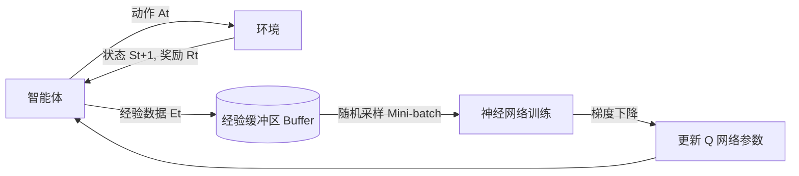

## 8. DQN

DQN是基于Q学习和神经网络的算法，上一章介绍了Q学习和神经网络相融合的方法，在此基础上引入了新的技术，即经验回放和目标网络，并且在这一章还介绍DQN的扩展算法Double DQN，优先级经验回放和Dueling DQN

### 8.1 Gymnasium

[Cart Pole (倒立摆) - Gymnasium 文档 - Gymnasium 文档](https://gymnasium.org.cn/environments/classic_control/cart_pole/)

**环境概述**


**CartPole（倒立摆/小车推杆）** 是强化学习领域的经典控制基准任务。一个刚性杆通过无动力的铰链连接在一个可以在光滑轨道上水平移动的小车上。系统无法直接施加力矩旋转杆子，智能体只能通过向左或向右对小车施加水平力，利用惯性使杆子尽可能长时间保持直立不倒。

**状态空间**

`CartPole-v1` 的状态是一个包含 4 个连续浮点数的向量，类型为 `Box(4,)`：

| **索引** | **观测特征**                      | **含义**                     | **失败判定阈值（Terminated）**                      |
| -------- | --------------------------------- | ---------------------------- | --------------------------------------------------- |
| `0`      | 小车位置（Cart Position）         | 小车距离轨道中心的水平位移   | 绝对值 $> 2.4$                                      |
| `1`      | 小车速度（Cart Velocity）         | 小车当前的水平线速度         | 无限制（理论上可达无穷）                            |
| `2`      | 杆角度（Pole Angle）              | 杆与垂直向上的夹角（弧度制） | 绝对值 \(> 0.2095 \text{ rad}\)（约 \(\pm 12^\circ\)） |
| `3`      | 杆角速度（Pole Angular Velocity） | 杆旋转的角速度               | 无限制（理论上可达无穷）                            |

**动作空间**

动作空间为离散型 `Discrete(2)`，每一步必须从以下两个动作中选择一个：

| **动作编号** | **动作行为** | **说明**                         |
| ------------ | ------------ | -------------------------------- |
| `0`          | 向左推小车   | 对小车施加一个向左的固定大小推力 |
| `1`          | 向右推小车   | 对小车施加一个向右的固定大小推力 |

**奖励机制**

- **每步存活奖励**：智能体在每一步只要未触发失败条件，就会获得 **`+1.0`** 的奖励。
- **目标**：累积奖励越高，代表小车维持杆子平衡的时间越长。

**终止与截断条件**

在 Gymnasium API 中，一个回合的结束通过两个标志位分开表示：

- **`terminated`（自然终止/失败）**：
  1. 杆子倾斜角度超过 \(\pm 12^\circ\)（约 \(0.2095\) 弧度）。
  2. 小车中心位置偏移超过 \(\pm 2.4\)（离开可视显示边界）。
- **`truncated`（截断/成功）**：
  - 单个回合的步数达到了系统默认上限（CartPole-v1 的默认上限为 **500 步**）。如果智能体能够维持 500 步不倒，该回合即视为圆满完成。


```python
# 导入库
import gymnasium as gym

# 定义游戏：创建 CartPole 环境并开启窗口渲染
env = gym.make('CartPole-v1', render_mode='human')

total_reward = 0
episodes = 5  # 测试轮数

for episode in range(episodes):
    # 初始化环境
    state, info = env.reset()
    done = False
    episode_reward = 0

    while not done:
        # 从动作空间中随机采样（0: 向左推，1: 向右推）
        action = env.action_space.sample()

        # 与环境交互一步
        state, reward, terminated, truncated, info = env.step(action)
        episode_reward += reward

        # 杆子倒下/出界 (terminated) 或 达到最大步数 (truncated) 时终止
        done = terminated or truncated

    total_reward += episode_reward
    print(f"Episode {episode + 1}: Reward = {episode_reward}")

# 关闭渲染窗口
env.close()

print(f"Average Reward: {total_reward / episodes:.2f}")
```


### 8.2 DQN的核心技术

Q学习通常是使用估计值来更新估计值，因为使用尚不正确的估计值来更新现在的估计值，因此Q学习或者更广泛说是TD学习有易于变得不稳定的趋势，如果此时再加入神经网络这样表现力强的函数近似方法，则结果会变得更加不稳定

DQN是Q学习和神经网络相结合的方法，它的特点是为了稳定神经网络的学习，使用了经验回放和目标网络这两项技术


#### 8.2.1 经验回放

在传统 Q 学习中，智能体通过与环境的交互产生数据 \((S_t, A_t, R_t, S_{t+1})\) 并直接用于更新 Q 函数。当我们将 Q 学习与神经网络结合（即 DQN）时，直接使用这些数据训练网络会面临严重的不稳定性，原因如下：

1. **自举带来的不稳定性**：Q 学习使用当前的估计值来更新估计值（自举，Bootstrapping）。如果结合表现力极强的神经网络，容易导致过度拟合训练数据，使得结果发散。
2. **数据的高度相关性**：在强化学习中，智能体在 \(t\) 时刻和 \(t+1\) 时刻采集的数据（\(E_t\) 和 \(E_{t+1}\)）存在极强的时序相关性。
3. **违背独立同分布假设**：神经网络（监督学习）要求训练数据满足独立同分布（i.i.d.）。如果按时间顺序将高度相关的连续数据直接喂给神经网络，网络参数会朝着单一方向连续更新，导致网络陷入局部最优或发生“灾难性遗忘”。


**监督学习与 Q 学习的核心差异对比**

| 对比维度     | 监督学习（如 MNIST 分类）             | 传统 Q 学习 / 强化学习       |
| :----------- | :------------------------------------ | :--------------------------- |
| **数据来源** | 预先给定的静态数据集                  | 智能体与环境实时交互动态产生 |
| **数据分布** | 随机打乱，满足独立同分布（i.i.d.）    | 时间序列，相邻数据高度相关   |
| **训练方式** | 随机抽取小批量（Mini-batch）计算 Loss | 按时间顺序逐步更新           |
| **偏差问题** | 可通过随机抽样消除数据偏差            | 连续动作导致数据存在严重偏差 |


#### 8.2.2 经验回放的定义与流程

**经验回放（Experience Replay）**：将智能体与环境交互产生的经验数据 \(E_t = (S_t, A_t, R_t, S_{t+1})\) 存储在一个固定大小的**缓冲区（Buffer）**中，在更新 Q 函数时，从缓冲区中**随机抽取**小批量数据进行学习。

### 核心流程图



**经验回放的作用**

1. **打破数据相关性**：通过随机抽样，将连续相关的数据混合，使得送入神经网络的训练数据近似满足独立同分布条件，大幅降低参数更新的方差，提升训练稳定性。
2. **提高数据效率**：一条经验数据 \(E_t\) 被收集后，可以被多次随机抽取用于参数更新，实现了数据的重复利用，提高了样本利用率。
3. **平滑数据分布**：防止网络因为连续遇到某一类特定样本（例如连续多步都遇到“向左走”的样本）而导致参数过度拟合，避免了网络陷入局部极小值。


**算法限制：仅限异策略 (Off-policy)**

经验回放技术**仅限于异策略型的强化学习算法（如 Q-Learning）**，同策略（On-policy）算法（如 SARSA）无法使用。

* **异策略（Off-policy）**：行为策略（收集数据）与目标策略（更新参数）可以不同。智能体可以利用过去旧的策略（哪怕是次优策略）产生的经验数据来训练当前的网络。
* **同策略（On-policy）**：收集数据的策略与评估改进的策略必须一致。一旦网络参数更新，旧数据就不再符合当前策略的分布，直接使用会产生严重的偏差（除非引入重要性采样进行修正，但这通常会导致高方差）。


#### 8.2.2 经验回放的实现

经验回放的缓冲区不能存储无限多的数据，所以需要事先决定它的最大容量，通过Python中的`collections.deque`通过先进先出的顺序存储数据，存储至一定范围将最旧的数据删除，最新的数据保存


```Python
import gymnasium as gym
from collections import deque
import random
import numpy as np

# 经验回放器
class ReplayBuffer:
    def __init__(self, buffer_size, batch_size):
        self.buffer = deque(maxlen=buffer_size)
        self.batch_size = batch_size

    def add(self, state, action, reward, next_state, done):
        data = (state, action, reward, next_state, done)
        self.buffer.append(data)

    def __len__(self):
        return len(self.buffer)

    def get_batch(self):
        data = random.sample(self.buffer, self.batch_size)

        state = np.stack([x[0] for x in data]) # 沿新轴将一系列数组堆叠拼接起来
        action = np.array([x[1] for x in data])
        reward = np.array([x[2] for x in data])
        next_state = np.stack([x[3] for x in data])
        done = np.array([x[4] for x in data]).astype(np.int32)
        return state, action, reward, next_state, done

env = gym.make('CartPole-v1', render_mode = 'human')
replay_buffer = ReplayBuffer(buffer_size=10000, batch_size=32)

total_reward = 0
episodes = 10

for episode in range(episodes):
    state, info = env.reset()
    done = False

    while not done:
        action = env.action_space.sample()
        next_state, reward, terminated, truncated, info = env.step(action)

        replay_buffer.add(state, action, reward, next_state, done)
        done = terminated or truncated

        state = next_state


state, action, reward, next_state, done = replay_buffer.get_batch()
print(state.shape)  # (32, 4)
print(action.shape) # (32)
print(reward.shape) # (32)
print(next_state.shape) # (32, 4)
print(done.shape)   # (32,)

env.close()
```


#### 8.2.3 目标网络

**1. Q 学习的核心矛盾**

在 DQN 中，网络优化的目标是让预测的 Q 值逼近 TD 目标（TD Target）。TD 目标的计算公式为：
\[
\text{Target} = R_t + \gamma \max_a Q(S_{t+1}, a)
\]

- **问题**：如果只使用一个网络，主网络在不断更新参数以减小误差的同时，公式中的 \(Q(S_{t+1}, a)\) 也在发生改变。这导致用来指导网络训练的“目标值”时刻在变动，引发 Loss 剧烈震荡，网络难以收敛。

**2. 双网络架构方案**

为了固定目标值，DQN 引入了双网络结构，切断了“目标值”与“预测值”之间的直接依赖：

- **主网络 (Main Network, \(Q_{main}\)**：负责计算当前的 \(Q(S_t, A_t)\)，参与前向传播、计算 Loss 并**不断更新参数**。

- **目标网络 (Target Network, \(Q_{target}\)**：网络结构与主网络完全一致。其参数在绝大部分时间里是**冻结的**，唯一作用是代入公式计算出稳定的 TD 目标：
  \[
  \text{Target} = R_t + \gamma \max_a Q_{target}(S_{t+1}, a)
  \]
  


 **3. 参数同步机制 (Parameter Synchronization)**

目标网络不能永远不更新，否则它计算出的目标值将缺乏指导意义。因此需要定期将主网络学习到的新参数同步给目标网络。目前有两种主流方案：

**1. 硬更新 (Hard Update)**

- **机制**：设定一个固定的步数间隔 \(C\)（如每 100 步）。在 \(C\) 步内，目标网络参数绝对不变。达到步数时，直接将主网络的全部参数**完全复制**并覆盖给目标网络。

- **数学表达**：
  \[
  \theta_{target} \leftarrow \theta_{main}
  \]

- **特点**：在间隔期内目标值极度稳定。但在发生更新的那个瞬间，参数突变会导致计算出的目标值发生跳跃，可能引起短期的训练数值波动。

**2. 软更新 (Soft Update / Polyak Averaging)**

- **机制**：不再等待固定的步数，而是**每一步**（或每一次主网络更新后）都对目标网络进行更新。更新方式是按一个极小的比例系数 \(\tau\)（例如 \(\tau = 0.001\)）混合主网络和目标网络的参数。

- **数学表达**：
  \[
  \theta_{target} \leftarrow \tau \theta_{main} + (1 - \tau) \theta_{target}
  \]
  

- **特点**：目标网络每次只吸收主网络极少量的改变。这种方式避免了硬更新带来的“数值跳跃”，过渡更加平滑，训练过程更稳定，是目前更为主流的做法。


#### 8.2.4 目标网络的实现


```python
import gymnasium as gym
from collections import deque
import random
import numpy as np


import copy
from dezero import Model
from dezero import optimizers
import dezero.functions as F
import dezero.layers as L

# 经验回放器
class ReplayBuffer:
    def __init__(self, buffer_size, batch_size):
        self.buffer = deque(maxlen=buffer_size)
        self.batch_size = batch_size

    def add(self, state, action, reward, next_state, done):
        data = (state, action, reward, next_state, done)
        self.buffer.append(data)

    def __len__(self):
        return len(self.buffer)

    def get_batch(self):
        data = random.sample(self.buffer, self.batch_size)

        state = np.stack([x[0] for x in data]) # 沿新轴将一系列数组堆叠拼接起来
        action = np.array([x[1] for x in data])
        reward = np.array([x[2] for x in data])
        next_state = np.stack([x[3] for x in data])
        done = np.array([x[4] for x in data]).astype(np.int32)
        return state, action, reward, next_state, done


# 神经网络QNet类
class QNet(Model):
    def __init__(self, action_size):
        super().__init__()
        self.l1 = L.Linear(128)
        self.l2 = L.Linear(128)
        self.l3 = L.Linear(action_size)

def forward(self, x):
    # xW1 + b1，(N, 4) @ (4, 128) + (128,) → (N, 128)
    x = F.relu(self.l1(x))   # (N, 4)  → (N, 128)

    # xW2 + b2，(N, 128) @ (128, 128) + (128,) → (N, 128)
    x = F.relu(self.l2(x))   # (N, 128) → (N, 128)

    # xW3 + b3，(N, 128) @ (128, 2) + (2,) → (N, 2)
    x = self.l3(x)           # (N, 128) → (N, 2)

    # 每行对应一个样本：[Q(s, a0), Q(s, a1)]
    return x                 # (N, 2)

# DQN智能代理
class DQNAgent:
    def __init__(self):
        self.gamma = 0.98
        self.lr = 0.0005
        self.epsilon = 0.1
        self.buffer_size = 10000
        self.batch_size = 32
        self.action_size = 2
        self.replay_buffer = ReplayBuffer(self.buffer_size, self.batch_size)
        self.qnet = QNet(self.action_size)
        self.qnet_target = QNet(self.action_size)
        self.optimizer = optimizers.Adam(self.lr)
        self.optimizer.setup(self.qnet) # 设置qnet

    def sync_qnet(self):
        self.qnet_target = copy.deepcopy(self.qnet)

    def get_action(self, state):
        if np.random.rand() < self.epsilon:
            return np.random.choice(self.action_size)
        else:
            state = state[np.newaxis, :] # state (4,) → (1, 4)
            qs = self.qnet(state) # (1, 2)
            return qs.data.argmax()

    def update(self, state, action, reward, next_state, done):
        self.replay_buffer.add(state, action, reward, next_state, done)
        if len(self.replay_buffer) < self.batch_size:
            return
        state, action, reward, next_state, done = self.replay_buffer.get_batch() # 解包 batch_size × 4(或1) 列
        qs = self.qnet(state) # 传入 state (32, 4) 得到 qs (32, 2)
        # np.arange(x)生成[0,...,x-1]列表 action (32, 2)
        q = qs[np.arange(self.batch_size), action] # 花式索引,按坐标点成对抽取 (0, action[0]), (1, action[1]), ..., (31, action[31])

        next_qs = self.qnet_target(next_state) # 传入 next_state (32, 4) 得到 next_qs (32, 2)
        next_q = next_qs.max(axis=1) # (32,) 装着每一行最大的q值
        next_q.unchain()
        target = reward + (1 - done) * self.gamma * next_q

        loss = F.mean_squared_error(q, target)

        self.qnet.cleargrads()
        loss.backward()
        self.optimizer.update()

episodes = 300
sync_interval= 20
render_mode = [None, 'human']
env = gym.make('CartPole-v1', render_mode = render_mode[0])
agent = DQNAgent()

reward_history= []
replay_buffer = ReplayBuffer(buffer_size=10000, batch_size=32)

for episode in range(episodes):
    if episode % 10 == 0:
        print(f'{episode}')
    state, info = env.reset() # state = [小车位置, 小车速度, 木棒角度, 木棒角速度]
    done = False
    total_reward = 0

    while not done:
        action = agent.get_action(state)
        next_state, reward, terminated, truncated, info = env.step(action)
        done = terminated or truncated
        agent.update(state, action, reward, next_state, done)
        state = next_state
        total_reward += reward

    if episode % sync_interval == 0:
        agent.sync_qnet()

    reward_history.append(total_reward)
print(f'{episodes}')
env.close()
```

对张量数据流思维的匮乏会导致在多维数组在流水线中形态变化和维度对齐不清楚


### 8.3 DQN的扩展


转换如下：

#### 8.3.1. Double DQN（双重 DQN）

Double DQN 旨在解决基础 DQN 中目标值被系统性高估的问题。   

- **基础 DQN 的目标值公式**：
  \[
  R_t + \gamma \max_a Q_{\theta'}(S_{t+1}, a)
  \]
  

  - **符号含义**：\(R_t\) 为当前步骤获得的即时奖励；\(\gamma\) 为折扣率；\(S_{t+1}\) 为下一时刻的状态；\(Q_{\theta'}\) 表示参数为 \(\theta'\) 的目标网络所给出的价值评估；\(\max_a\) 表示遍历下一时刻所有可选行动 \(a\)，直接取出数值最大的那个评估值。   
  - **原版机制的问题**：神经网络在学习阶段对价值的预测必然带有数值误差。若直接在带有误差的估算值集合上使用 \(\max_a\) 操作，正向偏差更大的误差项更容易被选中，导致计算出的整体目标数值长期高于实际真实值（即“过估计”），进而降低训练的稳定性。   

- **Double DQN 的改进公式**：

  \[
  R_t + \gamma Q_{\theta'}\left(S_{t+1}, \operatorname{argmax}_a Q_\theta(S_{t+1}, a)\right)
  \]

  
  - **符号与运算机制**：
    1. \(\operatorname{argmax}_a Q_\theta(S_{t+1}, a)\)：利用正在持续更新参数的主网络（参数为 \(\theta\)），找出在状态 \(S_{t+1}\) 下哪一个行动的预测分数最高。   
    2. \(Q_{\theta'}(S_{t+1}, \dots)\)：确定最高分的行动后，不采纳主网络给出的分数值，而是把该行动输入到参数相对固定的目标网络（参数为 \(\theta'\)）中计算其实际价值。   
  - **通俗解释**：将“选出表现最优的行动”与“对该行动的具体价值打分”两个任务剥离给两组参数不同的网络。因为两个网络的参数相互独立，主网络中因随机误差被选出的行动，在目标网络中不会同时具备同方向的高估误差，从而消除了数值过估计现象，使训练更稳定。   

#### 8.3.2 优先级经验回放（Prioritized Experience Replay, PER）

优先级经验回放旨在改变传统经验池中均匀随机采样的模式，优先抽取对模型训练价值更高的数据。   

- **优先级（TD 误差）计算公式**：

  \[
  \delta_i = \left\vert{} R_t + \gamma \max_a Q_{\theta'}(S_{t+1}, a) - Q_\theta(S_t, A_t) \right\vert{}
  \]

  
  - **符号与运算机制**：
    - \(R_t + \gamma \max_a Q_{\theta'}(S_{t+1}, a)\) 是目标网络计算得出的目标值。   
    - \(Q_\theta(S_t, A_t)\) 是主网络对当前状态 \(S_t\) 下采取行动 \(A_t\) 的预测值。   
    - 两者相减并取绝对值，得到第 \(i\) 条经验数据的绝对误差 \(\delta_i\)。   
  - **通俗解释**：绝对误差 \(\delta_i\) 衡量了当前网络预测结果与目标结果之间的偏离程度。\(\delta_i\) 越大，说明网络当前对该状态-行动对的判断偏差越大，参数需要修正的幅度就越大；\(\delta_i\) 越小，说明网络参数对该样本的拟合程度已经较好，能从中更新的信息量越少。   

- **抽样概率计算公式**：

  \[
  p_i = \frac{\delta_i}{\sum_{k=0}^N \delta_k}
  \]

  
  - **符号与运算机制**：\(N\) 为经验缓冲区中存储的样本总数。系统将单条样本的误差 \(\delta_i\) 除以缓冲区内所有样本误差的累加和，算出该样本被抽取的概率 \(p_i\)。   
  - **通俗解释**：保存数据时将 \(\delta_i\) 一并记录在经验单元 \((S_t, A_t, R_t, S_{t+1}, \delta_i)\) 中。在抽取数据时，误差更大、需要修正幅度更大的数据具有更高的被选中概率，从而将计算资源集中在尚未拟合准确的样本上，提升整体训练速度。   

#### 8.3.3 Dueling DQN（决斗 DQN）

Dueling DQN 通过改进神经网络的输出端架构，分别评估状态本身的价值与行动带来的相对变化，以提升学习效率。   

- **优势函数的定义公式**：
  \[
  A_\pi(s, a) = Q_\pi(s, a) - V_\pi(s)
  \]
  

  - **符号含义**：
    - \(Q_\pi(s, a)\) 是在状态 \(s\) 下强行执行行动 \(a\)、之后依照策略 \(\pi\) 执行下去所得总收益的期望值。   
    - \(V_\pi(s)\) 是在状态 \(s\) 下直接依照策略 \(\pi\) 执行下去所得总收益的期望值（即当前状态的基准表现）。   
    - \(A_\pi(s, a)\) 为优势函数，表示选定动作 \(a\) 相比于该状态下策略的整体基准水平具体好多少或差多少。   
  
- **网络输出重组公式**：
  \[
  Q_\pi(s, a) = A_\pi(s, a) + V_\pi(s)
  \]
  
  - **网络结构机制**：在神经网络的前端，卷积层等特征提取结构是共享的。在靠近输出层的位置网络分叉为两个独立分支：一个分支输出单一标量 \(V(s)\)（只评估当前所处状态的总体价值，与具体采取哪个行动无关）；另一个分支输出向量 \(A(s, a)\)（评估各动作相对于基准的差异）。最后将两路数值相加，重构得到各行动的 \(Q(s, a)\)。   
  - **通俗解释**：在很多场景中，无论智能体选择什么行动，最终结果都几乎没有差别（例如在游戏 Pong 中，球已经越过防线即将出界，执行向上或向下行动结果都是失分）。原版 DQN 必须把每个行动分别在当前状态下尝试一遍才能调整各个动作对应的 \(Q(s, a)\)；而 Dueling DQN 只需要经历该状态一次，就能直接更新该状态总体的 \(V(s)\)。因为所有动作的最终得分都包含了 \(V(s)\)，所以无需逐个尝试全部动作，该状态下所有动作的价值估计都能同步得到修正，提高了样本的训练效率。
