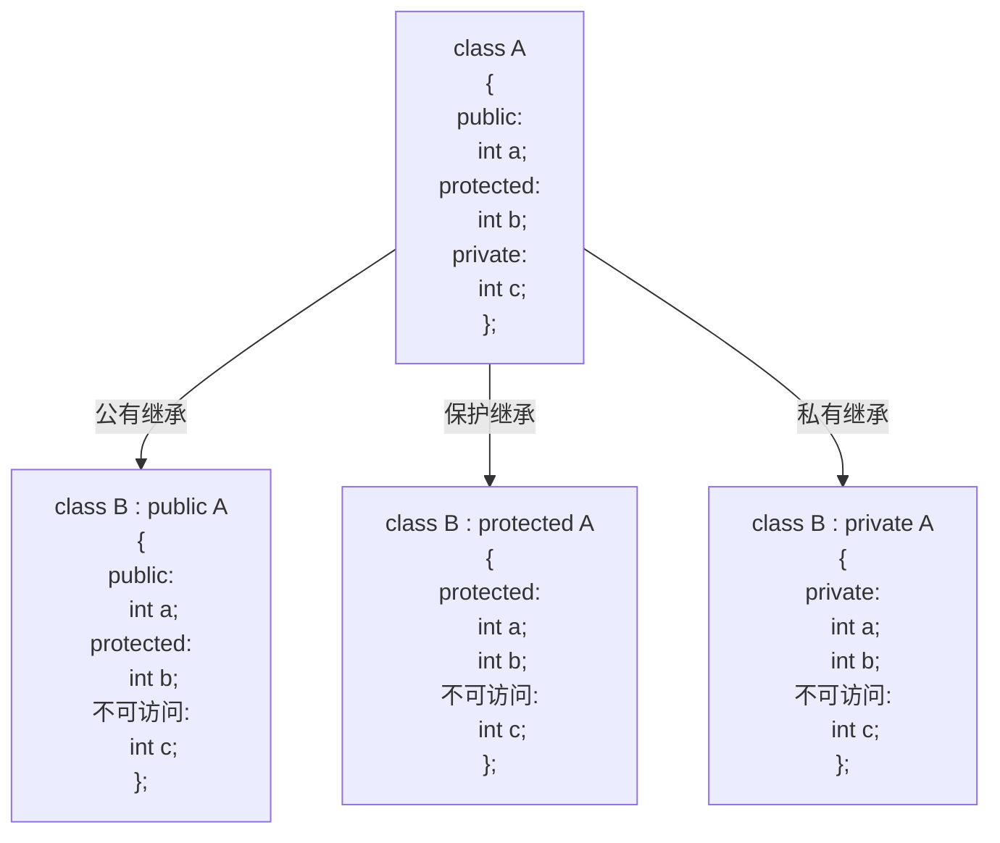
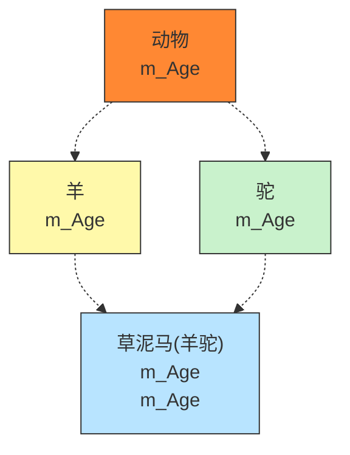

# C++基础

## 1 C++初识

### 1.1 HelloWorld

```cpp
#include <iostream>
using namespace std;

int main()
{
    cout << "hello world" << endl;
    system("pause");
    return 0;
}
```

### 1.2 注释

```cpp
#include <iostream>
using namespace std;

int main()
{
    // 单行注释
    /* 
       多
       行
       注
       释
    */
    system("pause");
    return 0;
}
```

`//`：单行注释  
`/**/`：多行注释  

### 1.3 变量

```cpp
#include <iostream>
using namespace std;

int main()
{
    int a = 10;
    cout << "a = " << a << endl;
    system("pause");
    return 0;
}
```

### 1.4 常量

```cpp
#include <iostream>
using namespace std;
// #define 宏常量
// const 修饰该变量为常量不能修改
#define day 7
int main()
{
    cout << "一周一共有" << day << "天" << endl;
    const int month = 12;
    system("pause");
    return 0;
}
```
`#define`：预处理直接文本替换，只能通过`#define NUM 100`定义  
- 错误写法：
```cpp
#define NUM = 100
```
`const`：初始化后禁止重新赋值  
- 错误写法：
```cpp
const int a = 6;
a = 88;
```
`#define`：宏常量

### 1.5 关键字

关键字是C++系统预先定义、具有特定功能和含义的标识符，不能用作变量名、函数名、宏名等自定义名称

### 1.6 标识符命名规则

标识符是程序员自定义的名称，用于命名变量、函数、宏、数组等，必须遵循C++统一规则。
- 由字母、数字、下划线组成，不能包含空格、@、#、$等特殊符号
- 不能以数字开头
- 不能与C++关键字重名
- 区分大小写

## 2.数据类型

### 2.1 整型

```cpp
/*
short 短整型 2
int 整型 4
long 长整型 4或64位linux 8
longlong 长长整型 8
*/
#include <iostream>
using namespace std;

int main(){
    short num1 = 10;
    int num2 = 10;
    cout << "num1 = " << num1 << endl;
    cout << "num2 = " << num2 << endl;
    system("pause");
    return 0;
```

**常用整型及大小**

| 类型 | 关键字 | 通常大小（字节） | 取值范围（2的次方表示） |
| :--- | :--- | :--- | :--- |
| 短整型 | `short` | 2 | $-2^{15} \sim 2^{15}-1 \quad (\text{即 } -32768 \sim 32767)$ |
| 整型 | `int` | 4 | $-2^{31} \sim 2^{31}-1 \quad (\text{即 } -2,147,483,648 \sim 2,147,483,647)$ |
| 长整型（Windows） | `long` | 4 | $-2^{31} \sim 2^{31}-1 \quad (\text{同 } int)$ |
| 长整型（Linux 64位） | `long` | 8 | $-2^{63} \sim 2^{63}-1 \quad (\text{同 } long\ long)$ |
| 长长整型 | `long long` | 8 | $-2^{63} \sim 2^{63}-1 \quad (\text{约 } -9.22\times10^{18} \sim 9.22\times10^{18})$ |

**无符号整型**  
在不使用负数的情况下可以使用 `unsigned` 前缀，可使正数范围扩大一倍。

**确定大小**  
```cpp
cout << sizeof(short) << endl;   // 通常输出 2
cout << sizeof(int)   << endl;   // 通常输出 4
```

**整型溢出**

当赋予的值超出类型范围时，会发生溢出，导致数据截断或循环  

```cpp
short num = 32767;   // 最大值
num = num + 1;       // 结果变成 -32768（溢出回绕）
```

**整型字面量写法**

5. 整型字面量写法
- 十进制：
```cpp
int a = 42;
```

- 八进制（前缀 0）：
```cpp
int b = 052; // 十进制 42
```

- 十六进制（前缀 0x 或 0X）：
```cpp
int c = 0x2A; // 十进制 42
```

- 后缀指定类型：

  - `10L` → `long` 
  - `10LL` → `long long`
  - `10U` → `unsigned int`

### 2.2 sizeof

```cpp
#include <iostream>
using namespace std;

int main(){
    short num1 = 10;
    cout << "short占用空间:" << sizeof(num1) << endl;
    int num2 = 10;
    cout << "int占用空间" << sizeof(num2) << endl;
    long num3 =10;
    cout << "long占用空间" << sizeof(num3) << endl;
    long long num4 =10;
    cout << "long long占用空间" << sizeof(num4) << endl;
    system("pause");
    return 0;
}
```

### 2.3 实型

实型（浮点型）用于表示带小数点的数字

|类型|关键字|占用字节|有效数字位数（十进制）|说明|
|:---|:---|:---|:---|:---|
|单精度|`float`|4|6~7位|精度较低，节省内存|
|双精度|`double`|8|15~16位|默认浮点字面量类型，精度高|

**字面量写法**

```cpp
float f1 = 3.14;      // 3.14 默认是 double 类型，赋值给 float 会有隐式转换
float f2 = 3.14f;     // 加 f / F 后缀表示 float 字面量
double d1 = 3.14;     // 直接使用 double
double d2 = 3.14;     // 不加后缀默认就是 double
```

```cpp
#include <iostream>
using namespace std;

int main() {
    /*
    float  : 4 字节
    double : 8 字节
    */
    // 默认输出：6 位有效数字
    float f1 = 3.14;          // 字面量 double → 转 float
    float f2 = 3.14f;         // 明确使用 float 字面量
    cout << "f1 = " << f1 << endl;   // f1 = 3.14
    double d1 = 3.1415926;
    cout << "d1 = " << d1 << endl;   // d1 = 3.14159 (6位有效数字)
    return 0;
}
```

**科学计数法**

```cpp
float f2 = 3e2; // 3 * 10 ^ 2
```

### 2.4 字符型
- **作用**：字符型变量用于显示单个字符
- **语法**：`char ch = 'a';`
- 注意1：在显示字符型变量时，用单引号将字符括起来，不要使用双引号  
- 注意2：单引号内只能有一个字符，不可以是字符串  

> C和C++中字符变量只占用1个字节  
> 字符型变量并不是把字符本身放到内存中存储，而是将对应的ASCII编码放入到存储单元

```cpp
#include <iostream>
using namespace std;

int main(){
    // 1. 字符型变量创建方式
    char ch = 'a';
    cout << ch << endl; // a

    // 2. 字符型变量所占内存大小
    cout << sizeof(ch) << endl; // 1

    // 3. 字符型变量常见错误
    // char ch1 = "b"; 创建字符型变量要用单引号
    // char ch2 = 'abcdef' 创建字符型变量时候，单引号内只能有一个字符

    // 4. 字符型变量对应ASCII编码
    cout << (int)ch << endl; // 97

    system("pause");
    return 0;
}
```

### 2.5 转义字符
- **作用**：用于表示一些不能显示出来的ASCII字符
- 现阶段常用转义字符有：`\n \\ \t`

|转义字符|含义|ASCII码值（十进制）|
|:---:|:---|:---:|
|`\a`|警报（响铃）|007|
|`\b`|退格(BS)，将当前位置移到前一列|008|
|`\f`|换页(FF)，将当前位置移到下页开头|012|
|`\n`|换行(LF)，将当前位置移到下一行开头|010|
|`\r`|回车(CR)，将当前位置移到本行开头|013|
|`\t`|水平制表(HT)（跳到下一个TAB位置）|009|
|`\v`|垂直制表(VT)|011|
|`\\`|代表一个反斜线字符`\`|092|
|`\'`|代表一个单引号（撇号）字符|039|
|`\"`|代表一个双引号字符|034|
|`\?`|代表一个问号|063|

```cpp
#include <iostream>
using namespace std;

int main(){
    // 转义字符

    // 换行符 \n

    cout << "hello world\n" << endl;

    // 反斜杠 \\ 注释行末尾 \ = 续行符
    cout << "hello \\ world" << endl;

    // 水平制表符 \t
    cout << "hello \t world" << endl;

    system("pause");
    return 0;
}
```

- `行尾 \`：行末尾用反斜杠 等于 续行符

### 2.6 字符串型
- **作用**：用于表示一串字符
- **两种风格**：
  - 1.**C风格字符串**：`char 变量名[] = "字符串值"`
  - 2.**C++风格字符串**：`string 变量名 = "字符串值"`
    > 使用C++风格字符串，需要包含头文件 #include <string>

### 2.7 布尔类型 bool
- **作用**：布尔数据类型代表真或假的值
bool类型只有两个值：
- true 真 1
- false 假 0

```cpp
#include <iostream>
using namespace std;

int main(){
    // 1. 创建bool数据类型
    bool flag = true;
    cout << flag << endl; // 1

    flag = false;
    cout << flag << endl; // 0
    // 2. 查看bool类型所占内存空间
    cout << "布尔类型所占空间：" << sizeof(bool) << endl; // 1

    return 0;
}
```

### 2.8 数据的输入
- **作用**：用于从键盘获取数据
- **关键字**：cin >> 变量

实例：

```cpp
#include <iostream>
#include <string>
using namespace std;

int main(){
    // 1. 整型
    int a = 0;
    cout << a << endl;
    cout << "请给整型变量a赋值：" << endl;
    cin >> a;
    cout << "整型变量a是多少：" << a << endl;

    // 2. 浮点型
    float f = 3.14f;
    cout << "请给浮点型变量f赋值：" << endl;
    cin >> f;
    cout << "浮点型变量f是多少：" << f << endl;

    // 3. 字符型
    char ch = 'a';
    cout << "请给字符型变量ch赋值：" << endl;
    cin >> ch;
    cout << "字符型变量ch是什么：" << endl;

    // 4. 字符串型
    string str = "hello";
    cout << "请给字符串型变量str赋值：" << endl;
    cin >> str;
    cout << "字符串型变量str是什么：" << str << endl;

    // 5. 布尔类型
    bool flag = false;
    cout << "请给布尔类型flag赋值" << endl;
    cin >> flag;
    cout << "布尔类型flag是什么：" << flag << endl;
}
```

## 3.运算符
- **作用**：用于执行代码的运算

主要讲解以下几类运算符：

|运算符类型|作用|
|:---:|:---|
|算术运算符|用于处理四则运算|
|赋值运算符|用于将表达式的值赋给变量|
|比较运算符|用于表达式的比较，并返回一个真值或假值|
|逻辑运算符|用于根据表达式的值返回真值或假值|

### 3.1 算术运算符

|运算符|术语|示例|结果|
|:---:|:---:|:---:|:---:|
|`+`|正号|`+3`|`3`|
|`-`|负号|`-3`|`-3`|
|`+`|加|`10+5`|`15`|
|`-`|减|`10-5`|`5`|
|`*`|乘|`10*5`|`50`|
|`/`|除|`10/5`|`2`|
|`%`|取模(取余)|`10%3`|`1`|
|`++`|前置递增|`a=2;b=++a;`|`a=3;b=3;`|
|`++`|后置递增|`a=2;b=a++;`|`a=3;b=2;`|
|`--`|前置递减|`a=2;b=--a;`|`a=1;b=1;`|
|`--`|后置递减|`a=2;b=a--;`|`a=1;b=2;`|

- 加减乘除：
  - （1）除数不为零
  - （2）两个整数相除结果是整数
  - （3）两个小数无法做取模运算
- 递增递减：
  - （1）`++a`：前置递增，让变量a+1
  - （2）`b++`：后置递增，让变量b+1
  - （3）`前置递增`：先加后运算
  ```cpp
    int a = 10;
    int b = ++a2 * 10;
    cout << "a = " << endl; // 11
    cout << "b = " << endl; // 110
  ```
  - （4）`后置递增`：先运算后加
  ```cpp
    int a = 10;
    int b = a2++ * 10;
    cout << "a = " << endl; // 11
    cout << "b = " << endl; // 100
  ```

### 3.2 赋值运算符
- **作用**：用于将表达式的值赋给变量  
赋值运算符包括如下符号：  

|运算符|术语|示例|结果|
|:---:|:---:|:---:|:---:|
|=|赋值|a=2;b=3;|a=2;b=3;|
|+=|加等于|a=0;a+=2;|a=2;|
|-=|减等于|a=5;a-=3;|a=2;|
|*=|乘等于|a=2;a*=2;|a=4;|
|/=|除等于|a=4;a/=2;|a=2;|
|%=|模等于|a=3;a%2;|a=1;|

### 3.3 比较运算符
- **作用**：用于表达式的比较，并返回一个真值或假值  
比较运算符有以下符号：  

|运算符|术语|示例|结果|
|:---:|:---:|:---:|:---:|
|==|相等于|4==3|0|
|!=|不等于|4!=3|1|
|<|小于|4<3|0|
|>|大于|4>3|1|
|<=|小于等于|4<=3|0|
|>=|大于等于|4>=1|1|

例如：

```cpp
cout << (a == b) << endl;
```

### 3.4 逻辑运算符
- **作用**：用于根据表达式的值返回真值或假值
逻辑运算符有以下符号：

|运算符|术语|示例|结果|
|:---:|:---:|:---:|:---:|
|!|非|!a|如果a为假，则!a为真；如果a为真，则!a为假。|
|&&|与|a&&b|如果a和b都为真，则结果为真，否则为假。|
|\|\||或|a\|\|b|如果a和b有一个为真，则结果为真，二者都为假时，结果为假。|

示例：  
```cpp
int main(){
    int a = 10;
    // 逻辑非运算
    cout << !a << endl; // 0
    cout << !!a << endl; // 1

    // 逻辑与运算
    int b = 10;
    int c = 10;
    cout << (b && c) << endl; // 1
    c = 0;
    cout << (b && c) << endl; // 0

    // 逻辑或运算符
    // 略

    system("pause");
    return 0;
}
```

## 4.程序流程结构
C/C++支持最基本的三种程序运行结构：顺序结构、选择结构、循环结构  
- 顺序结构：程序按顺序执行，不发生跳转
- 选择结构：依据条件是否满足，有选择的执行相应功能
- 循环结构：依据条件是否满足，循环多次执行某段代码
- 
### 4.1 选择结构

#### 4.1.1 if语句
**作用**：执行满足条件语句

示例  
```cpp
#include <iostream>
using namespace std;

int main(){
    float condition = 0.0f;

    cout << "请输入数字判断" << endl;
    cin >> condition;
    if (condition >= 1) // if
    {
        cout << "condition >= 1" << endl;
        if (condition >= 100) // 嵌套if
        {
            cout << "condition >= 100" << endl; 
        }
    }
    else if ((0 <= condition)&&(condition < 1)) // else if
    {
        cout << "0 =<condition < 1" << endl;
    }
    else // else
    {
        cout << "condition < 0" << endl;
    }
    system("pause");
    return 0;
}
```

#### 4.1.2 三目运算符  
**作用**：通过三目运算符实现简单的判断  
**语法**：```表达式1 ? 表达式2 : 表达式3```  
**解释**：  
如果表达式1的值为真，执行表达式2，并返回表达式2的结果
如果表达式2的值为假，执行表达式3，并返回表达式3的结果

```cpp
#include <iostream>
using namespace std;

int main(){
    // 三目运算符
    // ab哪个变量大 赋值给c
    int a = 10;
    int b = 20;
    int c = 0;
    cout << a << " " << b << " " << c << endl; // 10 20 0
    c = a > b ? a : b; 
    cout << a << " " << b << " " << c << endl;// 10 20 20


    (a > b ? a : b) = 100;
    cout << a << " " << b << endl; // 10 100

    return 0;
}
```

三目运算符返回的是一个变量，可以继续进行操作

#### 4.1.3 Switch语句
**作用**：执行多条件分支语句
**语法**

```cpp
switch(表达式)
{   
    case 结果1: 执行语句; break;
    case 结果2: 执行语句; break;

    ...

    default:执行语句;break;
}
```

示例  
```cpp
#include <iostream>
using namespace std;

int main(){
    int score = 0;
    cout << "请输入分数：" << endl;
    cin >> score;

    switch (score)
    {
        case 60:
            cout << "及格" << endl;
            break; // 否则会出现穿透
        case 75:
            cout << "良好" << endl;
            // 输入75测试break的作用
        case 90:
            cout << "优秀" << endl;
        default:
            cout << "你的分数不是60、75、90 不予评价" << endl;
    }
    return 0;
}
```

`switch`优点：结构清晰、执行效率高
`switch`缺点：判断的时候只能是整型或者字符型，不可以是一个区间
> 注意：case中没有break那么程序会一直向下执行

### 4.2 循环结构

#### 4.2.1 while循环语句
**作用**：满足循环条件，执行循环语句
**语法**：```while (循环条件) {循环语句}```

```cpp
#include <iostream>
using namespace std;

int main(){
    int num = 0;
    while (num<10)
    {
        cout << num << endl;
        num++;
    }
    return 0;
}
```

#### 4.2.2 do...while
**作用**：满足循环条件，执行循环语句  
**语法**：```do {循环语句} while (循环条件)```  

```cpp
#include <iostream>
using namespace std;

int main()
{
    int num = 0;
    do
    {
        cout << num << endl;
        num ++;
    }
    while(num < 10);
    return 0;
}
```

与 while 先判断条件不同，do while 会先执行一次循环语句再判断循环条件

#### 4.2.3 for循环语句
**作用**：满足循环条件，执行循环语句
**语法**：```for(起始表达式;条件表达式;末尾循环体) {循环语句}```

示例  
```cpp
#include <iostream>
using namespace std;

int main()
{
    for (int i = 0; i < 10; i++ )
    {
        cout << i << endl;
    }
    return 0;
}
```

#### 4.2.4 嵌套循环
**作用**：在循环体中再嵌套一层循环，解决一些实际问题

### 4.3 跳转语句

#### 4.3.1 break语句
**作用**：用于跳出选择结构或者循环结构
break使用的时机：
- 出现再switch条件语句中，作用是终止case并跳出switch 
- 出现在循环语句中，作用是跳出当前的循环语句
- 出现在嵌套循环中，跳出最近的内层循环语句

#### 4.3.2 continue语句
**作用**：在循环语句中，跳过本次循环中余下未执行语句，继续执行下一次循环

#### 4.3.3 goto语句
**作用**：可以无条件跳转语句  
**语法**：```goto 标记```  
**解释**：如果标记的名称存在，执行到goto语句时，会跳转到标记的位置  

示例
```cpp
int main()
{
    cout << "a" << endl;
    goto FLAG;
    cout << "2" << endl;
    
    FLAG:
    cout << "5" << endl;
    return 0;
}
```

## 5.数组

### 5.1 概述
所谓数组，就是一个集合，里面存放了相同类型的数据元素
**特点1**：数组中的每个数据元素都是相同的数据类型
**特点2**：数组是由连续的内存位置组成的

### 5.2 一维数组

#### 5.2.1 一维数组的定义方式
一维数组定义的三种方式：  
1.```数据类型 数组名[数组长度];```   
2.```数据类型 数组名[数组长度] = {值1, 值2, ...}```   
3.```数据类型 数组名[] = {值1, 值2, ...}```   

```cpp
#include <iostream>
using namespace std;

int main()
{
    // 数据类型 数组名[数组长度]
    int arr[5];
    arr[0] = 10;
    arr[1] = 10;

    // 数据类型 数组名[数组长度] = {值1, 值2, ...}
    // 如果再初始化数据的时候，没有全部填写完，会用0来填补剩余数据
    int arr1[5] = {1, 2, 3, 4, 5};

    // 数据类型 数组名[] = {值1, 值2, ...}
    int arr2[] = {1,2,3,4,5,6,7,8,9};
    for(int i = 0; i < 10; i++)
    {
        cout << arr[i] << endl;
        cout << arr1[i] << endl;
        cout << arr2[i] << endl;
    }
    return 0;
}
```

#### 5.2.2 一维数组数组名
一维数组名称的用途：
1.可以统计整个数组在内存中的长度
2.可以获取数组在内存中的首地址

示例
```cpp
#include <iostream>
using namespace std;

int main()
{
    // 数组名用途
    // 1.可以获取整个数组占用内存空间大小
    int arr[10] = {1,2,3,4,5,6,7,8,9,10};
    cout << "整个数组所占内存空间为：" << sizeof(arr) << endl;
    cout << "每个元素所占内存空间为:" << sizeof(arr[0]) << endl;
    cout << "数组的元素个数为：" << sizeof(arr) / sizeof(arr[0]) << endl;

    // 2.可以通过数组名获取到数组首地址
    cout << "数组首地址为：" << (long long)arr << endl;
    cout << "数组中第一个元素地址为：" << (long long)&arr[0] << endl;
    cout << "数组中第二个元素地址为：" << (long long)&arr[1] << endl;
    return 0;
}
```

### 5.3.2 二维数组数组名
- 查看二维数组所占内存空间
- 获取二维数组首地址

示例  

```cpp
#include <iostream>
using namespace std;

int main()
{
    int arr[2][3] = 
    {
        {1,2,3},
        {4,5,6}
    };
    cout << "二维数组大小：" << sizeof(arr) << endl;
    cout << "二维数组一行大小：" << sizeof(arr[0]) << endl;
    cout << "二维数组元素大小：" << sizeof(arr[0][0]) << endl;
    cout << "二维数组行数为：" << sizeof(arr) / sizeof(arr[0]) << endl;
    cout << "二维数组列数为：" << sizeof(arr[0]) / sizeof(arr[0][0]) << endl;
    
    cout << "二维数组首地址为：" << (long long)arr << endl;
    cout << "二维数组第一行首地址为：" << (long long)arr[0] << endl;
    cout << "二维数组第二行首地址为：" << (long long)arr[1] << endl;

    cout << "二维数组第一个元素首地址：" << (long long)&arr[0][0] << endl;
    cout << "二维数组第二个元素首地址：" << (long long)&arr[0][1] << endl;
    return 0;
}
```

## 6 函数

### 6.1 概述
**作用**：讲一段经常使用的代码封装起来，减少重复代码

### 6.2 函数的定义
函数的定义一般主要有5个步骤：  
1、返回值类型  
2、函数名  
3、参数列表  
4、函数体语句  
5、return表达式  

```cpp
返回类型 函数名 (参数列表)
{
    函数体语句
    return 表达式 
}
```

示例  

```cpp
int add(int num1, int num2)
{
    int sum = num1 + num2;
    return sum;
}
```

### 6.3 函数的调用
**功能**：使用定义好的函数
**语法**：```函数名 (参数)```

示例  

```cpp
#include <iostream>
using namespace std;


int add(int num1, int num2)
{
    int sum = num1 + num2;
    return sum;
}

int main()
{
    int a = 10;
    int b = 20;
    int c = add(a, b);
    cout << c << endl;
    return 0;
}
```

### 6.4 值传递
- 所谓值传递，就是函数调用时实参将数值传入给形参
- 值传递时，如果形参发生，并不会影响实参

示例  

```cpp
#include <iostream>
using namespace std;

void swap(int num1, int num2)
{
    cout << "交换前：" << endl;
    cout << "num1 = " << num1 << endl; // 10
    cout << "num2 = " << num2 << endl; // 20

    int temp = num1;
    num1 = num2;
    num2 = temp;

    cout << "交换后：" << endl;
    cout << "num1 = " << num1 << endl; // 20
    cout << "num2 = " << num2 << endl; // 10
    // return; 返回值不需要可以不写return
}

int main()
{
    int a = 10;
    int b = 20;
    cout << "a = " << a << endl; // 10
    cout << "b = " << b << endl; // 20
    swap(a, b);
    cout << "a = " << a << endl; // 10
    cout << "b = " << b << endl; // 20

    return 0;
}
```

### 6.5 函数的常见样式
常见的函数样式有4种  
1.无参无返  
2.有参无返  
3.无参有返  
4.有参有返  

示例  

```cpp
#include <iostream>
using namespace std;
// 1.无参无返
void test01()
{
    cout << "无参无返" << endl;
}
// 2.有参无返
void test02(int a)
{
    cout << "有参无返 a = " << a << endl;
}
// 3.无参有返
int test03()
{
    cout << "无参有返" << endl;
    return 1000;
}

// 4.有参有返
int test04(int a)
{
    cout << "有参有返" << endl;
    return a;
}

int main()
{
    test01(); // 无参无返调用

    test02(100); //有参无返调用

    int num1 = test03(); // 无参有返调用
    cout << "num1 = " << num1 << endl;

    int num2 = test04(10000); // 有参有返函数调用
    cout << "num2 = " << num2 << endl;
    return 0;
}
```
### 6.6 函数的声明
**作用**：告诉编译器函数名称以及如何调用函数。函数的实际主体可以单独定义  

- 函数的声明可以多次，但是函数的定义只能有一次

示例  

```cpp
#include <iostream>
using namespace std;
// 声明可以多次，定义只能一次

// 函数声明
int max(int a, int b);
int max(int a, int b);

// 函数定义
int max(int a, int b)
{
    return a > b ? a : b;
}

int main()
{
    int a = 10;
    int b = 20;

    cout << max(a,b) << endl;
    return 0;
}
```

### 6.7 函数的分文件编写
**作用**：让代码结构更加清晰  
函数分文件编写一般有4个步骤  
- 1.创建后缀名为.h的头文件  
- 2.创建后缀名为.cpp的源文件  
- 3.在头文件中写函数的声明  
- 4.在源文件中写函数的定义  

示例  

```cpp
// swap.h文件
#include<iostream>
using namespace std;

// 实现两个数字交换的函数声明
void swap(int a, int b)
```

```cpp
// swap.cpp文件
#include "swap.h"
// 定义函数
void swap(int a, int b)
{
    int temp = a;
    a = b;
    b = temp;

    cout << "a = " << a << endl;
    cout << "b = " << b << endl;
}
```

```cpp
// main函数
#include <iostream>
using namespace std;
#include"swap.h"

int main()
{
    int a = 10;
    int b = 20;
    swap(a, b);
    return 0;
}
```

## 7.指针

## 7.1 指针的基本概念

**指针的作用**:可以通过指针间接访问内存
- 内存一般从0开始记录,一般用十六进制数字表示
- 可以利用指针变量保存地址

## 7.2 指针变量的定义和使用

指针变量定义语法:`数据类型* 变量名;`  

**定义指针**:

```cpp
#include <iostream>
using namespace std;


int main()
{
	int a = 10;
	int* p = &a;

	cout << "a的地址为:" << &a << endl;
	cout << "指针p为" << p << endl;

	*p = 1000; // 找到 p 存储的地址，然后去操作数据
	cout << "a = " << a << endl;   // 1000
	cout << "*p = " << *p << endl; // 1000
}
```

### 7.3 指针所占内存空间

> 32位系统占4个字节,64位系统占8个字节

### 7.4 空指针和野指针

**空指针**:指针变量指向内存中编号为0的空间
> 内存地址 0 （编号为0的空间）是系统保留的“禁区”。操作系统把这块区域标记为不可读、不可写。一旦你的程序试图去触碰它，操作系统会立刻判定这是非法操作，并强制终止程序
> 指针的本质是存储地址，地址为0意味着“这个指针哪里都没指”。

**用途**:初始化指针变量

> 通常用 `int *p = NULL`; （这里的NULL通常就是0）来声明一个指针，明确告诉代码这个指针现在无效，还没准备好指向任何东西。
> 之后可以通过 `if (p != NULL)` 来判断它是否已被赋值，从而避免程序出错。

**注意**:空指针指向的内存是不可以访问的
> `0~255`之间的内存编号是系统占用的,因此不可以访问

```cpp
int main() {
    //指针变量p指向内存地址编号为0的空间
    int * p = NULL;

    //访问空指针报错
    //内存编号0 ~255为系统占用内存，不允许用户访问
    cout << *p << endl;

    system("pause");
    return 0;
}
```

**野指针**:指针变量指向非法的内存空间

```cpp
int main() {
    //指针变量p指向内存地址编号为0x1100的空间
    int * p = (int *)0x1100;

    //访问野指针报错
    cout << *p << endl;

    system("pause");
    return 0;
}

```

`int * p = (int *)0x1100;`:把一个绝对地址强行解释为存放int类型数据的地址，并把这个地址赋值给指针变量p

> 结论:空指针和野指针都不是我们申请的空间,因此不要访问

### 7.5 const修饰指针

const修饰指针有三种情况:
- 1.const修饰指针`常量指针`

> 指针前面加`const`就是const修饰指针,`const int * p = &a;`常量指针,
> 指针的指向可以修改,但是指针指向的值不可以改

```cpp
int a = 10;
int b = 20;
const int * p = &a;

// 指针的指向可以修改,但是指针指向的值不可以改

*p = 20; // 错误
p = &b;  // 正确
```


- 2.const修饰常量`指针常量`

```cpp
int a = 10;
int b = 20;
int * const p = &a;

// 指针的指向不可以修改,但是指针指向的值可以改

*p = 20; // 正确
p = &b;  // 错误
```

- 3.const既修饰指针,又修饰常量

```cpp
int main()
int a = 10;
int b = 20;
const int * const p = &a;

// 指针的指向和指向的值都不可以修改

*p = 20; // 错误
p = &b;  // 错误
```

### 7.6 指针和数组

**作用**:利用指针访问数组中的元素

```cpp

int main()
{
    int arr[10] = {1,2,3,4,5,6,7,6,7,8,9,10}; 

    int * p = arr;
    for (i=0; i<10; i++)
    {
        cout <<  << endl;
    }
    return 0;
}
```

### 7.7 指针和函数

**作用**:利用指针作函数参数,可以修改实参的值

```cpp
#include <iostream>
using namespace std;
void swap(int a, int b);
void swap01(int *a, int *b);

// 值传递 值传递不会改变实参
void swap(int a, int b)
{
    int temp = a;
    a = b;
    b = temp;
}

// 地址传递 地址传递会改变实参
void swap01(int *a, int *b)
{
	int temp = *a;
	*a = *b;
	*b = temp;
}

int main()
{
	int a = 10;
	int b = 20;
	cout << "交换前a = " << a << "\nb = " << b << "\n" << endl;
	swap01(&a, &b);
	cout << "交换后a = " << a << "\nb = " << b << "\n" << endl;
}
```

### 7.8 指针\数组\函数

**案例描述**:封装一个函数,利用冒泡排序,实现对整型数组的升序排序  
例如数组:int arr[10] = {4, 3, 6, 9, 1, 2, 10, 8, 7, 5}; 

```cpp
#include <iostream>
using namespace std;

void bubbleSort(int* arr, int len);
void bubbleSort(int* arr, int len)
{
	for (int i = 0; i < len - 1; i++)
	{
		for (int j = 0; j < len - 1; j++)
		{
			if (arr[j] > arr[j+1])
			{
				int temp = arr[j];
				arr[j] = arr[j + 1];
				arr[j + 1] = temp;
			}
		}

	}
}

int main()
{
	int arr[10] = { 4, 3, 6, 9, 1, 2, 10, 8, 7, 5 };

	int len = sizeof(arr) / sizeof(arr[0]);
	for (int i = 0; i < len; i++)
	{ 
		cout << "1.排序前arr数组" << arr[i] << endl;
	}
	
	bubbleSort(arr, len);
	// bubbleSort(&arr[0], len);

	for (int i = 0; i < len; i++)
	{
		cout << "2.排序后arr数组" << arr[i] << endl;
	}
	return 0;
}
```

## 8.结构体

### 8.1 结构体的基本概念

结构体属于用户自定义的数据类型,允许用户存储不同的数据类型

### 8.2 结构体定义和使用

**语法**:`struct 结构体名 { 结构体成员列表 };`  
通过结构体创建变量方式有三种:
- `struct 结构体名 变量名`
- `struct 结构体名 变量名 = {成员1值, 成员2值...}`
- 定义结构体时顺便创建变量

```cpp
struct Student
{
	string name;
	int age;
	int score;
};

// 定义结构体时顺便创建变量
struct Student
{
	string name;
	int age;
	int score;
}s3;

int main()
{
	// struct 结构体名 变量名
	struct Student s1;
	// 通过访问结构体变量中的属性予其赋值
	s1.name = "张三";
	s1.age = 18;
	s1.score = 100;
	cout << "姓名:" << s1.name << "年龄:" << s1.age << "分数:" << s1.score << endl;

    // struct 结构体名 变量名 = {成员1值, 成员2值...}
    struct Student s2 = { "李四" , 19 , 80};
    cout << "姓名:" << s2.name << "年龄:" << s2.age << "分数:" << s2.score << endl;

    // 定义结构体时顺便创建变量
    s3.name = "王五";
    s3.age = 20;
    s3.score = 75;
    cout << "姓名:" << s3.name << "年龄:" << s3.age << "分数:" << s3.score << endl;
}
```

### 8.3 结构体数组

**作用**:将自定义的结构体放入到数组中方便维护
**语法**:`struct 结构体名 数组名[元素个数] = { {}, {}, ... ,{} }`

- 定义结构体
- 创建结构体数组
- 给结构体数组中的元素赋值
- 遍历结构体数组

```cpp
// 定义结构体
struct Student
{
	string name;
	int age;
	int score;
};

int main()
{
    // 创建结构体数组
    struct Student stuArray[3] = 
    {
        {"张三", 18, 100},
        {"李四", 28, 99},
        {"王五", 38, 66}
    };

    // 给结构体数组中的元素赋值
    stuArray[2].name = "赵六";
    stuArray[2].age = 18;
    stuArray[2].score = 100;

    // 遍历结构体数组
    for (int i = 0; i < 3; i++)
    {
        cout << "姓名:" << stuArray[i].name << 
                "年龄:" << stuArray[i].age <<
                "分数:" << stuArray[i].score << endl;
    }
}
```

### 8.4 结构体指针

**作用**:通过指针访问结构体中的成员

- 利用操作符`->`可以通过结构体指针访问结构体属性

```cpp
#include <iostream>
#include <string>
using namespace std;

struct Student
{
	string name;
	int age;
	int score;
};

int main()
{
	// 1.创建学生结构体变量
	Student s = { "张三", 18, 100 };
	
	// 2.通过指针指向结构体变量
	Student* p = &s;

	// 3.通过指针访问结构体变量中的数据
	cout << "姓名:" << p->name << "年龄" << p->age << "分数" << p->score << endl;
}
```

### 8.5 结构体嵌套结构体

**作用**:结构体中的成员可以是另一个结构体

```cpp
#include <iostream>
#include <string>
using namespace std;

struct Student
{
	string name;
	int age;
	int score;
};

struct Teacher
{
	int id;			    // 教师编号
	string name;		// 教师名称
	int age;			// 年龄
	struct Student stu; // 辅导学生
};

int main()
{
	// 结构体嵌套结构体使用
	// 创建老师
	Teacher t = { 10000, "老王", 50, { "小明", 18, 90 } };
	cout << "教师编号: " << t.id << endl;
	cout << "教师姓名: " << t.name << endl;
	cout << "教师年龄: " << t.age << endl;
	cout << "辅导学生: " << t.stu.name
		 << "，年龄: " << t.stu.age
		 << "，分数: " << t.stu.score << endl;
}
```

### 8.6 结构体做函数参数

**作用**:将结构体作为参数向函数中传递
传递方式有两种:

- 值传递
- 地址传递

```cpp
#include <iostream>
#include <string>
using namespace std;

struct Student
{
	string name;
	int age;
	int score;
};

// 值传递
void printStudent1(struct Student s)
{
	s.score = 0;
	s.age = 100;
	cout << "printStudent1函数中打印\n姓名:" << s.name << "\n年龄:" << s.age << "\n分数" << s.score << endl;
}

// 地址传递
void printStudent2(struct Student * p)
{
	p->age = 200;

	cout << "printStudent2函数中打印\n姓名:" << p->name << "\n年龄:" << p->age << "\n分数" << p->score << endl;
}

int main()
{
	// 结构体做函数参数
	// 将学生传入到一个参数中,打印学生身上所有信息
	Student s = { "小明", 18, 90 };

	printStudent1(s);
	printStudent2(&s);
	cout << "main函数中打印\n姓名:" << s.name << "\n年龄:" << s.age << "\n分数" << s.score << endl;
}
```

### 8.7 结构体中const使用场景
**作用**:用const来防止误操作

```cpp
#include <iostream>
#include <string>
using namespace std;

struct Student
{
	string name;
	int age;
	int score;
};

// 将函数中的形参改为指针,可以减少内存空间,而且不会复制新的副本出来
void printStudents(const Student *s)
{
	// s->age = 150; // 形参改为指针参数容易修改,通过const Student *s防止误操作
	cout << "姓名:" << s->name << "年龄:" << s->age << "得分:" << s->score << endl;

}

int main()
{
	// 创建结构体变量
	struct Student s = { "张三", 15, 70 };
	printStudents(&s);
}
```

### 8.8 结构体案例


**案例一**  
学校正在做毕设项目,每名老师带领5个学生,总共有3名老师,需求如下
- 设计学生和老师的结构体,其中在老师的结构体中,有老师姓名和一个存放5名学生的数组作为成员
- 学生的成员有姓名、考试分数,创建数组存放3名老师,通过函数给每个老师及所带的学生赋值
- 最终打印出老师数据以及老师所带的学生数据。

```cpp
#include <iostream>
#include <string>
#include <cstdlib>
using namespace std;

/*
学校正在做毕设项目,每名老师带领5个学生,总共有3名老师,需求如下

设计学生和老师的结构体,其中在老师的结构体中,有老师姓名和一个存放5名学生的数组作为成员
学生的成员有姓名、考试分数,创建数组存放3名老师,通过函数给每个老师及所带的学生赋值
最终打印出老师数据以及老师所带的学生数据。
*/
const int STU_NUM = 5;

struct Student
{
	string sname;
	int score = 0;
};

struct Teacher
{
	string tname;
	struct Student stuArray[STU_NUM];
};

void allocateSpace(struct Teacher tArray[], int len)
{
	string nameSeed = "ABCDE";
	for (int i = 0; i < len; i++)
	{
		tArray[i].tname = "Teacher_";
		tArray[i].tname += nameSeed[i];
		for (int j = 0; j < STU_NUM; j++)
		{
			tArray[i].stuArray[j].sname = "Student_";
			tArray[i].stuArray[j].sname += nameSeed[j];
			tArray[i].stuArray[j].score = rand() % 100;
		}
	}
}

void printInfo(struct Teacher tArray[], int len)
{
	for (int i = 0; i < len; i++)
	{
		for (int j = 0; j < STU_NUM; j++)
		{
			cout << "教师" << tArray[i].tname
				<< "他的学生有\n" << tArray[i].stuArray[j].sname
				<< ",他的分数是:" << tArray[i].stuArray[j].score << "\n" << endl;
		}
	}
}

int main()
{
	// 创建三名老师数组
	struct Teacher tArray[3];

	// 通过函数给3名老师的信息赋值,并给老师带的学生信息赋值
	int tlen = sizeof(tArray) / sizeof(tArray[0]);
	allocateSpace(tArray, tlen);
	printInfo(tArray, tlen);
	// 打印所有老师及所带学生信息
}
```

**案例二**
设计一个英雄的结构体，包括成员姓名，年龄，性别；创建结构体数组，数组中存放 5 名英雄。  
通过冒泡排序的算法，将数组中的英雄按照年龄进行升序排序，最终打印排序后的结果。  

```cpp
// 五位英雄信息
{"刘备",23,"男"},
{"关羽",22,"男"},
{"张飞",20,"男"},
{"赵云",21,"男"},
{"貂蝉",19,"女"},
```

## 9 内存分区模型

C++程序在执行时,将内存大方向划分为4个区域

- 代码区:存放函数体的二进制代码,由操作系统进行管理
- 全局区:存放全局变量和静态变量以及常量
- 栈区:由编译器自动分配释放,存放函数的参数值,局部变量等
- 堆区:由程序员分配和释放,若程序员不释放,程序结束时由操作系统回收

内存四区的意义:不同区域存放的数据,赋予不同的生命周期,更灵活

### 9.1 程序运行前
在程序编译后,生成了exe可执行程序,**未执行该程序前**分为两个区域
**代码区**:
- 存放CPU执行的机器指令
- 代码区是**共享**的,共享的目的是对于频繁被执行的程序,只需要在内存中有一份代码即可
- 代码区是**只读**的,使其只读的原因是防止程序意外地修改了它的指令
**全局区**:
- 全局变量和静态变量存放在此
- 全局区还包含了常量区,字符串常量和其他常量也存放在此
- 该区域的数据在程序结束后由操作系统释放

```cpp
#include <iostream>
using namespace std;

//全局变量
int g_a = 10;
int g_b = 10;

//全局常量
const int c_g_a = 10;
const int c_g_b = 10;

int main() {
    //局部变量
    int a = 10;
    int b = 10;

    //打印地址
    cout << "局部变量a地址为: " << (int)&a << endl;
    cout << "局部变量b地址为: " << (int)&b << endl;

    cout << "全局变量g_a地址为: " << (int)&g_a << endl;
    cout << "全局变量g_b地址为: " << (int)&g_b << endl;

    //静态变量
    static int s_a = 10;
    static int s_b = 10;

    cout << "静态变量s_a地址为: " << (int)&s_a << endl;
    cout << "静态变量s_b地址为: " << (int)&s_b << endl;

    cout << "字符串常量地址为: " << (int)"hello world" << endl;
    cout << "字符串常量地址为: " << (int)"hello world1" << endl;

    cout << "全局常量c_g_a地址为: " << (int)&c_g_a << endl;
    cout << "全局常量c_g_b地址为: " << (int)&c_g_b << endl;

    const int c_l_a = 10;
    const int c_l_b = 10;
    cout << "局部常量c_l_a地址为: " << (int)&c_l_a << endl;
    cout << "局部常量c_l_b地址为: " << (int)&c_l_b << endl;

    system("pause");

    return 0;
}
```

**总结**
- C++中在程序运行前分为全局区和代码区
- 代码区的特点是共享和只读
- 全局区中存放全局变量\静态变量\常量
- 常量区中存放const修饰的全局常量和字符串常量

| 变量/常量类型 | 是否在全局区 | 说明 |
| --- | --- | --- |
| 局部变量 | ❌ 不在全局区 | 函数内部定义的普通变量，存放在栈区 |
| const 修饰的局部变量（局部常量） | ❌ 不在全局区 | 本质仍是栈上的局部变量，只是值不可修改 |
| 全局变量 | ✅ 在全局区 | 函数外部定义的变量，程序整个生命周期存在 |
| static静态变量 | ✅ 在全局区 | 包含静态全局变量、静态局部变量 |
| 字符串常量 | ✅ 在全局区 | 例如 `"hello world"` 字符串字面量 |
| const修饰的全局变量（全局常量） | ✅ 在全局区 | 全局作用域下定义的const常量 |

### 9.2 程序运行后

**栈区**:  

- 由编译器自动分配市坊,存放函数的参数值\局部变量等
- 注意事项:不要返回局部变量的地址,栈区开辟的数据由编译器自动释放

> 函数的形参\函数中的局部变量都在栈区,这些参数不能直接return &p返回,第一次返回通过*p会返回该地址的值,第二次时栈区就将其释放了

**堆区**:  

- 由程序员分配释放,若程序员不释放,程序结束时由操作系统回收
- 在C++中主要利用new在堆区开辟内存

```cpp
#include <iostream>
#include <string>
using namespace std;

int * func()
{
	// 利用new关键字可以将数据开辟到堆区
	// 指针 本质也是局部变量,放在栈上,指针保存的数据是放在堆区
	int* p = new int(10);

	return p;
}

int main()
{
	// 在堆区开辟数据
	int* p = func();
	cout << *p << endl;
	cout << *p << endl;
	return 0;
}
```

### 9.3 new操作符

C++中利用new操作符在堆区开辟数据
- 堆区开辟的数据,由程序员手动开辟,手动释放,释放利用操作符delete
- 语法:`new 数据类型`
- 利用new创建的数据,会返回该数据对应的类型的指针

```cpp
#include <iostream>
#include <string>
using namespace std;

int* func()
{
	// 在堆区创建整型数据
	// new返回是该数据类型的指针
	int * p = new int(10);
	return p;
}

int main()
{
	int* p = func();
	cout << *p << endl;
	cout << *p << endl;

	// 堆区的数据由程序员开辟释放
	// 用关键字delete释放堆区数据
	delete p;

	// cout << *p << endl; 内存已被释放,再次访问就是非法操作会报错
	return 0;
}
```

- 数组
```cpp
#include <iostream>
using namespace std;

//堆区开辟数组
int main() {

    int* arr = new int[10];

    for (int i = 0; i < 10; i++)
    {
        arr[i] = i + 100;
    }

    for (int i = 0; i < 10; i++)
    {
        cout << arr[i] << endl;
    }

    //释放数组 delete 后加 []
    delete[] arr;

    system("pause");

    return 0;
}
```

## 10 引用

### 10.1 引用的基本使用

**作用**:给变量起别名
**语法**:`数据类型 &别名 = 原名`

```cpp
#include <iostream>
#include <string>
using namespace std;

int main()
{
	int a = 10;
	int& b = a;
	cout << "a = " << a << endl;
	cout << "b = " << b << endl;

	b = 100;

	cout << "a = " << a << endl;
	cout << "b = " << b << endl;
}
```

### 10.2 引用注意事项

- 引用必须初始化

```cpp
int a = 10;
int &b; // 错误
```

- 引用在初始化后,不可以改变

```cpp
int main()
{
    int a = 10;
    int b = 20;
    // int &c; 错误
    int &c = a;
    c = b; // 这是赋值操作不是更改引用

    cout << "a = " << a << endl; // 20
    cout << "b = " << b << endl; // 20
    cout << "c = " << c << endl; // 20
    return 0;
}
```

### 10.3 引用做函数参数

**作用**:函数传参时,可以利用引用的技术让形参修饰实参
**优点**:可以简化指针修改实参

```cpp
void swap(int &a, int &b) // 做了一个引用,令形参等于传入的a,int &a = a;
{
    int temp = a;
    a = b;
    b = temp;
}

int main()
{
    int a = 10;
    int b = 20;
    swap(a, b)
    return 0;
}
```

```cpp
#include <iostream>
#include <string>
using namespace std;

// 值传递

void swap01(int a, int b)
{
    int temp = a;
    a = b;
    b = temp;
}

// 地址传递

void swap02(int *a, int *b)
{
    int temp = *a;
    *a = *b;
    *b = temp;
}

// 引用传递

void swap03(int &a, int &b) // 形参 int &a起了与a相同的别名
{
    int temp = a;
    a = b;
    b = temp;
}

int main()
{
    int a = 10;
    int b = 20;
    cout << " a = " << a << endl;
    cout << " b = " << b << endl;
    swap01(a, b);
    cout << " swap01 a = " << a << endl;
    cout << " swap01 b = " << b << endl;
    swap02(&a, &b);
    cout << " swap02 a = " << a << endl;
    cout << " swap02 b = " << b << endl;
    
    a = 10;
    b = 20;
    cout << " a = " << a << endl;
    cout << " b = " << b << endl;

    swap03(a, b);
    cout << " swap03 a = " << a << endl;
    cout << " swap03 b = " << b << endl;
    return 0;
}
```

### 10.4 引用做函数的返回值

**作用**:引用时可以作为函数的返回值存在的
**注意**:不要返回局部变量引用
**用法**:函数调用作为左值

```cpp
#include <iostream>
#include <string>
using namespace std;

int& test01()
{
    int a = 10;
    return a;
}

int& test02()
{
    static int a = 10; // 静态变量存储在全局区,程序结束后自动释放
    return a;
}

int main()
{
    int &ref = test01(); 
    // vs2026第一次编译器不做保留
    cout << "ref = " << ref << endl; // 第一次正确,编译器保留
    cout << "ref = " << ref << endl; // 第二次错误,a的内存被释放
    
    
    int& ref2 = test02();
    cout << "ref2 = " << ref2 << endl;
    cout << "ref2 = " << ref2 << endl;
    
    // 将引用函数返回值a赋值为1000,同时将另一个引用变量赋值为1000
    test02() = 1000; // 如果函数的返回值是引用,这个函数调用可以作为左值存在(即可以赋值)
    cout << "ref2 = " << ref2 << endl;
    cout << "ref2 = " << ref2 << endl;
    return 0;
}
```

### 10.5 引用的本质

**本质**:引用的本质在C++内部实现是一个指针常量

```cpp
#include <iostream>
using namespace std;

//发现是引用，转换为 int* const ref = &a;
void func(int& ref){
    ref = 100; // ref是引用，转换为*ref = 100
}

int main(){
    int a = 10;

    //自动转换为 int* const ref = &a; 指针常量是指针指向不可改，也说明为什么引用不可更改
    int& ref = a;
    ref = 20; //内部发现ref是引用，自动帮我们转换为: *ref = 20;

    cout << "a:" << a << endl;
    cout << "ref:" << ref << endl;

    func(a);
    return 0;
}
```

### 10.6 常量引用

**作用**:常量引用主要用来修饰形参,防止误操作  
在函数形参列表,可以加`const`修饰形参,防止形参改变实参  

```cpp
#include <iostream>
using namespace std;

//引用使用的场景，通常用来修饰形参
void showValue(const int& v) {
    //v += 10; // const引用，不能修改值
    cout << v << endl;
}

int main() {

    //int& ref = 10;  引用本身需要一个合法的内存空间，因此这行错误
    //加入const就可以了，编译器优化代码，int temp = 10; const int& ref = temp;
    const int& ref = 10;

    //ref = 100; //加入const后不可以修改变量
    cout << ref << endl;

    //函数中利用常量引用防止误操作修改实参
    int a = 10;
    showValue(a);

    system("pause");

    return 0;
}
```

## 11 函数提高

### 11.1 函数默认参数

在C++中,函数的形参列表中的形参是可以有默认值的  
语法:`返回值类型 函数名 (参数 = 默认值) {}`

- 1. 如果某个位置参数有默认值，那么从这个位置往后，从左向右，必须都要有默认值
- 2. 如果函数声明有默认值，函数实现的时候就不能有默认参数

```cpp
#include <iostream>
using namespace std;

int func(int a, int b = 10, int c = 10) {
    return a + b + c;
}

//1. 如果某个位置参数有默认值，那么从这个位置往后，从左向右，必须都要有默认值
//2. 如果函数声明有默认值，函数实现的时候就不能有默认参数
int func2(int a = 10, int b = 10);
int func2(int a, int b) {
    return a + b;
}

int main() {
    cout << "ret = " << func(20, 20) << endl;
    cout << "ret = " << func(100) << endl;

    system("pause");

    return 0;
}
```

### 11.2 函数占位参数

C++中函数的形参列表里可以有占位参数,用来做占位,调用函数时必须填补该位置  
**语法**:`返回值类型 函数名 (数据类型){}`  
在现阶段函数的占位参数存在意义不大,但是后面的课程中会用到该技术

```cpp
#include <iostream>
using namespace std;

//函数占位参数，占位参数也可以有默认参数
void func(int a, int) {
    cout << "this is func" << endl;
}

int main() {
    func(10,10); //占位参数必须填补
    return 0;
}
```

### 11.3 函数重载

#### 11.3.1 函数重载概述

**作用**:函数名可以相同,提高复用性

**函数重载满足条件**

- 同一个作用域下
- 函数名称相同
- 函数参数类型不同或者个数或者顺序不同

**注意**:函数的返回值不可以做为函数重载的条件

```cpp
#include <iostream>
#include <string>
using namespace std;
  
void func() 
{
	cout << "func的调用" << endl;
}

// 作用域相同 名称相同 参数不同

void func(int a)
{
	cout << "func (int a)的调用" << endl;
}

int main()
{
	func(10); // 传不同的参数运行不同函数
	return 0;
}
```

#### 11.3.2 函数重载注意事项

- 引用作为重载条件
- 函数重载碰到函数默认参数

```cpp
#include <iostream>
using namespace std;

// 函数重载注意事项
// 1、引用作为重载条件
void func(int &a)
{
    cout << "func (int &a) 调用 " << endl;
}

void func(const int &a)
{
    cout << "func (const int &a) 调用 " << endl;
}

// 2、函数重载碰到函数默认参数
void func2(int a, int b = 10)
{
    cout << "func2(int a, int b = 10) 调用" << endl;
}

void func2(int a)
{
    cout << "func2(int a) 调用" << endl;
}

int main() {
    int a = 10;
    func(a);  // 调用无const
    func(10); // 调用有const

    //func2(10); //碰到默认参数产生歧义，需要避免

    system("pause");

    return 0;
}
```

## 12 类和对象

C++面向对象的三大特性为:`封装\继承\多态`  
C++认为万事万物都皆为对象,对象上有其属性和行为  

例如:  
- 人可以作为对象,属性有姓名、年龄、身高、体重...,行为有走、、跑、跳、吃饭、唱歌...
- 车也可以作为对象,属性有轮胎、方向盘、车灯...行为有载人、放音乐、放空调...

具有相同性质的对象,我们可以抽象称为类,人属于人类,车属于车类

### 12.1 封装

#### 12.1.1封装的意义

封装是C++面向对象三大特性之一  
封装的意义:  

- 将属性和行为作为一个整体,表现生活中的事务
- 将属性和行为加以权限控制

**封装意义一**:
在设计类的时候,属性和行为写在一起,表现事物  

**语法**:`class 类名{ 访问权限: 属性 / 行为};`

```cpp
#include <iostream>
#include <string>
using namespace std;

const double PI = 3.14;

class Circle
{
	// 访问权限
	// 公共权限
public:

	// 属性
	// 半径
	int m_r;

	// 行为
	// 获取圆的周长
	double calculateZC()
	{
		return 2 * PI * m_r;
	}
};

int main()
{
	Circle c1;   // 实例化
	c1.m_r = 10; // 给圆对象的属性进行赋值

	cout << "圆的周长为:" << c1.calculateZC() << endl;
}
```

**示例**:设计一个学生类,属性有姓名和学号,可以给姓名和学号赋值,可以显示学生的姓名和学号

```cpp
#include <iostream>
#include <string>
using namespace std;

class Student
{
public:
	string name;
	int id;
	
	void setName(string s_name)
	{
		name = s_name;
	}

	void setId(int s_id)
	{
		id = s_id;
	}

	void showStudent()
	{
		cout << "姓名:" << name << "学号:" << id << endl;
	}
};

int main()
{
	Student st1;
	st1.setName("张三");
	st1.setId(1234);
	st1.showStudent();
	return 0;
}
```

**封装意义二**:  

类在设计时,可以把属性和行为放在不同权限下,加以控制  

访问权限有三种:

- `1.public    公共权限`
- `2.protected 保护权限`
- `3.private   私有权限`

```cpp
#include <iostream>
#include <string>
using namespace std;

// 访问权限

// 公共权限 public    成员 类内可以访问 类外可以访问
// 保护权限 protected 成员 类内可以访问 类外不可以访问 子类可以访问父类保护内容
// 四有权限 private   成员 类内可以访问 类外不可以访问 子类不可以访问父类私有内容
class Person
{
public: // 公共权限
	string m_Name; // 姓名
protected: // 保护权限
	string m_Car;  // 汽车
private: // 私有权限
	int m_Password; // 银行卡密码

public:
	void func()
	{
		m_Name = "张三";
		m_Car = "拖拉机";
		m_Password = 123456;
	}
};

int main()
{
	Person p1;

	p1.m_Name = "李四";
	// 1.m_Car = "奔驰";    // 保护权限内容,在类外访问不到
	// p1.m_Password = 123; // 私有权限内容,类外访问不到
	
	p1.func();
	return 0;
}
```

#### 12.1.2 struct和class区别

在C++中struct和class唯一的区别就在于**默认的访问权限不同**

区别:

- struct 默认权限为公有
- class 默认权限为私有


```c++
#include <iostream>
#include <string>
using namespace std;

class C1
{
	int m_A; // 默认权限是私有
};

struct C2
{
	int m_A; // 默认权限是公共
};

int main()
{
	C1 c1;
	// c1.m_A = 100; 类外不可访问
	C2 c2;
	c2.m_A = 100; // 默认权限为公共,可以访问
	return 0;
}
```

#### 12.1.3 成员属性设置为私有

**优点1**:将所有成员属性设置为私有,可以自己控制读写权限

**优点2**:对于写权限,我们可以检测数据的有效性

```c++
#include <iostream>
#include <string>
using namespace std;

// 成员属性设置为私有
// 1.可以自己控制读写权限
// 2.对于写可以检测数据有效性

// 人类
class Person
{
public:
	// 设置
	void setName(string name)
	{
		m_Name = name;
	}

	// 获取姓名
	string getName()
	{
		return m_Name;
	}

	// 获取年龄
	int getAge()
	{
		return m_Age;
	}

	// 设置年龄(0~120)
	void setAge(int age)
	{
		if (age < 0 || age > 150)
		{
			cout << "年龄输入有误,赋值失败" << endl;
			return;
		}
		m_Age = age;
	}


	// 设置偶像
	void setIdol(string idol)
	{
		m_Idol = idol;
	}

private:
	string m_Name; // 姓名 可读可写
	int m_Age = 18;     // 年龄 只读
	string m_Idol; // 偶像 只写
};

int main()
{
	Person p;
	// 姓名 
	p.setName("张三");
	cout << "姓名:" << p.getName() << endl; // 可读可写

	// p.m_Age = 20;
	p.setAge(160);
	cout << "年龄:" << p.getAge() << endl; // 只读

	// 偶像设置
	p.setIdol("小明"); // 只写
	// cout << "偶像" << p.getIdol  << endl; 因为只写不可访问
	return 0;
}
```


### 12.2 对象的初始化和清理

- 生活中买电子产品基本都有出厂设置,某天我们不用的时候也会删除一些自己的信息数据保证安全
- C++中面向对象来源于生活,每个对象也都会有初始设置以及对象销毁前的清理数据的设置


#### 12.2.1 构造函数和析构函数

对象的**初始化和清理**也是两个非常重要的安全问题

- 一个对象或者变量没有初始状态,对其使用后果是未知

- 同样的使用完一个对象或者变量,没有及时清理,也会遭一定的安全问题


C++利用了**构造函数**和**析构函数**解决上述问题,这两个函数将会被编译器自动调用,完成对象初始化和清理工作

对象的初始化和清理工作是编译器强制要我们做的事情,因此如果**不提供构造和析构,编译器会提供编译器提供的构造函数和析构函数是空实现**


- 构造函数:主要作用在于创建对象时为对象的成员属性赋值,构造函数由编译器自动调用,无须手动调用
- 析构函数:主要作用在于对象**销毁前**系统自动调用,执行一些清理工作


**构造函数语法**:`类名() {}`

1. 构造函数,没有返回值也不写void
2. 函数名称与类名相同
3. 构造函数可以有参数,因此可以发生重载
4. 程序在调用对象时候会自动调用构造,无需手动调用,而且只会调用一次


**析构函数语法**:`~类名(){}`

1. 析构函数,没有返回值也不写void
2. 函数名称与类名相同,在名称前加符号`~`
3. 析构函数不可以有参数,因此不可以发生重载
4. 程序在对象销毁前会自动调用析构,无须手动调用,而且只会调用一次


```c++
#include <iostream>
#include <string>
using namespace std;

// 对象的初始化和清理

// 1.构造函数 进行初始化操作

class Person
{
public:
	// 1.1 构造函数
	// 没有返回值 不用写void
	// 函数名与类名相同
	// 构造函数可以有参数 可以发生重载
	// 创建对象的时候,构造函数会自动调用,而且只调用一次
	Person()
	{
		cout << "Person 构造函数的调用" << endl;
	}
	// 2.析构函数 进行清理的操作
	// 没有返回值 不写void
	// 函数名和类名相同 在名称前加~
	// 析构函数不可以有参数的,不可以发生重载
	// 对象在销毁前会自动调用析构函数,而且只会调用一次
	~Person()
	{
		cout << "Person 析构函数的调用" << endl;
	}
};
// 构造和析构都是必须有的实现,如果我们自己不提供,编译器会提供一个空实现的构造和析构
int main()
{
	Person p;
	system("pause");
	return 0;
}
```


#### 12.2.2 构造函数的分类及调用

两种分类方式:

​	按参数分为:有参构造和无参构造

​	按类型分为:普通构造和拷贝构造

三种调用方式

​	括号法

​	显示法

​	隐式转换


示例

```c++
#include <iostream>
#include <string>
using namespace std;

// 1.构造函数的分类及调用
// 分类
// 按照参数分类 无参构造(默认构造) 有参构造
class Person
{
public:
	// 构造函数
	Person()
	{
		cout << "Person的无参构造函数调用" << endl;
	}
	Person(int a)
	{
		age = a;
		cout << "Person的有参构造函数调用" << endl;
	}
	// 拷贝构造函数
	Person( const Person &p)
	{
		// 将传入的人身上的所有属性,拷贝到我身上
		cout << "拷贝构造函数调用" << endl;
		age = p.age;
	}
	~Person()
	{
		cout << "Person的析构函数调用" << endl;
	}
	int age;
};

// 调用
void test01()
{
	// 1.括号法
	/*Person p1; // 默认构造函数调用
	Person p2(10); // 有参构造函数
	Person p3(p2); // 拷贝构造函数
	
	// 注意事项
	// 调用默认构造函数时候,不要加()
	// 因为下面这行代码,编译器会认为是一个函数的声明,不会认为在创建对象 
	// Person p1();  相当于 void func();

	cout << "p2的年龄为" << p2.age << endl;
	cout << "p3的年龄为" << p3.age << endl; */
	// 2.显示法
	Person p1;
	Person p2 = Person(10); // 有参构造
	Person p3 = Person(p2); // 拷贝构造
	Person(10); // 匿名对象 特点:当前行执行结束后,系统会立即回收匿名对象
	// cout << "aaaa" << endl; 测试匿名对象

	// 注意事项2
	// 不要利用拷贝构造函数 初始化匿名对象 编译器会认为Person(p3) === Person p3;
	// Person(p3);

	// 3.隐式转换法
	Person p4 = 10; // 相当于写了Person p4 = person(10); 有参构造
	Person p5 = p4; // 拷贝构造
}

int main()
{
	test01();
    return 0;
}
```


#### 12.2.3 拷贝构造函数调用时机

C++种拷贝构造函数调用时机通常有三种情况

- 使用一个已经创建完毕的对象来初始化一个新对象
- 值传递的方式给函数参数传值
- 以值方式返回局部对象


```c++
#include <iostream>
#include <string>
using namespace std;

// 拷贝构造函数调用时机
// 1.使用一个已经创建完毕的对象来初始化一个新对象
// 2.值传递的方式给函数参数传值
// 3.值方式返回局部对象

class Person
{
public:
	Person()
	{
		cout << "Person默认构造函数调用" << endl;
	}

	Person(int age)
	{
		cout << "Person有参构造函数调用" << endl;
		m_age = age;
	}

	Person(const Person& p)
	{
		cout << "Person拷贝构造函数调用" << endl;
		m_age = p.m_age;
	}

	~Person()
	{
		cout << "Person析构函数调用" << endl;
	}

	int m_age;
};

// 1.使用一个已经创建完毕的对象来初始化一个新对象
void test01()
{
	Person p1(20);
	Person p2(p1);

	cout << "p2的年龄为:" << p2.m_age << endl;
}

// 2.值传递的方式给函数参数传值
void doWork(Person p)
{
	// Person p;
}

void test02()
{
	Person p;
	doWork(p); // 实参传形参
}

Person doWork2()
{
	Person p1;
	return p1;
}

// 3.值方式返回局部对象
void test03()
{
	Person p = doWork2();
}

int main()
{
	// test01();
	// test02();
	test03();
	return 0;
}
```


#### 12.2.4 构造函数调用规则

默认情况下,C++编译器至少给一个类添加3个函数

1. 默认构造函数(无参,函数体为空)
2. 默认析构函数(无参,函数体为空)

3. 默认拷贝构造函数,对属性进行值拷贝


构造函数调用规则如下:

- 如果用户定义有参构造函数,C++不在提供默认无参构造,但是会提供默认拷贝构造
- 如果用户定义拷贝构造函数,C++不会再提供其他构造函数


| 用户提供的构造函数 | 无参构造 | 有参构造 | 拷贝构造                 | 说明                         |
| ------------------ | -------- | -------- | ------------------------ | ---------------------------- |
| 只提供有参构造     | ❌ 不可用 | ✅ 可用   | ✅ 可用（编译器默认生成） | 有参、拷贝可用，无参被抑制   |
| 只提供拷贝构造     | ❌ 不可用 | ❌ 不可用 | ✅ 可用                   | 拷贝可用，无参和有参都不生成 |

```c++
#include <iostream>
#include <string>
using namespace std;

// 构造函数的调用规则
// 1. 创建一个类,C++编译器会给每个类都添加至少3个函数
// 默认构造 (空实现)
// 析构函数 (空实现)
// 拷贝构造 (值拷贝)


// 2. 
// 如果写了有参构造函数,编译器就不再提供默认构造,但是依然提供拷贝构造
// 如果写了拷贝构造函数,编译器就不再提供其他普通构造函数

class Person
{
public:
	//Person()
	//{
	//	cout << "Person的默认构造函数调用" << endl;
	//}

	~Person()
	{
		cout << "Person的析构函数调用" << endl;
	}

	Person(int age)
	{
		cout << "Person的有参构造函数调用" << endl;
		m_age = age;
	}

	Person(const Person& p)
	{
		cout << "Person的拷贝构造函数调用" << endl;
		m_age = p.m_age;
	}

	int m_age;
};

/*
void test01()
{
	Person p;
	p.m_age = 18;
	Person p2(p);

	cout << "p2的年龄为:" << p2.m_age << endl;
}
*/

void test02()
{
	Person p(28);
}

int main()
{
	test02();
	system("pause");
	return 0;
}
```


#### 12.2.5 深拷贝与浅拷贝


深浅拷贝是面试经典问题,也是常见的一个坑


浅拷贝:简单的复制拷贝操作

深拷贝:在堆区重新申请空间,进行拷贝操作


```c++
#include <iostream>
#include <string>
using namespace std;

class Person 
{
public:
	Person()
	{
		cout << "Person的默认构造函数调用" << endl;
	}

	Person(int age, int height)
	{
		m_age = age;
		m_height = new int(height); // 利用new将数据创建在堆区,用指针去接收
		cout << "Person的有参构造函数调用" << endl;
	}

	// 自己实现拷贝构造函数,解决浅拷贝带来的问题
	Person(const Person& p)
	{
		cout << "拷贝构造函数的调用" << endl;
		m_age = p.m_age;
		// m_height = p.m_height; 编译器默认实现就是这行代码
		m_height = new int(*p.m_height);
	}
	
	~Person()
	{
		// 析构代码,将堆区开辟数据做释放操作
		if (m_height != NULL)
		{
			delete m_height;
			m_height = NULL;
		}
		cout << "Person的析构函数调用" << endl;
	}

	int m_age;     // 年龄
	int* m_height; // 身高
};

void test01()
{
	Person p1(18, 160);
	cout << "p1的年龄为:" << p1.m_age << ",身高为:" << *p1.m_height << "." << endl;

	Person p2(p1);
	cout << "p2的年龄为:" << p2.m_age << ",身高为:" << *p2.m_height << "." << endl;
}

int main()
{
	test01();
	return 0;
}
```

> 总结:如果属性有在堆区开辟的,一定要自己提供拷贝构造函数,放置浅拷贝带来的问题


#### 12.2.6 初始化列表


**作用**:

C++提供了初始化列表语法,用来初始化属性


**语法**:`构造函数: 属性1(值1), 属性2(值2) ... {}`


示例

```c++
#include <iostream>
#include <string>
using namespace std;

// 初始化列表
class Person
{
public:
	/* 1.传统初始化操作
	Person(int a, int b, int c)
	{
		m_a = a;
		m_b = b;
		m_c = c;
	}
	*/

	/* 2.初始化列表初始化属性
	Person() : m_a(10), m_b(20), m_c(30)*/
	
	// 3.灵活传入
	Person(int a, int b, int c) : m_a(a), m_b(b), m_c(c)
	{
	}
	int m_a;
	int m_b;
	int m_c;
};

void test01()
{
	// 1.传统初始化操作
	// Person p(10, 20, 30);
	// 2.初始化列表初始化属性
	// Person p;
	// 3.灵活传入
	Person p(30, 20, 10);
	cout << "m_a = " << p.m_a << endl;
	cout << "m_b = " << p.m_b << endl;
	cout << "m_c = " << p.m_c << endl;
}

int main()
{
	test01();
	return 0;
}
```


#### 12.2.7 类对象作为类成员


C++类中的成员可以是另一个类的对象,我们称该成员为对象成员


```c++
class A{}
class B
{
    A a;
}
```


B类种有对象A作为成员,A为对象成员


那么当创建B对象时,A与B的构造和析构的顺序是谁先谁后?


```c++
#include <iostream>
#include <string>
using namespace std;

// 类对象作为类成员

// 手机类
class Phone
{
public:
	Phone(string pName)
	{
		m_PName = pName;
	}
	// 手机品牌名称
	string m_PName;
};


class Person
{
public:
	//  m_Phone(pName)这里是 Phone m_Phone = pName 隐式转换法
	Person(string name, string pName): m_Name(name), m_Phone(pName)
	{
	}
	// 姓名
	string m_Name;
	// 手机
	Phone m_Phone; // Phone 类型的成员对象

};

// 当其他类对象作为本类成员,构造的时候先构造类对象,再构造自身,析构的顺序与构造相反

void test01()
{
	Person p("张三", "苹果Max");
	cout << p.m_Name << "拿着:" << p.m_Phone.m_PName << endl;
}

int main()
{
	test01();
	return 0;
}
```


#### 12.2.8 静态成员


静态成员就是在成员变量和成员函数前加上关键字static,称为静态成员

静态成员分为:

- 静态成员变量
  - 所有对象共享同一份数据
  - 在编译阶段分配内存
  - 类内声明,类外初始化

- 静态成员函数
  - 所有对象共享同一个函数
  - 静态成员函数只能访问静态成员变量

  

示例一:静态成员变量

```c++
#include <iostream>
#include <string>
using namespace std;

// 静态成员变量
class Person
{
public:
	// 1.所有对象都共享同一份数据
	// 2.编译阶段就分配内存
	// 3.类内声明,类外初始化操作
	static int m_A; 

	// 静态成员变量也是有访问权限的
private:
	static int m_B;
};

int Person::m_A = 100; // Person作用域下的m_A成员
int Person::m_B = 200;

void test01()
{
	Person p;
	cout << p.m_A << endl; // 100

	Person p2;
	p2.m_A = 200;

	cout << p.m_A << endl; // 200
}

void test02()
{
	// 静态成员变量 不属于某个对象上,所有对象都共享同一份数据
	// 因此静态成员变量有两种访问方式

	// 1.通过对象进行访问
	Person p;
	cout << p.m_A << endl;

	// 2.通过类名进行访问
	cout << Person::m_A << endl;
	// cout << Person::m_B << endl; 类外访问不到私有静态成员变量
}

int main()
{
	// test01();
	test02();
	return 0;
}
```

示例二:静态成员函数

```c++
#include <iostream>
#include <string>
using namespace std;

// 静态成员函数
// 所有对象共享同一个函数
// 静态成员函数只能访问静态成员变量

class Person
{
public:
	// 静态成员函数
	static void func()
	{
		m_A = 100; // 静态成员函数 可以访问 静态成员变量
		// m_B = 200; // 静态成员函数 不可以访问非静态成员变量,无法区分到底是哪个对象的m_B
		cout << "static void func调用" << endl;
	}

	// 静态成员函数也是有访问权限的
private:
	static void func2()
	{
		cout << "static void func2调用" << endl;
	}

	static int m_A; // 静态成员变量
	int m_B; // 非静态成员变量
};

int Person::m_A = 0;

// 有两种访问方式
void test01()
{
	// 1.通过对象访问
	Person p;
	p.func();

	// 2.通过类名访问
	Person::func();
	// Person::func2(); 类外访问不到私有静态成员函数
}

int main()
{
	test01();
	return 0;
}
```


### 12.3 C++对象模型和this指针


#### 12.3.1 成员变量和成员函数分开存储


在C++中,类中的成员变量和成员函数分开存储

只有非静态成员变量才属于类的对象上


```c++
#include <iostream>
#include <string>
using namespace std;

// 成员变量 和 成员函数 分开存储

class Person 
{
	int m_a;        // 非静态成员变量 属于类的对象上

	static int m_b; // 静态成员成员变量 不属于类对象上

	void func(){}   // 非静态成员函数 不属于类对象上

	static void func2() {} // 静态成员函数 不属于类对象上
};

int Person::m_b = 0;

void test01()
{
	Person p;
	// 空对象占用的内存空间为: 1
	// C++编译器会给每个空对象也分配一个字节空间,是为了区分空对象占内存位置
	// 每个空对象也应该有一个独一无二的内存地址
	cout << "size of p = " << sizeof(p) << endl;
}

void test02()
{

}

int main()
{
	test01();
	test02();
	return 0;
}
```


#### 12.3.2 this指针概念

通过12.3.1我们知道成员变量和成员函数是分开存储的

每一个非静态成员函数只会诞生一份函数实例,也就是说多个同类型的对象会共用一块代码

那么问题是:这一块代码是如何区分那个对象调用自己的呢?


C++通过提供特殊的对象指针,this指针,解决上述问题,**this指针指向被调用的成员函数所属的对象**


this指针是隐含每一个非静态成员函数内的一种指针

this指针不需要定义,直接使用即可


this指针的用途

- 当形参和成员变量同名时,可用this指针来区分
- 在类的非静态成员函数中返回对象本身,可使用return *this


```C++
#include <iostream>
#include <string>
using namespace std;

class Person
{
public:
	Person(int age)
	{
		// this 指针指向的 被调用的成员函数 所属的对象
		this->age = age; // 构造出现的三个age是相同的
	}

	// Person 返回是值返回,创建的是一个新对象,用引用返回就是返回引用的这个对象 
	Person& PersonAddAge(Person &p)
	{
		this->age += p.age;

		// this指向p2的指针,而*this指向的就是p2这个对象本体
		return *this;
	}

	int age; // m_age 替换更好 mermber
};

// 1.解决名称冲突
void test01()
{
	Person p1(18);
	cout << "p1的年龄为:" << p1.age << endl;
}

// 2.返回对象本身用*this
void test02() 
{
	Person p1(10);
	Person p2(10);

	// 链式编程思想
	p2.PersonAddAge(p1).PersonAddAge(p1).PersonAddAge(p1);
	cout << "p2的年龄为:" << p2.age << endl;
}

int main()
{
	test01();
	test02();
	return 0;
}
```


#### 12.3.3 空指针访问成员函数

C++中空指针也是可以调用成员函数的,但是也要注意有没有用到this指针


如果用到this指针,需要加以判断保证代码的健壮性


示例

```c++
#include <iostream>
#include <string>
using namespace std;

// 空指针调用成员函数

class Person
{
public:
	void showClassName()
	{
		cout << "this is Person class" << endl;
	}

	void showPersonAge()
	{
		// 报错原因是传入的指针是为NULL

		if (this == NULL)
		{
			return; // 增加健壮性
		}
		cout << "age = " << this->m_Age << endl;
	}
	int m_Age;
};

void test01()
{
	Person* p = NULL;
	p->showClassName();
	p->showPersonAge();
};

int main()
{
	test01();
	return 0;
}
```

> 总结:空指针可以访问成员.


#### 12.3.4 const修饰成员函数


**常函数**:

- 成员函数后加const后我们称这个函数为**常函数**
- 常函数内不可以修改成员属性
- 成员属性声明时加关键字mutable后,在常函数中依然可以修改

**常对象**:

- 声明对象前加const称该对象为常对象
- 常对象只能调用常函数


```C++
#include <iostream>
#include <string>
using namespace std;

// 常函数

class Person
{
public:
	// this 相当于 Person * const this
	// this 指针的本质是 指针常量 指针的指向是不可以修改的

	// const Person * const this; 指针指向的值也不可以修改
	// └──>const 就是 void showPerson() const中的const

	// 在成员函数后面加const,修饰的是this指向,让指针指向的值也不可以修改
	void showPerson() const
	{
		this->m_B = 100;
		// this->m_A = 100; 错误
		// this = NULL this指针不可以修改指针的指向的
		// this 指针指向的值是不可以修改的	
	}

	void func()
	{
	}

	int m_A;
	mutable int m_B; // 特殊变量,即使在常函数中,也可以修改这个值
};

void test01()
{
	Person p;
	p.showPerson();
}

// 常对象
void test02()
{
	const Person p; // 在对象前加const,变为常对象 
	// p.m_A = 100;    不能修改指针指向值
	p.m_B = 100;    // m_B是特殊值,常对象下也可修改

	// 常对象只能调用常函数
	p.showPerson();
	// p.func();    // 常对象 不可以调用普通成员函数,因为普通成员函数可以修改属性
}

int main()
{

	return 0;
}
```


### 12.4 友元

生活中你的家有客厅 (Public),有你的卧室 (Private)

客厅所有来的客人都可以进去,但是你的卧室是私有的,也就是说只有你能进去

但是呢,你也可以允许你的好闺蜜好基友进去


在程序里,有些私有属性 也想让类外特殊的一些函数或者类进行访问,就需要用到友元的技术


友元的目的就是让一个函数或者类,访问另一个类中私有成员


友元的关键字为 `friend`


友元的三种实现

- 全局函数做友元
- 类做友元
- 成员函数做友元


```c++
#include <iostream>
#include <string>
using namespace std;

// 建筑物类
class Building
{
	friend void goodGay(Building* building); // goodGay全局函数是building的朋友,可以访问Building中私有成员

public:
	Building()
	{
		m_SittingRoom = "客厅";
		m_BedRoom = "卧室";
	}
public:
	string m_SittingRoom; // 客厅

private:
	string m_BedRoom;     // 卧室
};

// 全局函数
void goodGay(Building *building)
{
	// building 指针 building->m_SittingRoom 通过指针访问到的成员变量
	cout << "好基友的全局函数 正在访问: " << building->m_SittingRoom << endl;
	cout << "好基友的全局函数 正在访问: " << building->m_BedRoom << endl;
}

void test01()
{
	Building building;
	goodGay(&building);
}

int main()
{
	test01();
	return 0;
}
```


#### 12.4.1 全局函数做友元

```c++
#include <iostream>
#include <string>
using namespace std;

// 类做友元
class Building;
class GoodGay
{
public:
	GoodGay();
	void visit(); // 参观函数 访问Building中属性
	Building* building;
};

class Building
{
	friend class GoodGay; // GoodGay类是本来的朋友,可以访问本类中私有成员

public:
	Building(); // 类内做声明
public:
	string m_SittingRoom; // 客厅
private:
	string m_BedRoom;     // 卧室
};

// 类内做声明 类外写成员函数
Building::Building()
{
	m_SittingRoom = "客厅";
	m_BedRoom = "卧室";
}

GoodGay::GoodGay()
{
	// 创建建筑物对象
	building = new Building;
}

void GoodGay::visit()
{
	cout << "好基友类正在访问:" << building->m_SittingRoom << endl;
	cout << "好基友类正在访问:" << building->m_BedRoom << endl;
}

void test01()
{
	GoodGay gg;
	gg.visit();
}

int main()
{
	test01();
	return 0;
}
```


#### 12.4.2 类做友元

在类内引用别的类,会因为位置顺序造成前面类先读取,后面类后读取,若此时前面的类需要用到后面的类,则需要先在类内声明,再在类外引用

```c++
class Building; // 声明第二个类
class GoodGay   // 第一个类
{
public:
	GoodGay();    // GoodGay需要创建第二个类,所以需要声明
	void visit(); // 参观函数 访问Building中属性 所以也需要声明
private:
	Building* building; // Building类型指针,用来指向一个Building堆对象
};

class Building // 第二个类
{
	friend class GoodGay; // GoodGay类是本类的朋友,可以访问本类中私有成员

public:
	Building(); // 类内做声明
public:
	string m_SittingRoom; // 客厅
private:
	string m_BedRoom;     // 卧室
};

// 类内做声明 类外写成员函数
Building::Building()
{
	this->m_SittingRoom = "客厅"; // 指向当前正在创建的Building对象 赋值其字符串
	this->m_BedRoom = "卧室";     // 指向当前正在创建的Building对象 赋值其字符串
}

GoodGay::GoodGay()
{
	// 创建建筑物对象
	building = new Building;
}

void GoodGay::visit()
{
	cout << "好基友类正在访问:" << building->m_SittingRoom << endl;
	cout << "好基友类正在访问:" << building->m_BedRoom << endl;
}

void test01()
{
	GoodGay gg;
	gg.visit();
}

int main()
{
	test01();
	return 0;
}
```


#### 12.4.3 成员函数做友元

```c++
#include <iostream>
#include <string>
using namespace std;

class Building;
class GoodGay
{
public:
	GoodGay();

	void visit();  // 让visit函数可以访问Building中私有的成员
	void visit2(); // 让visit2函数不可以访问Building中私有成员
	Building* building;

};


class Building
{
	// 告诉编译器 GoodGay类下的visit成员函数作为本类的朋友,可以访问私有成员
	friend void GoodGay::visit();
public:
	Building();

public:
	string m_SittingRoom; // 客厅

private:
	string m_BedRoom;     // 卧室
};


// 类外实现成员函数
Building::Building()
{
	m_SittingRoom = "客厅";
	m_BedRoom = "卧室";
}

GoodGay::GoodGay()
{
	building = new Building;
}

void GoodGay::visit()
{
	cout << "visit函数正在访问:" << building->m_SittingRoom << endl;
	cout << "visit函数正在访问:" << building->m_BedRoom << endl;
}

void GoodGay::visit2()
{
	cout << "visit2函数正在访问:" << building->m_SittingRoom << endl;
	// cout << "visit2函数正在访问:" << building->m_BedRoom << endl; 错误
}

void test01()
{
	GoodGay gg;
	gg.visit();
	gg.visit2();
}

int main()
{
	test01();
	return 0;
}
```


### 12.5 运算符重载


运算符重载概念:对已有的运算符重新进行定义,赋予其另一种功能, 以适应不同的数据类型


#### 12.5.1 加号运算符重载


作用:实现两个自定义数据类型相加的运算


```c++
#include <iostream>
#include <string>
using namespace std;

// 加号运算符重载

class Person
{
public:
	// 成员函数重载本只调用
	// Person p3 = p1.operator+(p2); 简化成 Person p3 = p1 + p2;

	/*
	// 1.成员函数重载+号
	Person operator+(Person & p)
	{
		Person temp;
		temp.m_A = this->m_A + p.m_A;
		temp.m_B = this->m_B + p.m_B;
		return temp;
	}
	*/

	int m_A;
	int m_B;
};

// 2.全局函数重载+号
Person operator+(Person& p1, Person& p2)
{
	Person temp;
	temp.m_A = p1.m_A + p2.m_A;
	temp.m_B = p1.m_B + p2.m_B;
	return temp;
}

void test01()
{
	Person p1;
	p1.m_A = 10;
	p1.m_B = 10;
	Person p2;
	p2.m_A = 10;
	p2.m_B = 10;

	Person p3 = p1 + p2;
	// Person p3 = p1 + 10;  Person + int  没有与这些匹配的操作符
	/*
	Person operator+(Person& p1, int num)
	{
		Person temp;
		temp.m_A = p1.m_A + num;
		temp.m_B = p1.m_B + num;
		return temp;
	}
	*/
	cout << "p3.m_A = " << p3.m_A << endl;
	cout << "p3.m_B = " << p3.m_B << endl;
}

int main()
{
	test01();
	return 0;
}
```


> 总结1:对于内置的数据类型的表达式的运算符是不能改变的
>
> 总结2:不要滥用运算符重载
>
> 

#### 12.5.2 左移运算符重载


作用:可以输出自定义数据类型


```c++
#include <iostream>
#include <string>
using namespace std;

// 左移运算符重载
class Person
{

public:
	Person(int a, int b)
	{
		m_A = a;
		m_B = b;
	}

private:
	// 利用成员函数重载 左移运算符 无法实现
	// 因为p.operator<<(cout) 简化版本 p << cout ,cout 无法在左侧
	/*void operator<<(cout)
	{
	}*/
	friend ostream& operator<<(ostream& cout, Person& p);

	int m_A;
	int m_B;
};

// 只能利用全局函数重载左移运算符
ostream& operator<<(ostream& cout, Person& p) // 本质 operator<<(cout, p) 简化 cout << p
{
	cout << "m_A = " << p.m_A << ",m_B = " << p.m_B << endl;
	return cout;
}

void test01()
{
	Person p(10, 10);
	cout << p;
}

int main()
{
	test01();
	return 0;
}
```


#### 12.5.3 递增运算符重载


```C++
#include <iostream>
#include <string>
using namespace std;

// 重置递增运算符

// 自定义整型
class MyInteger
{
	friend ostream& operator<<(ostream& cout, MyInteger myint);
public:
	MyInteger()
	{
		m_Num = 0;
	}

	// 重载前置++运算符
	MyInteger& operator++()
	{
		m_Num++;      // 先进行++运算
		return *this; // 再将自身做返回
	}

	// 重载后置++运算符
	MyInteger operator++(int) // void operator++(int) 中 int 代表占位参数,可以用于区分前置和后置递增
	{
		// 先 记录当时结果
		MyInteger temp = *this;
		// 后 递增
		m_Num++;
		// 最后将记录结果做返回
		return temp;
	}

private:
	int m_Num;
};

// 重载<<运算符
ostream& operator<<(ostream& cout, MyInteger myint)
{
	cout << myint.m_Num;
	return cout;
}

void test01()
{
	MyInteger myint;
	cout << ++myint << endl;

}

void test02()
{
	MyInteger myint;
	cout << myint++ << endl;
	cout << myint << endl;
}

int main()
{
	// test01();
	test02();
	return 0;
}
```

> 总结:前置递增返回引用,后置递增返回值


#### 12.5.4 赋值运算符重载

C++编译器至少给一个类添加4个函数

1. 默认构造函数(无参,函数体为空)
2. 默认析构函数(无参,函数体为空)

3. 默认拷贝构造函数,对属性值进行值拷贝
4. 赋值运算符operator=,对属性进行值拷贝


如果类中有属性指向堆区,做赋值操作时也会出现深浅拷贝问题


```c++
#include <iostream>
#include <string>
using namespace std;

// 赋值运算符重载
class Person
{
public:
	Person(int age)
	{
		m_Age = new int(age);
	}

	~Person()
	{
		if (m_Age != NULL)
		{
			delete m_Age;
			m_Age = NULL;
		}
	}
	int* m_Age;

	// 重载 赋值运算符
	Person& operator=(Person &p)
	{
		// 编译器提供浅拷贝 m_Age = p.m_Age;

		// 应该先判断是否有属性在堆区,如果有先释放干净,然后再深拷贝
		if (m_Age != NULL)
		{
			delete m_Age;
			m_Age = NULL;
		}

		// 深拷贝
		m_Age = new int(*p.m_Age);

		// 返回对象本身
		return *this;
	}
};

void test01()
{
	Person p1(18);
	Person p2(20);
	Person p3(30);

	p2 = p1; // 赋值操作会引发堆区内存重复释放,所以需要重载赋值运算符

	p3 = p2 = p1; // 错误,因为operator返回void

	cout << "p1的年龄为:" << *p1.m_Age << endl;
	cout << "p2的年龄为:" << *p2.m_Age << endl;
}

int main()
{
	test01();
	system("pause");
	return 0;
}
```


#### 12.5.5 关系运算符重载


作用:重载关系运算符,可以让两个自定义类型对象进行对比操作


```c++
#include <iostream>
#include <string>
using namespace std;

// 重载关系运算符

class Person
{
public:
	Person(string name, int age)
	{
		m_Name = name;
		m_Age = age;
	}

	// 重载关系运算符 == 

	bool operator==(Person& p)
	{
		if (this->m_Name == p.m_Name && this->m_Age == p.m_Age)
		{
			return true;
		}
		return false;
	}

	bool operator!=(Person& p)
	{
		if (this->m_Name == p.m_Name && this->m_Age == p.m_Age)
		{
			return false;
		}
		return true;
	}

	string m_Name;
	int m_Age;
};

void test01()
{
	Person p1("Tom", 18);
	Person p2("Jarry", 18);
	if (p1 == p2)
	{
		cout << "p1和p2是相等的" << endl;
	}
	else
	{
		cout << "p1和p2是不相等的" << endl;
	}
	if (p1 != p2)
	{
		cout << "p1和p2是不相等的" << endl;
	}
	else
	{
		cout << "p1和p2是相等的" << endl;
	}
}

int main()
{
	test01();
	system("pause");
	return 0;
}
```


#### 12.5.6 函数调用运算符重载


- 函数调用运算符()也可以重载
- 由于重载后使用的方式非常像函数的调用,因此称为仿函数
- 仿函数没有固定写法,非常灵活


```c++
#include <iostream>
#include <string>
using namespace std;

// 函数调用运算符重载

// 打印输出类
class MyPrint
{
public:
	// 重载函数调用运算符
	void operator()(string test)
	{
		cout << test << endl;
	}
};

void MyPrint02(string test)
{
	cout << test << endl;
}

void test01()
{
	MyPrint myPrint;
	myPrint("hello world");   // 由于使用起来非常类似于函数调用,因此称为仿函数
	MyPrint02("hello world");
}

// 仿函数非常灵活,没有固定的写法
// 加法类
class MyAdd
{
public:
	int operator()(int num1, int num2)
	{
		return num1 + num2;
	}
};

void test02()
{
	MyAdd myAdd;
	int ret = myAdd(100, 200);
	cout << "ret = " << ret << endl;
	
	// 匿名函数对象
	cout << MyAdd()(100, 100) << endl;
}

int main()
{
	test01();
	test02();
	system("pause");
	return 0;
}
```


### 12.6 继承

继承是面向对象三大特性之一

定义类时,下级别成员除了拥有上一级的共性,还有自己的特性,这个时候可以考虑利用继承的技术,减少重复代码


#### 12.6.1 继承的基本语法


例如我们看到很多网站,都有公共的头部,公共的底部,甚至公共的左侧列表,只有中心内容不同

接下来分别利用普通写法和继承写法来实现网页中的内容,看一下继承存在的意义以及好处


**语法**

- `class 子类名 : 继承方式 父类名`,如`class Java : public BasePage`
- 父类也称为基类,子类也称为派生类

**继承实现**:

```c++
#include <iostream>
#include <string>
using namespace std;

// 继承实现
class BasePage
{
public:
	void header()
	{
		cout << "首页\\公开课\\登录\\注册\\...(公共头部)" << endl;
	}
	void footer()
	{
		cout << "帮助中心\\交流合作\\站内地图\\...(公共底部)" << endl;
	}
	void left()
	{
		cout << "Java\\Python\\C++\\...(公共分类列表)" << endl;
	}
};

// Java页面

class Java :public BasePage
{
public:
	void content()
	{
		cout << "Java学科视频" << endl;
	}
};


// Python页面

class Python :public BasePage
{
public:
	void content()
	{
		cout << "Python学科视频" << endl;
	}
};

// C++页面

class CPP :public BasePage
{
public:
	void content()
	{
		cout << "C++学科视频" << endl;
	}
};

void test01()
{
	cout << "Java下载视频如下:" << endl;
	Java ja;
	ja.header();
	ja.footer();
	ja.left();
	ja.content();

	cout << "--------------------" << endl;
	cout << "Python下载视频如下:" << endl;
	Python py;
	py.header();
	py.footer();
	py.left();
	py.content();

	cout << "--------------------" << endl;
	cout << "CPP下载视频如下:" << endl;
	CPP c;
	c.header();
	c.footer();
	c.left();
	c.content();
}

int main()
{
	test01();
	system("pause");
	return 0;
}
```

总结:

继承的好处:**可以减少重复的代码**

派生类中的成员,包含两大部分:

一类是从基类继承过来的,一类是自己增加的成员

从基类继承过来的表现其共性,而新增的成员体现了其个性


#### 12.6.2 继承方式


继承的语法:`class 子类 : 继承方式 父类`


**继承方式一共有三种**:

- 公共继承
- 保护继承
- 私有继承




```C++
#include <iostream>
#include <string>
using namespace std;

// 继承方式

// 公共继承
class Base1
{
public:
	int m_A;
protected:
	int m_B;
private:
	int m_C;
};

class Son1 : public Base1
{
public:
	void func()
	{
		m_A = 10; // 父类 公共权限成员 到子类中依然是公共权限
		m_B = 10; // 父类 保护权限成员 到子类中依然是保护权限
		// m_C = 10; 父类 私有权限成员 到子类中访问不到
	}
};

void test01()
{
	Son1 s1;
	s1.m_A = 100; // 公共权限类外可以访问
	// s1.m_B = 100; 保护权限类外访问不了
}

// 保护继承

class Base2
{
public:
	int m_A;
protected:
	int m_B;
private:
	int m_C;
};

class Son2 : protected Base2
{
public:
	void func()
	{
		m_A = 10; // 父类 公共权限成员 到子类中变为保护权限
		m_B = 10; // 父类 保护权限成员 到子类中依然是保护权限
		// m_C = 10; 父类 私有权限成员 到子类中访问不到
	}
};

void test02()
{
	Son2 s1;
	// s1.m_A = 100; Son2中 m_A变为保护权限,类外不能访问

	// s1.m_B = 100; Son2中 m_B为保护权限,类外不能访问
}

// 私有继承

class Base3
{
public:
	int m_A;
protected:
	int m_B;
private:
	int m_C;
};

class Son3 : private Base3
{
public:
	void func()
	{
		m_A = 10; // 父类 公共权限成员 到子类中变为私有成员
		m_B = 10; // 父类 保护权限成员 到子类中变为私有成员
		// m_C = 10; 父类 私有权限成员 到子类中访问不到
	}
};

void test03()
{
	Son3 s1;
	// s1.m_A = 100; Son3中 m_A变为私有权限,类外不能访问

	// s1.m_B = 100; Son3中 m_B为私有权限,类外不能访问
}

class GrandSon3 :public Son3
{
public:
	void func()
	{
		// m_A = 100; Son3中 m_A变为私有权限,子类也不能访问
		// m_B = 100; Son3中 m_A变为私有权限,子类也不能访问
	}
};

int main()
{
	test01();
	system("pause");
	return 0;
}
```


#### 12.6.3 继承中的对象模型


**问题**:从父类继承过来的成员,哪些术语子类对象中?


**答**:父类中所有非静态成员属性都会被子类继承下去


示例:

```C++
#include <iostream>
#include <string>
using namespace std;

class Base
{
public:
	int m_A;
protected:
	int m_B;
private:
	int m_C;
};

class Son : public Base
{
public:
	int m_D;
};

// 利用开发人员命令提示工具查看对象模型
// 跳转盘符 F:
// 跳转文件路径 cd 具体路径下
// 查看命名
// cl /dl reportSingleClassLayout 类名 文件名

void test01()
{
	// 父类中所有非静态成员属性都会被子类继承下去
	// 父类中私有成员属性 被编译器隐藏,因此访问不到,但确实被继承下去了
	cout << "size of Son = " << sizeof(Son) << endl; // 16
}

int main()
{
	test01();
	system("pause");
	return 0;
}
```


#### 12.6.4 继承中构造和析构顺序


子类继承父类后,当创建子类对象,也会调用父类的构造函数


问题:父类和子类的构造和析构顺序是谁先谁后?


**答**:继承中的构造和析构顺序如下

先构造父类,再构造子类,析构的顺序与构造顺序相反


示例:


```C++
#include <iostream>
#include <string>
using namespace std;

// 继承中的构造和析构顺序
class Base
{
public:
	Base()
	{
		cout << "Base构造函数!" << endl;
	}

	~Base()
	{
		cout << "Base析构函数!" << endl;
	}
};

class Son : public Base
{
public:
	Son()
	{
		cout << "Son构造函数!" << endl;
	}

	~Son()
	{
		cout << "Son析构函数!" << endl;
	}
};

void test01()
{
	Base b;
	Son s;
}

int main()
{
	test01();
	system("pause");
	return 0;
}
```

```text
Base构造函数! // b的构造
Base构造函数! // s的构造
Son构造函数!  // s的构造
Son析构函数!  // s的析构
Base析构函数! // s的析构
Base析构函数! // b的析构
```


#### 12.6.5 继承同名成员处理方式

问题:当子类与父类出现同名的成员,如何通过子类对象,访问到子类或者父类中同名的数据呢?


- 访问子类同名成员 直接访问即可
- 访问父类同名成员 需要加作用域


示例:

```C++
#include <iostream>
#include <string>
using namespace std;

// 继承中同名成员处理
class Base
{
public:
	Base()
	{
		m_A = 100;
	}
	void func()
	{
		cout << "Base - func() 调用" << endl;
	}
	void func(int a)
	{
		cout << "Base - func(int a) 重载调用" << endl;
	}
	int m_A;
};

class Son : public Base
{
public:
	Son()
	{
		m_A = 200;
	}
	void func()
	{
		cout << "Son - func() 调用" << endl;
	}
	int m_A;
};

// 同名属性处理方式
void test01()
{
	Son s;
	cout << "Son 下 m_A = " << s.m_A << endl;

	// 子类对象访问父类继承下来的同名成员,需要加作用域
	cout << "Base 下 m_A = " << s.Base::m_A << endl; 
	
}

// 同名函数处理方式
void test02()
{
	Son s;

	s.Base::func();

	// 父类 函数重载 子类函数不存在 s.func(100);有问题
	// 如果子类中出现和父类同名的成员函数,子类的同名成员会隐藏掉父类中所有同名成员函数
	// 如果想访问到父类中被隐藏的同名成员函数,需要加作用域
	s.Base::func(100);
}

int main()
{
	test01();
	test02();
	system("pause");
	return 0;
}
```

> 总结:
>
> 1. 子类对象可以直接访问到子类中同名成员
> 2. 子类对象加作用域可以访问到父类同名成员
> 3. 当子类与父类拥有同名的成员函数,子类会隐藏父类中同名成员函数,加作用域可以访问到父类中同名函数


#### 12.6.6 继承同名静态成员处理方式


问题:继承中同名静态成员在子类对象上如何访问?


静态成员和非静态成员出现同名,处理方式一致


- 访问子类同名成员,直接访问即可
- 访问父类同名成员,需要加作用域


```C++
#include <iostream>
#include <string>
using namespace std;

// 继承中的同名静态成员处理方式

class Base
{
public:
	static int m_A;
	static void func()
	{
		cout << "Base - static void func()" << endl;
	}
	static void func(int)
	{
		cout << "Base - static void func()" << endl;
	}
};

int Base::m_A = 100;

class Son : public Base
{
public:
	static int m_A;
	static void func()
	{
		cout << "Son - static void func()" << endl;
	}
};

int Son::m_A = 200;

// 同名静态成员属性
void test01()
{
	// 对于静态成员来说，通过对象访问和通过类名访问效果完全一样

	// 1.通过对象访问
	Son s;
	cout << "通过对象访问:" << endl;
	cout << "Son 下 m_A = " << s.m_A << endl;
	cout << "Base 下 m_A = " << s.Base::m_A << endl;

	// 2.通过类名访问
	cout << "通过类名访问:" << endl;
	cout << "Son 下 m_A = " << Son::m_A << endl;
	// 一 :: 代表通过类名方式访问 二 :: 代表访问父类作用域下
	cout << "Son 的 Base 父类 下 m_A = " << Son::Base::m_A << endl;
}

void test02()
{
	Son s;
	s.func();

	cout << "通过对象访问:" << endl;
	s.func();
	s.Base::func();
	cout << "通过类名访问:" << endl;
	Son::func();
	Son::Base::func();

	// 子类出现和父类同名静态成员函数,也会隐藏父类中所有同名成员函数
	// 如果想访问父类中被隐藏同名成员,需要加作用域
	Son::Base::func(100);
}

int main()
{
	test01();
	cout << "--------------------" << endl;
	test02();
	system("pause");
	return 0;
}
```

> 总结:同名静态成员处理方式和非静态处理方式一样,只不过有两种访问的方式(通过对象和通过类名)

#### 12.6.7 多继承语法


C++允许**一个类继承多个类**

语法:`class 子类 : 继承方式 父类1, 继承方式 父类2...`

多继承可能会引发父类中有同名成员出现,需要加作用域区分

**C++实际开发中不建议用多继承**


```c++
#include <iostream>
#include <string>
using namespace std;

// 多继承语法

class Base1
{
public:
	Base1()
	{
		m_A = 100;
	}
	int m_A;
};

class Base2
{
public:
	Base2()
	{
		m_A = 100;
		m_B = 200;
	}
	int m_A;
	int m_B;
};

// 子类 需要继承Base1和Base2
class Son : public Base1, public Base2
{
public:
	Son()
	{
		m_C = 300;
		m_D = 400;
	}
	int m_C;
	int m_D;
};
void test01()
{
	Son s;

	cout << "sizeof Son = " << sizeof(s) << endl;
	//  当父类中出现同名成员,需要加作用域区分
	cout << "Base1::m_A = " << s.Base1::m_A << endl;
	cout << "Base2::m_B = " << s.Base2::m_A << endl;
}

int main()
{
	test01();
	system("pause");
	return 0;
}
```


#### 12.6.8 菱形继承


**菱形继承概念**:

​	两个派生类继承同一个基类

​	又有某个类同时继承者两个派生类

​	这种继承被称为菱形继承,或者钻石继承




m_Age只要有一份就行,但因为菱形继承，Animal 被继承了两遍，导致 m_Age 在对象中存了两份，浪费内存。

解决方法是继承之前加上关键字 virtual 变为虚继承,`class Sheep : virtual public Animal`

```c++
#include <iostream>
#include <string>
using namespace std;

// 动物类
class Animal
{
public:
	int m_Age;
};

// 利用虚继承 解决菱形继承的问题
// 继承之前加上关键字 virtual 变为虚继承
// Animal类称为 虚基类
// 羊类
class Sheep : virtual public Animal
{

};

//驼类
class Tuo : virtual public Animal
{

};

// 羊驼类
class SheepTuo : public Sheep, public Tuo
{

};

void test01()
{
	SheepTuo st;
	// st.m_Age = 8; 不明确
	st.Sheep::m_Age = 18;
	st.Tuo::m_Age = 28;

	// 当菱形继承,两个父类拥有相同数据,需要加以作用域区分
	cout << "st.Sheep::m_Age = " << st.Sheep::m_Age << endl;
	cout << "st.Tuo::m_Age = " << st.Tuo::m_Age << endl;
	cout << "st.m_Age = " << st.m_Age << endl;
	// m_Age只要有一份就行,但因为菱形继承，Animal 被继承了两遍，导致 m_Age 在对象中存了两份，浪费内存。
}

int main()
{
	test01();
	system("pause");
	return 0;
}
```

> 总结:
>
> - 菱形继承带来的主要问题是子类继承两份相同的数据,导致资源浪费以及毫无意义
> - 利用虚继承可以解决菱形继承的问题


### 12.7 多态

#### 12.7.1 多态的基本概念


**多态是C++面向对象三大特性之一**

多态分为两类

- 静态多态:函数重载和运算符重载属于静态多态,复用函数名
- 动态多态:派生类和虚函数实现运行时多态

静态多态和动态多态区别

- 静态多态的函数地址早绑定 - 编译阶段确定函数地址
- 动态多态的函数地址晚绑定 - 运行阶段确定函数地址

下面通过案例进行讲解多态


```C++
#include <iostream>
#include <string>
using namespace std;

// 多态

// 动物类
class Animal
{
public:
	virtual void speak()
	{
		cout << "动物在说话" << endl;
	}
};

// 猫类
class Cat : public Animal
{
public:
	// 虚函数
	void speak()
	{
		cout << "小猫在说话" << endl;
	}
};

// 执行说话的函数
// 地址早绑定 早编译阶段确定函数地址
// 如果想执行让猫说话,这个函数地址不能提前绑定,需要在运行阶段进行绑定,也就是地址晚绑定

// 动态多态满足条件
// 1.有继承关系
// 2.子类重写父类的虚函数
// 重写:函数返回值类型相同, 函数名相同, 形参列表中所有内容也相同

// 动态多态使用
// 父类的指针或者引用 执行子类对象
void doSpeak(Animal& animal) // Animal & animal = cat;
{
	animal.speak();
}

void test01()
{
	Cat cat;
	doSpeak(cat);
}

int main()
{
	test01();
	system("pause");
	return 0;
}
```

> 总结:
>
> 多态满足条件
>
> - 有继承关系
> - 子类重写父类中的虚函数
>
> 多态使用条件
>
> - 父类指针或引用指向子类对象

- 重载:函数名相同,参数不同
- 重写:函数返回值类型相同,函数名相同,形参列表中所有内容也相同


#### 12.7.2 多态案例一-计算器类


案例描述:

分别利用普通写法和多态技术,设计实现两个操作数进行运算的计算器类


多态的优点:

- 代码组织结构清晰

- 可读性强

- 利于前期和后期的扩展以及维护


```cpp
#include <iostream>
#include <string>
using namespace std;

// 分别使用普通写法和多态技术实现计算器类

// 普通写法
class Calculator
{
public:
	int getResult(string oper)
	{
		if (oper == "+")
		{
			return m_Num1 + m_Num2;
		}
		else if (oper == "-")
		{
			return m_Num1 - m_Num2;
		}
		else if (oper == "*")
		{
			return m_Num1 * m_Num2;
		}
		// 如果想扩展新的功能,需要修改源码 真实开发中提倡开闭原则
		// 开闭原则:对扩展进行开发,对修改进行关闭
		// 对扩展开放：允许你增加新功能。
		// 对修改关闭：尽量不要修改已经写好的、稳定的代码。
	}
	int m_Num1, m_Num2;
};

// 利用多态实现计算器
// 实现计算器抽象类
class AbstractCalculator
{
public:
	virtual int getResult()
	{
		return 0;
	}
	int m_Num1;
	int m_Num2;
};

// 加法计算器类
class AddCalculator : public AbstractCalculator
{
public:
	int getResult()
	{
		return m_Num1 + m_Num2;
	}
};

// 减法计算器类
class SubCalculator : public AbstractCalculator
{
public:
	int getResult()
	{
		return m_Num1 - m_Num2;
	}
};

class MulCalculator : public AbstractCalculator
{
public:
	int getResult()
	{
		return m_Num1 * m_Num2;
	}
};

void test01()
{
	// 创建计算器对象
	Calculator c;
	c.m_Num1 = 10;
	c.m_Num2 = 10;
	cout << c.m_Num1 << " + " << c.m_Num2 << " = " << c.getResult("+") << endl;
	cout << c.m_Num1 << " - " << c.m_Num2 << " = " << c.getResult("-") << endl;
	cout << c.m_Num1 << " * " << c.m_Num2 << " = " << c.getResult("*") << endl;
}

void test02()
{
	// 多态使用条件
	//父类指针或者引用指向子类对象

	// 加法运算
	AbstractCalculator* abc = new AddCalculator;
	abc->m_Num1 = 10;
	abc->m_Num2 = 10;
	cout << abc->m_Num1 << " + " << abc->m_Num2 << " = " << abc->getResult() << endl;
	// 用完记得销毁
	delete abc;

	abc = new SubCalculator;
	abc->m_Num1 = 100;
	abc->m_Num2 = 100;
	cout << abc->m_Num1 << " - " << abc->m_Num2 << " - " << abc->getResult() << endl;
}

int main()
{
	// test01();
	test02();
	system("pause");
	return 0;
}
```

> 总结:C++开发提倡利用多态设计程序架构,因为多态优点很多


#### 12.7.3 纯虚函数和抽象类

在多态中,通常父类中虚函数的实现是毫无意义的,主要都是调用子类重写的内容

因此可以将虚函数改为纯虚函数

纯虚函数的语法:`virtual 返回值类型 函数名 (参数列表) = 0;`

当类中有了纯虚函数,这个类也称为`抽象类`


**抽象类特点**:

- 无法实例化对象
- 子类必须重写抽象类中的纯虚函数,否则也属于抽象类


示例


```c++
#include <iostream>
#include <string>
using namespace std;

// 纯虚函数抽象类
class Base
{
public:
	// 纯虚函数
	// 只要有一个纯虚函数,这个类称为抽象类
	// 抽象类特点:
	// 1.无法实例化对象
	// 2.抽象类的子类,必须要重写父类中的纯虚函数,否则也属于抽象类
	virtual void func() = 0;
};

class Son : public Base
{
public:
	virtual void func()
	{
		cout << "func函数调用" << endl;
	}

};

void test01()
{
	// Base b;
	// New Base; 抽象类无法实例化对象
	// Son s;不重写父类中的纯虚函数,则子函数也属于抽象类无法实例化对象
	Base* base = new Son;
	base->func();
}

int main()
{
	test01();
	system("pause");
	return 0;
}
```


#### 12.7.4 多态案例二-制作饮品

案例描述:

制作饮品的大致流程为: 煮水 - 冲泡 - 倒入杯中 - 加入辅料


利用多态技术实现本案例,提供抽象制作饮品基类,提供子类制作咖啡和茶叶


```c++
#include <iostream>
#include <string>
using namespace std;

// 多态案例2 制作饮品
class AbstractDrinking
{
public:
	// 煮水
	virtual void Boil() = 0;
	// 冲泡
	virtual void Brew() = 0;
	// 倒入杯中
	virtual void PourInCup() = 0;
	// 加入辅料
	virtual void PutSomething() = 0;
	// 制作饮品
	void makeDrink()
	{
		Boil();
		Brew();
		PourInCup();
		PutSomething();
	}
};

// 制作咖啡
class Coffee : public AbstractDrinking
{
public:
	virtual void Boil()
	{
		cout << "煮农夫山泉" << endl;
	}

	virtual void Brew()
	{
		cout << "冲泡咖啡" << endl;
	}

	virtual void PourInCup()
	{
		cout << "倒入杯中" << endl;
	}

	virtual void PutSomething()
	{
		cout << "加入糖和牛奶" << endl;
	}
};

// 制作咖啡
class tea : public AbstractDrinking
{
public:
	virtual void Boil()
	{
		cout << "煮怡宝" << endl;
	}

	virtual void Brew()
	{
		cout << "冲泡茶叶" << endl;
	}

	virtual void PourInCup()
	{
		cout << "倒入杯中" << endl;
	}

	virtual void PutSomething()
	{
		cout << "加入枸杞" << endl;
	}
};

void doWork(AbstractDrinking * abs)
{
	abs->makeDrink(); // 父类指针指向一个 子类对象
	delete abs;
}

void test01()
{
	// 制作咖啡
	doWork(new tea); // 创建一个tea 对象 返回 tea* 地址
}

int main()
{
	test01();
	system("pause");
	return 0;
}
```


#### 12.7.5 虚析构和纯虚析构

多态使用时,如果子类中有属性开辟到堆区,那么父类指针在释放时无法调用到子类的析构代码

解决方式:将父类中的析构函数改为**虚析构**或者**纯虚析构**


虚析构和纯虚析构共性:

- 可以解决父类指针释放子类对象
- 都需要有具体的函数实现

虚析构和纯虚析构区别:

- 如果是纯虚析构,该类属于抽象类,无法实例化对象


虚析构语法:

`virtual ~类名(){}`

纯虚析构语法:

`virtual ~类名() = 0;`

`类名::~类名(){}`


```c++
#include <iostream>
#include <string>
using namespace std;

// 虚析构和纯虚析构
class Animal
{
public:
	Animal()
	{
		cout << "Animal构造函数调用" << endl;
	}

	// 利用虚析构可以解决父类指针释放子类对象时不干净的问题
	//virtual ~Animal()
	//{
	//	cout << "Animal析构函数调用" << endl;
	//}


	// 纯虚析构 需要有声明 有实现
	// 有了纯虚析构 这个类也属于抽象类 无法实例化对象
	virtual ~Animal() = 0;
	// 纯虚函数 只需声明
	virtual void speak() = 0;
};


// Animal下的纯虚析构
Animal::~Animal()
{
	cout << "Animal纯虚析构函数调用" << endl;
}

class Cat : public Animal
{
public:
	Cat(string name)
	{
		cout << "Cat构造函数在调用" << endl;
		m_Name = new string(name);
	}

	virtual void speak()
	{
		cout << *m_Name << "小猫在说话" << endl;
	}

	~Cat()
	{
		if (m_Name != NULL)
		{
			cout << "Cat析构函数调用" << endl;
			delete m_Name;
			m_Name = NULL;
		}
	}
	string* m_Name;
};

void test01()
{
	Animal* animal = new Cat("Tom");
	animal->speak();
	// 父类指针在析构时候 不会调用子类析构函数 导致子类如果有堆区属性 出现内存泄漏
	delete animal;
}

int main()
{
	test01();
	system("pause");
	return 0;
}
```

> 总结:
>
> 1. 虚析构或纯虚析构就是用来解决通过父类指针释放子类对象
> 2. 如果子类没有堆区数据,可以不写为虚析构或纯虚析构
> 3. 拥有纯虚析构函数的类也属于抽象类


#### 12.7.6 多态案例三-电脑组装

案例描述:

电脑主要组成部件为CPU,显卡,内存条

将每个零件封装出抽象基类,并且提供不同的厂商生产不同的零件,例如Intel厂商和Lenovo厂商

创建电脑类提供让电脑工作的函数,并且调用每个零件工作的接口

测试时组装三台不同的电脑进行工作


```C++
#include <iostream>
#include <string>
using namespace std;

// 抽象不同零件
// 抽象CPU类
class CPU
{
public:
	// 抽象的计算函数
	virtual void calculate() = 0;

};

// 抽象显卡类
class VideoCard
{
public:
	// 抽象的计算函数
	virtual void display() = 0;
};

// 抽象内存条类
class Memory
{
public:
	// 抽象的计算函数
	virtual void storage() = 0;

};

// 电脑类
class Computer
{
public:
	Computer(CPU* cpu, VideoCard* vc, Memory* mem)
	{
		m_cpu = cpu;
		m_vc = vc;
		m_mem = mem;
	}

	// 提供工作的函数
	void work()
	{
		m_cpu->calculate();
		m_vc->display();
		m_mem->storage();
	}

	// 提供析构函数释放3个电脑零件
	~Computer()
	{
		if (m_cpu != NULL)
		{
			delete m_cpu;
			m_cpu = NULL;
		}
		if (m_vc != NULL)
		{
			delete m_vc;
			m_cpu = NULL;
		}
		if (m_cpu != NULL)
		{
			delete m_mem;
			m_mem = NULL;
		}
	}

private:
	CPU* m_cpu; // CPU的零件指针
	VideoCard* m_vc; // 显卡的零件指针
	Memory* m_mem; // 内存条零件指针
};

// 具体厂商
// Intel
class IntelCPU : public CPU
{
public:
	virtual void calculate()
	{
		cout << "Intel的CPU开始计算了!" << endl;
	}
};

class IntelVideoCard : public VideoCard
{
public:
	virtual void display()
	{
		cout << "Intel的显卡开始显示了!" << endl;
	}
};

class IntelMemory : public Memory
{
public:
	virtual void storage()
	{
		cout << "Intel的内存条开始存储了" << endl;
	}
};


// Lenovo
class LenovoCPU : public CPU
{
public:
	virtual void calculate()
	{
		cout << "Lenovo的CPU开始计算了!" << endl;
	}
};

class LenovoVideoCard : public VideoCard
{
public:
	virtual void display()
	{
		cout << "Lenovo的显卡开始显示了!" << endl;
	}
};

class LenovoMemory : public Memory
{
public:
	virtual void storage()
	{
		cout << "Lenovo的内存条开始存储了" << endl;
	}
};

void test01()
{
	// 第一台电脑零件
	CPU* intelCpu = new IntelCPU;
	VideoCard* intelCard = new IntelVideoCard;
	Memory* intelMem = new IntelMemory;

	// 创建第一台电脑
	Computer* computer1 = new Computer(intelCpu, intelCard, intelMem);
	computer1->work();
	delete computer1;
}

int main()
{
	test01();
	system("pause");
	return 0;
}
```


## 13 文件操作

程序运行时产生的数据都属于临时数据,程序一旦运行结束都会被释放

**通过文件可以将数据持久化**

C++中对文件操作需要包含头文件`<fstream>`


文件类型分为两种

1. **文本文件**:文件以文本的**ASCII**码形式存储在计算机中
2. **二进制文件**:文件以文本的**二进制**形式存储在计算机中,用户一般不能直接读懂它们


操作文件的三大类:

1. ofstream:写操作
2. ifstream:读操作
3. fstream:读写操作


### 13.1文本文件

#### 13.1.1 写文件

写文件步骤如下:

1. 包含头文件

```c++
#include <fstream>
```

2. 创建流对象

```C++
ofstream ofs;
```

3. 打开文件

```C++
ofs.open("文件路径",打开方式);
```

4. 写数据

```C++
ofs << "写入的数据";
```

5. 关闭文件

```C++
ofs.close();
```


**文件打开方式**

| 打开方式    | 解释                       |
| ----------- | -------------------------- |
| ios::in     | 为读文件而打开文件         |
| ios::out    | 为写文件而打开文件         |
| ios::ate    | 初始位置: 文件尾           |
| ios::app    | 追加方式写文件             |
| ios::trunc  | 如果文件存在先删除，再创建 |
| ios::binary | 二进制方式                 |

> 注意：文件打开方式可以配合使用，利用 `|` 操作符
>
> 例如：用二进制方式写文件 `ios::binary | ios:: out`


```C++
#include <iostream>
#include <string>
using namespace std;
// 包含头文件fstream
#include <fstream>

// 文本文件 写文件
void test01()
{
	// 1.包含头文件fstream
	// 2.创建流对象
	ofstream ofs;

	// 3.指定打开方式
	ofs.open("text.txt", ios::out);

	// 4.写内容
	ofs << "姓名:张三" << endl;
	ofs << "性别:男" << endl;
	ofs << "年龄:18" << endl;

	// 5.关闭文件
	ofs.close();
}

int main()
{
	test01();
	system("pause");
	return 0;
}
```


#### 13.1.2 读文件

读文件与写文件步骤相似，但是读取方式相对于比较多

读文件步骤如下：

1. 包含头文件

```c++
#include <fstream>
```

2. 创建流对象

```C++
ifstream ifs;
```

3. 打开文件并判断文件是否打开成功

```C++
ifs.open("文件路径",打开方式);
```

4. 读数据

   四种方式读取

5. 关闭文件

```C++
ifs.close();
```


```C++
#include <iostream>
#include <string>
using namespace std;
// 1.包含头文件fstream
#include <fstream>

// 文本文件读文件
void test01()
{
	// 2.创建流对象
	ifstream ifs;

	// 3.打开文件并判断文件是否打开成功
	ifs.open("text.txt", ios::in);

	if (!ifs.is_open())
	{
		cout << "文件打开失败" << endl;
		return;
	}
	// 4.读数据
	// 第一种
	/*
	char buf[1024] = { 0 };
	while (ifs >> buf)
	{
		cout << buf << endl;
	}
	*/

	// 第二种
	/*
	char buf[1024] = { 0 };
	while (ifs.getline(buf, sizeof(buf)))
	{
		cout << buf << endl;
	}
	*/

	// 第三种
	/*
	string buf;
	while (getline(ifs, buf))
	{
		cout << buf << endl;
	}
	*/

	// 第四种
	char c;
	while ((c = ifs.get()) != EOF)
	{
		cout << c;
	}

	// 5.关闭文件
	ifs.close();
}

int main()
{
	test01();
	system("pause");
	return 0;
}
```

> 总结
>
> - 读文件可以用ifstream,或者fstream类
> - 利用is_open函数可以判断文件是否打开成功
> - close关闭文件


### 13.2 二进制文件

以二进制的方式对文件进行读写操作

打开方式要指定为`ios::binary`


#### 13.2.1 写文件

二进制方式写文件主要利用流对象调用成员函数write

函数原型: `ostream& write(const char * buffer, int len);`

参数解释: 字符指针buffer指向内存中一段存储空间 len是读写的字节数


```c++
#include <iostream>
#include <string>
using namespace std;
// 1.包含头文件
#include <fstream>

// 二进制文件 写文件
class Person
{
public:
	char m_Name[64]; // 姓名
	int m_Age;       // 年龄
};

void test01()
{
	// 2.创建流对象
	ofstream ofs;
	// 3.打开文件
	ofs.open("person.txt", ios::out | ios::binary);
	// 4.写文件
	Person p = { "张三", 18 };
	ofs.write((const char*)&p, sizeof(Person));
	// 5.关闭文件
	ofs.close();
}

int main()
{
	test01();
	system("pause");
	return 0;
}
```


#### 13.2.2 读文件

二进制方式读文件主要利用流对象调用成员函数read

函数原型: `istream& read(char *buffer, int len);`

参数解释: 字符指针buffer指向内存中一段存储空间 len是读写的字节数


```c++
#include <iostream>
#include <string>
using namespace std;
// 1.包含头文件
#include <fstream>

class Person
{
public:
	char m_Name[64];
	int m_Age;
};

// 二进制文件 读文件
void test01()
{
	// 2.创建流对象
	ifstream ifs;
	// 3.打开文件
	ifs.open("person.txt", ios::in | ios::binary);
	if (!ifs.is_open())
	{
		cout << "文件打开失败" << endl;
		return;
	}

	// 4.读文件
	Person p;
	ifs.read((char*)&p, sizeof(Person));
	cout << "姓名: " << p.m_Name << "年龄: " << p.m_Age << endl;

	// 5.关闭文件
	ifs.close();
}

int main()
{
	test01();
	system("pause");
	return 0;
}
```

