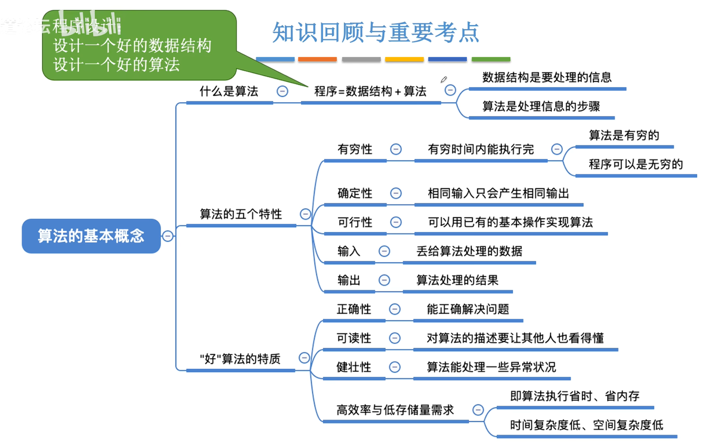
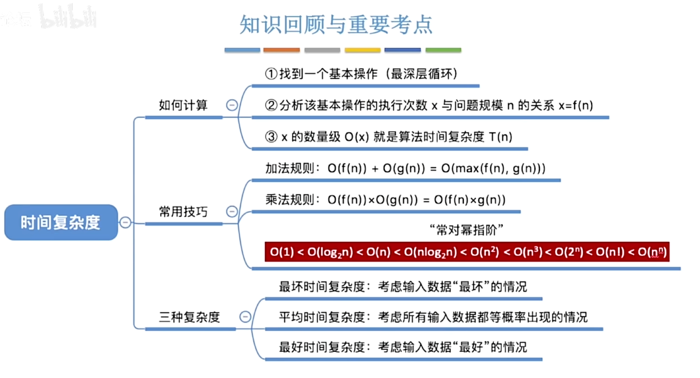
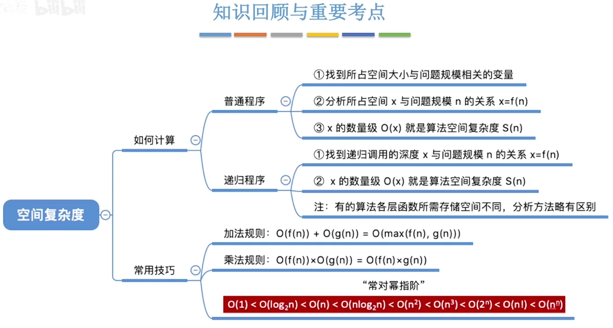

# 数据结构

## 1 

---

### 1.1 数据结构的基本概念

<div align="center">

</div>

### 1.2 算法的基本概念

#### 1.2.1 算法的基本概念

算法是对**特定问题求解步骤的一种描述**

**算法的特性**

- 有穷性:一个算法必须总在执行有穷步之后结束,且每一步都可在有穷时间完成
- 确定性:算法中每条指令必须有确切的含义,对于**相同的输入**只能得出**相同的输出**.
- 可行性:算法中描述的操作都可以通过已经实现的**基本运算执行有限次**来实现

**好算法**

- 正确性
- 可读性
- 健壮性
- 高效率与低存储量需求

<div align="center">

</div>

#### 1.2.2 算法的时间复杂度

**算法时间复杂度**:事前预估算法时间开销$T(n)$与问题规模$n$的关系(T表示"time")

##### 时间复杂度示例：逐步递增型爱你
```c
//算法1— 逐步递增型爱你
void loveYou(int n) {    // n 为问题规模
①   int i=1;            // 爱你的程度
②   while(i<=n){
③       i++;            // 每次+1
④       printf("I Love You %d\n", i);
    }
⑤   printf("I Love You More Than %d\n", n);
}

int main(){
    loveYou(3000);
}
```

##### 语句频度（n=3000）
|语句|执行次数|
|----|--------|
|① `int i=1;`|1次|
|② `while(i<=n)`|3001次|
|③ `i++;`、④ `printf(...)`|3000次|
|⑤ `printf(...)`|1次|

##### 时间开销计算

$$ T(3000) = 1 + 3001 + 2*3000 + 1 $$
$$ T(n) = 3n +3 $$

**只考虑阶数高部分**

$$T(n)= 3n +3 =O(n)$$

- **加法规则**:$T(n)=T_1(n)+T_2(n)=O(f(n))+O(g(n))=O(max(f(n),g(n)))$
- **乘法规则**:$T(n)=T_1(n)×T_2(n)=O(f(n))×O(g(n))=O(f(n)×g(n))$

##### 时间复杂度示例：嵌套循环型爱你

```c
//算法2— 嵌套循环型爱你
void loveYou(int n) {    // n 为问题规模
    int i=1;            // 爱你的程度
    while(i<=n){        // 外层循环执行 n 次
        i++;
        printf("I Love You %d\n", i);
        // 嵌套两层循环
        for (int j=1; j<=n; j++){
            printf("I am Iron Man\n");  // 内层循环共执行 n² 次
        }
    }
    printf("I Love You More Than %d\n", n);
}
```

##### 循环执行分析
1. **外层 while 循环**：一共执行 $n$ 次
2. **内层 for 循环**：**外层每跑1次，内层完整跑n次**
    > 内层总执行次数：$n \times n = \boldsymbol{n^2}$
3. 外层循环内部语句（`i++`、第一个`printf`）开销：$O(n)$

##### 时间开销

$$T(n) = O(n)+O(n^2)= \boldsymbol{O(n^2)}$$

<div align="center">

</div>

#### 1.2.3 算法的空间复杂度

**空间复杂度示例**

```c
void loveYou(int n) {  //n是问题规模
    int i=1;
    while(i<=n){
        i++;
        printf("I Love You %d\n", i);
    }
    printf("I Love You More Than %d\n", n);
}
```

- **程序代码区**：存放编译后的机器指令，大小固定 100B。
> 代码本身占的内存**不算进空间复杂度**

- **数据区**：函数运行时开辟形参 `int n`：4 字节,局部变量 `int i`：4 字节,合计：8 字节。
> 总内存占用：100B+8B =108B。

$S(n)$：**Space 空间**，看算法额外申请多少内存。这里只固定 8 字节，$S(n)=O(1)$。

```c
void test(int n) {
    int flag[n]; //长度为n的数组
    int i;
}
```

- **内存占用**:函数运行时开辟形参 `int n`：4 字节,数组 `flag[n]`：4n字节,局部变量 `int i`：4 字节,合计：4n+8字节。

$S(n)=O(n)$

<div align="center">

</div>

## 2 线性表

---

### 2.1 线性表的定义和基本操作

线性表是具有相同数据类型的n个数据元素的有限序列,其中n为表长,当n=0时线性表是一个空表,若用L明明线性表,则其一般表示为
$$L=(a_1,a_2,\dots,a_i,a_{i+1},\dots,a_n)$$

#### 线性表的基本操作
- **InitList(&L)**：初始化表。构造一个空的线性表L，分配内存空间。
- **DestroyList(&L)**：销毁操作。销毁线性表，并释放线性表L所占用的内存空间。
<br></br>
- **ListInsert(&L,i,e)**：插入操作。在表L中的第i个位置上插入指定元素e。
- **ListDelete(&L,i,&e)**：删除操作。删除表L中第i个位置的元素，并用e返回删除元素的值。
<br></br>
- **LocateElem(L,e)**：按值查找操作。在表L中查找具有给定关键字值的元素。
- **GetElem(L,i)**：按位查找操作。获取表L中第i个位置的元素的值。
 
#### 其他常用操作
- **Length(L)**：求表长。返回线性表L的长度，即L中数据元素的个数。
- **PrintList(L)**：输出操作。按前后顺序输出线性表L的所有元素值。
- **Empty(L)**：判空操作。若L为空表，则返回true，否则返回false。

**&**:对参数的修改结果需要带回来

### 2.2

#### 2.2.1 顺序表的定义

##### 静态分配


##### 动态分配

