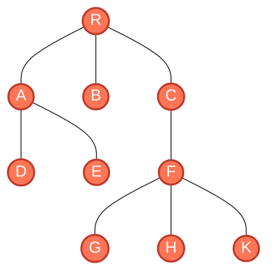
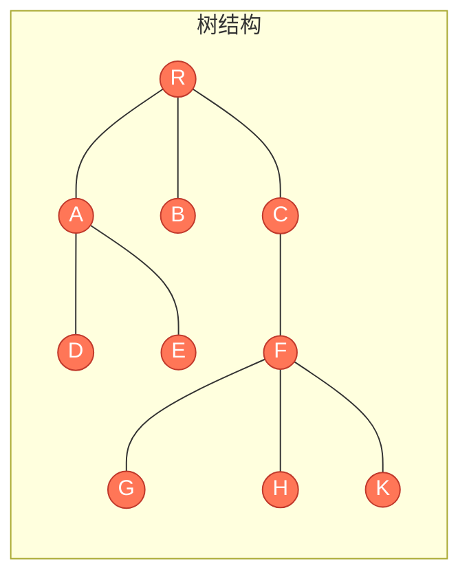
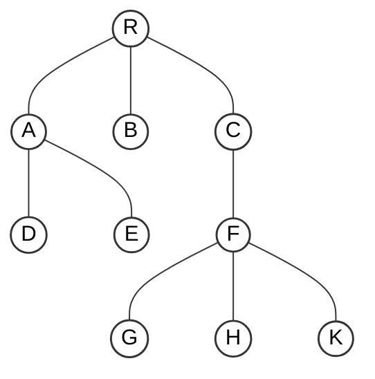
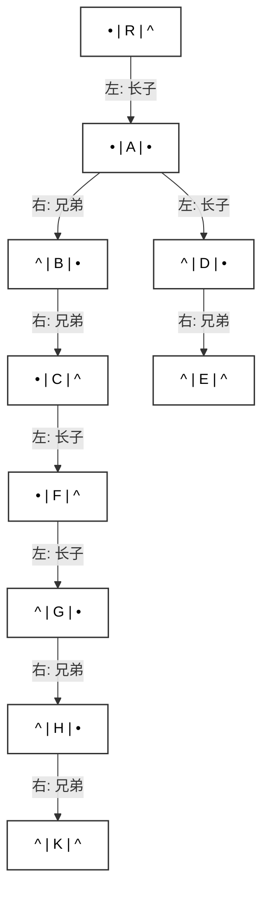
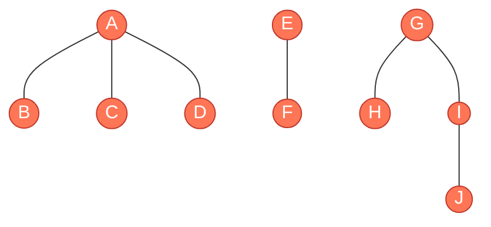
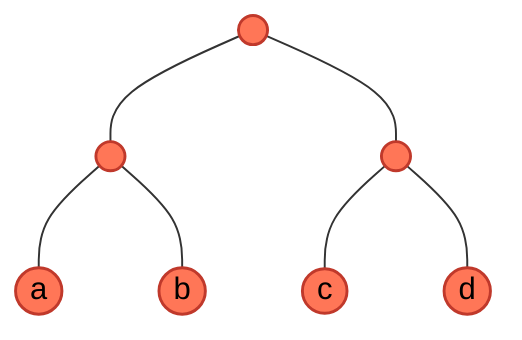
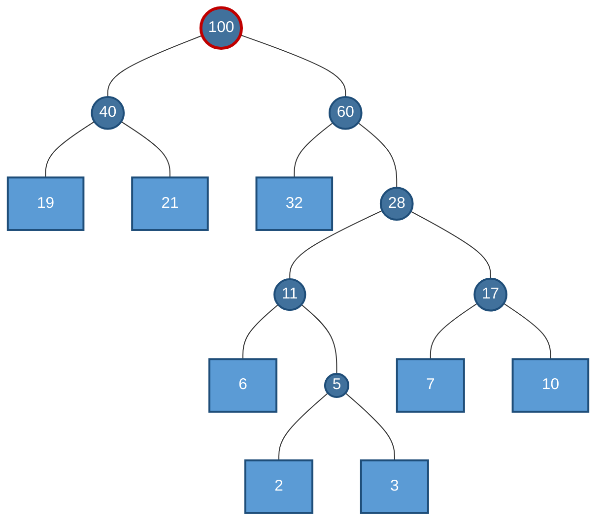
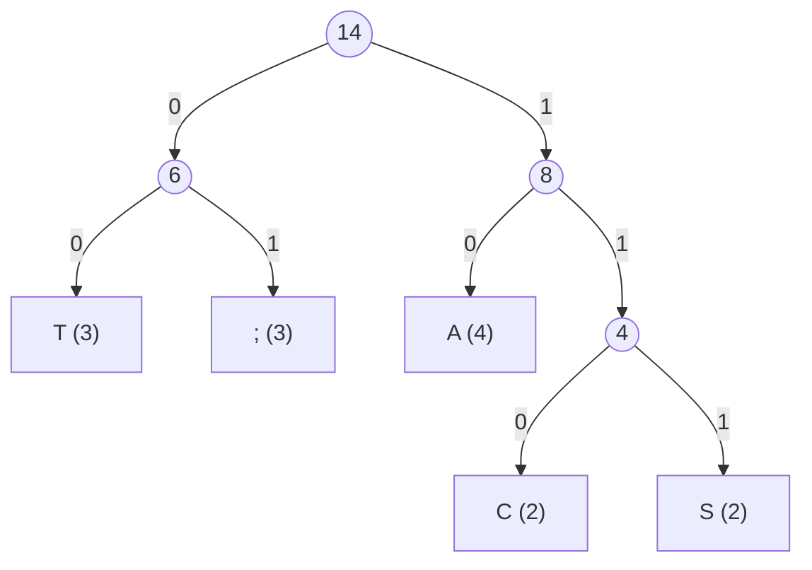

## 4 树和二叉树

### 4.1 树和二叉树的定义

树型结构（非线性结构）：1：n关系，结点之间有分支、具有层次关系


#### 4.1.1 树的定义

树(Tree)是 n (n≥0) 个结点的有限集。

 若 n = 0，称为空树；

 若 n > 0：

- (1) 有且仅有一个特定的称为根(Root)的结点； 

- (2) 其余结点可分为 m (m≥0) 个互不相交的有限集 T1,T2,T3,…,Tm，每一个集合本身又是一棵树，称为根的子树(SubTree)。

树是有n个结点的有限集。显然，树的定义是一个递归的定义


#### 4.1.2 树的基本术语

根节点：非空树中无前驱结点的结点

结点的度：结点拥有的子树数

树的度：树内各结点的度的最大值

结点的度 = 0称为叶子节点，也称为终端结点

孩子、双亲、兄弟、堂兄弟、祖先、子孙结点


有序树：树中结点的各子树从左到右有次序

无序树：树中结点的各子树无次序

森林：是m棵互不相交的树的集合


#### 4.1.3 二叉树的定义

二叉树：每个结点最多只有两个分支。因为第一二叉树结构最简单，规律性最强，且所有树都能转为唯一对应的二叉树。

普通树如不转化为二叉树，则运算很难实现


二叉树是 n (n≥0) 个结点的有限集，它或者是空集（n = 0），或者由一个根结点及两棵互不相交的分别称作这个根的左子树和右子树的二叉树组成。
特点：
1、每个结点最多有俩孩子（二叉树中不存在度大于 2 的结点）。
2、子树有左右之分，其次序不能颠倒。
3、二叉树可以是空集合，根可以有空的左子树或空的右子树。


### 4.2 案例引入

略


### 4.3 树和二叉树的抽象数据类型定义

**二叉树的抽象数据类型定义**

ADT BinaryTree{

数据对象D：D是具有相同特性的数据元素的集合。

数据关系R：

- 若D=Φ，则R=Φ； 

- 若D≠Φ，则R={H}；H是如下二元关系：

  - ① root 唯一 
  - ② Dj∩Dk = Φ 
  - ③ …… 
  - ④ …… 

  

基本操作 P： 

}ADT BinaryTree


CreateBiTree(&T,definition)
初始条件：definition给出二叉树T的定义。
操作结果：按definition构造二叉树T。

PreOrderTraverse(T)
初始条件：二叉树T存在。
操作结果：先序遍历T，对每个结点访问一次。

InOrderTraverse(T)
初始条件：二叉树T存在。
操作结果：中序遍历T，对每个结点访问一次。

PostOrderTraverse(T)
初始条件：二叉树T存在。
操作结果：后序遍历T，对每个结点访问一次。


### 4.4 二叉树的性质和存储结构

性质1:在二叉树的第 i 层上至多有 \(2^{i-1}\) 个结点(i≥1)

性质2:深度为k的二叉树至多有 \(2^{k}-1\) 个结点(k≥1)

性质3:对任何一棵二叉树 T,如果其叶子数为 \(n_0\),度为2的结点数为 \(n_2\),则 \(n_0 = n_2 + 1\)（从下往上和从上往下）


**满二叉树**：一棵深度为 k 且有 \(2^k - 1\) 个结点的二叉树称为满二叉树

- 特点一：每一层结点数都是最大结点数
- 特点二：叶子结点全部在最底层

满二叉树在同样深度的二叉树中结点个数最多

满二叉树在同样深度的二叉树中叶子结点个数最多


**完全二叉树**：深度为k的具有n个结点的二叉树,当且仅当其每一个结点都与深度为k的满二叉树中编号为1~n的结点一一对应时,称之为完全二叉树。

- 特点一：叶子只可能分布在层次最大的两层上
- 特点二：对任一结点，如果其右子树的最大层次为i，则其左子树的最大层次必为 i 或 i + 1


性质四：具有n个结点的完全二叉树的深度为 \(log_2n+1\)（n为元素，用元素求有几层）

性质五：完全二叉树**从上到下、从左往右挨个编号（从 1 开始）**，可以直接靠公式算出父节点、左右孩子的编号，不用遍历树。假设对任意结点 i

- 父结点位置：`i//2`（向下取整）
- 左孩子结点位置：`2*i`
- 右孩子结点位置：`2*i+1`


二叉树的顺序存储结构

实现：按照满二叉树的结点层次编号，依次存放二叉树中的数据元素

```C++
// 二叉树顺序存储表示
#define MAXTSIZE 100
typedef TElemType SqBiTree[MAXTSIZE];
SqBiTree bt;
```


二叉树若存储单支树需要更多的存储空间，适于满二叉树和完全二叉树


**二叉树的链式存储结构**：lchild|data|rchild

```C++
typedef struct BiNode
{
    TElemType data;
    struct BiNode *lchild, *rchild; // 左右孩子指针
}BiNode, *BiTree;
```

在含有 \(n\) 个结点的二叉链表中，有 **\(n + 1\)** 个空指针域。


**三叉链表**

```C++
typedef struct TriTNode
{
    TelemType data;
    struct TriTNode *lchild, *parent, *rchild;
}TriTNode, *TriTree;
```


### 4.5 遍历二叉树和线索二叉树

遍历定义——顺着某一条搜索路径巡访二叉树中的结点，使得每个结点均被访问一次，而且仅被访问一次（又称周游）。 

“访问”的含义很广，可以是对结点作各种处理，如：输出结点的信息、修改结点的数据值等，但要求这种访问不破坏原来的数据结构。

 遍历目的——得到树中所有结点的一个线性排列。

 遍历用途——它是树结构插入、删除、修改、查找和排序运算的前提，是二叉树一切运算的基础和核心。


**遍历方法**

依次遍历二叉树中的三个组成部分，便是遍历了整个二叉树。 

假设：L：遍历左子树　D：访问根结点　R：遍历右子树

则遍历整个二叉树方案共有： DLR、LDR、LRD、DRL、RDL、RLD 六种。


| 先序遍历二叉树                                               | 中序遍历二叉树                                               | 后序遍历二叉树                                               |
| ------------------------------------------------------------ | ------------------------------------------------------------ | ------------------------------------------------------------ |
| 若二叉树为空，则空操作；<br>否则<br>(1) 访问**根**结点；<br>(2) **先序**遍历左子树；<br>(3) **先序**遍历右子树。 | 若二叉树为空，则空操作；<br>否则<br>(1) **中序**遍历左子树；<br>(2) 访问**根**结点；<br>(3) **中序**遍历右子树。 | 若二叉树为空，则空操作；<br>否则<br>(1) **后序**遍历左子树；<br>(2) **后序**遍历右子树；<br>(3) 访问**根**结点。 |


- 若二叉树中各结点的值均不相同，则二叉树结点的先序序列、中序序列和后序序列都是唯一的

- 由二叉树的先序序列和中序序列，或由二叉树的后序序列和中序序列可以确定唯一一棵二叉树


遍历算法实现——先序遍历

若二叉树为空，则空操作

若二叉树非空

- 访问根结点（D）
- 前序遍历左子树（L）
- 前序遍历右子树（R）


```C++
Status PreOrderTraverse(BiTree T)
{
    if(T==NULL)
        return OK; // 空二叉树
    else
    {
        visit(T); // 访问根结点
        PreOrderTraverse(T->lchild); // 递归遍历左子树
        PreOrderTraverse(T->rchild); // 递归遍历右子树
    }
}
```


遍历算法实现——中序遍历

若二叉树为空，则空操作

若二叉树非空

- 中序遍历左子树（L）

- 访问根结点（D）
- 中序遍历右子树（R）


```C++
Status InOrderTraverse(BiTree T)
{
    if(T==NULL)
        return OK; // 空二叉树
    else
    {
        InOrderTraverse(T->lchild); // 递归遍历左子树
        visit(T); // 访问根结点
        InOrderTraverse(T->rchild); // 递归遍历右子树
    }
}
```


遍历算法实现——后序遍历

若二叉树为空，则空操作

若二叉树非空

- 后序遍历左子树（L）
- 后序遍历右子树（R）

- 访问根结点（D）


```C++
Status InOrderTraverse(BiTree T)
{
    if(T==NULL)
        return OK; // 空二叉树
    else
    {
        InOrderTraverse(T->lchild); // 递归遍历左子树
        InOrderTraverse(T->rchild); // 递归遍历右子树
        visit(T); // 访问根结点
    }
}
```


中序遍历的非递归算法（栈）

```C++
Status InOrderTraverse(BiTree T)
{
    BiTree p=T;
    InitStack(S);
    while(p || !StackEmpty(S))
    {
        if(p){Push(S,p); p=p->lchild;}
        else{Pop(S,q); printf("%c", q->data); p=q->rchild;}
    }
	return OK;	
}
```


**二叉树的层次遍历**

对于一棵二叉树，从根结点开始，按从上到下、从左到右的顺序访问每一个结点。每一个结点仅可访问一次


算法设计思路： 使用一个队列 

- I. 将根结点进队； 

- II. 队不空时循环： 从队列中出列一个结点*p，访问它；
  - ① 若它有左孩子结点，将左孩子结点进队； 
  - ② 若它有右孩子结点，将右孩子结点进队。

```C++
typedef struct // 队列定义如下
{
    BTNode data[MaxSize]; // 存放队中元素
    int front, rear;	  // 队头和队尾指针
}SqQueue;				  // 顺序循环队列类型

// 二叉树层次遍历算法
void LevelOrder(BTNode *b)
{
    BTNode *p; SqQueue *qu;
    InitQueue(qu);  // 初始化队列
    enQueue(qu, b); // 根节点指针进入队列
    while(!QueueEmpty(qu)) // 队不为空，则循环
    {
        deQueue(qu, p); // 出队结点p
        printf("%c", p->data); // 访问结点p
        if(p->lchild!=NULL) enQueue(qu, p->lchild); // 有左孩子时将其进队
        if(p->rchild!=NULL) enQueue(qu, p->rchild); // 有右孩子时将其进队
    }
}
```


**二叉树遍历算法的应用——二叉树的建立**

按先序遍历序列建立二叉树的二叉链表

- 从键盘输入二叉树的结点信息，建立二叉树的存储结构
- 在建立二叉树的过程中按照二叉树先序方式建立


ABC##DE#G##F###：以#作为空字符，按这个顺序读入字符

```C++
Status CreateBiTree(BiTree &T)
{
    scanf(&ch); // cin >> ch;
    if(ch=="#")
        T = NULL;
    else
    {
        T = new BiTNode;
        T->data = ch; // 生成根结点
        CreateBiTree(T->lchild); // 构造左子树
        CreateBiTree(T->rchild); // 构造右子树
    }
    return OK;
}
```


**复制二叉树**

- 如果是空树，递归结束
- 否则，申请新结点空间，复制根结点
  - 递归复制左子树
  - 递归复制右子树

```C++
int Copy(BiTree T, BiTree &NewT)
{
    if (T==NULL){ // 如果是空树返回0
        NewT = NULL;
        return 0;}
    else{
    	NewT = new BiNode;              // 1. 申请一个全新独立的节点
    	NewT->data = T->data;           // 2. 复制当前根节点的数据
    	Copy(T->lchild, NewT->lchild);  // 3. 递归克隆整棵左子树
    	Copy(T->rchild, NewT->rchild);  // 4. 递归克隆整棵右子树
        return 1;
    }
}
```


**计算二叉树深度**

- 如果是空树，则深度为0
- 否则，递归计算左子树深度m，递归计算右子树深度n，二叉树的深度为其较大者值+1

计算是在递归调用到达最底层的 `NULL`（树的边界）之后，伴随着函数出栈“自底向上”开始累加

```C++
int Depth(BiTree T)
{
    if(T==NULL)
        return 0;
    else{
        m = Depth(T->lchild);
        n = Depth(T->rchild);
        if(m>n) return (m+1);
        else return (n+1);
    }
}
```


**计算二叉树结点总数**

- 如果是空树，则结点个数为0
- 否则，结点个数为左子树的结点个数+右子树的结点个数再+1

```C++
int NodeCount(BiTree T)
{
    if(T==NULL)
        return 0;
    else
        return NodeCount(T->lchild) + NodeCount(T->rchild) + 1;
}
```


**计算二叉树叶子结点数**

- 如果是空树，则结点个数为0
- 否则，结点个数为左子树的结点个数+右子树的叶子结点个数

```C++
int LeadCount(BiTree T)
{
    if (T=NULL)
        return 0; // 如果是空树返回0
    if(T->lchild == NULL && T->rchild == NULL)
        return 1; // 如果是叶子结点返回1
    else
        return LeafCount(T->lchild) + L eafCount(T->rchild);
}
```


#### 线索二叉树

当用二叉链表作为二叉树的存储结构时，可以很方便地找到某个结点的左右孩子。但一般情况下，无法直接找到该结点在某种遍历序列中的前驱和后继结点

如何寻找特定遍历序列二叉树结点的前驱和后继？

解决方法

- 通过遍历寻找——费时间
- 再增设前驱、后继指针域——增加存储负担
- **利用二叉链表中的空指针域**


具有n个结点的二叉链表中，一共有**2n**个指针域，因为n个结点中有**n-1**个孩子，即2n个指针域中有n-1个用来指示结点的左右孩子，其余**n+1个指针域为空**


利用二叉链表中的空指针域：

如果某个结点的左孩子为空，则将空的左孩子指针域改为**指向其前驱**

如果某个结点的右孩子为空，则将空的右孩子指针域改为**指向其后继**

——这种**改变指向的指针**称为线索

加上了线索的二叉树称为**线索二叉树（Threaded Binary Tree）**


为区分lrchid和rchild指针到底是指向孩子的指针，还是指向前驱或者后继的指针，对二叉链表中每个结点增设两个标志域ltag和rtage，并约定

- ltag = 0　　lchild 指向该结点的左孩子
- ltag = 1　　lchild 指向该结点的前驱
- rtag = 0　　rchild 指向该结点的右孩子
- rtag = 1　　rchild 指向该结点的后继


这样结点结构为

| lchild | ltag | data | rtag | rchild |
| ------ | ---- | ---- | ---- | ------ |

```C++
typedef struct BiThrNode{
    int data;
    int ltag, rtag;
    struct BiThrNode *lchild, rchild;
}BiThrNode, *BiThrTree;
```


为避免两个叶子结点的两只指针悬空，添加一个头结点

ltag = 0，lchild指向根结点

 rtag = 1，rchild指向遍历序列中最后一个结点

遍历序列中第一个结点的lc域和最后一个结点的rc域都指向头结点


### 5.6 树和森林

树 (Tree) 是 \(n\ (n\ge0)\) 个结点的有限集。若 \(n = 0\)，称为空树；
若 \(n > 0\)
(1) 有且仅有一个特定的称为根 (Root) 的结点；
(2) 其余结点可分为 \(m\ (m\ge0)\) 个互不相交的有限集 \(T_1,T_2,T_3,\dots,T_m\)，


森林：是 \(m\ (m\ge0)\) 棵互不相交的树的集合。


#### 5.6.1 树的存储结构

**1.双亲表示法**

实现：定义结构数组，存放树的结点，每个结点含两个域

- 数据域：存放结点本身信息
- 双亲域：指示本结点的双亲结点在数组中的位置





| 数组下标 (Index) | 结点数据 (Data) | 双亲位置 (Parent) |
| :--------------: | :-------------: | :---------------: |
|      **0**       |        R        |        -1         |
|      **1**       |        A        |         0         |
|      **2**       |        B        |         0         |
|      **3**       |        C        |         0         |
|      **4**       |        D        |         1         |
|      **5**       |        E        |         1         |
|      **6**       |        F        |         3         |
|      **7**       |        G        |         6         |
|      **8**       |        H        |         6         |
|      **9**       |        K        |         6         |

r表示根结点下标，n表示结点中元素的个数

>  特点：找双亲容易，找孩子难


```C++
// 单个结点
typedef struct PTNode{
    TElemType data;
    int parent; // 双亲位置域
}PTNode;
// 树结构
#define MAX_TREE_SIZE 100
typedef struct{
    PTNode nodes[MAX_TREE_SIZE];
    int r, n; // 根结点的位置和结点个数
}PTree;
```


**孩子列表****

把每个结点的孩子结点排列起来，看成是一个线性表，用单链表存储，则 \(n\) 个结点有 \(n\) 个孩子链表（叶子的孩子链表为空表）。而 \(n\) 个头指针又组成一个线性表，用顺序表（含 \(n\) 个元素的结构数组）存储。

孩子结点结构：`child | next`

```C++
typedef struct CTNode{
    int child;
    struct CTNode *next;
}*ChildPtr;
```


双亲结点结构：`data | firstchild`

```C++
typedef struct{
    TElemType data;
    ChildPtr firstchild; // 孩子链表头指针
}CTBox;
```


树结构

```C++
typedef struct{
    CTBox nodes[MAX_TREE_SIZE];
    int n, r; // 结点数和根结点位置
}CTree;
```





| **数组下标 (Index)** | **双亲位置 (parent)** | **结点数据 (data)** | **孩子链表 (firstchild →\rightarrow→ [child \| next])** | **对应孩子结点说明**            |
| -------------------- | --------------------- | ------------------- | ------------------------------------------------------- | ------------------------------- |
| **0**                | 4                     | **A**               | `→ [ 3 ] → [ 5 ^ ]`                                     | 孩子为 D(3), E(5)               |
| **1**                | 4                     | **B**               | `^` (NULL)                                              | 无孩子（叶子结点）              |
| **2**                | 4                     | **C**               | `→ [ 6 ^ ]`                                             | 孩子为 F(6)                     |
| **3**                | 0                     | **D**               | `^` (NULL)                                              | 无孩子（叶子结点）              |
| **4**                | -1                    | **R**               | `→ [ 0 ] → [ 1 ] → [ 2 ^ ]`                             | 根结点，孩子为 A(0), B(1), C(2) |
| **5**                | 0                     | **E**               | `^` (NULL)                                              | 无孩子（叶子结点）              |
| **6**                | 2                     | **F**               | `→ [ 7 ] → [ 8 ] → [ 9 ^ ]`                             | 孩子为 G(7), H(8), K(9)         |
| **7**                | 6                     | **G**               | `^` (NULL)                                              | 无孩子（叶子结点）              |
| **8**                | 6                     | **H**               | `^` (NULL)                                              | 无孩子（叶子结点）              |
| **9**                | 6                     | **K**               | `^` (NULL)                                              | 无孩子（叶子结点）              |

### 

**孩子兄弟表示法（二叉树表示法、二叉链表表示法）**

实现：用二叉链表作树的存储结构，链表中每个结点的两个指针域分别指向第一个孩子结点和下一个兄弟结点

```C++
typedef struct CSNode{
    ElemType data;
    struct CSNode *firstchild, *nextsibling;
}CSNode, *CSTree;
```







##### 树和二叉树的转换

- 将树转化为二叉树进行处理，利用二叉树的算法来实现对树的操作。
- 由于树和二叉树都可以用二叉链表作存储结构，则以二叉链表作媒介可以导出树与二叉树之间的一个对应关系。


**将树转换成二叉树：**

①加线：在兄弟之间加一连线

②抹线：在每个结点，除了其左孩子外，去除其与其余孩子之间的关系

③旋转：以树的根结点为轴心，将整树顺时针旋转45°


树变二叉树：兄弟相连留长子


**将二叉树转换为树：**

① 加线：若 \(p\) 结点是双亲结点的左孩子，则将 \(p\) 的右孩子，右孩子的右孩子……沿分支找到的所有右孩子，都与 \(p\) 的双亲用线连起来
② 抹线：抹掉原二叉树中双亲与右孩子之间的连线
③ 调整：将结点按层次排列，形成树结构


二叉树变树：左孩右右连双亲，去掉原来右孩线


#### 4.6.2 森林与二叉树的转化

- 森林转换成二叉树（二叉树与多棵树之间的关系）

①将各棵树分别转换成二叉树

②将每棵树的根结点用线相连

③以第一棵树根结点为二叉树的根，再以根结点为轴心，顺时针旋转，构成二叉树型结构


森林变二叉树：树变二叉根相连


- 二叉树转换成森林

①抹线：将二叉树中根结点与其右孩子连线，及沿右分支搜索到的所有右孩子间连线全部抹掉，使之变成孤立的二叉树

②还原：将孤立的二叉树还原成树


二叉树变森林：去掉全部右孩线，孤立二叉再还原


#### 4.6.3 树和森林的遍历

1.树的遍历

- 先根遍历

  若树不空，则先访问根结点，然后依次先根遍历各棵子树

- 后根遍历

  若树不空，则先依次后根遍历各棵子树，然后访问根结点

- 按层次遍历

  若树不空，则自上而下自左而右访问树中每个结点


2.森林的遍历

将森林看作由三部分构成：

1、森林中第一棵树的根结点

2、森林中第一棵树的子树森林

3、森林中其他树构成的森林


- 先序遍历：

  若森林不为空，则

  - 1、访问森林中第一棵树根结点
  - 2、**先序遍历**森林中第一棵树的子树森林
  - 3、**先序遍历**森林中其余树构成的森林

> 即：依次从左到右对森林中的每一棵树进行先根遍历


- 中序遍历：

  若森林不为空，则

  - 1、**中序遍历**森林中第一棵的子树森林
  - 2、访问森林中第一棵树的根结点
  - 3、**中序遍历**森林中其余树构成的森林


代码段



遍历结果：   

- **先序遍历**：A B C D E F G H I J   
- **中序遍历**：B C D A F E H J I G   


### 5.7 哈夫曼树及其应用

#### 5.7.1 哈夫曼树的基本概念


分数编码计算速度可以解释哈夫曼树


**路径**：从树中一个结点到另一个结点之间的分支构成这两个结点间路径

**结点的路径长度**：两结点间路径上的分支数


**树的路径长度：**从树根到每一个结点的路径长度之和，记作：TL

结点数目相同的二叉树中，完全二叉树是路径长度最短的二叉树


**权(weight)**：将树中结点赋给一个有着某种含义的数值，则这个数值称为该**结点的权**

**结点的带权路径长度**：从根结点到该结点之间的路径长度与该结点的**权的乘积**

**树的带权路径长度**：树中所有叶子结点的带权路径长度之和


例：有4 个结点 $a, b, c, d$，权值分别为 7, 5, 2, 4，   

构造以此 4 个结点为叶子结点的二叉树：   

代码段



7 **a**   5 **b**   **c** 2   **d** 4   

带权路径长度是：   

WPL= 7×2 + 5×2 + 2×2 + 4×2 = 36


哈夫曼树：带权路径长度（WPL）最短的树——**最优二叉树**

**满二叉树不一定是哈夫曼树**

哈夫曼树中权越大的叶子离根越近


贪心算法：构造哈夫曼树时首先选择权值小的叶子结点

哈夫曼算法

哈夫曼算法（构造哈夫曼树的方法）
(1) 根据 \(n\) 个给定的权值 \(\{w_1, w_2, \dots, w_n\}\) 构成 \(n\) 棵二叉树的森林 \(F=\{T_1, T_2, \dots, T_n\}\)，其中 \(T_i\) 只有一个带权为 \(w_i\) 的根结点。
- 构造森林全是根

(2) 在 \(F\) 中选取两棵根结点的权值最小的树作为左右子树，构造一棵新的二叉树，且设置新的二叉树的根结点的权值为其左右子树上根结点的权值之和。
- 选用两小造新树

(3) 在 \(F\) 中删除这两棵树，同时将新得到的二叉树加入森林中。
- 删除两小添新人


哈夫曼算法口诀：
1、构造森林全是根；
2、选用两小造新树；
3、删除两小添新人；
4、重复 2、3 剩单根。


哈夫曼树的结点的度数为0或2（就是要么是两个子结点的父结点或叶子节点）,没有度为1的结点。

包含几个叶子结点的哈夫曼树中共有2n-1个结点。


**哈夫曼树构造算法的实现**

采用顺序存储结构——一维结构数组`HuffmanTree H;`

结点类型定义

```C++
typedef struct{
    int weight;
    int parent, lch, rch;
}HTNode, *HuffmanTree;
```

哈夫曼树中共有2n-1个结点，不使用0下标，数组大小为2n


举例，有n=8，权重W={7, 19, 2, 6, 32, 3, 21, 10}，构造哈夫曼树

对于n=8的叶子节点，哈夫曼树总共有2n - 1 = 15个节点

| **下标 (Index)** | **权值 (weight)** | **双亲 (parent)** | **左孩子 (lch)** | **右孩子 (rch)** | **说明**                      |
| ---------------- | ----------------- | ----------------- | ---------------- | ---------------- | ----------------------------- |
| **1**            | 7                 | 11                | 0                | 0                | 初始叶子节点                  |
| **2**            | 19                | 13                | 0                | 0                | 初始叶子节点                  |
| **3**            | 2                 | 9                 | 0                | 0                | 初始叶子节点                  |
| **4**            | 6                 | 10                | 0                | 0                | 初始叶子节点                  |
| **5**            | 32                | 14                | 0                | 0                | 初始叶子节点                  |
| **6**            | 3                 | 9                 | 0                | 0                | 初始叶子节点                  |
| **7**            | 21                | 13                | 0                | 0                | 初始叶子节点                  |
| **8**            | 10                | 11                | 0                | 0                | 初始叶子节点                  |
| **9**            | 5                 | 10                | 3                | 6                | 合并 3(2) 和 6(3)             |
| **10**           | 11                | 12                | 4                | 9                | 合并 4(6) 和 9(5)             |
| **11**           | 17                | 12                | 1                | 8                | 合并 1(7) 和 8(10)            |
| **12**           | 28                | 14                | 10               | 11               | 合并 10(11) 和 11(17)         |
| **13**           | 40                | 15                | 2                | 7                | 合并 2(19) 和 7(21)           |
| **14**           | 60                | 15                | 5                | 12               | 合并 5(32) 和 12(28)          |
| **15**           | 100               | 0                 | 13               | 14               | 根节点：合并 13(40) 和 14(60) |

### 哈夫曼树结构图（Mermaid）

矩形代表初始叶子节点，圆形代表合并生成的分支节点与根节点：



【算法实现】

- 1.初始化`HT[1......2n-1]`：lch=rch=parent=0;
- 2.输入初始`n个叶子结点`：置HT[1......n]的**weight值**
- 3.进行以下n-1次合并，依次产生n-1个结点HT[i]，i=n+1......2n-1：
  - 在HT[1...i-1]中选两个未被选过（从parent==0的结点中选）的weight最小的两个结点HT[s1]和HT[s2]，s1、s2为两个最小结点下标
  - 修改HT[s1]、HT[s2]的parent值：HT[s1].parent=i，HT[s2].parent=i；
  - 修改新产生的HT[i]
    - HT[i].weight = HT[s1].weight + HT[s2].weight;
    - HT[i].lch = s1; HT[i].rch = s2;

```C++
void CraeteHuffmanTree(HuffmanTree HT, int n){
    if(n<=1) return;
    m = 2*n - 1; // 数组共2n-1个元素
    HT = new HTNode[m+1]; // 0号单元未用，HT[m]表示根结点
    for(i = 1; i <= m; ++i) // 将2n-1个元素的lch、rch、parent置为0
    {
        HT[i].lch = 0; HT[i].rch = 0; HT[i].parent = 0;
    }
    for(i = 1; i <= n; ++i) cin >> HT[i].weight; // 输入前n个元素的weight值
    
    for(i = n+1; i<=m; i++){ // 合并产生n-1个结点——构造Huffman树
        Select(HT, i-1, s1, s2) // 在HT[k]（1<=k<=i-1）中选择两个其双亲域为0，且权值最小的结点，并返回他们在HT中的序号s1和s2
        HT[s1].parent = i; HT[s2].parent = i;
        HT[i].lch = s1; HT[i].rch = s2;
        HT[i].weight=HT[s1].weight + HT[s2].weight; // i的权值为左右孩子权值之和
    }
}
```


要设计长度不等的编码，则必须使任一字符的编码都不是另一个字符的编码的前缀。

如A-0、B-00、C-1、D-01则错误，因为不能区分0000是什么

而A-0、B-10、C-110、D-111则能区分，这叫前缀编码

哈夫曼编码前缀码能使电文总长最短


哈夫曼编码构造方法：
1、统计字符集中每个字符在电文中出现的平均概率（概率越大，要求编码越短）。
2、利用哈夫曼树的特点：权越大的叶子离根越近；将每个字符的概率值作为权值，构造哈夫曼树。则概率越大的结点，路径越短。
3、在哈夫曼树的每个分支上标上0或1：
    结点的左分支标0，右分支标1
    把从根到每个叶子的路径上的标号连接起来，作为该叶子代表的字符的编码。


**哈夫曼编码与译码**

- **要传输的字符集**：$D = \{C, A, S, T, ;\}$   
- **字符出现频率**：$w = \{2, 4, 2, 3, 3\}$   

**1. 哈夫曼树结构与字符编码**

代码段



- **T** : `00`   
- **;** : `01`   
- **A** : `10`   
- **C** : `110`   
- **S** : `111`   

**2. 编码与译码示例**

- **电文**：`CAS;CAT;SAT;AT`   
  - **编码**：`11010111011101000011111000011000`   
- **反之，若编码是**：`1101000`   
  - **译文**：`CAT`   


两个问题：
1. 为什么哈夫曼编码能够保证是前缀编码？
因为没有一片树叶是另一片树叶的祖先，所以每个叶结点的编码就不可能是其它叶结点编码的前缀。

2. 为什么哈夫曼编码能够保证字符编码总长最短？
因为哈夫曼树的带权路径长度最短，故字符编码的总长最短。

- 性质1 哈夫曼编码是前缀码
- 性质2 哈夫曼编码是最优前缀码


**哈夫曼编码的算法实现**

```C++
void CreateHuffmanCode(HuffmanTree HT, HuffmanCode &HC, int n)
// 从叶子到根逆向求每个字符的哈夫曼编码，存储在编码表HC中
{
    HC = new char *[n+1]; // 分配n个字符编码的头指针矢量
    cd = new char [n];	  // 分配临时存放编码的动态数组空间
    cd[n-1] = '\0';		  // 编码结束字符
    for(i=1; i<=n; ++i)   // 逐个字符求哈夫曼编码
    {
        start=n-1;c=i;f=HT[i].parent;
        while(f!=0)	      // 从叶子节点开始向上回溯 直到根结点
        {
            --start;	  // 回溯一次start向前指一个位置
            if(HT[f].lchild==c) cd[start]='0'; // 结点c是f的左孩子则生成代码0
            else 				cd[start]='1'; // 结点c是f的右孩子则生成代码1
            c=f; f=HT[f].parent;			   // 继续向前回溯
        }
        // 求出第i个字符的编码
        HC[i]=new char [n-start];  // 为第i个字符串编码分配空间
        strcpy(HC[i], &cd[start]); // 将求得的编码从临时空间cd复制到HC的当前行中
    }
    delete cd; // 释放临时空间
}
```

