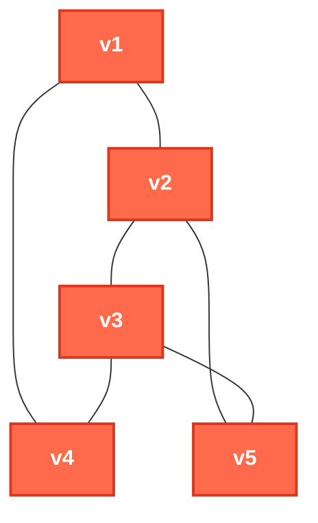
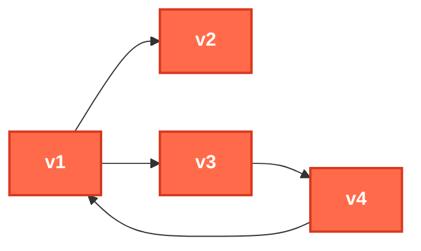
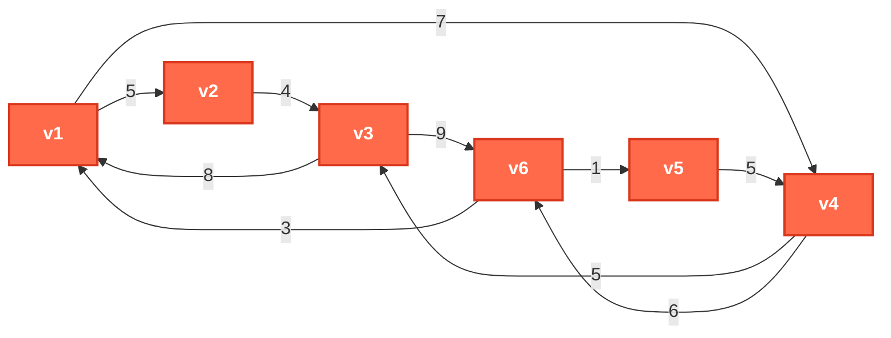

## 5. 图

### 5.1 图的定义和基本术语

图：\(G=(V,E)\)
\(V\)：顶点(数据元素)的有限非空集合；
\(E\)：边的有限集合。

无向图：每条边都是无方向的

有向图：每条边都是有方向的【有向图带箭头的边称为弧】

完全图：任意两个点都有一条边相连

- 无向完全图：n个顶点，\(\frac{n(n-1)}{2}\)条边
- 无向完全图：n个顶点，\(n(n-1)\)条边


稀疏图：有很少边或弧的图（\(e<nlogn\)）

稠密图：有较多边或弧的图

网：边/弧带权的图


邻接：有边/弧相连的两个顶点之间的关系。
存在\((v_i, v_j)\)，则称\(v_i\)和\(v_j\)互为邻接点；
存在\(\langle v_i, v_j \rangle\)，则称\(v_i\)邻接到\(v_j\)，\(v_j\)邻接于\(v_i\)

关联(依附)：边/弧与顶点之间的关系。
存在\((v_i, v_j)/\langle v_i, v_j \rangle\)，则称该边/弧关联于\(v_i\)和\(v_j\)

- `(vi, vj)` 表示一条**没有方向的边**，\(v_i\) 和 \(v_j\) **互为邻接点**。

- `<vi, vj>` 表示一条**有方向的边（称为弧）**，且默认规定尖括号内的第一个顶点 \(v_i\) 是起点（弧尾），第二个顶点 \(v_j\) 是终点（弧头）


顶点的度：与该顶点相关联的边的数目，记为**TD(v)**

在有向图中，顶点的度等于该顶点的入度和出度之和

**顶点v的入度**是以v为终点的有向边的条数，记作**ID(v)**

**顶点v的出度**是以v为始点的有向边的条数，记作**OD(v)**


当图中仅有一个顶点入度为0，其余顶点的入度为一，这是一棵有向树


**路径**：接续的边构成的顶点序列

**路径长度**：路径上边或弧的数目/权值之和

**回路（环）**：第一个顶点和最后一个顶点相同的路径

**简单路径**：除路径起点和终点可以相同外，其余顶点均不相同的路径

**简单回路（简单环）**：除路径起点和终点相同外，其余顶点均不相同的路径


**连通图（强连通图）**
在无（有）向图\(G=(V,\{E\})\)中，若对任何两个顶点\(v\)、\(u\)都存在从\(v\)到\(u\)的路径，则称\(G\)是连通图（强连通图）


**权和网**

图中边或弧所具有的相关数称为**权**。表明从一个顶点到另一个顶点的距离或耗费。
带权的图称为**网**。

**子图**

设有两个图\(G=(V,\{E\})\)、\(G_1=(V_1,\{E_1\})\)，若\(V_1\subseteq V\)，\(E_1\subseteq E\)，则称\(G_1\)是\(G\)的子图。


**连通分量（强连通分量）**

无向图\(G\)的极大连通子图称为\(G\)的连通分量。
极大连通子图意思是：该子图是 \(G\) 连通子图，将\(G\)的任何不在该子图中的顶点加入，子图不再连通。


### 5.2 案例引入

六度空间理论


### 5.3 图的类型定义

ADT Graph{
数据对象\(V\)：具有相同特性的数据元素的集合，称为顶点集。
数据关系\(R\)：\(R=\{\text{VR}\}\)
\(\text{VR}=\{<v,w> \mid v,w \in V \land p(v,w)\}\)，
\(<v,w>\)表示从\(v\)到\(w\)的弧，\(p(v,w)\)定义了弧\(<v,w>\)的信息

基本操作P：
Create_Graph()：图的创建操作。
初始条件：无。
操作结果：生成一个没有顶点的空图\(G\)。

GetVex(\(G, v\))：求图中的顶点\(v\)的值。
初始条件：图\(G\)存在，\(v\)是图中的一个顶点。
操作结果：返回顶点\(v\)的值。

CreateGraph(&\(G\),\(V\),\(\text{VR}\))
初始条件：\(V\)是图的顶点集，\(\text{VR}\)是图中弧的集合。
操作结果：按\(V\)和\(\text{VR}\)的定义**构造图\(G\)**。

DFSTraverse(\(G\))
初始条件：图\(G\)存在。
操作结果：对图进行**深度优先遍历**。

BFSTraverse(\(G\))
初始条件：图\(G\)存在。
操作结果：对图进行**广度优先遍历**。
} ADT Graph


### 5.4 图的存储结构

图的结构：多对多


图没有顺序存储结构，但可以借助二维数组来表示元素间的关系

- 邻接矩阵
- 邻接表
- 十字链表
- 邻接多重表


1.数组（邻接矩阵）表示法

建立一个**顶点表（记录各个顶点信息）**和一个**邻接矩阵（表示各个顶点之间关系）**

设**图A = (V, E)** 有n个顶点，则

顶点表\(\text{Vexs}[n]\)

| \(i\)              | 0       | 1       | 2       | …    | \(n-1\) |
| ------------------ | ------- | ------- | ------- | ---- | ------- |
| \(\text{Vexs}[i]\) | \(v_1\) | \(v_2\) | \(v_3\) | …    | \(v_n\) |

图的邻接矩阵是一个二维数组**A.arcs[n] [n]**
\[
A.\text{arcs}[i][j]=
\begin{cases}
1, & \text{如果 } <i,j> \in E \text{ 或者 } (i,j) \in E \\
0, & \text{否则}
\end{cases}
\]



**邻接矩阵**
\[
A.\text{arcs}[i][j]= \begin{bmatrix} 0 & 1 & 0 & 1 & 0 \\ 1 & 0 & 1 & 0 & 1 \\ 0 & 1 & 0 & 1 & 1 \\ 1 & 0 & 1 & 0 & 0 \\ 0 & 1 & 1 & 0 & 0 \end{bmatrix}
\]
分析1：无向图的邻接矩阵是对称的

分析2：顶点 i 的度 = 第 i 行（列）中 1 的个数


**有向图的邻接矩阵**



\[
A.\text{arcs}[i][j]= 
\begin{array}{c|cccc}
 & v_1 & v_2 & v_3 & v_4 \\
\hline
v_1 & 0 & 1 & 1 & 0 \\
v_2 & 0 & 0 & 0 & 0 \\
v_3 & 0 & 0 & 0 & 1 \\
v_4 & 1 & 0 & 0 & 0
\end{array}
\]


第 i 行含义：以结点 \(v_i\) 为尾的弧（即出度边）

第 i 列含义：以结点 \(v_i\) 为头的弧（即入度边）


分析1：有向图的邻接矩阵可能是**不对称**的

分析2：顶点的**出度=第i行元素之和**

​	      顶点的**入度=第i列元素之和**

​	      **顶点的度=第i行元素之和+第i列元素之和**


 网（即有权图）的邻接矩阵表示法

定义为：
\[
A.\text{arcs}[i][j]=
\begin{cases}
W_{ij}, & <v_i,v_j> \text{ 或 } (v_i,v_j) \in VR \\
\infty, & \text{无边（弧）}
\end{cases}
\]



\[
A.\text{arcs}[i][j]=
\begin{array}{c|cccccc}
 & v_1 & v_2 & v_3 & v_4 & v_5 & v_6 \\
\hline
v_1 & \infty & 5 & \infty & 7 & \infty & \infty \\
v_2 & \infty & \infty & 4 & \infty & \infty & \infty \\
v_3 & 8 & \infty & \infty & \infty & \infty & 9 \\
v_4 & \infty & \infty & 5 & \infty & \infty & 6 \\
v_5 & \infty & \infty & \infty & 5 & \infty & \infty \\
v_6 & 3 & \infty & \infty & \infty & 1 & \infty
\end{array}
\]


### 5.4  图的存储结构


#### 5.4.1 邻接矩阵

邻接矩阵的存储表示：用**两个数组**分别存储**顶点表**和**邻接矩阵**

```C++
#define MaxInt 32767 // 表示极大值，即∞
#define MVNum 100 // 最大顶点数
typedef char VerTexType; // 设顶点的数据类型为字符型
typedef int ArcType; // 假设边的权值类型为整型

typedef struct{
    VerTexType vexs[MVNum]; // 顶点表
    ArcType arcs[MVNum][MVNum]; // 邻接矩阵
    int vexnum, arcnum; // 图的当前点数和边数
}AMGraph; // Adjacency Matrix Graph
```


采用邻接矩阵表示法创建**无向网**

（1）输入**总顶点数和总边数**

（2）依次输入**点的信息存入顶点表**

（3）**初始化邻接矩阵**，使每个权值初始化为极大值

（4）构造**邻接矩阵**

```C++
Status CreateUDN(AMGraph &G){
// 采用邻接矩阵表示法，创建无向网G
	cin >> G.vexnum >> G.arcnum; // 输入总顶点数，总边数
    for (i = 0; i < G.vexnum; ++i) // 依次输入点的信息
        cin >> G.vexs[i];
    for (i = 0; i < G.vexnum; ++i) // 初始化邻接矩阵
        for(j = 0; j < G.vexnum; ++j)
            G.arcs[i][j] = MaxInt; // 边的权值均置为极大值
    for(k = 0; k < G.arcnum; ++k){
        cin >> v1 >> v2 >> w; // 输入一条边所依附的顶点及边的权值
        i = LocateVex(G, v1);
        j = LocateVex(G, v2); 		 // 确定v1和v2在G中的位置
        G.arcs[i][j] = w;			 // 边<v1, v2>的权值设置为w
        G.arcs[j][i] = G.arcs[i][j]; // 置<v1, v2>的对称边<v2, v1>的权值为w
    } // for
    return OK;
} // CreateUDN

// 在图中查找顶点
int LocateVex(AMGraph G, VertexType u){
    int i;
    for(i=0; i<G.vexnum; ++i){
        if(u==G.vexs[i])
            return i;}
    return -1;
}
```


邻接矩阵：优缺点
优点

1. 直观、简单、好理解
2. 方便检查任意一对顶点间是否存在边
3. 方便找任一顶点的所有邻接点（有边直接相连的顶点）
4. 方便计算任一顶点的度
    - 无向图：对应行（或列）非0元素的个数
    - 有向图：对应行非0元素的个数是出度；对应列非0元素的个数是入度

缺点
1. 不便于增加和删除顶点
2. 空间浪费：存储稀疏图（顶点多、边很少）存在大量无效元素；适合稠密图（尤其是完全图）
3. 时间浪费：统计稀疏图总边数时需要遍历整个矩阵


#### 5.4.2 邻接表

- 顶点：按编号顺序存放于一维顶点数组
- 边/弧：同一个顶点出发的边（以该顶点为尾的弧）组织成一条单链表
- 结构：
  1. 顶点表：顺序数组，每个顶点对应一个边链表头指针
  2. 边表：链表结点，存放邻接点编号

> 适合稀疏图，空间开销小；是图最常用存储方式


特点：
1. 邻接表不唯一（邻接点链表的结点顺序不固定）
2. 空间：\(n\) 个顶点，\(e\) 条边，需要 \(n\) 个头结点，\(2e\) 个表结点，适合稀疏图
3. 度计算：无向图顶点 \(v_i\) 的度 = 第 \(i\) 条单链表的结点个数


邻接表的存储表示：

顶点的结点结构：`data | firstarc`

```C++
typedef struct VNode{
    VerTexType data; // 顶点信息
	ArcNode * firstarc; // 指向第一条依附该顶点的边的指针
}VNode, AdjList[MVNum]; // AdjList表示邻接表类型
```


图的邻接表存储表示：

弧（边）的结点结构 `adjvex | nextarc | info`

```C++
#define MVNum 100 // 最大顶点数
typedef struct ArcNode{	// 边结点
    int adjvex; // 该边所指向的顶点的位置
    struct ArcNode * nextarc; // 指向下一条边的指针
    OtherInfo info; // 和边相关的信息
}ArcNode;

// 图的结构定义
typedef struct{
    AdjList vertices;   // vertices-vertex的复数
    int vexnum, arcnum; // 图的当前顶点数和弧数
}ALGraph;

ALGraph G; // 定义了邻接表表示的图G
G.vexnum = 5; G.arcnum = 5; // 图G包含5个顶点，5条边
G.vertices[1].data = 'b';  	// 图G中第2个顶点是b
p=G.vertices[1].firstarc; 	// 指针p指向顶点b的第一条边结点
p->adjvex = 4;			 	// p指针所指边结点是到下标为4的结点的边
```


**采用邻接表表示法创建无向网**

【算法思想】

（1）输入**总顶点数**和**总边数**

（2）建立**顶点表**

​	**依次**输入点的信息**存入顶点表**中

​	使每个表头结点的**指针域初始化为NULL**

（3）**创建邻接表**

​	依次输入每条边依附的两个结点

​	确定两个顶点的序号i和j，建立边结点

​	将此边结点分别插入到 \(v_i\) 和 \(v_j\) 对应的两个边链表的头部

```C++
Status CreateUDG(ALGraphy &G){ // 采用邻接表表示法，创建无向图G
    cin >> G.vexnum >> G.arcnum; // 输入总顶点数，总边数
    for(i = 0; i < G.vexnum; ++i){ // 输入各点 构造表头结点表
        cin >> G.vertices[i].data; // 输入顶点值
        G.vertices[i].firstarc = NULL; // 初始化表头结点的指针域
    }
    for(k = 0; k < G.arcnum; ++k){ // 输入各边 构造邻接表
        cin >> v1 >> v2; 		   // 输入一条边依附的两个顶点
        i = LocateVex(G, v1);
        j = LocateVex(G, v2);
       	p1 = new ArcNode; // 生成一个新的边结点*p1
        p1->adjvex = j;	  // 邻接点序号为j
        p1->nextarc = G.vertices[i].firstarc;
        G.vertices[i].firstarc = p1; // 蒋新结点*p1插入顶点vi的边表头部
        p2 = new ArcNode; // 生成另一个对称的新的边结点*p2
        p2->adjvex=i;	  // 邻接点序号为i
        p2->nextarc = G.vertices[j].firstarc;
        G.vertices[j].firstarc = p2; // 将新结点*p2插入到顶点vj的边表头部
    } // for
    return OK;
} // CreateUDG
```


邻接表特点

- 方便找任一顶点的所有“邻接点”
- 节约稀疏图的空间
  - 需要 \(N\) 个头指针 \(+ 2E\) 个结点（每个结点至少2个域）
- 度的计算
  - 无向图：方便计算顶点的度
  - 有向图：只能直接算出**出度**；求入度需要使用**逆邻接表**
- 不方便检查任意一对顶点间是否存在边

邻接矩阵与邻接表区别

1. 唯一性：确定无向图，邻接矩阵唯一（行列号与顶点编号一致）；邻接表不唯一（链表结点顺序不定）
2. 空间复杂度：邻接矩阵 \(O(n^2)\)；邻接表 \(O(n+e)\)

用途

- 邻接矩阵：适合稠密图
- 邻接表：适合稀疏图


**邻接多重表**

1. 顶点结点（表头数组元素）

| **Data** | **firstedge** |
| -------- | ------------- |

- **`Data`**：存储与顶点相关的信息。   
- **`firstedge`**：指针域，指向第一条依附于该顶点的边结点。   

2. 边结点（每条无向边仅存一个结点）

| **mark** | **ivex** | **ilink** | **jvex** | **jlink** | **info** |
| -------- | -------- | --------- | -------- | --------- | -------- |

- **`mark`**：标志域，用于标记此边是否被搜索过（避免重复访问）。   
- **`ivex`、`jvex`**：位置域，分别记录该边依附的两个顶点在表头数组中的下标位置。   
- **`ilink`**：指针域，指向下一条依附于顶点 `ivex` 的边。   
- **`jlink`**：指针域，指向下一条依附于顶点 `jvex` 的边。   
- **`info`**：信息域，存储与边相关的附加信息（如权值等）。


### 5.5 图的遍历

遍历的定义：

从已给的连通图中某一顶点除法，沿着一些边访遍图中所有的顶点，并且使每个顶点仅被访问一次，就叫做图的遍历，它是图的基本运算

遍历的实质：找到每个顶点的邻接点的过程

图的特点：

图中可能存在回路，且图的任一顶点都可能与其他顶点相通，在访问完某个顶点之后可能会沿着某些边又回到了曾经访问过的顶点

图遍历：避免重复访问

解决思路：设置辅助数组 \(visited[n]\)，用来标记每个被访问过的顶点。

- 初始状态：\(visited[i] = 0\) 
- 顶点 \(i\) 被访问：置 \(visited[i] = 1\)，防止多次访问


图常用的遍历：

- 深度优先搜索
- 广度优先搜索


**深度优先搜索**

方法：
- 访问起始顶点 \(v\)，从 \(v\) 出发，访问它的任一邻接顶点 \(w_1\)
- 再从 \(w_1\) 出发，访问和 \(w_1\) 邻接、未访问的顶点 \(w_2\)
- 继续从 \(w_2\) 出发，重复访问……
- 直到到达顶点 \(u\)，\(u\) 的所有邻接顶点都已访问
- 回退到上一个顶点，检查是否还有未访问邻接点
  - 有：访问该顶点，继续向下深度搜索
  - 无：继续回退搜索
- 循环直到连通图全部顶点访问完成


**深度优先搜索遍历算法的实现**

邻接矩阵表示的无向图深度遍历实现

```C++
void DFS(AMGraph G, int v){		  // 图G为邻接矩阵类型
    cout << v; visited[v] = true; // 访问第v个顶点
    for(w = 0; w < G.vexnum; w++) // 依次检查邻接矩阵v所在的行
    	if(G.arcs[v][w]!=0)&&(!visited[w])
            DFS(G, w);
} // w是v的邻接点，如果w未访问，则递归调用DFS
```


**DFS算法效率分析**

- 邻接矩阵存储：遍历每个顶点需要扫描该行，时间复杂度为 \(O(n^2)\)
- 邻接表存储：扫描 \(e\) 个边结点 + 访问 \(n\) 个头结点，时间复杂度为 \(O(n+e)\)

结论：
- 稠密图适于在邻接矩阵上进行深度遍历；
- 稀疏图适于在邻接表上进行深度遍历。


**广度优先搜索**

方法：从图的某一结点出发，首先依次访问该结点的所有邻接点 \(v_{i_1},v_{i_2},\dots,v_{i_n}\)；再按这些顶点被访问的先后次序依次访问与它们相邻接的所有未被访问的顶点。
重复此过程，直至所有顶点均被访问为止。


```C++
void BFS(Graph G, int v){ // 按广度优先非递归遍历连通图G
    cout << v; // 访问第v个顶点
    visited[v] = true;
    
    InitQueue(Q); // 辅助队列Q初始化 置空
    EnQueue(Q, v); // v进队
    while(!QueueEmpty(Q)){ // 队列非空
        DeQueue(Q, u); // 队头元素出队并置为u
        for(w = FirstAdjVex(G, u); w>=0; w = NextAdjVex(G, u, w))
            if(!visited[w]){ // w为u的尚未访问的邻接顶点
                cout << w;
                visited[w] = true;
                EnQueue(Q, w); // w进队
            } // if
    } // while
} // BFS
```

BFS算法效率分析

- 邻接矩阵存储：每个顶点都要检测一整行，时间复杂度 \(O(n^2)\)
- 邻接表存储：扫描 \(e\) 个边结点 + 访问 \(n\) 个头结点，时间复杂度 \(O(n+e)\)

- 空间复杂度：DFS、BFS均为 \(O(n)\)（DFS用栈，BFS用队列）
- 时间复杂度只与存储结构（邻接矩阵或邻接表）有关，与搜索路径无关。

### 5.6 图的应用

#### 5.6.1 最小生成树

**生成树**

定义：所有顶点均由边连接在一起，但不存在回路的图。

- 一个图可以有许多棵不同的生成树
- 所有生成树具有以下共同特点
  - 生成树的顶点个数与图的顶点个数相同；
  - 生成树是图的极小连通子图，去掉一条边则非连通；
  - 一个有 \(n\) 个顶点的连通图的生成树有 \(n-1\) 条边；
  - 在生成树中再加一条边必然形成回路。
  - 生成树中任意两个顶点间的路径是唯一的；


设图 \(G=(V, E)\) 是个连通图，当从图任一顶点出发遍历图 \(G\) 时，将边集 \(E(G)\) 分成两个集合 \(T(G)\) 和 \(B(G)\)。其中 \(T(G)\) 是遍历图时所经过的边的集合，\(B(G)\) 是遍历图时未经过的边的集合。显然，\(G_1(V, T)\) 是图 \(G\) 的极小连通子图。即子图 \(G_1\) 是连通图 \(G\) 的生成树。


最小生成树：给定一个无向网络，在该网的所有生成树中，使得各边权值之和最小的那棵生成树称为该网的最小生成树，也叫最小代价生成树。


**构造最小生成树方法一：Prim算法**

【算法思想】

- 设 \(N=(V, E)\) 是连通网，\(TE\) 是 \(N\) 上最小生成树中边的集合。
- 初始令 \(U=\{u_0\}, (u_0\in V), TE=\{\}\)。
- 在所有 \(u\in U,\ v\in V-U\) 的边 \((u, v)\in E\) 中，找一条代价最小的边 \((u_0, v_0)\)。
- 将 \((u_0, v_0)\) 并入集合 \(TE\)，同时 \(v_0\) 并入 \(U\)。
- 重复上述操作直至 \(U=V\) 为止，则 \(T=(V, TE)\) 为 \(N\) 的最小生成树。


**构造最小生成树方法二：Kruskal算法**

【算法思想】

- 设连通网 \(N = (V, E)\)，令最小生成树初始状态为只有 \(n\) 个顶点而无边的非连通图 \(T=(V, \{\})\)，每个顶点自成一个连通分量。
- 在 \(E\) 中选取代价最小的边，若该边依附的顶点落在 \(T\) 中不同的连通分量上（即：不能形成环），则将此边加入到 \(T\) 中；否则，舍去此边，选取下一条代价最小的边。
- 依此类推，直至 \(T\) 中所有顶点都在同一连通分量上为止。


#### 5.6.2 最短路径

典型用途：交通网络的问题——从甲地到乙地之间是否有公路连通？在有多条通路的情况下，哪一条路最短？

交通网络用有向网来表示：
顶点——表示地点，
弧——表示两个地点有路连通，
弧上的权值——表示两地点之间的距离、交通费或途中所花费的时间等。

如何能够使一个地点到另一个地点的运输时间最短或运费最省？这就是一个求两个地点间的最短路径问题。


问题抽象：在有向网中 A 点（源点）到达 B 点（终点）的多条路径中，寻找一条各边权值之和最小的路径，即最短路径。

最短路径与最小生成树不同，路径上不一定包含 \(n\) 个顶点，也不一定包含 \(n-1\) 条边。


**第一类问题：两点间最短路径**

**第二类问题：某原点到其他各点最短路径**


两种常见最短路径问题

一、单源最短路径——Dijikstra算法

二、所有顶点间的最短路径——Floyd算法


**Dijistra算法**

1. 初始化：先找出从源点\(v_0\)到各终点\(v_k\)的直达路径\((v_0,v_k)\)，即通过一条弧到达的路径。
2. 选择：从这些路径中找出一条长度最短的路径\((v_0,u)\)。
3. 更新：然后对其余各条路径进行适当调整：
若在图中存在弧\((u,v_k)\)，且
\[
(v_0,u)+(u,v_k) < (v_0,v_k)
\]
则以路径\((v_0,u,v_k)\)代替\((v_0,v_k)\)。

在调整后的各条路径中，再找长度最短的路径，依此类推。


**Floyd算法**

- 逐个顶点试探
- 从 \(v_i\) 到 \(v_j\) 的所有可能存在的路径中
- 选出一条长度最短的路径


#### 5.6.3 拓扑排序

**有向无环图及其应用**

AOV网：
用一个有向图表示一个工程的各子工程及其相互制约的关系，其中以顶点表示活动，弧表示活动之间的优先制约关系，称这种有向图为顶点表示活动的网，简称AOV网(Activity On Vertex network)。

AOE网：
用一个有向图表示一个工程的各子工程及其相互制约的关系，以弧表示活动，以顶点表示活动的开始或结束事件，称这种有向图为边表示活动的网，简称为AOE网（Activity On Edge）。


在AOV网没有回路的前提下，我们将全部活动排列成一个线性序列，使得若AOV网中有弧 \(<i,j>\) 存在，则在这个序列中，\(i\) 一定排在 \(j\) 的前面，具有这种性质的线性序列称为拓扑有序序列，相应的拓扑有序排序的算法称为拓扑排序。

检测AOV网中是否存在环方法：
对有向图构造其顶点的拓扑有序序列，若网中所有顶点都在它的拓扑有序序列中，则该AOV网必定不存在环。


### 5.6.4 关键路径

把工程计划表示为**边表示活动的网络**，即**AOE网**，用顶点表示**事件**，弧表示**活动**，弧的权表示**活动持续时间**。

例：设一个工程有 11 项活动，9 个事件。
事件 \(v_1\) —— 表示整个工程开始（源点：入度为0的顶点）
事件 \(v_9\) —— 表示整个工程结束（汇点：出度为0的顶点）

关键路径——路径长度最长的路径

路径长度——路径上各活动持续时间之和


\(ve(v_j)\) —— 表示事件 \(v_j\) 的最早发生时间。
例：\(ve(v_1) = 0\)　\(ve(v_2) = 30\)


\(ve(v_j)\) —— 表示事件 \(v_j\) 的最早发生时间。

\(vl(v_j)\) —— 表示事件 \(v_j\) 的最迟发生时间。

\(e(i)\) —— 表示活动 \(a_i\) 的最早开始时间。

\(l(i)\) —— 表示活动 \(a_i\) 的最迟开始时间。

\(l(i) - e(i)\) —— 表示完成活动 \(ai\) 的时间余量。

**关键活动** —— 关键路径上的活动，即 \(l(i) == e(i)\)（即\(l(i)-e(i)==0\)）的活动


如何找 \(l(i) = e(i)\) 的关键活动？
设活动 \(a_i\) 用弧 \(<j, k>\) 表示，其持续时间记为：\(w_{j,k}\)
则有：
(1) \(e(i) = ve(j)\)
(2) \(l(i) = vl(k) - w_{j,k}\)

如何求 \(ve(j)\) 和 \(vl(j)\)？
(1) 从 \(ve(1) = 0\) 开始向前递推
\[
ve(j) = \operatorname{Max}_{i}\{ve(i) + w_{i,j}\},\ <i,j> \in T,\ 2 \le j \le n
\]
其中 \(T\) 是所有以 \(j\) 为头的弧的集合。

(2) 从 \(vl(n) = ve(n)\) 开始向后递推
\[
vl(i) = \operatorname{Min}_{j}\{vl(j) - w_{i,j}\},\ <i,j> \in S,\ 1 \le i \le n-1
\]
其中 \(S\) 是所有以 \(i\) 为尾的弧的集合。


**求关键路径步骤**：

1. 求 \(ve(i)\)、\(vl(j)\)
2. 求 \(e(i)\)、\(l(i)\)
3. 计算 \(l(i)-e(i)=0\)

\[
ve(j) = \operatorname{Max}_{i}\{ve(i) + w_{i,j}\}
\]
\[
vl(i) = \operatorname{Min}_{j}\{vl(j) - w_{i,j}\}
\]

(1) \(e(i) = ve(j)\)
(2) \(l(i) = vl(k) - w_{j,k}\)


### 5.7 案例分析与实现