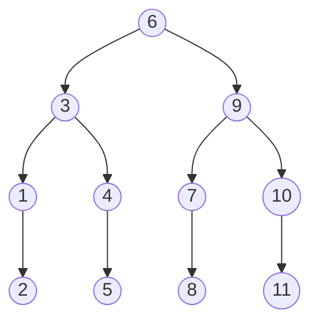
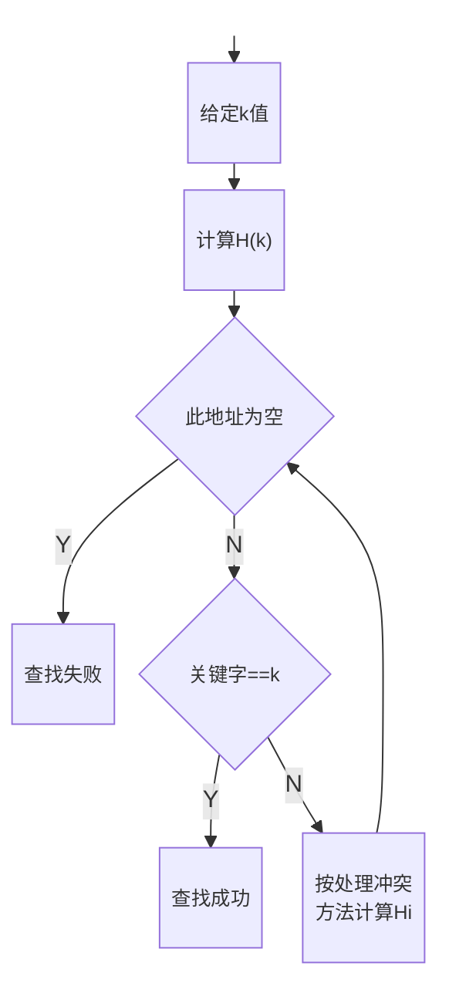

## 6. 查找


### 6.1 查找的基本概念

在哪找？—— 查找表

- 查找表是由同一类型的数据元素（或记录）构成的集合。由于“集合”中的数据元素之间存在着松散的关系，因此查找表是一种应用灵便的结构。

问题：什么查找？

——根据给定的某个值，在查找表中确定一个其关键字等于给定值的数据元素或（记录）

**关键字**：用来标识一个数据元素（或记录）的某个数据项的值

- 主关键字：可唯一地标识一个记录的关键字是主关键字；
- 次关键字：反之，用以识别若干记录的关键字是次关键字。


- 若查找表中存在这样一个记录，则称“查找成功”。
- 查找结果给出整个记录的信息，或指示该记录在查找表中的位置；
- 否则称“查找不成功”。
- 查找结果给出“空记录”或“空指针”。


问题：查找目的是什么？
对查找表经常进行的操作：
1. 查询某个“特定的”数据元素是否在查找表中；
2. 检索某个“特定的”数据元素的各种属性；
3. 在查找表中插入一个数据元素；
4. 删除查找表中的某个数据元素。


查找表可分为两类：
- 静态查找表：仅作“查询”（检索）操作的查找表。
- 动态查找表：作“插入”和“删除”操作的查找表。
有时在查询之后，还需要将“查询”结果为“不在查找表中”的数据元素插入到查找表中；或者，从查找表中删除其“查询”结果为“在查找表中”的数据元素，此类表为动态查找表。


查找算法的评价指标：
关键字的平均比较次数，也称平均查找长度 ASL(Average Search Length)
\[
ASL = \sum_{i=1}^{n} p_i c_i
\]
（关键字比较次数的期望值）
- \(n\)：记录的个数
- \(p_i\)：查找第\(i\)个记录的概率（通常认为\(p_i = 1/n\)）
- \(c_i\)：找到第\(i\)个记录所需的比较次数


问题：查找过程中我们要研究什么？
**查找的方法**取决于查找表的结构，即表中数据元素是**依何种关系组织在一起的**。

由于对查找表来说，在集合中查询或检索一个“特定的”数据元素时，若无规律可循，只能对集合中的元素一一加以辨认直至找到为止。

而这样的“查询”或“检索”是任何计算机应用系统中使用频度都很高的操作，因此**设法提高查找表的查找效率**，是本章讨论问题的出发点。

为提高查找效率，一个办法就是在构造查找表时，**在集合中的数据元素之间人为地加上某种确定的约束关系**。

**研究查找表的各种组织方法及其查找过程的实施**。


### 6.2 线性表的查找

一、顺序查找（线性查找）

二、折半查找（二分或对分查找）

三、分块查找


#### 6.2.1 顺序查找

应用范围：

- 顺序表或线性链表表示的静态查找表
- 表内元素之间无序

顺序表的表示

数据类型定义

```C++
typedef struct{
    KeyType key; // 关键字域
    ......		 // 其他域
}ElemType;
```

```C++
typedef struct{  // 顺序表结构类型定义
    ElemType *R; // 表基址
    int length;  // 表长
}SSTable; // Sequential Search Table
SSTable ST; // 定义顺序表ST
```


在顺序表ST中查找值为key的数据元素，**从最后一个元素开始比较**
例如：查找13：找到，返回5  查找60：未找到，返回0

i   0 1 2 3 4 5 6 7 8 9 10 11
ST.R[i].key  5 7 19 21 13 56 64 92 88 80 75
ST.length=11

【算法6.1】
```c
int Search_Seq( SSTable ST, KeyType key ){
    //若成功返回其位置信息，否则返回0
    for( i=ST.length; i>=1; --i )
        if ( ST.R[i].key==key ) return i;
    return 0;
}
```

```C++
int Search_Seq(SSTable ST, KeyType key)
{
    for(i = ST.length; ST.R[i].key!=key; --i)
   		if(i<=0) break;
    if(i > 0) return i;
    else return 0;
}
```

```C++
int Search_Seq(SSTable ST, KeyType key)
{
    for(i = ST.length; ST.R[i].key!=key && i > 0; --i)
    if(i > 0) return i;
    else return 0;
}
```

每执行一次循环都要进行两次比较，是否能改进


改进：把待查关键字key存入表头（“哨兵”、“监视哨”），从后往前逐个比较，可免去查找过程中每一步都要检测是否查找完毕，加快速度。

【算法6.2】设置监视哨的顺序查找

```c
int Search_Seq(SSTable ST, KeyType key) {
    ST.R[0].key = key;
    for (i = ST.length ; ST.R[i].key != key ; --i);
    	return i;
}
```

当ST.length较大时，此改进能使进行一次查找所需的平均时间几乎减少一半


- 时间复杂度：\(O(n)\)

查找成功时的平均查找长度，设表中各记录查找概率相等
\[
ASL_s(n)=(1+2+\dots +n)/n = \frac{n+1}{2}
\]

- 空间复杂度：一个辅助空间 —— \(O(1)\)


**1、记录的查找概率不相等时如何提高查找效率？**
查找表存储记录原则——按查找概率高低存储：

1) 查找概率越高，比较次数越少；
2) 查找概率越低，比较次数较多。

**2、记录的查找概率无法测定时如何提高查找效率？**
方法——按查找概率动态调整记录顺序：

1) 在每个记录中设一个访问频度域；
2) 始终保持记录按非递增有序的次序排列；
3) 每次查找后均将刚查到的记录直接移至表头。


#### 6.2.2 折半查找

顺序查找的特点

**优点**：算法简单，逻辑次序无要求，且不同存储结构均适用。 

**缺点**：ASL太长，时间效率太低。


**折半查找**：每次将待查记录所在区间缩小一半

【**基本步骤**】

1. **确定边界**：设 `low` 为区间起点，`high` 为区间终点，计算中间位置 `mid = (low + high) / 2`（向下取整）。   
2. **比较并缩小区间**：将目标值 `key` 与 `mid` 位置的元素比较：
   - 若相等，查找成功。
   - 若 `key` 较小，说明目标在左半部分，更新 `high = mid - 1`。   
   - 若 `key` 较大，说明目标在右半部分，更新 `low = mid + 1`。
3. **重复执行**：循环上述过程，直到找到目标，或 `low > high`（查找失败）。

【算法6.3】折半查找（非递归算法）

```C++
int Search_Bin(SSTable ST, KeyType key){
    low = 1; high = ST.Length; // 置区间初值
    while(low <= high){
        mid = (low + high) / 2;
        if(ST.R[mid].key == key) return mid; // 找到待查元素
        else if(key < ST.R[mid].key) // 缩小查找区间
            	high = mid - 1; // 继续在前半区间进行查找
        	else low = mid + 1; // 继续在后半区间进行查找
    }
    return 0; // 顺序表中不存在待查元素
}// Search_Bin
```

折半查找——递归算法

```C++
int Search_Bin(SSTable ST, KeyType key, int low, int high){
    if(low > high) return 0; // 查找不到时返回0
    mid = (low + high) / 2;
    if(key == ST.elem[mid].key) return mid;
    else if(key < ST.elem[mid].key)
    ...... // 递归，在前半区进行查找
		else ...... // 递归，在后半区进行查找
}
```


折半查找的性能分析——判定树

| $i$   | 1    | 2    | 3    | 4    | 5    | 6    | 7    | 8    | 9    | 10   | 11   |
| ----- | ---- | ---- | ---- | ---- | ---- | ---- | ---- | ---- | ---- | ---- | ---- |
| 数值  | 5    | 13   | 19   | 21   | 37   | 56   | 64   | 75   | 80   | 88   | 92   |
| $C_i$ | 3    | 4    | 2    | 3    | 4    | 1    | 3    | 4    | 2    | 3    | 4    |

得到判定树



**查找成功**

比较次数 = 路径上的结点数

比较次数 = 结点的层数

\(log_2n + 1\) = 树的深度 >= 比较次数

**查找不成功**

比较次数 = 路径上的内部结点数， 比较次数 <= \(log_2n + 1\)


假定每个元素的查找概率相等，求查找成功时的平均查找长度。 

\[ \text{ASL} = \frac{1}{11}\times(1\times 1 + 2\times 2 + 4\times 3 + 4\times 4) = \frac{33}{11}=3 \]


平均查找长度ASL（成功时）：
设表长 \(n = 2^{h}-1\)，则 \(h = \log_{2}(n + 1)\)（此时，判定树为深度 \(= h\) 的满二叉树），且表中每个记录的查找概率相等：\(P_{i} = \dfrac{1}{n}\)。

则：
\[
\begin{align*}
\text{ASL}_{bs} &= \sum_{i=1}^{n} p_{i}c_{i}
= \frac{1}{n}\sum_{i=1}^{n} c_{i}
= \frac{1}{n}\sum_{j=1}^{h} j\cdot 2^{j-1} \\
&= \frac{n+1}{n}\log_{2}(n+1) - 1 \\
&\approx \log_{2}(n+1) - 1 \quad (n>50)
\end{align*}
\]
折半查找优点：效率比顺序查找高。
折半查找缺点：只适用于有序表，且限于顺序存储结构（对线性链表无效）。


#### 6.2.3 分块查找

可以直接复制到 Typora 的笔记整理如下：

### 分块查找（索引顺序查找）


**1. 核心思想**
将查找表分为若干子块，结合**索引表**（有序）与**块内元素**（可无序）进行两级查找，兼顾顺序查找与折半查找的优点。

**2. 适用条件**

* **块间有序，块内无序**：将表分成若干块，若 \(i < j\)，则第 \(j\) 块中所有记录的关键字必须**大于**第 \(i\) 块中的最大关键字。


* **建立索引表**：索引表按关键字有序排列，每个索引项包含两项内容：


1. 当前块内的**最大关键字**；


2. 指向该块**第一个记录的指针**（起始下标）。

**3. 查找过程（两步走）**

1. **确定所在块**：在有序的索引表中查找目标关键字所属的块（因索引表有序，可用**顺序查找**或**折半查找**）。


2. **块内查找**：根据索引项指向的起始位置，进入对应子块内部进行**顺序查找**（因块内元素无序）。


**查找效率**：\(ASL = L_b + L_w\)

- \(L_b\)：对索引表查找的ASL
- \(L_w\)：对块内查找的ASL

\[
\text{ASL}_{bs} \approx \log_{2}\left(\frac{n}{s}+1\right)+\frac{s}{2} \quad \left(\log_{2}n \le \text{ASL}_{bs} \le \frac{n+1}{2}\right)
\]
\(s\) 为每块内部的记录个数，\(\dfrac{n}{s}\) 即块的数目。


**分块查找优缺点**

- 优点：插入和删除比较容易，无需进行大量移动。
- 缺点：要增加一个索引表的存储空间并对初始索引表进行排序运算。
- 适用情况：如果线性表既要快速查找又经常动态变化，则可采用分块查找。


### 6.3 树表的查找

当表插入、删除操作频繁时，为维护表的有序性，需要移动表中很多记录。

改用动态查找表——几种特殊的树
表结构在查找过程中动态生成
对于给定值\(key\)，若表中存在，则成功返回。否则，插入关键字等于\(key\)的记录

动态查找树：
- 二叉排序树
- 平衡二叉树
- 红黑树
- B-树
- B+树
- 键树


#### 7.3.1 二叉排序树

**二叉排序树**（Binary Sort Tree）又称为二叉搜索树、二叉查找树

定义：
二叉排序树或是空树，或是满足如下性质的二叉树：
(1) 若其左子树非空，则左子树上所有结点的值均小于根结点的值；
(2) 若其右子树非空，则右子树上所有结点的值均大于等于根结点的值；
(3) 其左右子树本身又各是一棵二叉排序树


二叉排序树的性质：
中序遍历非空的二叉排序树所得到的数据元素序列是一个按关键字排列的递增有序序列。


**二叉排序树的操作——查找**

- 若查找的关键字等于根结点，成功
- 否则
  - 若小于根结点，查其左子树
  - 若大于根结点，查其右子树
- 在左右子树上的操作类似


二叉排序树的存储结构

```C++
typedef struct{
    KeyType key; // 关键字项
    InfoType otherinfo; // 其他数据域
}ElemType;

typedef struct BSTNode{
    ElemType data; // 数据域
    struct BSTNode *lchild, *rchild; // 左右孩子指针
}BSTNode, *BSTree;

BSTree T; // 定义二叉排序树T
```


【算法6.4】 二叉排序树的递归查找

(1) 若二叉排序树为空，则查找失败，返回空指针。
(2) 若二叉排序树非空，将给定值\(key\)与根结点的关键字\(T->data.key\)进行比较：
① 若\(key\)等于\(T->data.key\)，则查找成功，返回根结点地址；
② 若\(key\)小于\(T->data.key\)，则进一步查找左子树；
③ 若\(key\)大于\(T->data.key\)，则进一步查找右子树。


```C++
BSTree SearchBST(BSTree T, KeyType key){
    if((!T) || key == T->data.key) return T;
    else if(key<T->data.key)
        return SearchBST(T->lchild, key);  // 在左子树中继续查找
    else return SearchBST(T->rchild, key); // 在右子树中继续查找
} // SearchBST
```


二叉排序树上查找某关键字等于给定值的结点过程，其实就是走了一条从根到该结点的路径

比较的关键字次数 = 此结点所在层次数

最多的比较次数 = 树的深度


二叉排序树的平均查找长度：含有n个结点的二叉排序树的平均查找长度和树的形态有关


问题：如何提高形态不均衡的二叉排序树的查找效率？

解决方法：做平衡化处理，尽量让二叉树的形状均衡


**二叉排序树的操作——插入**

- 若二叉排序树为空，则插入结点作为根结点插入到空树中
- 否则，继续在其左、右子树上查找
  - 树中已有，不再插入
  - 树中没有
    - 查找直至某个叶子结点的左子树或右子树为空为止，则插入结点应为该叶子结点的左孩子或右孩子

**插入的元素一定在叶子结点上**


**二叉排序树的操作——生成**

从空树出发，经过一系列的查找、插入操作之后，可生成一棵二叉排序树


一个无序序列可通过构造二叉排序树而变成一个有序序列，构造树的过程就是对无序序列进行排序的过程

插入的结点均为叶子结点，故无需移动其他结点。相当于在有序序列上插入记录而无需移动其他记录

但是：关键字的输入顺序不同，建立的不同二叉排序树


**二叉排序树的操作——删除**

从二叉排序树中删除一个结点，不能把以该结点为根的子树都删去，只能删掉该结点，并且**还应保证删除后所得的二叉树仍然满足二叉排序树的性质不变**。

由于中序遍历二叉排序树可以得到一个递增有序的序列。那么，在二叉排序树中删去一个结点相当于删去有序序列中的一个结点。
- 将因删除结点而断开的二叉链表重新链接起来
- 防止重新链接后树的高度增加

（1）被删除的结点是叶子结点：直接删去该结点

（2）被删除的结点只有左子树或者只有右子树，用其左子树或者右子树替换它（结点替换）

（3）被删除的结点既有左子树，也有右子树。以其中序前趋值替换之（值替换），然后再删除该前趋结点。前趋是左子树最大的结点。（意思是[1, 4, 5, 6, 9]，假如5是删去结点，则用其前趋结点4替换并删除4，树中更直观）也可以用其后继替换之，然后再删除该后继结点。后继是右子树中最小的结点


含有 \(n\) 个结点的二叉排序树的平均查找长度和树的形态有关

最好情况：\(\text{ASL}=\log_2(n + 1) - 1\)（形态比较均衡）
\(O(\log_2 n)\)

最坏情况：\(\text{ASL} = (n + 1) / 2\)（单支树的形态）
\(O(n)\) 查找效率与顺序查找情况相同


问题：如何提高形态不均衡的二叉排序树的查找效率？

解决方法：做平衡化处理，尽量让二叉树的形态均衡


1. 平衡二叉树的定义
平衡二叉树（balanced binary tree）
- 又称AVL树(Adelson-Velskii and Landis)。
- 一棵平衡二叉树或者是空树，或者是具有下列性质的二叉排序树：
① 左子树与右子树的高度之差的绝对值小于等于1；
② 左子树和右子树也是平衡二叉排序树。


为了方便起见，给每个结点附加一个数字，给出**该结点左子树与右子树的高度差**，这个数字称为结点的**平衡因子**
\[
平衡因子 = 结点数左子树的高度 - 结点右子树的高度
\]
根据平衡二叉树的定义，平衡二叉树上所有结点的平衡因子只能是 \(-1\)、\(0\)，或 \(1\)。


当我们在一个平衡二叉排序树上插入一个结点时，如果AVL在插入新结点后失衡，必须重新调整树的结构，使之恢复平衡


平衡调整的四种类型 

- LL型
- LR型
- RL型
- RR型

```mermaid
---
config:
  flowchart:
    nodeSpacing: 14
    rankSpacing: 22
    padding: 4
---
flowchart LR
  classDef n fill:#fbd3a3,stroke:#e08e45,stroke-width:2px,color:#1a35c9,font-weight:bold,font-size:20px
  classDef h fill:none,stroke:none,width:1px,height:1px

  subgraph LL["<b style='font-size:22px'>LL型</b>"]
    direction TB
    subgraph LL1[" "]
      A1((A))---|"<b style='color:#d96b00;font-size:18px'>L</b>"|B1((B))
      A1~~~n1[ ]
      B1---|"<b style='color:#d96b00;font-size:18px'>L</b>"|C1((C))
      B1~~~n2[ ]
    end
    subgraph LL2[" "]
      B2((B))---C2((C)) & A2((A))
    end
    LL1==>LL2
  end

  subgraph LR["<b style='font-size:22px'>LR型</b>"]
    direction TB
    subgraph LR1[" "]
      A3((A))---|"<b style='color:#d96b00;font-size:18px'>L</b>"|B3((B))
      A3~~~n3[ ]
      B3~~~n4[ ]
      B3---|"<b style='color:#d96b00;font-size:18px'>R</b>"|C3((C))
    end
    subgraph LR2[" "]
      C4((C))---B4((B)) & A4((A))
    end
    LR1==>LR2
  end

  subgraph RL["<b style='font-size:22px'>RL型</b>"]
    direction TB
    subgraph RL1[" "]
      A5((A))~~~n5[ ]
      A5---|"<b style='color:#d96b00;font-size:18px'>R</b>"|B5((B))
      B5---|"<b style='color:#d96b00;font-size:18px'>L</b>"|C5((C))
      B5~~~n6[ ]
    end
    subgraph RL2[" "]
      C6((C))---A6((A)) & B6((B))
    end
    RL1==>RL2
  end

  subgraph RR["<b style='font-size:22px'>RR型</b>"]
    direction TB
    subgraph RR1[" "]
      A7((A))~~~n7[ ]
      A7---|"<b style='color:#d96b00;font-size:18px'>R</b>"|B7((B))
      B7~~~n8[ ]
      B7---|"<b style='color:#d96b00;font-size:18px'>R</b>"|C7((C))
    end
    subgraph RR2[" "]
      B8((B))---A8((A)) & C8((C))
    end
    RR1==>RR2
  end

  LL~~~LR~~~RL~~~RR

  class A1,B1,C1,A2,B2,C2,A3,B3,C3,A4,B4,C4,A5,B5,C5,A6,B6,C6,A7,B7,C7,A8,B8,C8 n
  class n1,n2,n3,n4,n5,n6,n7,n8 h
  linkStyle default stroke:#1a35c9,stroke-width:2.5px
  style LL1 fill:none,stroke:none
  style LL2 fill:none,stroke:none
  style LR1 fill:none,stroke:none
  style LR2 fill:none,stroke:none
  style RL1 fill:none,stroke:none
  style RL2 fill:none,stroke:none
  style RR1 fill:none,stroke:none
  style RR2 fill:none,stroke:none
```




调整原则：1）降低高度2）保持二叉排序树性质


**LL型调整过程**

- B结点带左子树一起上升
- A结点成为B的右孩子
- 原来B结点的右子树作为A的左子树


**RR型调整过程**

- B结点带右子树一起上升
- A结点成为B的左孩子
- 原来B结点的左子树作为A的右子树


**LR型调整**

- C结点穿过A、B结点上升

- B结点成为C的左孩子

  A结点成为C的右孩子

- 原来C结点的左子树作为B的右子树

  原来C结点的右子树作为A的左子树


**RL型调整**

- C 结点穿过 A、B 结点上升

- A结点成为C的左孩子

  B 结点成为C的右孩子

- 原来C结点的左子树作为A的右子树

  原来C结点的右子树作为B的左子树

  

### 6.4 散列表（哈希表）的查找

- 基本思想：记录的存储位置与关键字之间存在对应关系

对应关系——hash函数

Loc(i) = H(keyi)

根据散列函数 \(H(\text{key})=\text{key}\)
查找 \(\text{key}=9\)，则访问 \(H(9)=9\) 号地址，若内容为9则成功；
若查不到，则返回一个特殊值，如空指针或空记录。

优点：查找效率高
缺点：空间效率低！


**散列方法**(杂凑法)
选取某个函数，依该函数按关键字计算元素的存储位置，并按此存放；
查找时，由同一个函数对给定值k计算地址，将k与地址单元中元素关键码进行比，确定查找是否成功。

**散列函数**(杂凑函数)：散列方法中使用的转换函数

**散列表**（杂凑表）：按上述思想构造的表

**冲突**：不同的关键码映射到同一个散列地址，key1≠key2，但H(key1) = H(key2)

**同义词**：具有相同函数值的多个关键字


**散列存储**：选取某个函数，依该函数**按关键字计算元素的存储位置**

Loc(i) = H(keyi)

**冲突**：不同的关键码映射到同一个散列地址

key1 ≠ key2，但是 H(key1) = H(key2)

使用散列表要解决好两个问题：

1) 构造好的散列函数
(a) 所选函数尽可能简单，以便提高转换速度；
(b) 所选函数对关键码计算出的地址，应在散列地址集中致均匀分布，以减少空间浪费。

2) 制定一个好的解决冲突的方案
查找时，如果从散列函数计算出的地址中查不到关键码，则应当依据解决冲突的规则，有规律地查询其它相关单元。


**构造散列函数考虑的因素**

①执行速度（即计算散列函数所需时间）

②关键字长度

③散列表大小


根据元素集合的特性构造
- 要求一：\(n\) 个数据原仅占用 \(n\) 个地址，虽然散列查找是以空间换时间，但仍希望散列的地址空间尽量小。
- 要求二：无论用什么方法存储，目的都是尽量均匀地存放元素，以避免冲突。


构造散列函数的方法： 1. 直接定址法 2. 数字分析法 3. 平方取中法 4. 折叠法 5. 除留余数法 6. 随机数法


**直接定址法**

\(\text{Hash}(\text{key}) = a\cdot \text{key} + b\quad (a、b为常数)\)

优点：以关键码\(\text{key}\)的某个线性函数值为散列地址，不会产生冲突。
缺点：要占用连续地址空间，空间效率低。

例：\(\{100,\ 300,\ 500,\ 700,\ 800,\ 900\}\)，
散列函数 \(\text{Hash}(\text{key})=\text{key}/100\quad (a=1/100,\ b=0)\)


**除留余数法**

\(\text{Hash}(\text{key})= \text{key} \bmod p\quad (p是一个整数)\)

关键：如何选取合适的\(p\)？
技巧：设表长为\(m\)，取 \(p \le m\) 且为质数

例：\(\{15,\ 23,\ 27,\ 38,\ 53,\ 61,\ 70\}\)，
散列函数 \(\text{Hash}(\text{key})=\text{key} \bmod 7\)


##### 处理冲突的方法

**1.开放地址法**

基本思想：有冲突时就去寻找下一个空的散列地址，只要散列表足够大，空的散列地址总能找到，并将数据元素存入。

例如：除留余数法 \(\displaystyle H_i=(\text{Hash}(\text{key})+d_i) \bmod m\)，\(d_i\) 为增量序列

常用方法：
- 线性探测法：\(d_i\) 为 \(1,2,\dots,m-1\) 线性序列
- 二次探测法：\(d_i\) 为 \(1^2,-1^2,2^2,-2^2,\dots,q^2\) 二次序列
- 伪随机探测法：\(d_i\) 为伪随机数序列


**线性探测法**
\[
H_i = (\text{Hash}(\text{key}) + d_i) \bmod m \quad (1\le i < m)
\]
其中：\(m\) 为散列表长度
\(d_i\) 为增量序列 \(1,2,\dots,m-1\)，且 \(d_i=i\)

一旦冲突，就找下一个地址，直到找到空地址存入


例：关键码集为 \(\{47, 7, 29, 11, 16, 92, 22, 8, 3\}\)，散列表长 \(m=11\)；散列函数为 \(\text{Hash}(\text{key})=\text{key} \bmod 11\)；拟用线性探测法处理冲突。

散列表：
| 0    | 1    | 2    | 3    | 4    | 5    | 6    | 7    | 8    | 9    | 10   |
| ---- | ---- | ---- | ---- | ---- | ---- | ---- | ---- | ---- | ---- | ---- |
| 11   | 22   |      | 47   | 92   | 16   | 3    | 7    | 29   | 8    |      |
| ①    | ②    |      | ①    | ①    | ①    | ④    | ①    | ②    | ②    |      |

解释：
① \(47、7\) 均是由散列函数得到的没有冲突的散列地址；
② \(\text{Hash}(29)=7\)，散列地址有冲突，需寻找下一个空的散列地址：
由 \(H_1=(\text{Hash}(29)+1) \bmod 11=8\)，散列地址8为空，因此将29存入。
③ \(11、16、92\) 均是由散列函数得到的没有冲突的散列地址；
④ 另外，\(22、8、3\) 同样在散列地址上有冲突，也是由 \(H_1\) 找到空的散列地址的。

平均查找长度：
\[
\text{ASL} = \frac{1+2+1+1+1+4+1+2+2}{9} \approx 1.67
\]


**2.链地址法（拉链法）**

基本思想：相同散列地址的记录链成一单链表

**m个散列地址就设m个单链表**，然后用一个数组将m个单链表的表头指针存储起来，形成一个动态的结构


链地址法建立散列表步骤

- Step1: 取数据元素的关键字key，计算其散列函数值（地址）。若该地址对应的链表为空，则将该元素插入此链表；否则执行Step2解决冲突。
- Step2: 根据选择的冲突处理方法，计算关键字key的下一个存储地址。若该地址对应的链表不为空，则利用链表的前插法或后插法将该元素插入此链表。


链地址法的优点：

- 非同义词不会冲突，无聚集现象
- 链表上结点空间动态申请，更适合于表长不确定的情况


#### 6.4.4 散列表的查找



**散列表的查找效率分析**

使用平均查找长度ASL来衡量查找算法，ASL取决于

- 散列函数
- 处理冲突的方法
- 散列表的装填因子\(\alpha\)

\[
\alpha = \frac{表中填入的记录数}{哈希表长度}
\]

\(\alpha\) 越大表中记录数越多，说明表装得月满，发生冲突的可能性越大，查找时比较次数越多

ASL与装填因子\(\alpha\)有关！既不是严格的\(O(1)\)，也不是\(O(n)\)

\[
\begin{align*}
\text{ASL} &\approx 1+\frac{\alpha}{2} \quad (\text{拉链法}) \\
\text{ASL} &\approx \frac{1}{2}\left(1+\frac{1}{1-\alpha}\right) \quad (\text{线性探测法}) \\
\text{ASL} &\approx -\frac{1}{\alpha}\ln(1-\alpha) \quad (\text{随机探测法})
\end{align*}
\]