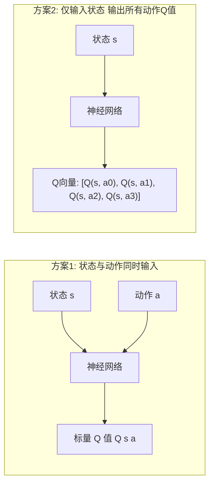

## 7. 神经网络与 Q 学习

此前我们处理的都是状态、动作空间规模较小的强化学习任务，这类场景可以用表格或者字典来保存全部 Q 值，但现实问题往往拥有极其庞大的状态空间，例如国际象棋的棋局数量高达\(10^{123}\)，此时依靠表格存储、更新 Q 函数不再具备可行性。

为了解决这个问题，我们可以借助深度学习，使用神经网络作为近似函数来表征 Q 函数，由此进入深度强化学习的学习阶段。

本章将先介绍深度学习框架 DeZero，学习神经网络的基础知识，最终利用神经网络实现 Q 学习；本书不严格区分神经网络与深度学习，将具备多层结构的神经网络称为深度学习。


### 7.1 DeZero 框架概述

* **定位与来源**：DeZero 是源自《深度学习入门2：自制框架》的开源深度学习框架。
* **设计目标**：以结构简洁和易于理解为核心设计原则。其 API 接口与 PyTorch 保持一致，DeZero 编写的代码可直接转换为 PyTorch 实现。
* **安装方式**：
  ```bash
  pip install dezero
  ```


#### 7.1.1 初识DeZero

* `Variable` 是对 NumPy 多维数组（`np.ndarray`）的封装类。
* 将多维数组传入 `Variable` 构造函数即可创建计算图节点，支持常规算术运算。

```python
import numpy as np
from dezero import Variable

x_np = np.array(5.0)
x = Variable(x_np)

y = 3 * x ** 2
print(y)  # 输出: variable(75.0)
```


* 调用输出变量的 `backward()` 方法，计算图会自动执行反向传播算法，求出目标变量对各输入变量的导数。
* 计算结果保存在输入变量的 `.grad` 属性中。
* 针对函数：
  \[
  y = 3x^2
  \]

其导数公式为：

\[
\frac{\mathrm{d}y}{\mathrm{d}x} = 6x
\]
  当 \(x = 5\) 时，导数计算结果为 \(30.0\)。


```python
y.backward()
print(x.grad)  # 输出: variable(30.0)
```


#### 7.1.2 多维数组（张量）与矩阵运算

多维数组是存储和处理数值集合的数据结构。数值排列的方向定义为“维度”或“轴”。

| 维度     | 数学名称       | 张量阶数 | 数学符号表示                                      |
| :------- | :------------- | :------- | :------------------------------------------------ |
| 0 维数组 | 标量（Scalar） | 零阶张量 | 普通斜体字母，如 \(a, b\)                         |
| 1 维数组 | 向量（Vector） | 一阶张量 | 粗斜体字母，如 \(\boldsymbol{a}, \boldsymbol{b}\) |
| 2 维数组 | 矩阵（Matrix） | 二阶张量 | 粗斜体字母，如 \(\boldsymbol{a}, \boldsymbol{b}\) |


**向量内积**

设有两个长度为 \(n\) 的向量 \(\boldsymbol{a} = (a_1, \dots, a_n)\) 与 \(\boldsymbol{b} = (b_1, \dots, b_n)\)。两者的内积定义为对应元素乘积之和：
\[\boldsymbol{a} \cdot \boldsymbol{b} = a_1 b_1 + a_2 b_2 + \dots + a_n b_n\]

**矩阵乘积与形状匹配规则**

* **运算规则**：左侧矩阵的每一行向量分别与右侧矩阵的每一列向量计算内积，内积结果填入输出矩阵的对应行列位置。
* **形状约束**：左侧矩阵的列数必须与右侧矩阵的行数严格相等。若矩阵 \(\boldsymbol{a}\) 的形状为 \((3 \times 2)\)，矩阵 \(\boldsymbol{b}\) 的形状为 \((2 \times 4)\)，相乘生成的矩阵 \(\boldsymbol{c}\) 形状为 \((3 \times 4)\)。

**DeZero 中的矩阵乘法实现**

* 通过 `dezero.functions.matmul`（通常简写为 `F.matmul`）计算向量内积或矩阵乘积。
* `F.matmul` 能够直接接收 `np.ndarray` 类型的数据，内部会自动将其转换为 `Variable` 实例进行计算。

```python
import numpy as np
from dezero import Variable
import dezero.functions as F

# 向量内积
a = np.array([1, 2, 3])
b = np.array([4, 5, 6])
c = F.matmul(a, b)
print(c)  # 输出: variable(32)

# 矩阵乘法
a = np.array([[1, 2], [3, 4]])
b = np.array([[5, 6], [7, 8]])
c = F.matmul(a, b)
print(c)
# 输出:
# variable([[19 22]
#           [43 50]])
```


#### 7.1.3 最优化与梯度下降法

**最优化的定义与基准测试函数**

* **最优化**：通过数值计算方法，求解使目标函数输出最小化或最大化的参数输入值。
* **Rosenbrock 函数**：用于验证最优化算法性能的非凸基准函数：
  \[y = 100(x_1 - x_0^2)^2 + (x_0 - 1)^2\]
  该函数的全局理论极小值点位于 \((x_0, x_1) = (1, 1)\)，对应函数输出极小值为 \(0\)。

**梯度定义与导数计算**

* 函数在点 \((x_0, x_1)\) 处的偏导数组合为梯度向量：
  \[
  \nabla y = \left( \frac{\partial y}{\partial x_0}, \frac{\partial y}{\partial x_1} \right)
  \]
* 梯度向量的方向是函数值局部增长最快的方向，反方向（即负梯度方向）是函数值局部减小最快的方向。

在初始点 \((x_0, x_1) = (0.0, 2.0)\) 处的导数计算代码：
```python
import numpy as np
from dezero import Variable

def rosenbrock(x0, x1):
    y = 100 * (x1 - x0 ** 2) ** 2 + (x0 - 1) ** 2
    return y

x0 = Variable(np.array(0.0))
x1 = Variable(np.array(2.0))

y = rosenbrock(x0, x1)
y.backward()
print(x0.grad, x1.grad)  # 输出: variable(-2.0) variable(400.0)
```

**梯度下降法算法实现**

梯度下降法通过沿负梯度方向按设定的步长（学习率 \(\eta\)）迭代更新变量数值，从而逐步逼近函数的极小值点。

参数更新公式：
\[
x_0 \leftarrow x_0 - \eta \frac{\partial y}{\partial x_0}
\]

\[
x_1 \leftarrow x_1 - \eta \frac{\partial y}{\partial x_1}
\]

**实现要点与代码规范**

1. **就地更新数据属性**：`x0` 与 `x0.grad` 均为 `Variable` 类型，其实际数值存储于 `.data` 中。必须通过 `x0.data -= lr * x0.grad.data` 直接修改底层数值数组。若直接对 `Variable` 对象做运算，会构建新的计算图节点，产生不必要的内存和计算开销。
2. **重置累计梯度**：DeZero 在连续执行 `backward()` 时默认累加梯度。在每次循环开始新的反向传播前，必须调用 `cleargrad()` 方法清空历史梯度。

```python
x0 = Variable(np.array(0.0))
x1 = Variable(np.array(2.0))

lr = 0.001       # 学习率
iters = 10000    # 迭代次数

for i in range(iters):
    y = rosenbrock(x0, x1)

    # 1. 清除上一次迭代的梯度
    x0.cleargrad()
    x1.cleargrad()
    
    # 2. 反向传播求当前梯度
    y.backward()

    # 3. 沿负梯度方向更新变量底层数据
    x0.data -= lr * x0.grad.data
    x1.data -= lr * x1.grad.data

print(x0, x1)
# 最终输出结果:
# variable(0.9944984367782456) variable(0.9890050527419593)
```

经过 \(10000\) 次迭代更新，自变量更新至数值 \((0.9945, 0.9890)\)，逼近理论极小值点 \((1.0, 1.0)\)。


### 7.2 线性回归

机器学习的核心机制是借助算法使计算机从数据里自动优化参数，学习得到输入与输出之间的映射关系，不需要人为编写确定性的求解规则；而回归是依据自变量 x 预测连续实数型因变量 y 的任务，当所使用的预测模型为线性函数时，这类回归任务就叫做线性回归。


#### 7.2.1 玩具数据集

* **概念定义**：用于算法验证的小规模实验数据集（Toy Dataset）。
* **生成机制**：通过设定固定随机数种子以确保实验的可复现性。数据点由确定的线性表达式叠加均匀分布的随机数噪声生成：
  \[y = 2x + 5 + \epsilon\]
  其中 \(\epsilon \sim U(0, 1)\) 表示随机噪声项。

```python
import numpy as np
import matplotlib.pyplot as plt
# 固定随机数种子以确保结果可复现
np.random.seed(0)
x = np.random.rand(100, 1)
y = 5 + 2 * x + np.random.rand(100, 1)

plt.scatter(x, y)
plt.xlabel('x')
plt.ylabel('y')
plt.show()
```

数据呈现线性分布趋势，由于噪声的存在，数据点偏离了严格的直线轨迹。建模目标是根据已知的观测数据拟合出最优数学模型，用于输入 \(x\) 时预测输出 \(y\)。


#### 7.2.2 线性回归理论基础

* **模型表示**：设自变量 \(x\) 与因变量 \(y\) 满足线性关系，预测函数表示为：
  \[y = Wx + b\]
  其中 \(W\) 为权重标量，\(b\) 为偏置标量。
* **残差（Residual）**：样本真实观测值 \(y_i\) 与模型预测值 \((Wx_i + b)\) 之间的差值 \(Wx_i + b - y_i \)。
* **损失函数（Loss Function）**：评估模型预测值与真实数据吻合程度的定量指标。在线性回归中采用均方误差（Mean Squared Error, MSE）作为损失函数：
  \[
  L = \frac{1}{N} \sum_{i=1}^{N} (W x_i + b - y_i)^2
  \]
  其中 \(N\) 为样本总数。该式对每个样本的误差求平方后累加，再除以 \(N\) 计算算术平均值。部分定义亦采用 \(\frac{1}{2N}\) 作为系数，该形式在求导后仅影响固定倍率，可通过调整学习率参数进行等价抵消。
* **优化目标**：求解使损失函数 \(L\) 取得最小值的参数解 \((W^*, b^*)\)，该问题通过梯度下降法进行数值求解。


#### 7.2.3 线性回归的实现

**1. 参数定义与矩阵批量前向传播**

* **参数维度设置**：
  * 包含 100 个样本的输入特征矩阵 \(x\) 的形状为 \((100, 1)\)。
  * 权重 \(W\) 设为形状是 \((1, 1)\) 的 `Variable` 对象。
  * 偏置 \(b\) 设为形状是 \((1,)\) 的一维 `Variable` 对象。
* **矩阵维度对齐机制**：
  * 调用 `F.matmul(x, W)` 对批量数据进行并行矩阵乘法计算，输出形状为 \((100, 1)\)。
  * 矩阵相乘的充要条件是左侧矩阵的列数等于右侧矩阵的行数，即 `x.shape[1] == W.shape[0]`。
  * 当输入特征维度扩展至 \(D\) 维时，只要将输入矩阵设定为 \((N, D)\)，权重矩阵对齐为 \((D, 1)\)，即可完成多维特征的线性组合计算。

```python
import numpy as np
from dezero import Variable
import dezero.functions as F

# 生成玩具数据集
np.random.seed(0)
x = np.random.rand(100, 1)
y = 5 + 2 * x + np.random.rand(100, 1)
x, y = Variable(x), Variable(y)  # 显式封装为 Variable 实例

# 初始化权重与偏置参数
W = Variable(np.zeros((1, 1)))
b = Variable(np.zeros(1))

# 定义预测函数（批量计算）
def predict(x):
    y = F.matmul(x, W) + b
    return y
```

**2. 损失函数计算与梯度下降循环优化**

* **均方误差实现**：可通过自定义函数 `mean_squared_error` 计算残差平方均值，亦可直接调用内置的 `F.mean_squared_error(y, y_pred)`。\(\text{MSE}(y, \hat{y}) = \frac{1}{N}\sum_{i=1}^{N}\left(y_i - \hat{y}_i\right)^2\)
* **迭代步骤**：
  1. 计算当前参数下的预测值 `y_pred` 与损失值 `loss`。
  2. 调用 `W.cleargrad()` 与 `b.cleargrad()` 重置上一轮循环的历史累加梯度。
  3. 执行 `loss.backward()` 自动计算损失函数关于参数 \(W\) 和 \(b\) 的偏导数。
  4. 使用就地运算 `W.data -= lr * W.grad.data` 与 `b.data -= lr * b.grad.data` 更新参数的底层数组数值。

```python
def mean_squared_error(x0, x1):
    diff = x0 - x1
    return F.sum(diff ** 2) / len(diff)

lr = 0.1       # 学习率
iters = 100    # 优化迭代步数

for i in range(iters):
    y_pred = predict(x)
    loss = mean_squared_error(y, y_pred)
    # 也可直接使用: loss = F.mean_squared_error(y, y_pred)

    # 1. 梯度清零
    W.cleargrad()
    b.cleargrad()

    # 2. 反向传播求导
    loss.backward()

    # 3. 就地更新底层数值
    W.data -= lr * W.grad.data
    b.data -= lr * b.grad.data

    if i % 10 == 0:
        print(loss.data)

print('====')
print('W =', W.data)
print('b =', b.data)

plt.scatter(x.data, y.data, color='blue')
x_line = np.array([[0.0], [1.0]])
y_line = predict(Variable(x_line)).data
plt.plot(x_line, y_line,color='red',linewidth=1)
plt.xlabel('x')
plt.ylabel('y')
plt.show()
```

**3. 运行收敛结果**

* **损失收敛过程**：损失标量由初始的 \(42.296\) 快速递减，经 100 轮迭代后收敛至约 \(0.0799\)。
* **参数拟合数值**：
  * 学习得到的参数为 \(W = 2.11807369\)，\(b = 5.46608905\)。
  * 因原始数据生成方程中噪声项均值为 \(0.5\)，整体理论期望截距为 \(5.5\)，斜率为 \(2.0\)，优化结果与理论统计期望高度吻合。


### 7.3 神经网络

#### 7.3.1 非线性数据集


```python
import numpy as np
import matplotlib.pyplot as plt
np.random.seed(0)
x = np.random.rand(100, 1)
y = np.sin(2 * np.pi * x) + np.random.rand(100, 1)

plt.scatter(x=x, y=y)
plt.xlabel('x')
plt.ylabel('y')
plt.show()
```


#### 7.3.2 线性变换和激活函数

线性回归中执行的计算只有矩阵的乘积和加法运算

```python
y = F.matmul(x, W) + b
```

DeZero提供了线性变换的函数F.linear

```python
y = F.linear(x, W, b)
```

线性变换是对输入数据进行线性的变换，而神经网络是对线性变换的输出进行非线性的变换，进行非线性变换的函数叫做激活函数
\[
sigmoid (x) = \frac{1}{1 + e^{-x}}
\]

\[
ReLu (x) = \begin{cases}
0, (x<0) \\
x, (x≥0)
\end{cases}
\]

#### 7.3.3 神经网络的实现

典型的神经网络会交替使用线性变换和激活函数，两层的神经网络实现如下

```python
W1, b1 = Variable(...), Variable(...)
W2, b2 = Variable(...), Variable(...)

def predict(x):
    y = F.linear(x, W1, b1)
    y = F.sigmoid(y)
    y = F.linear(y, W2, b2)
    return y
```

上面是一个缺少 train 的 predict函数，之后会在推理过程添加损失函数，然后再找出使该损失函数的输出最小的参数

```python
import numpy as np
from dezero import Variable
import dezero.functions as F
import matplotlib.pyplot as plt

# 数据集
np.random.seed(0)
x = np.random.rand(100, 1)
y = np.sin(2 * np.pi * x) + np.random.rand(100, 1)

# 参数的初始化
I, H, O = 1, 10, 1
W1 = Variable(0.01 * np.random.randn(I, H))
b1 = Variable(np.zeros(H))
W2 = Variable(0.01 * np.random.randn(H, O))
b2 = Variable(np.zeros(O))

# 神经网络的推理
def predict(x):
    y = F.linear(x, W1, b1) # y = F.linear(x, W1, b1) # 100行10列
    y = F.sigmoid(y)        # 100行10列的数值非线性化
    y = F.linear(y, W2, b2) # 100行1列的数值
    return y

lr = 0.2
iters = 10000

# 神经网络的训练
for i in range(iters):
    y_pred = predict(x)
    loss = F.mean_squared_error(y, y_pred) # 100行1列的数值放进均方差进行平均计算

    # 清除累计梯度并更新参数
    W1.cleargrad()
    b1.cleargrad()
    W2.cleargrad()
    b2.cleargrad()

    loss.backward() 

    W1.data -= lr * W1.grad.data
    b1.data -= lr * b1.grad.data
    W2.data -= lr * W2.grad.data
    b2.data -= lr * b2.grad.data
    if i % 1000 == 0:
        print(loss.data) # 打印损失信息

# 绘制原始散点图
plt.scatter(x, y)

t = np.linspace(0, 1, 100).reshape(100, 1)
# 计算模型对这些预测点值
y_line = predict(t)
# 绘图逻辑：利用样本训练出最佳权重与偏置；生成等距排列的测试点 t 作为横坐标，送入模型预测得到纵坐标 y_line，连线绘制出平滑曲线。
plt.plot(t, y_line.data, color='red', linewidth=2) # t 为(100,)或者(100,1)都可以正确传入

plt.show()
```


#### 7.3.4 层与模型

在神经网络结构变深、参数增多时，手动定义和管理每个权重 W 与偏置 b 会极其繁琐且容易遗漏。为了模块化构建网络并统一管理参数，DeZero 引入了面向对象的工具类：**层（Layer）** 与 **模型（Model）**。该设计风格与 PyTorch 的 `nn.Module` 完全一致。

**1. 层（Layer）与线性层 `Linear`**

* **核心作用**：层类兼具**初始化参数**和**管理参数**的功能。
* **`Linear` 类的定义与参数**：
  
  ```python
  Linear(out_size, nobias=False, dtype=np.float32, in_size=None)
  ```

- `out_size`：输出维度大小（必须指定）。

- `in_size`：输入维度大小。默认设为 `None`，支持**延迟初始化（Lazy Initialization）**。

- `nobias`：是否禁用偏置项（默认为 `False`）。

- `dtype`：数据类型（默认单精度浮点数 `np.float32`）。

- **延迟初始化机制**：

  在实例化 `linear = L.Linear(out_size)` 时无需显式指定 `in_size`。当第一批数据传入执行前向传播 `y = linear(x)` 的瞬间，`Linear` 层会自动获取输入数据的最后一维大小，并在内部动态生成并初始化对应形状的权重 `W` 和偏置 `b`。

```Python
import numpy as np
import dezero.layers as L

# 1. 实例化线性层（只指定输出维度为 10）
linear = L.Linear(10)

# 2. 模拟批量输入数据 (100 个样本，每个样本 5 维特征)
batch_size, input_size = 100, 5
x = np.random.randn(batch_size, input_size)

# 3. 数据流入时自动完成参数初始化与线性变换
y = linear(x)

print('y shape:', y.shape) # y shape: (100, 10)
print('params shape:', linear.W.shape, linear.b.shape) # params shape: (5, 10) (10,)

# 4. 通过 params() 访问层持有的全部参数
for param in linear.params():
    print(param.name, param.shape)
    # W (5, 10)
    # b (10,)
```

**2. 继承 `Model` 构建神经网络**

DeZero 允许像搭积木一样，通过继承 `Model` 基类来组织各个层。

- **定义规范**：
  1. 在 `__init__` 中调用 `super().__init__()`，并实例化该网络所需的各个层对象（作为成员变量持有）。
  2. 在 `forward` 方法中实现具体的前向传播计算流程（连接各层与激活函数）。
- **继承 `Model` 的核心优势**：
  - **统一管理参数**：调用 `model.params()` 可自动递归遍历模型内部包含的所有层的所有参数对象。
  - **一键梯度清零**：调用 `model.cleargrads()` 即可一次性将模型持有的全部参数梯度重置为 `None` / 0，无需逐个变量清空。

```Python
from dezero import Model
import dezero.layers as L
import dezero.functions as F

class TwoLayerNet(Model):
    def __init__(self, hidden_size, out_size):
        super().__init__()
        # 声明包含的层
        self.l1 = L.Linear(hidden_size)
        self.l2 = L.Linear(out_size)

    def forward(self, x):
        # 规划前向传播数据流
        y = F.relu(self.l1(x))
        y = self.l2(y)
        return y

# 实例化网络模型
model = TwoLayerNet(10, 1)

# 访问所有内部参数
for param in model.params():
    print(param)

# 重置模型内全部参数的梯度
model.cleargrads()
```

**3. 基于 Model 与 Layer 的非线性回归完整训练闭环**

利用封装好的 `TwoLayerNet` 对带噪声的 \(\sin\) 函数数据集进行拟合。在训练循环中，遵循深度学习标准的“前向预测 \(\to\) 误差计算 \(\to\) 梯度清零 \(\to\) 反向传播 \(\to\) 参数更新”流水线：

```Python
import numpy as np
from dezero import Model
import dezero.layers as L
import dezero.functions as F

# 1. 生成非线性数据集 (sin 函数叠加噪声)
np.random.seed(0)
x = np.random.rand(100, 1)
y = np.sin(2 * np.pi * x) + np.random.rand(100, 1)

# 2. 超参数设置
lr = 0.2
iters = 10000

# 3. 定义双层网络结构
class TwoLayerNet(Model):
    def __init__(self, hidden_size, out_size):
        super().__init__()
        self.l1 = L.Linear(hidden_size)
        self.l2 = L.Linear(out_size)

    def forward(self, x):
        y = F.sigmoid(self.l1(x))  # 隐藏层使用 Sigmoid 激活函数
        y = self.l2(y)
        return y

model = TwoLayerNet(10, 1)

# 4. 训练迭代优化循环
for i in range(iters):
    # (1) 前向传播预测（model(x) 等价于 model.forward(x)）
    y_pred = model.forward(x)
    
    # (2) 计算均方误差损失
    loss = F.mean_squared_error(y, y_pred)
    
    # (3) 梯度清零：一键清空模型所有参数的历史梯度
    model.cleargrads()
    
    # (4) 误差反向传播求偏导
    loss.backward()
    
    # (5) 遍历所有参数，沿负梯度方向更新权重与偏置底层数值
    for p in model.params():
        p.data -= lr * p.grad.data
    
    if i % 1000 == 0:
        print(f"iter {i}: loss = {loss.data}")
```

- **总结**：

  引入 `Layer` 与 `Model` 后，底层张量矩阵的乘法维度匹配被交由 `Linear` 自动处理，而散落各处的梯度清零与更新操作被收拢至 `model.cleargrads()` 与 `model.params()`。代码从“底层数值计算脚本”升格为“模块化网络架构”，为后续实现复杂的深度 Q 网络（DQN）打下了面向对象的基础。


#### 7.3.5 优化器

```python
import numpy as np
from dezero import Model
from dezero import optimizers
import dezero.layers as L
import dezero.functions as F
import matplotlib.pyplot as plt

# 数据集的生成
np.random.seed(0)
x = np.random.rand(100, 1)
y = np.sin(2 * np.pi * x) + np.random.rand(100, 1)

lr = 0.2
iters = 10000

class TwoLayerNet(Model):
    def __init__(self, hidden_size, out_size):
        super().__init__()
        self.l1 = L.Linear(hidden_size)
        self.l2 = L.Linear(out_size)

    def forward(self, x):
        y = F.sigmoid(self.l1(x))
        y = self.l2(y)
        return y

model = TwoLayerNet(10, 1)
optimizer = optimizers.SGD(lr) # 生成优化器
optimizer.setup(model)

for i in range(iters):
    y_pred = model.forward(x)
    loss = F.mean_squared_error(y, y_pred)

    model.cleargrads()
    loss.backward()

    optimizer.update() # 通过优化器更新
    
    if i % 1000 == 0:
        print(loss)

plt.scatter(x, y)

t = np.linspace(0, 1, 100).reshape(100, 1)
y_line = model.forward(t)

plt.plot(t, y_line.data, color = 'red', linewidth = 2)
plt.show()
```

代码导入了optimizers包，通过使用这个optimizers包中的SGD随机梯度下降法的最优化方法将参数沿梯度方向更新了lr倍，然后通过optimizer.setup(model)来注册模型，通过每次调用optimizer.update()更新参数，可以使用这种使用优化器的方式更新参数，其他典型方法如Momentum或AdaGrad或AdaDelta或Adam等实现如下

```python
optimizer = optimizers.Adam(lr)
```


### 7.4 Q 学习与神经网络

在第 6 章中，我们学习了强化学习中最著名的异策略无模型控制算法——Q 学习（Q-Learning）。此前我们一直使用表格（如 Python 中的 `defaultdict`）来独立维护每一个 \((s, a)\) 对应的 Q 值。但当面对大规模甚至连续的状态空间时，表格方法将面临“维度灾难”而失效。   

本节的核心目标是实现 **Q 学习与神经网络的融合（深度 Q 学习的雏形）**：使用神经网络作为函数近似器来表征 Q 函数，从而摆脱对离散表格的依赖。   


#### 7.4.1 神经网络的预处理（One-Hot 独热编码）

在神经网络中，离散的类别型数据（Categorical Data，如衣服尺寸 S/M/L、血型等）无法直接作为连续数值送入网络运算，通常需要将其转换为**独热向量（One-Hot Vector）**。   

- **独热向量定义**：仅有一个维度元素为 \(1.0\)，其余所有维度均为 \(0.0\) 的稀疏向量。   
- **网格世界的状态表示**：
  - 在 \(3 \times 4\) 的网格世界中，智能体的位置坐标为 \((y, x)\)，共有 \(3 \times 4 = 12\) 种离散位置。   
  - 将二维坐标索引映射为一维下标：\(\text{idx} = \text{WIDTH} \times y + x\)。   
  - 生成长度为 12 的全零向量，并将 \(\text{idx}\) 处赋值为 \(1.0\)。   
  - 考虑到神经网络通常采用批量（Batch）形式处理数据，使用 `vec[np.newaxis, :]` 扩展出批次轴，将张量形状由 \((12,)\) 转换为 \((1, 12)\)。   

```Python
import numpy as np

def one_hot(state):
    HEIGHT, WIDTH = 3, 4
    vec = np.zeros(HEIGHT * WIDTH, dtype=np.float32)
    y, x = state
    idx = WIDTH * y + x
    vec[idx] = 1.0
    return vec[np.newaxis, :]  # 增加批量维度: (1, 12)

# 测试状态 (2, 0)
state = (2, 0)
x = one_hot(state)
print(x.shape)  # 输出: (1, 12)
print(x)        # 输出: [[0. 0. 0. 0. 0. 0. 0. 0. 1. 0. 0. 0.]]
```

#### 7.4.2 表示 Q 函数的神经网络结构

此前使用字典维护 Q 函数时，输入 \((s, a)\) 直接映射到一个标量 Q 值：   

```Python
Q[(state, action)] -> float
```

用神经网络拟合 Q 函数时，存在以下两种候选架构：   

代码段



**两种网络结构的性能对比**：

| **结构方案**       | **输入**            | **输出**                             | **决策 \(\max_a Q(s,a)\) 时的计算开销   JPG** | **适用场景**     |
| ------------------ | ------------------- | ------------------------------------ | ------------------------------------------------------------ | ---------------- |
| **方案 1**         | 状态 \(s\) + 动作 \(a\) | 标量 \(Q(s, a)\)                       | **高**（若有 4 个候选动作，必须执行 4 次前向传播）           | 连续动作空间     |
| **方案 2（选用）** | 状态 \(s\)            | 向量 \([Q(s, a_1), \dots, Q(s, a_n)]\) | **极低**（**仅需 1 次前向传播**即可同时获得全部动作的 Q 值） | **离散动作空间** |

由于 Q 学习在选取贪婪动作和计算 TD 目标时均需高频求解 \(\max_a Q(s, a)\)，方案 2 具有显著的计算效率优势。   

**Q 网络代码实现（基于 DeZero）**：

采用包含 1 个隐藏层（100 个节点，ReLU 激活）和 1 个输出层（4 个节点，分别对应上下左右动作）的全连接网络：   

```Python
from dezero import Model
import dezero.functions as F
import dezero.layers as L

class QNet(Model):
    def __init__(self):
        super().__init__()
        self.l1 = L.Linear(100)  # 隐藏层大小: 100
        self.l2 = L.Linear(4)    # 输出层大小: 4 (候选动作个数)

    def forward(self, x):
        x = F.relu(self.l1(x))
        x = self.l2(x)
        return x

# 实例化与前向推理测试
qnet = QNet()
state = one_hot((2, 0))
qs = qnet(state)
print(qs.shape)  # 输出: (1, 4)
```

#### 7.4.3 神经网络和 Q 学习的算法融合

##### 1. 理论映射：将强化学习更新转化为监督回归任务

回顾表格型 Q 学习的核心迭代公式：   

\[
Q'(S_t, A_t) = Q(S_t, A_t) + \alpha \left\{ \underbrace{R_t + \gamma \max_a Q(S_{t+1}, a)}_{\text{TD 目标 } T} - Q(S_t, A_t) \right\} \tag{7.3}
\]

令目标值记为 \(T\)：   

\[
T = R_t + \gamma \max_a Q(S_{t+1}, a)
\]

更新公式可改写为：   

\[
Q'(S_t, A_t) = Q(S_t, A_t) + \alpha \{ T - Q(S_t, A_t) \} \tag{7.4}
\]

- **监督学习视角的等价性**：该公式本质上要求神经网络在接收输入 \(S_t\) 并选取动作 \(A_t\) 时，其输出标量 \(Q(S_t, A_t)\) 尽可能逼近目标标量 \(T\)。   

- **损失函数构建**：将 \(T\) 视为监督学习中的“正确标签”，以均方误差（Mean Squared Error, MSE）定义损失函数：   

  \[
  L = \frac{1}{2} \big( T - Q(S_t, A_t) \big)^2
  \]

  对参数求梯度并执行反向传播即可替代原有的查表增量更新。   

##### 2. 关键实现细节

1. **截断目标梯度（`unchain`）**：

   - TD 目标 \(T\) 中的 \(\max_a Q(S_{t+1}, a)\) 是通过同一个 Q 网络前向计算出来的。但在监督学习语境下，\(T\) 只承担“固定参考标签”的角色，**绝不能让梯度沿着 \(T\) 链条反向传播到下个状态中**。   
   - 必须调用 `next_q.unchain()` 切断计算图连接，将其转化为纯常量标量，避免产生错误且开销巨大的循环梯度更新。   

2. **回合终止处理（`done` 标志）**：

   - 当智能体到达目标格子时（`done = True`），不存在后续状态的潜在收益，未来回报为 \(0\)，故 \(T = R_t\)。   

   - 采用数学紧凑写法统一逻辑：   

     \[
     T = R_t + (1 - \text{done}) \cdot \gamma \cdot \max_a Q(S_{t+1}, a)
     \]

     利用 Python 中 `int(True) = 1` 与 `int(False) = 0` 的特性，能够消除 `if-else` 分支，便于后续向量化批量扩展。   

#### 7.4.4 神经网络版 Q 学习的完整实现与训练

```Python
import numpy as np
from dezero import Model, optimizers
import dezero.functions as F
import dezero.layers as L

# 1. 独热编码预处理
def one_hot(state):
    HEIGHT, WIDTH = 3, 4
    vec = np.zeros(HEIGHT * WIDTH, dtype=np.float32)
    y, x = state
    idx = WIDTH * y + x
    vec[idx] = 1.0
    return vec[np.newaxis, :]

# 2. 状态输入型 Q 网络
class QNet(Model):
    def __init__(self):
        super().__init__()
        self.l1 = L.Linear(100)
        self.l2 = L.Linear(4)

    def forward(self, x):
        x = F.relu(self.l1(x))
        x = self.l2(x)
        return x

# 3. 神经网络 Q 学习智能体
class QLearningAgent:
    def __init__(self):
        self.gamma = 0.9
        self.lr = 0.01
        self.epsilon = 0.1
        self.action_size = 4

        self.qnet = QNet()
        self.optimizer = optimizers.SGD(self.lr)
        self.optimizer.setup(self.qnet)

    def get_action(self, state):
        # epsilon-greedy 策略采样
        if np.random.rand() < self.epsilon:
            return np.random.choice(self.action_size)
        else:
            qs = self.qnet(state)
            return qs.data.argmax()

    def update(self, state, action, reward, next_state, done):
        done = int(done)
        # 1. 计算下一状态的最大 Q 值，并切断计算图截断梯度 (unchain)
        next_qs = self.qnet(next_state)
        next_q = next_qs.max(axis=1)
        next_q.unchain()

        # 2. 构建 TD 目标标签
        target = reward + (1 - done) * self.gamma * next_q

        # 3. 预测当前 (state, action) 的 Q 值并计算 MSE 损失
        qs = self.qnet(state)
        q = qs[:, action]
        loss = F.mean_squared_error(target, q)

        # 4. 反向传播与梯度下降更新
        self.qnet.cleargrads()
        loss.backward()
        self.optimizer.update()

        return loss.data
```

**训练主循环流程**：


```Python
env = GridWorld()
agent = QLearningAgent()

episodes = 1000
loss_history = []

for episode in range(episodes):
    state = env.reset()
    state = one_hot(state)  # 状态独热向量化
    
    total_loss, cnt = 0, 0
    done = False

    while not done:
        action = agent.get_action(state)
        next_state, reward, done = env.step(action)
        next_state = one_hot(next_state)

        loss = agent.update(state, action, reward, next_state, done)
        total_loss += loss
        cnt += 1
        
        state = next_state

    average_loss = total_loss / cnt
    loss_history.append(average_loss)
```

**实验现象与收敛特征分析**：

1. **损失曲线的高波动性**： 与传统的监督学习（标签静态不变）不同，强化学习中的目标标签 \(T\) 是由不断变化的网络本身自举生成的，同时智能体的数据收集策略也在动态改变。这导致训练过程中的 MSE 损失曲线剧烈震荡（图 7-14）。   
2. **总体收敛趋势**： 尽管局部方差较大，但从长周期来看损失依然呈现逐步降低的趋势；训练结束后，提取网络输出的最大 Q 值所对应的策略箭头（图 7-15），智能体能稳定学习到直达 Goal 目标的接近最优路径。这一机制构成了后续第 8 章引入**经验回放（Experience Replay）\**与\**目标网络（Target Network）**（即完整 DQN）的核心理论根基。